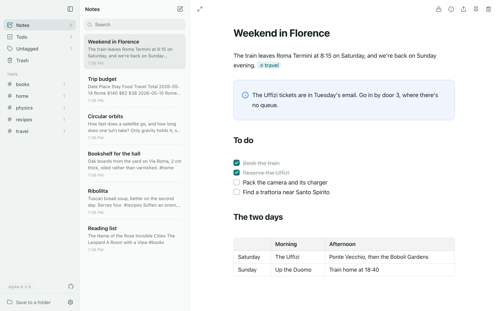

# lines

**Calm, local-first notes in plain Markdown.** Type Markdown and see it formatted as you write. Your notes stay on your device, as ordinary text you can open anywhere.

**[Try it in your browser →](https://overtio.github.io/lines/app/)** No account, nothing to install. Or download the apps for Mac, Windows and Linux from [the website](https://overtio.github.io/lines/#download), which also has [the docs](https://overtio.github.io/lines/docs/).

<picture>
  <source media="(prefers-color-scheme: dark)" srcset="site/images/app-dark.webp">
  
</picture>

> [!WARNING]
> **lines is in alpha.** It changes often and may have bugs, so please don't rely on it for important work yet, and export your notes now and then (Settings → Export and Import → Export).

## Why lines

- **Just Markdown.** What you type is exactly what's stored. There's no hidden format, so your notes open in any other app.
- **Yours.** Notes live on your device and work offline. There's no account and no server. Sync is optional, through storage you choose.
- **Calm.** Inspired by [Bear](https://bear.app): a focused writing space, with tags instead of folders.
- **Everywhere.** Web, macOS, Windows, Linux, iOS and Android, from one codebase.
- **Private when you need it.** End-to-end encryption, locked notes and an app lock.
- **Free and open source**, under the AGPL.

## Features

The [web app](https://overtio.github.io/lines/app/) opens with a tour: one short note per feature, to read and play with.

### Writing

- **Live Markdown.** Type `**bold**`, `# Heading` or `- [ ] todo` and see it formatted. Put the cursor on a line to see its Markdown again, or choose in Settings to keep it all in sight, show it as written, or never show it at all, as in Bear or Notion.
- **Slash commands.** Type `/` at the start of a line for headings, todos, tables, callouts, code, diagrams, math, images, drawings, today's date and more. <kbd>Tab</kbd> completes, like a shell.
- **Format toolbar.** Select text to make it bold, italic, underlined, struck through, code or highlighted. Or have what you select copied at once, as in a terminal (Settings → Editor).
- **Lists and todos.** <kbd>Tab</kbd> and <kbd>⇧Tab</kbd> nest list items. Click a checkbox to tick it; the Todo view gathers every note with open tasks.
- **Drag to move.** Grab the grip beside any line, list item, heading, table or card to move it, or use <kbd>⌥↑</kbd> / <kbd>⌥↓</kbd>. The grips can be turned off.
- **Arrows and symbols.** `->` shows as →, `!=` as ≠, and so on, on screen only. The note keeps what you typed.
- **Copy buttons** on values in `Key: Value` lines and on table cells.
- **Page breaks.** `/page break` starts a new page in the PDF, and over a backdrop splits the note into pages, as Craft does.
- **Marks in the margin.** <kbd>⌘⇧M</kbd> puts a colored bar beside lines, with what it means on pointing at it, as a code editor marks changed lines; it's an HTML comment other apps don't show. Plugins mark lines too: Changes marks what you've changed since opening a note.
- **Find and replace** in a note (<kbd>⌘F</kbd>), matching case, whole words or a regular expression.

### More than text

- **Tables** that look like tables. <kbd>Tab</kbd> moves between cells, and rows pasted from a spreadsheet become one. A cell like `=SUM(B2:B4)` shows what it works out to.
- **Cards and callouts.** Group a section into a card, or make it an info, question, warning, error or decision callout: `:::info` … `:::`.
- **Code blocks** with syntax highlighting in your theme's colors, a copy button, and a wand that tidies JSON, SQL, JavaScript, CSS and more.
- **Diagrams** from [Mermaid](https://mermaid.js.org) code: flowcharts, sequence diagrams, Gantt charts and more, drawn as you type by [Pele](https://pele.run) in your theme's colors, or by Mermaid itself.
- **Typing practice.** Put any text in a note to type over (`/typing`): a quote, a page of a book, code. It's timed, shows your speed, your accuracy and the keys you miss, and keeps your best. See [docs/linedown.md](docs/linedown.md#typing-practice).
- **Timing diagrams** for electronics, from [WaveDrom](https://wavedrom.com) code: clocks, signals and buses over time, a register's bit fields, and logic circuits (`/timing`).
- **3D models** to turn around and zoom into: [OpenSCAD](https://openscad.org) code in an ` ```openscad ` block (`/model`), made into its model as you type and downloaded as STL for 3D printing, and attached OpenSCAD, STL, OBJ, 3MF, glTF, STEP and IGES files. See [docs/linedown.md](docs/linedown.md#3d-models).
- **Code notes.** Switch a note to Code and choose its language, from about 120: line numbers, a fixed-width font, highlighting in your theme's colors, and indenting and brackets as in a code editor. It stays the file it is, and downloads and exports as one (`.py`, `.ts`, `.rs`…). Importing a code file makes one.
- **Math** with [KaTeX](https://katex.org): `$…$` in a line, `$$` for a block.
- **Drawings** with [Excalidraw](https://excalidraw.com), saved in the note as an SVG any Markdown app can show.
- **Links to folders on your computer.** Drop a folder from Finder onto a note, or type `/folder`, for a link that opens it in Finder; links to files open them in their apps. See [docs/linedown.md](docs/linedown.md#folders-and-files-on-your-computer).
- **Images, files, audio and video.** Paste or drop them in. Drag an image's or video's corner to resize it. Audio and video play right in the note, and audio keeps playing while you scroll and write.
- **Photos and GIFs from the web.** `/unsplash` searches Unsplash's free photos and `/giphy` GIPHY's GIFs, and puts the one you pick in the note.
- **Wallpapers from Wallhaven.** In the apps, `/wallhaven` searches [Wallhaven](https://wallhaven.cc)'s wallpapers and keeps the one you pick with the note; Settings → Theme → New → From Wallhaven… makes a theme of a wallpaper's colors, and puts it behind your notes. See [docs/themes.md](docs/themes.md#your-own-themes).
- **Research papers.** `/paper` searches [arXiv](https://arxiv.org) by title, author or topic and links to the paper you pick by its title, in Markdown and LaTeX notes (in the apps). More sources of papers can be added as plugins.
- **API requests.** Write requests in an ` ```http ` block (`/request`) and send them from the note, a lighter Postman or Bruno: variables, one request using another's response, curl commands pasted in or copied out. The `.http` format JetBrains' IDEs, VS Code and Visual Studio read, so a whole note of requests opens there too, or [Hurl](https://hurl.dev)'s, whose captures and asserts check each response. See [docs/requests.md](docs/requests.md).
- **Terminal recordings** from [asciinema](https://asciinema.org) play right in the note, in your theme's colors. Paste a recording's link, or drop in a `.cast` file.
- **GitHub and arXiv links** read short, like `overtio/lines#12` with GitHub's mark, or `arXiv:1706.03762`.

### LaTeX notes

Switch a note to LaTeX from its ⓘ panel and write `\section`, theorems, citations and math as you would in a paper, drawn as you type. Paste a whole paper and it just works. Export gives you a `.tex` file that compiles, or have TeX itself typeset the PDF, right in the app. See [docs/latex.md](docs/latex.md).

### Spreadsheets

Switch a note to a spreadsheet from its ⓘ panel, or put one in a Markdown note with `/spreadsheet` (a ` ```csv ` block). Formulas are worked out by [IronCalc](https://www.ironcalc.com). See [docs/spreadsheets.md](docs/spreadsheets.md).

- **Works like Excel**: its keys, functions suggested as you type, cells pointed at with the mouse or the arrow keys, copy and paste with other apps, sorting, and rows and columns inserted with formulas that follow.
- **Fill and move.** Drag the selection's corner to carry on a series (1, 2 → 3, 4; Monday → Tuesday), or hold cells a moment and drag them elsewhere.
- **Money, dates and numbers below zero** shown your way, accounting style too, and the sum and average of what's selected.
- **Formulas across notes.** `=Budget!B4` uses another note's spreadsheet, and follows it when it's renamed.
- **Plain CSV underneath**, so it syncs and searches like any note. A block turns into a Markdown table, and back, with a button.
- **CSV and Excel files.** Import them from Settings → Export and Import, or turn a CSV file in a note into a spreadsheet there with its button; download a spreadsheet as CSV (formulas or values) or as an Excel workbook.

### Organizing

- **Tags, not folders.** Write `#tag` or `#nested/tag` anywhere in a note. Give tags icons, and rename them everywhere at once.
- **Objects and mentions.** Give a note properties and a type (`type: person`) and it's listed under Types. Type `@` or `[[` to mention another note, `@Ada.email` to show one of its properties, and `@type.recipe` for a table of every recipe.
- **Note icons**, shown before the title in the list.
- **Fast search** across every note.
- **Pin, trash, restore.** Right-click, long-press or swipe a note.
- **Several notes at once.** <kbd>⌘</kbd>-click, <kbd>⇧</kbd>-click or <kbd>⌘A</kbd> in the list, then tag, pin or trash them together.
- **Two notes side by side.** Open to the Side (or <kbd>⌥</kbd>-click in the list) opens a note beside the one you're in, to read one while writing the other; swap them, or drag the line between them.
- **Floating notes** (desktop apps). Pop a note into its own small window that can stay on top.

### Export and share

- **PDF and print.** <kbd>⌘P</kbd> lays a note out on A4 or Letter pages, black on white. Save it as a PDF, or as PNG images.
- **Share** a note through the system share sheet, copy it as Markdown or plain text, or download it as a file.
- **Export everything** as files in a .zip, each in its note's format (Markdown, LaTeX, CSV, .http or .hurl), with images and files (Settings → Export and Import).
- **Import** Markdown, LaTeX, CSV, Excel, `.http` and `.hurl` files as notes (Settings → Export and Import).
- **Sample notes.** Add the feature tour, LaTeX examples or the QA notes from Settings → Export and Import.

### Sync and privacy

- **Save to a folder** (web, in Chrome and Edge). lines keeps your notes there as `.md` files, both ways.
- **Sync through your cloud drive** (desktop apps): iCloud Drive, Google Drive, Proton Drive, Dropbox, OneDrive or any folder.
- **Sync with your own storage**: any S3-compatible bucket, such as Cloudflare R2, Backblaze B2, Amazon S3 or MinIO. Conflicts never lose an edit. See [docs/sync.md](docs/sync.md).
- **End-to-end encryption** (optional). Notes are encrypted on your device before they reach the bucket or drive.
- **Locked notes**, like in Apple Notes: one password (or Touch ID on the Mac) opens them.
- **Secrets.** Keep API keys and passwords in a locked note, and use them by name, `{{github}}`, in requests and other notes, which show the name and dots, to reveal or copy. See [docs/secrets.md](docs/secrets.md).
- **App lock** (optional). lines asks for your passphrase or Touch ID when it opens, and after a while without use.

### Make it yours

- **Plugins.** Like a code editor, lines is a small core with plugins around it: the formats notes are written in, what draws math and diagrams, ways to make a PDF, themes and icons. Turn off what you don't use in Settings → Plugins; nothing in your notes changes. See [docs/plugins.md](docs/plugins.md).
- **Styles**: the whole look, not just the colors. Classic, a desktop of the late 90s with bevels and a title bar; Pixel, one-bit and minimal in a pixel font; Neon, glowing lines on a grid. Each with colors of its own, or any theme's. See [docs/themes.md](docs/themes.md#styles).
- **Twenty-three themes**, each light and dark, including High Contrast and two for color blindness. **Make your own** from any of them, or from a picture (a wallpaper's colors, read on your device), share it as a file, or import one made for VS Code, Zed, Base16, iTerm2, Alacritty, Kitty, Ghostty and other terminals, or KDE and GTK. See [docs/themes.md](docs/themes.md).
- **Dark panes**: the sidebar, the note list or both in the theme's dark colors, while the note stays light. See [docs/themes.md](docs/themes.md#dark-panes).
- **Monochrome and Invert**: any theme in greys, or turned light for dark, with the contrast it had.
- **Paper to write on.** Ruled lines that every line of text sits on, and dots, squares or graph paper with a row of cells for each line (or any size you like), isometric paper, in your theme's colors or any color, as faint or strong as you like, and a grain or linen texture (Settings → Paper).
- **A backdrop behind the page.** Put a soft gradient, a color or a picture of your own behind your notes, which then sit on it as pages, solid or frosted like glass (Settings → Paper → Backdrop).
- **Fonts, text size, note width and spacing**, and headings in the accent or a color of your own, with a live preview; <kbd>⌘+</kbd> and <kbd>⌘−</kbd> size the text as you read. Notes can be narrow, medium, wide, any width between, or fill the window.
- **A mascot.** A cat, an alien, a slime in your accent or a pixel girl, in pixel art, that walks along the bottom of your note, hops up to sit at the end of the sentence you're writing, cheers you on, naps when you're away, pounces on the pointer, and can be picked up and dropped. Plugins can add their own.
- **Cursors.** A text cursor as a bar, a thick one, a block or an underline, in the accent or any color, blinking, fading or steady, that glides or trails where it goes as some terminals' do, glows, turns through the rainbow or throws sparks as you type. And a pointer of 90s pixels or a dot in the accent, with a comet's tail or sparkles behind it.
- **Typing sounds.** Hear a keyboard as you type: creamy or clacky linears, tactile, clicky, Topre, or a typewriter that rings its bell at Return. Or add a recorded one: any [Mechvibes](https://mechvibes.com) sound pack, from a .zip or its folder. Off to begin with.
- **Focus mode** hides everything but the note (<kbd>⇧⌘\\</kbd>).
- **Fits any screen**: three columns on a desktop, a drawer on a tablet, a stack on a phone. Drag the columns to resize them.
- **Your layout.** Put the sidebar and the note list on the left or the right, each its own way, and turn on tabs for the notes you open, as in a code editor (Settings → Layout). Scroll bars can be turned off everywhere.
- **Outline.** Turn on short lines beside the note, on its right or left, one for each heading, darker for the part you're reading. Point at them to see the headings by name, and click one to glide there. Markdown and LaTeX notes both have it.
- **Native touches**: SF Symbols on Apple devices, see-through windows on the Mac (all of the window, or only its sidebar, or its sidebar and note list), and Settings in its own window.
- **Updates itself** (desktop apps). A new version downloads in the background once it's been out a week, and installs when you quit lines, or straight away with Restart to update. Choose how long to wait, or turn it off, in Settings → About.
- **English, Spanish and French**, following your system or chosen in Settings. See [docs/translations.md](docs/translations.md) to add a language.
- **Accessible.** Everything works from the keyboard and with a screen reader, at large text sizes, with reduced motion and with increased contrast. See [docs/accessibility.md](docs/accessibility.md).

## Keyboard shortcuts

Press <kbd>⌘/</kbd> to see them all. On Windows and Linux, use <kbd>Ctrl</kbd> instead of <kbd>⌘</kbd>.

| Shortcut | What it does |
| --- | --- |
| <kbd>⌘N</kbd> | New note (<kbd>⌥N</kbd> on the web, where the browser keeps <kbd>⌘N</kbd>) |
| <kbd>⌘⇧F</kbd> | Search notes |
| <kbd>⌘F</kbd> | Find and replace in the open note |
| <kbd>⌘B</kbd> <kbd>⌘I</kbd> <kbd>⌘U</kbd> <kbd>⌘E</kbd> | Bold, italic, underline, inline code |
| <kbd>⌘⇧X</kbd> <kbd>⌘⇧H</kbd> | Strikethrough, highlight |
| <kbd>⌘↵</kbd> | Make a todo, or tick it |
| <kbd>⌘⇧M</kbd> | Mark lines in the margin, or take their marks off |
| <kbd>Tab</kbd> <kbd>⇧Tab</kbd> | Nest or un-nest a list item; next or previous table cell |
| <kbd>⌘-click</kbd> or <kbd>⌥↵</kbd> | Open a link, mention, tag or file (Settings → Editor → Links sets what click, ⌘-click and ⇧⌘-click do) |
| <kbd>⌘-click</kbd> <kbd>⇧-click</kbd> <kbd>⌘A</kbd> | Select several notes in the list (<kbd>⌫</kbd> moves them to the Trash) |
| <kbd>⌘\\</kbd> | Show or hide the sidebar |
| <kbd>⇧⌘\\</kbd> | Focus mode |
| <kbd>F6</kbd> <kbd>⇧F6</kbd> | Move between the sidebar, the note list and the note |
| <kbd>⌘P</kbd> | Preview as PDF, then print or save |
| <kbd>⌘+</kbd> / <kbd>⌘−</kbd> / <kbd>⌘0</kbd> | Make notes' text bigger, smaller, or its usual size |
| <kbd>⌃⌘L</kbd> | Lock lines, when the app lock is on |

## Documentation

Also on the website: [overtio.github.io/lines/docs](https://overtio.github.io/lines/docs/).

### Using lines

| | |
| --- | --- |
| [Linedown](docs/linedown.md) | The Markdown lines reads and writes, including its few additions (callouts, highlights, tags…) |
| [LaTeX notes](docs/latex.md) | What's drawn in notes written in LaTeX |
| [Spreadsheets](docs/spreadsheets.md) | Formulas in tables, spreadsheet notes, and opening and saving CSV and Excel files |
| [Themes](docs/themes.md) | Making, sharing and importing themes, and lines' theme files |
| [API requests](docs/requests.md) | Sending requests from notes, in the `.http` and Hurl formats |
| [Secrets](docs/secrets.md) | API keys and passwords kept in a locked note, and used by name |
| [Plugins](docs/plugins.md) | How lines is made of plugins, turning them off, and writing one |
| [Sync](docs/sync.md) | How sync and encryption work |
| [Storage](docs/storage.md) | Where the web app keeps your notes, and for how long |
| [Accessibility](docs/accessibility.md) | Keyboard and screen reader use, and how it's checked |
| [Limitations](docs/limitations.md) | What doesn't work yet, and what hasn't been tried on real devices |
| [What's new](CHANGELOG.md) | What changed in each release |

### Working on lines

| | |
| --- | --- |
| [Contributing](CONTRIBUTING.md) | Setting up, making a change, and the pull requests main takes |
| [Performance](docs/performance.md) | How fast lines is with thousands of notes, and the benchmarks that check it |
| [Translations](docs/translations.md) | How translations work, and adding a language |
| [Releasing](docs/releasing.md) | Versions, release notes, and how the apps are built and published |

## Development

You need [Bun](https://bun.com) 1.4+, which installs the packages and runs the scripts, and [Node.js](https://nodejs.org) 22+, which Vite, svelte-check and Tauri's CLI run on. The native apps also need [Rust](https://rustup.rs) and the [Tauri prerequisites](https://v2.tauri.app/start/prerequisites/).

```sh
bun install
bun run dev          # web app at http://localhost:1420
bun run tauri dev    # desktop app (macOS, Windows, Linux)
bun run tauri build
bun run check        # types (svelte-check, tsc)
bun run lint         # Oxlint
bun run test         # unit tests
bun run test:browser # the app in headless Chromium (BROWSER=webkit for WebKit)
bun run qa-shots     # pictures of each look and feature, light and dark, for QA (qa/README.md)
bun run bench        # benchmarks in WebKit and Chromium (docs/performance.md)
```

In a debug build of the desktop app, <kbd>F12</kbd> (or View → Developer Tools on a Mac) opens the Web Inspector.

<details>
<summary><b>Mobile</b></summary>

Set up the native projects once, then run on a simulator or device:

```sh
# iOS (needs Xcode)
bun run tauri ios init
bun run tauri ios dev

# Android (needs Android Studio, the SDK and NDK)
bun run tauri android init
bun run tauri android dev
```

</details>

<details>
<summary><b>TeX, for typesetting LaTeX notes</b></summary>

TeX itself (BusyTeX's engine and TeX Live's basic packages, about 125 MB) isn't in git. `bun run tex-assets` downloads it into `public/busytex/`, so `bun run dev` and builds include it. Without it everything else works, and the PDF preview says TeX isn't included. To keep the 125 MB out of a build (the desktop app embeds it), serve it from elsewhere and set `VITE_TEX_ASSETS` to that address when building.

</details>

<details>
<summary><b>OpenSCAD, for 3D models</b></summary>

OpenSCAD, which makes ` ```openscad ` blocks into models, isn't in git either (about 11 MB). `bun run openscad-assets` downloads the OpenSCAD project's own WebAssembly build, a dated snapshot pinned by its SHA-256 in `scripts/openscad-assets.mjs`, into `public/openscad/`, so `bun run dev` and builds include it. Without it, those blocks say OpenSCAD isn't included; everything else, attached 3D files too, works. To move to a newer snapshot, pick one from [files.openscad.org/snapshots](https://files.openscad.org/snapshots/) at least 10 days old and change its name and hash there.

</details>

<details>
<summary><b>Unsplash and GIPHY keys</b></summary>

`/unsplash` and `/giphy` search through Unsplash's and GIPHY's APIs, which need a key each: an access key from [unsplash.com/developers](https://unsplash.com/developers) and an API key from [developers.giphy.com](https://developers.giphy.com). Put them in `.env.local` (git ignores it) before building:

```sh
VITE_UNSPLASH_ACCESS_KEY=…
VITE_GIPHY_API_KEY=…
```

The website workflow reads them from the repository's secrets `UNSPLASH_ACCESS_KEY` and `GIPHY_API_KEY`. A build without a key leaves its plugin off, and Settings → Plugins says why. The keys end up in the app, as both services expect of apps that call them from the device.

</details>

<details>
<summary><b>Demo website</b></summary>

The web app with the feature tour instead of the welcome note, saving to a folder on the visitor's computer or in the browser ([docs/storage.md](docs/storage.md)). `.github/workflows/website.yml` publishes it to GitHub Pages on every push to main.

```sh
bun run build:site   # to dist-site/, works from any subfolder
bunx vite preview --outDir dist-site
```

</details>

### How it's built

| | |
| --- | --- |
| UI | [Svelte 5](https://svelte.dev): compiled, no virtual DOM, a very small runtime |
| Components | [Bits UI](https://bits-ui.com) for menus, dialogs, selects, switches and the like (accessible, unstyled), styled with [Tailwind CSS 4](https://tailwindcss.com) on the theme's colors |
| Editor | [CodeMirror 6](https://codemirror.net) with a custom live-preview layer |
| Plugins | Formats, math and diagram engines, typesetters, themes and icons, on a small core ([docs/plugins.md](docs/plugins.md)) |
| Apps | [Tauri 2](https://v2.tauri.app): macOS, Windows, Linux, iOS, Android |
| Icons | [Lucide](https://lucide.dev), or SF Symbols on Apple platforms |
| Build | [Vite](https://vite.dev) and TypeScript |

**Why this editor?** Block editors like Notion keep a rich document model and translate between it and the screen, and that translation is where cursor jumps, lost characters and odd input-method behavior come from. lines keeps each note as **plain Markdown text** in CodeMirror, which is built for fast, correct text input on desktop and mobile (input methods, spellcheck, accessibility). Formatting is drawn *over* the text, and the markup hides when the cursor isn't on it. Only the visible part of a note is drawn, so very long notes stay fast. The editor is also *uncontrolled*: nothing pushes text back into it while you type.

<details>
<summary><b>Project structure</b></summary>

```
src/
  App.svelte                 App shell and responsive layout
  app.css                    Design tokens (the theme's colors, one scale of sizes) as Tailwind's, light and dark
  bench/                     The benchmarks' library of notes and in-page timing, only in `--mode bench` builds
  plugins/                   lines' own plugins, one folder each (docs/plugins.md)
    markdown/                Markdown, the format notes are written in by default (its editor is lib/editor)
    latex/                   LaTeX notes: editor.ts draws them, syntax.ts reads them, text.ts for the list and
                             exports, print.ts lays them out on paper
    spreadsheet/             Spreadsheet notes: sheet.ts reads their title and CSV, editor.ts and Grid.svelte
                             draw the grid to work in, index.ts lists, prints, imports and exports them;
                             block.svelte.ts draws ```csv blocks in Markdown notes as the same grid;
                             links.ts finds the other spreadsheets formulas name, pointing.svelte.ts
                             points at their cells, renames.svelte.ts follows them when they're renamed
    ironcalc/                The formula engine (IronCalc in WebAssembly), and reading and writing Excel workbooks
    tex/                     Typesets a LaTeX note with TeX (BusyTeX's pdfLaTeX in WebAssembly)
    katex/                   The math engine (KaTeX)
    pele/                    Mermaid diagrams drawn by Pele (the default): the renderer and its colors
    mermaid/                 Mermaid diagrams drawn by Mermaid itself, and what both add (blocks.ts): /diagram, Copy and Edit as Drawing
    wavedrom/                WaveDrom's timing diagrams, register fields and logic circuits, in the theme's colors; /timing
    typing/                  Typing practice: a ```typing block drawn as a drill to type over (Practice.svelte), what it comes to (drill.svelte.ts); /typing
    unsplash/  giphy/        /unsplash and /giphy: searching their pictures for the picker
    wallhaven/               Wallhaven's wallpapers: /wallhaven, kept in the note, and themes from them (a picture library)
    github/                  Links to GitHub drawn short
    arxiv/                   Links to arXiv's papers drawn short, and searching arXiv for /paper (pacing requests as arXiv asks)
    code/                    Code notes, a format for each language CodeMirror knows, shown as one (Code) with a choice of language
    changes/                 Marks the lines changed since a note was opened (a line diff, diff.ts)
    paper/                   Paper to write on: ruled lines, dots, squares, graph and isometric paper, grain and linen, backdrops
    keyboards/               Keyboards to hear as you type, made from sound (synth.ts)
    mascots/                 Companions in the window, as pixel art (art.ts); what they do is lib/mascot/
    themes/                  The twenty-three themes, as their colors (Lines, the default, in lines.ts), and the theme files of other apps it reads (formats/)
    styles/                  Whole looks beyond the colors: Classic, Pixel and Neon, each a CSS file, its fonts and its colors
    lucide/  sf-symbols/     Icon sets
  lib/
    plugins/
      types.ts               What a plugin is and what it can add: formats, themes, icon sets, engines…
      registry.svelte.ts     The plugins, which are on (kept and shared between windows), and what they add
      plainText.ts           How a note shows while its format's plugin is off
    paper.svelte.ts          The paper chosen in Settings → Paper, as custom properties editor.css draws
    themes/                  The themes plugins add, as CSS (css.ts, which the website uses too), and this window's theme (show.svelte.ts) and style (styles.svelte.ts); your own themes, their files, importing them, and working out colors
    editor/
      Editor.svelte          CodeMirror host; per-note undo history
      livePreview.ts         Hides Markdown and renders bullets, checkboxes, rules, images
      symbols.ts             Shows -> as →, != as ≠ and the like (the table is notes/symbols.ts)
      tables.ts              Rendered tables (formulas worked out), cell navigation, column alignment, pasting tables
      cards.ts               Draws ::: card blocks and callouts behind their text; /card, leaving a card
      markers.ts             Marks in the margin: a note's own (written by its language) and plugins', in lanes; ⌘⇧M
      formatCode.ts          Tidies code blocks (JSON, SQL, Prettier languages)
      formatting.ts          Bold, italic, underline, code… toggles and the toolbar over selected text
      links.ts               Following links, tags and mentions as Settings → Editor → Links says for each click
      outline.svelte.ts      The outline beside a note: its languages' headings, the part being read, gliding to one
      OutlineRail.svelte     The outline's lines and its card of headings
      dragBlocks.ts          Grips for dragging lines and blocks to move them
      cursor.ts              Draws the text cursor (WebKit can leave a stray native caret behind)
      rendered.ts            Code blocks drawn by renderer plugins (```mermaid): live, resizable, with their buttons; or to work in (```csv)
      actions.ts             A block's buttons, down its right side or inside its corner
      find.svelte.ts         The find bar (⌘F): finding and replacing in a note; FindBar.svelte draws it
      drawings.ts            Excalidraw drawings (SVGs holding their scene): spotting, opening, /drawing, from a diagram
      math.ts                Draws $math$ and $$ blocks with the math engine plugin
      texCommands.ts         The "\" menu of LaTeX commands, in math and in LaTeX notes
      attachments.ts         Image and file blocks; pasting, dropping, /image and /file
      webImages.ts           Picking a picture from a library on the web (/unsplash, /giphy)
      papers.ts              /paper: picking a paper from a source (PaperPicker.svelte) and linking to it
      WebSearchPicker.svelte The picker both use: searching as you type, more on scrolling, the arrow keys
      shortLinks.ts          Links drawn short with a site's mark, as plugins read them (GitHub, arXiv)
      fences.ts              Closes ``` and ::: fences as you type them; ` or : wraps a selection
      lists.ts               Tab / Shift-Tab nesting for list items; Backspace after a marker
      keyValue.ts            Copy buttons for Key: Value lines
      syntax.ts              #tag, ==highlight==, <u>underline</u>, ::: card, $math$ and @mention / [[wiki link]] parser extensions
      objects.ts             Properties, @mentions and their menus; creating a mentioned note
      typeTables.ts          Tables of a type's notes (@type.recipe)
      setup.ts               Extensions, keymaps, formatting commands; the Markdown editor with plugins' additions
      editor.css             Styles for the rendered Markdown
    sheets/
      csv.ts                 Reading and writing CSV, as spreadsheet apps write it
      cells.ts               Cell names (B4), formulas, and putting in and taking out rows and columns
      fill.ts                Filling cells from those before them: series that go on, the rest repeated
      display.ts             Dates and money: read however they're typed, shown as Settings says
      formulas.ts            The formula engine that's on, loading it, and tables' formulas worked out
    print/
      markdown.ts            A Markdown note as a printed document
      parts.ts               Math, code, drawn code blocks and images on paper, and waiting for them to draw
      pages.ts               Cuts a document into pages between lines, as the preview shows and prints them
      print.css              How a note looks on paper
    notes/
      store.svelte.ts        Reactive note state: filtering, search, tags, selection, saving
      storage.ts             Storage interface + IndexedDB implementation
      attachments.ts         Images and files: saved by content hash, opened, cleaned up when unused
      noteKeys.svelte.ts     Locked notes' keys: encrypting a note, opening it with the password
      locked.svelte.ts       Locking and opening locked notes, their password, closing them when idle
      parse.ts               Title, excerpt and tag extraction; adding and renaming tags and types
      properties.ts          Properties (front matter), types and mentions as text
      samples.ts             Adds the feature tour (tour/), the LaTeX examples (examples/) or the QA notes (qa/)
      import.ts              Makes notes from files, each by its format's plugin (Settings → Export and Import → Import)
      export.ts              Every note as a file in its format, in a .zip
      tour/                  The feature tour: the demo website's first notes
      examples/              Notes written in LaTeX: a paper, lecture notes, a problem set
    sync/
      engine.svelte.ts       Two-way sync: upload, download, conflicts, deletions; turning encryption on and off
      sealed.ts              End-to-end encryption: the key file, and a remote that encrypts everything
      s3.ts                  Minimal S3 client (SigV4 via aws4fetch)
      format.ts              Note ⇄ Markdown-with-front-matter
      providers.ts           R2 / B2 / S3 presets
      folder.ts              Cloud drive folders in the desktop apps
      browserFolder.ts       A folder on the web, through the File System Access API
    lock/
      lock.svelte.ts         The app lock: unlocking, turning it on and off, locking when idle
      vault.ts               Encrypts what's stored on the device while the lock is on
    components/              Sidebar, tag tree, note list, dialogs
      ui/                    Shared parts: buttons, switches, selects, sliders, setting rows and groups
      settings/              Settings: its list of sections, and one component per section
    windows/                 Floating notes, the Settings window, and messages between windows
    icons/                   Icon component (drawn by the icon set plugin chosen) and the icons lines uses
    i18n/                    Translations: t(), the language, and each language's messages (locales/)
    a11y.ts                  Saying things to screen readers
    prefs.svelte.ts          Theme, appearance, font, text size, note width, spacing, icon set (themes and icon sets by plugin id), layout, links, updates
    tabs.svelte.ts           Tabs for open notes: preview tabs, closing, following the selection
    crypto.ts                AES-256-GCM and passphrase keys (WebCrypto), for sync and the app lock
    release.ts               The version and the source repository
    updates.svelte.ts        The desktop apps updating themselves: what Settings and the sidebar show, regular checks
src-tauri/                   Native shell (Rust); sf_symbols.rs draws SF Symbols, lock.rs shares the
                             unlocked key with floating notes and does Touch ID, updates.rs finds,
                             downloads and installs new versions
src-tauri/icons/source/      App icon artwork (SVG): Mac layout and full-bleed for iOS/Android
docs/                        Linedown, LaTeX, spreadsheets, plugins, sync, storage, limitations, accessibility, translations, performance
site/                        The website (bun run build:site): the home page (home.mjs), the docs as pages, the web
                             app at app/; build.mjs builds it and checks its links, screenshots.mjs takes the home
                             page's pictures (images/) of the notes in samples/
qa/                          Release checklist and QA notes (generated by scripts/qa-notes.mjs)
tests/                       Unit tests (unit/, bun test) and browser tests (browser/, the app built with src/test/)
scripts/bench.mjs            The benchmarks (bun run bench): builds, seeds 5,000 notes, drives WebKit and Chromium
scripts/qa-shots.mjs         Pictures of lines for QA (bun run qa-shots), into qa/shots/ with a page to see them on
scripts/release.mjs          Versions and release notes from the commits (docs/releasing.md)
.github/workflows/           Checks on every pull request, the release pull request, releases, the website
```

</details>

## Roadmap

What's planned next. Known limits of what's already there are in [docs/limitations.md](docs/limitations.md).

**Sync**
- [ ] iCloud in the iPhone app (an iCloud container, which needs the app signed with iCloud entitlements)
- [ ] iCloud on the web: sign in with your Apple Account (CloudKit JS)
- [ ] Google Drive on the web and phones: sign in with Google (Drive API; needs an OAuth client ID)
- [ ] Proton Drive on the web and phones, once Proton opens its Drive SDK to third-party apps
- [ ] Show notes by title in synced folders, for browsing them in Finder
- [ ] Sync the icons chosen for tags and types (each device keeps its own for now)
- [ ] Remove attachments from sync storage once no note uses them (they're only cleaned up on the device for now)

**Security**
- [ ] Encrypt images and files in locked notes
- [ ] Face ID for the app lock and locked notes on iPhone
- [ ] Store sync credentials (the S3 secret key) in the OS keychain on native platforms instead of local storage
- [ ] Conditional S3 writes (`If-Match`), so an upload fails instead of overwriting a note another device changed in between
- [ ] Narrow the app's native permissions: limit network access to the configured endpoint and file access to the chosen sync folder

**Plugins**
- [ ] More formats as plugins, drawn as you type, printed and exported: Org mode, AsciiDoc, WikiText (MediaWiki) and reStructuredText
- [ ] Plugins made by others: a plugin format, installing one from Settings → Plugins, and running its code safely (the apps only run lines' own scripts now)
- [ ] Icon sets from a file, which need no code
- [ ] Sync your themes between devices, and open a VS Code extension (`.vsix`) to pick its themes
- [ ] More renderers for code blocks: Graphviz, PlantUML, D2, Vega-Lite charts, music in ABC
- [ ] Circuit schematics written in [CircuiTikZ](https://ctan.org/pkg/circuitikz), drawn as you type: ` ```circuitikz ` blocks in Markdown notes, and `circuitikz` in LaTeX notes
- [ ] Drawings (Excalidraw), code highlighting and symbols as plugins
- [ ] Choose the format new notes start in
- [ ] Plugins that add to LaTeX notes, as they can to Markdown ones
- [ ] Sync which plugins are on
- [ ] [HyperFormula](https://github.com/overtio/lines/issues/1) as a formula engine to choose instead of IronCalc
- [ ] [SQLite files](https://github.com/overtio/lines/issues/2): their tables, and SQL query blocks, read-only
- [ ] 3D models: OpenSCAD's customizer (sliders for a model's numbers), measuring, section views, fonts for `text()` and libraries such as BOSL2
- [ ] [API requests](https://github.com/overtio/lines/issues/165): environments, test runs with a report, and Bruno, Postman and OpenAPI import; [Hurl](https://github.com/overtio/lines/issues/167) with the `hurl` program where it's installed

**Research papers**
- [ ] More sources for `/paper`: Semantic Scholar, OpenAlex (which, unlike arXiv, takes requests from web pages, so the website could search too), PubMed, bioRxiv
- [ ] A paper as a note of its own, `type: paper`, with its authors, year, link and abstract as properties, so `@type.paper` is a reading list
- [ ] Citations in LaTeX notes: `\cite` a paper found with `/paper`, its BibTeX entry kept in the note
- [ ] Open a paper elsewhere from its link: its PDF, alphaXiv, Semantic Scholar, Connected Papers

**Spreadsheets**
- [ ] Several sheets in one spreadsheet note, with formulas between them
- [ ] Column widths, number formats and bold kept in the note
- [ ] Filter, and sort by more than one column
- [ ] Moving cells and resizing blocks with a finger

**Notes**
- [ ] Backlinks: the notes that mention this one
- [ ] Renaming a note updates the mentions of it
- [ ] Drawings in LaTeX notes (`\includegraphics` of a drawing, as a PDF for TeX)
- [ ] Converting a note between Markdown and LaTeX
- [ ] More of TeX Live for TeX's PDFs (packages beyond the basic ones, fetched as a note needs them)

**Export**
- [ ] Save lines' PDF straight to a file in the apps, without the print dialog
- [ ] Export a note as HTML

**Platforms**
- [ ] Offline support for the web app (service worker)
- [ ] Browser extensions (Chrome, Edge, Firefox, Safari)
- [ ] Try the forced-colors styles (Windows' contrast themes) on Windows
- [ ] A "System" theme that follows your desktop, generated from one seed color for light and dark, and updating live:
  - Mac: colors picked from the wallpaper (dynamic and per-display wallpapers, re-checked when the app comes to the front)
  - Windows: the wallpaper, or the accent color Windows picks from it
  - Linux: a full palette from pywal / wallust / matugen (`~/.cache/wal/colors.json`) or a KDE color scheme; otherwise the XDG desktop portal's accent color
  - Android: Material You colors
  - iPhone and web: the system accent color (CSS `AccentColor`, real in Safari and Firefox; Chrome reports a default blue, so fall back to a neutral theme)

**Exploring**
- [ ] A fully native Rust interface, as Zed does with GPUI, to see what it would take. Build the editor with live preview for a few elements (headings, lists, a callout, a table) and judge:
  - speed with very large notes, memory use and startup time, against the current app
  - text input: Chinese, Japanese and Korean input, dead keys, dictation, spellcheck and autocorrect
  - screen readers, right-to-left text and emoji
  - which frameworks reach the web and phones (GPUI has neither; egui, Makepad and Slint draw to a canvas on the web)
  - what replaces Mermaid for diagrams

<details>
<summary><b>Done</b></summary>

- [x] Sync through any S3-compatible storage
- [x] Sync through a cloud drive folder on the desktop (iCloud Drive, Google Drive, Proton Drive, Dropbox, OneDrive)
- [x] Save to a folder on the web (Chrome and Edge)
- [x] End-to-end encryption for synced notes
- [x] App lock: encrypted on the device, with a passphrase or Touch ID
- [x] Locked notes, with a password or Touch ID
- [x] Syntax highlighting inside code blocks
- [x] Rendered tables
- [x] Image attachments (paste and drag-and-drop)
- [x] Any file as an attachment
- [x] Drawings with Excalidraw, kept as SVG images
- [x] Mermaid diagrams copied into drawings, to edit by hand
- [x] Diagrams drawn by Pele, faster and in the theme's colors, with Mermaid itself as the alternative
- [x] Timing diagrams, register bit fields and logic circuits (WaveDrom)
- [x] Note links: mentions (`@Note`), and properties of notes (`@Note.key`)
- [x] Wiki links (`[[Note]]`, `[[Note|text]]`) as mentions
- [x] Math (KaTeX), and notes written in LaTeX
- [x] LaTeX notes: typesetting a PDF with a real TeX engine
- [x] A note as a PDF: preview, print and save
- [x] A note as PNG images: one tall image, or one per page
- [x] Arrows and symbols (`->` as →, `!=` as ≠) shown without changing the note, in text and code, each switchable
- [x] Resizable sidebar and note list, each on the left or the right
- [x] Tabs for open notes, with preview tabs (off by default)
- [x] An outline of a note's headings beside it (off by default)
- [x] Choose what a click, ⌘-click and ⇧⌘-click do on links, tags and mentions
- [x] Several notes at once: select, tag, pin and trash them together
- [x] Plugins: formats, math and diagram engines, typesetters, themes and icon sets, each turned off or on in Settings → Plugins
- [x] Spreadsheets: formulas in tables, spreadsheet notes and ` ```csv ` blocks, worked out by IronCalc; CSV and Excel files in and out
- [x] Formulas that use other notes' spreadsheets, and follow them when they're renamed
- [x] Find and replace in a note
- [x] Two notes side by side (Open to the Side)
- [x] Photos and GIFs from the web (`/unsplash`, `/giphy`)
- [x] Settings in a window of its own in the desktop apps

</details>

## Contributing

Issues and pull requests are welcome; [CONTRIBUTING.md](CONTRIBUTING.md) says how, for people and coding agents alike, including the [contributor agreement](CLA.md) you agree to on your first pull request. In short: one change per pull request, its title a [Conventional Commit](https://www.conventionalcommits.org) (`fix(sync): keep edits made while a pass is running`), since it becomes the commit on main and the release notes. A change people can see also updates the docs, the QA checklist and the feature tour where they're affected. Before opening a pull request, please run:

```sh
bun run check
bun run lint
bun run test
bun run test:browser
bun run build
```

## License

lines is free software under the [GNU Affero General Public License v3.0](LICENSE). You can use, study, change and share it. If you distribute a modified version, or run one as a service other people use, you must share its source code with them under the same license.
