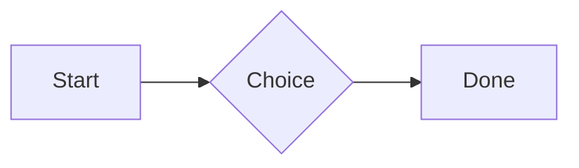
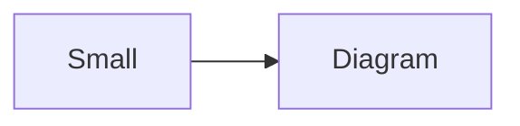

# QA · Everything at the top level

Each element at the top level. Check: it draws as it does on its own, sits inside the container's edges with even space around it, and its Markdown shows while the cursor is in it. Tables, spreadsheets, diagrams and attachments in quotes and list items stay as Markdown.

#qa/containers

#### 1. Paragraph at the top level

A paragraph with **bold**, *italic*, <u>underlined</u>, ~~struck~~, ==highlighted==, `code`, a [link](https://example.com) and a #qa/tag.

#### 2. Long paragraph at the top level

A long paragraph that wraps onto several lines at the usual width, so the space between its lines, its indent on every line, and where it meets the edges of anything around it can be checked. It goes on a little longer to be sure it wraps on a phone too.

#### 3. Heading 1 at the top level

# Heading one

#### 4. Heading 2 at the top level

## Heading two

#### 5. Heading 3 at the top level

### Heading three

#### 6. Bullet list at the top level

- First item
- Second item
  - Nested item
    - Third level
- Last item

#### 7. Numbered list at the top level

1. First
2. Second
   1. Nested
3. Third

#### 8. Todo list at the top level

- [x] Done todo
- [ ] Open todo
  - [ ] Nested open todo

#### 9. Quote at the top level

> A quote that runs over
> two lines.

#### 10. Code block at the top level

```
plain code
  indented line
```

#### 11. Code block (TypeScript) at the top level

```ts
const greeting: string = "hello";
console.log(greeting);
```

#### 12. JSON block (no language) at the top level

```
{"name":"lines","tags":["a","b"],"id":12345678901234567890}
```

#### 13. Diagram at the top level



#### 14. Diagram (240 px wide) at the top level



#### 15. 3D model (openscad block), a colored part, an echo at the top level

```openscad
difference() {
  cube(20, center = true);
  sphere(r = 13);
}
translate([25, 0, 0]) color("tomato") cylinder(h = 10, r = 5);
echo("made");
```

#### 16. Flat model (openscad block) at the top level

```openscad
square(20);
translate([30, 10]) circle(8);
```

#### 17. Broken model (openscad block) at the top level

```openscad
cube(10)
sphere(3;
```

#### 18. 3D model (stl block) at the top level

```stl
solid pyramid
facet normal 0 0 -1
outer loop
vertex 0 0 0
vertex 10 10 0
vertex 10 0 0
endloop
endfacet
facet normal 0 0 -1
outer loop
vertex 0 0 0
vertex 0 10 0
vertex 10 10 0
endloop
endfacet
facet normal 0 -1 1
outer loop
vertex 0 0 0
vertex 10 0 0
vertex 5 5 8
endloop
endfacet
facet normal 1 0 1
outer loop
vertex 10 0 0
vertex 10 10 0
vertex 5 5 8
endloop
endfacet
facet normal 0 1 1
outer loop
vertex 10 10 0
vertex 0 10 0
vertex 5 5 8
endloop
endfacet
facet normal -1 0 1
outer loop
vertex 0 10 0
vertex 0 0 0
vertex 5 5 8
endloop
endfacet
endsolid pyramid
```

#### 19. Math block at the top level

$$
\int_0^1 x^2\,dx = \frac{1}{3}
$$

#### 20. Table at the top level

| Left | Center | Right |
| :--- | :----: | ----: |
| a | **b** | 1 |
| longer cell text | `code` | 22 |

#### 21. Table with formulas at the top level

| Item | Cost |
| --- | ---: |
| Rent | 1200 |
| Food | 450.50 |
| Total | =SUM(B2:B3) |
| Broken | =B2/0 |

#### 22. Hurl entries (hurl block): a capture used by the next entry, and asserts at the top level

```hurl
# A todo
GET https://jsonplaceholder.typicode.com/todos/1
HTTP 200
[Captures]
owner: jsonpath "$.userId"
[Asserts]
jsonpath "$.id" == 1

# Its owner
GET https://jsonplaceholder.typicode.com/users/{{owner}}
HTTP 200
[Asserts]
jsonpath "$.name" isString
```

#### 23. Secret ({{name}}, kept in a locked secrets note) at the top level

The token is {{qa-token}}, and {{no-such-secret}} isn't one.

#### 24. API requests (http block): a variable, a named request and one using its response at the top level

```http
@api = https://jsonplaceholder.typicode.com

### A todo
# @name todo
GET {{api}}/todos/1

### Its owner
GET {{api}}/users/{{todo.response.body.$.userId}}
```

#### 25. Spreadsheet (csv block) at the top level

```csv
Item, Cost
Rent, 1200
Food, 450.50
Total, =SUM(B2:B3)
```

#### 26. Named spreadsheet (csv name=), and a formula in another block using it at the top level

```csv name=costs
Item, Cost, Day
Rent, $1200, 2026-01-05
```

```csv
Total, =costs!B2*2
```

#### 27. Divider at the top level

---

#### 28. Key: Value line at the top level

**Wi-Fi password:** correct-horse-battery

#### 29. Mention at the top level

Ask @[QA · Ada] at @[QA · Ada].email.

#### 30. Wiki link at the top level

Ask [[QA · Ada]], or [[QA · Ada|her]].

#### 31. Symbols at the top level

Home -> cabin <- back, a <-> b, x => y, p <=> q, 1 <= 2 >= 0 != 3. Stays: --> !== \-> and `a -> b` in code.

#### 32. GitHub links at the top level

Issue https://github.com/overtio/lines/issues/1 and [a named link](https://github.com/overtio/lines)

#### 33. Image at the top level


#### 34. Drawing at the top level


#### 35. File at the top level

[Budget.csv](attachment:budget.csv)

#### 36. Attached 3D model (STL) at the top level

[Bracket.stl](attachment:bracket.stl)

#### 37. Terminal recording (.cast file) at the top level

[terminal.cast](attachment:terminal.cast)

#### 38. Missing file at the top level

[Not here yet.pdf](../attachments/00000000000000000000000000000000.pdf)

#### 39. Card at the top level

::: card
Text in a card.
:::

#### 40. Callout (info) at the top level

:::i
Text in an info callout.
:::

#### 41. Callout (warning, chosen icon) at the top level

:::! icon=flag
Text in a warning callout with the flag icon.
:::

#### 42. Callout (decision, no icon) at the top level

:::^ icon=none
Text in a decision callout with no icon.
:::
