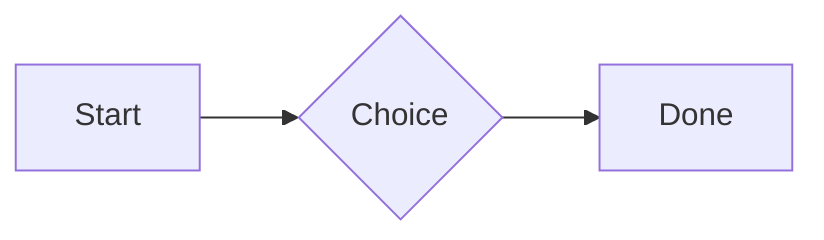
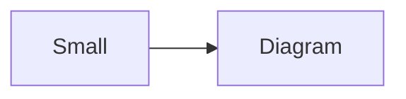

# QA · Everything in a callout

Each element in a callout. Check: it draws as it does on its own, sits inside the container's edges with even space around it, and its Markdown shows while the cursor is in it. Tables, spreadsheets, diagrams and attachments in quotes and list items stay as Markdown.

#qa/containers

#### 1. Paragraph in a callout

:::i
A paragraph with **bold**, *italic*, <u>underlined</u>, ~~struck~~, ==highlighted==, `code`, a [link](https://example.com) and a #qa/tag.
:::

#### 2. Long paragraph in a callout

:::i
A long paragraph that wraps onto several lines at the usual width, so the space between its lines, its indent on every line, and where it meets the edges of anything around it can be checked. It goes on a little longer to be sure it wraps on a phone too.
:::

#### 3. Heading 1 in a callout

:::i
# Heading one
:::

#### 4. Heading 2 in a callout

:::i
## Heading two
:::

#### 5. Heading 3 in a callout

:::i
### Heading three
:::

#### 6. Bullet list in a callout

:::i
- First item
- Second item
  - Nested item
    - Third level
- Last item
:::

#### 7. Numbered list in a callout

:::i
1. First
2. Second
   1. Nested
3. Third
:::

#### 8. Todo list in a callout

:::i
- [x] Done todo
- [ ] Open todo
  - [ ] Nested open todo
:::

#### 9. Quote in a callout

:::i
> A quote that runs over
> two lines.
:::

#### 10. Line marks in a callout

:::i
Marked as the accent. <!-- mark -->
Two lines marked green, one bar. <!-- mark green: ready -->
The second of them. <!-- mark green: ready -->
Red, with a label to point at. <!-- mark red: to fix -->
- A list item, marked purple. <!-- mark purple -->
:::

#### 11. Code block in a callout

:::i
```
plain code
  indented line
```
:::

#### 12. Code block (TypeScript) in a callout

:::i
```ts
const greeting: string = "hello";
console.log(greeting);
```
:::

#### 13. JSON block (no language) in a callout

:::i
```
{"name":"lines","tags":["a","b"],"id":12345678901234567890}
```
:::

#### 14. Diagram in a callout

:::i

:::

#### 15. Diagram (240 px wide) in a callout

:::i

:::

#### 16. 3D model (openscad block), a colored part, an echo in a callout

:::i
```openscad
difference() {
  cube(20, center = true);
  sphere(r = 13);
}
translate([25, 0, 0]) color("tomato") cylinder(h = 10, r = 5);
echo("made");
```
:::

#### 17. Flat model (openscad block) in a callout

:::i
```openscad
square(20);
translate([30, 10]) circle(8);
```
:::

#### 18. Broken model (openscad block) in a callout

:::i
```openscad
cube(10)
sphere(3;
```
:::

#### 19. 3D model (stl block) in a callout

:::i
```stl
solid pyramid
facet normal 0 0 -1
outer loop
vertex 0 0 0
vertex 10 10 0
vertex 10 0 0
endloop
endfacet
facet normal 0 0 -1
outer loop
vertex 0 0 0
vertex 0 10 0
vertex 10 10 0
endloop
endfacet
facet normal 0 -1 1
outer loop
vertex 0 0 0
vertex 10 0 0
vertex 5 5 8
endloop
endfacet
facet normal 1 0 1
outer loop
vertex 10 0 0
vertex 10 10 0
vertex 5 5 8
endloop
endfacet
facet normal 0 1 1
outer loop
vertex 10 10 0
vertex 0 10 0
vertex 5 5 8
endloop
endfacet
facet normal -1 0 1
outer loop
vertex 0 10 0
vertex 0 0 0
vertex 5 5 8
endloop
endfacet
endsolid pyramid
```
:::

#### 20. Timing diagram (wavedrom block) in a callout

:::i
```wavedrom
{ signal: [
  { name: "clk", wave: "p.....|..." },
  { name: "data", wave: "x.345x|=.x", data: ["head", "body", "tail", "data"] },
  {},
  { name: "ack", wave: "1.....|01.", node: ".a......b" }
], edge: ["a~>b t1"] }
```
:::

#### 21. Typing practice (typing block) in a callout

:::i
```typing
It’s a “fine” day — type it.
function go() {
  return 1;
}
```
:::

#### 22. Math block in a callout

:::i
$$
\int_0^1 x^2\,dx = \frac{1}{3}
$$
:::

#### 23. Table in a callout

:::i
| Left | Center | Right |
| :--- | :----: | ----: |
| a | **b** | 1 |
| longer cell text | `code` | 22 |
:::

#### 24. Table with formulas in a callout

:::i
| Item | Cost |
| --- | ---: |
| Rent | 1200 |
| Food | 450.50 |
| Total | =SUM(B2:B3) |
| Broken | =B2/0 |
:::

#### 25. Hurl entries (hurl block): a capture used by the next entry, and asserts in a callout

:::i
```hurl
# A todo
GET https://jsonplaceholder.typicode.com/todos/1
HTTP 200
[Captures]
owner: jsonpath "$.userId"
[Asserts]
jsonpath "$.id" == 1

# Its owner
GET https://jsonplaceholder.typicode.com/users/{{owner}}
HTTP 200
[Asserts]
jsonpath "$.name" isString
```
:::

#### 26. Secret ({{name}}, kept in a locked secrets note) in a callout

:::i
The token is {{qa-token}}, and {{no-such-secret}} isn't one.
:::

#### 27. API requests (http block): a variable, a named request and one using its response in a callout

:::i
```http
@api = https://jsonplaceholder.typicode.com

### A todo
# @name todo
GET {{api}}/todos/1

### Its owner
GET {{api}}/users/{{todo.response.body.$.userId}}
```
:::

#### 28. Spreadsheet (csv block) in a callout

:::i
```csv
Item, Cost
Rent, 1200
Food, 450.50
Total, =SUM(B2:B3)
```
:::

#### 29. Named spreadsheet (csv name=), and a formula in another block using it in a callout

:::i
```csv name=costs
Item, Cost, Day
Rent, $1200, 2026-01-05
```

```csv
Total, =costs!B2*2
```
:::

#### 30. Divider in a callout

:::i
---
:::

#### 31. Page breaks (as lines writes them, and as Obsidian and Typora do; a new page in the PDF at each, a gap between pages over a backdrop) in a callout (stays Markdown here)

:::i
Before the break.

<!-- pagebreak -->
After it, on a new page.

<div style="page-break-after: always"></div>

And another.
:::

#### 32. Key: Value line in a callout

:::i
**Wi-Fi password:** correct-horse-battery
:::

#### 33. Score (Settings → Little Touches) in a callout

:::i
Rating: 4/5
Score: 7 / 10
Not a score: 12/20
:::

#### 34. Mention in a callout

:::i
Ask @[QA · Ada] at @[QA · Ada].email.
:::

#### 35. Wiki link in a callout

:::i
Ask [[QA · Ada]], or [[QA · Ada|her]].
:::

#### 36. Symbols in a callout

:::i
Home -> cabin <- back, a <-> b, x => y, p <=> q, 1 <= 2 >= 0 != 3. Stays: --> !== \-> and `a -> b` in code.
:::

#### 37. GitHub links in a callout

:::i
Issue https://github.com/overtio/lines/issues/1 and [a named link](https://github.com/overtio/lines)
:::

#### 38. arXiv links in a callout

:::i
Paper https://arxiv.org/abs/1706.03762 and [a named link](https://arxiv.org/abs/2006.11239)
:::

#### 39. Time in an episode in a callout

:::i
At [12:34](https://traffic.megaphone.fm/FSI3647670844.mp3#t=754) they said it; [3:16] stays text here
:::

#### 40. Image in a callout

:::i

:::

#### 41. Drawing in a callout

:::i

:::

#### 42. File in a callout

:::i
[Budget.csv](attachment:budget.csv)
:::

#### 43. Folder and file links in a callout

:::i
See [Projects](file:///Users/me/My%20Projects/) and [the plan](file:///Users/me/plan.pdf) on this computer.
:::

#### 44. Attached 3D model (STL) in a callout

:::i
[Bracket.stl](attachment:bracket.stl)
:::

#### 45. Terminal recording (.cast file) in a callout

:::i
[terminal.cast](attachment:terminal.cast)
:::

#### 46. Audio in a callout

:::i
[Chime.mp3](attachment:chime.mp3)
:::

#### 47. Video in a callout

:::i
[Sky.mp4](attachment:sky.mp4)
:::

#### 48. Missing file in a callout

:::i
[Not here yet.pdf](../attachments/00000000000000000000000000000000.pdf)
:::

#### 49. Card in a callout

:::i
::: card
Text in a card.
:::
:::

#### 50. Callout (info) in a callout

:::i
:::i
Text in an info callout.
:::
:::

#### 51. Callout (warning, chosen icon) in a callout

:::i
:::! icon=flag
Text in a warning callout with the flag icon.
:::
:::

#### 52. Callout (decision, no icon) in a callout

:::i
:::^ icon=none
Text in a decision callout with no icon.
:::
:::
