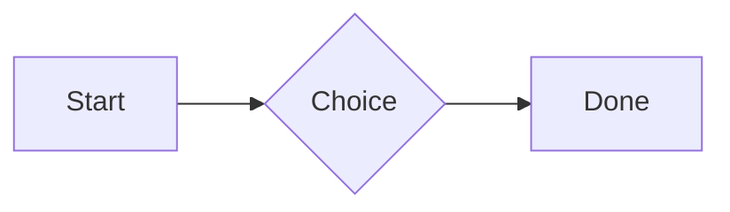
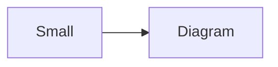

# QA · Everything in a callout

Each element in a callout. Check: it draws as it does on its own, sits inside the container's edges with even space around it, and its Markdown shows while the cursor is in it. Tables, spreadsheets, diagrams and attachments in quotes and list items stay as Markdown.

#qa/containers

#### 1. Paragraph in a callout

:::i
A paragraph with **bold**, *italic*, <u>underlined</u>, ~~struck~~, ==highlighted==, `code`, a [link](https://example.com) and a #qa/tag.
:::

#### 2. Long paragraph in a callout

:::i
A long paragraph that wraps onto several lines at the usual width, so the space between its lines, its indent on every line, and where it meets the edges of anything around it can be checked. It goes on a little longer to be sure it wraps on a phone too.
:::

#### 3. Heading 1 in a callout

:::i
# Heading one
:::

#### 4. Heading 2 in a callout

:::i
## Heading two
:::

#### 5. Heading 3 in a callout

:::i
### Heading three
:::

#### 6. Bullet list in a callout

:::i
- First item
- Second item
  - Nested item
    - Third level
- Last item
:::

#### 7. Numbered list in a callout

:::i
1. First
2. Second
   1. Nested
3. Third
:::

#### 8. Todo list in a callout

:::i
- [x] Done todo
- [ ] Open todo
  - [ ] Nested open todo
:::

#### 9. Quote in a callout

:::i
> A quote that runs over
> two lines.
:::

#### 10. Code block in a callout

:::i
```
plain code
  indented line
```
:::

#### 11. Code block (TypeScript) in a callout

:::i
```ts
const greeting: string = "hello";
console.log(greeting);
```
:::

#### 12. JSON block (no language) in a callout

:::i
```
{"name":"lines","tags":["a","b"],"id":12345678901234567890}
```
:::

#### 13. Diagram in a callout

:::i

:::

#### 14. Diagram (240 px wide) in a callout

:::i

:::

#### 15. Math block in a callout

:::i
$$
\int_0^1 x^2\,dx = \frac{1}{3}
$$
:::

#### 16. Table in a callout

:::i
| Left | Center | Right |
| :--- | :----: | ----: |
| a | **b** | 1 |
| longer cell text | `code` | 22 |
:::

#### 17. Table with formulas in a callout

:::i
| Item | Cost |
| --- | ---: |
| Rent | 1200 |
| Food | 450.50 |
| Total | =SUM(B2:B3) |
| Broken | =B2/0 |
:::

#### 18. API requests (http block): a variable, a named request and one using its response in a callout

:::i
```http
@api = https://jsonplaceholder.typicode.com

### A todo
# @name todo
GET {{api}}/todos/1

### Its owner
GET {{api}}/users/{{todo.response.body.$.userId}}
```
:::

#### 19. Spreadsheet (csv block) in a callout

:::i
```csv
Item, Cost
Rent, 1200
Food, 450.50
Total, =SUM(B2:B3)
```
:::

#### 20. Named spreadsheet (csv name=), and a formula in another block using it in a callout

:::i
```csv name=costs
Item, Cost, Day
Rent, $1200, 2026-01-05
```

```csv
Total, =costs!B2*2
```
:::

#### 21. Divider in a callout

:::i
---
:::

#### 22. Key: Value line in a callout

:::i
**Wi-Fi password:** correct-horse-battery
:::

#### 23. Mention in a callout

:::i
Ask @[QA · Ada] at @[QA · Ada].email.
:::

#### 24. Wiki link in a callout

:::i
Ask [[QA · Ada]], or [[QA · Ada|her]].
:::

#### 25. Symbols in a callout

:::i
Home -> cabin <- back, a <-> b, x => y, p <=> q, 1 <= 2 >= 0 != 3. Stays: --> !== \-> and `a -> b` in code.
:::

#### 26. GitHub links in a callout

:::i
Issue https://github.com/overtio/lines/issues/1 and [a named link](https://github.com/overtio/lines)
:::

#### 27. Image in a callout

:::i

:::

#### 28. Drawing in a callout

:::i

:::

#### 29. File in a callout

:::i
[Budget.csv](attachment:budget.csv)
:::

#### 30. Missing file in a callout

:::i
[Not here yet.pdf](../attachments/00000000000000000000000000000000.pdf)
:::

#### 31. Card in a callout

:::i
::: card
Text in a card.
:::
:::

#### 32. Callout (info) in a callout

:::i
:::i
Text in an info callout.
:::
:::

#### 33. Callout (warning, chosen icon) in a callout

:::i
:::! icon=flag
Text in a warning callout with the flag icon.
:::
:::

#### 34. Callout (decision, no icon) in a callout

:::i
:::^ icon=none
Text in a decision callout with no icon.
:::
:::
