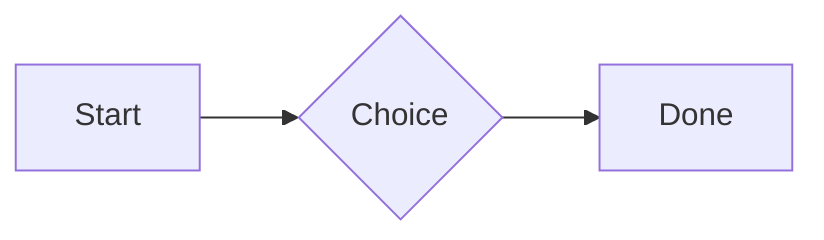
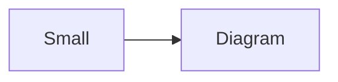

# QA · Everything in a callout in a card

Each element in a callout in a card. Check: it draws as it does on its own, sits inside the container's edges with even space around it, and its Markdown shows while the cursor is in it. Tables, spreadsheets, diagrams and attachments in quotes and list items stay as Markdown.

#qa/containers

#### 1. Paragraph in a callout in a card

::: card
:::!
A paragraph with **bold**, *italic*, <u>underlined</u>, ~~struck~~, ==highlighted==, `code`, a [link](https://example.com) and a #qa/tag.
:::
:::

#### 2. Long paragraph in a callout in a card

::: card
:::!
A long paragraph that wraps onto several lines at the usual width, so the space between its lines, its indent on every line, and where it meets the edges of anything around it can be checked. It goes on a little longer to be sure it wraps on a phone too.
:::
:::

#### 3. Heading 1 in a callout in a card

::: card
:::!
# Heading one
:::
:::

#### 4. Heading 2 in a callout in a card

::: card
:::!
## Heading two
:::
:::

#### 5. Heading 3 in a callout in a card

::: card
:::!
### Heading three
:::
:::

#### 6. Bullet list in a callout in a card

::: card
:::!
- First item
- Second item
  - Nested item
    - Third level
- Last item
:::
:::

#### 7. Numbered list in a callout in a card

::: card
:::!
1. First
2. Second
   1. Nested
3. Third
:::
:::

#### 8. Todo list in a callout in a card

::: card
:::!
- [x] Done todo
- [ ] Open todo
  - [ ] Nested open todo
:::
:::

#### 9. Quote in a callout in a card

::: card
:::!
> A quote that runs over
> two lines.
:::
:::

#### 10. Code block in a callout in a card

::: card
:::!
```
plain code
  indented line
```
:::
:::

#### 11. Code block (TypeScript) in a callout in a card

::: card
:::!
```ts
const greeting: string = "hello";
console.log(greeting);
```
:::
:::

#### 12. JSON block (no language) in a callout in a card

::: card
:::!
```
{"name":"lines","tags":["a","b"],"id":12345678901234567890}
```
:::
:::

#### 13. Diagram in a callout in a card

::: card
:::!

:::
:::

#### 14. Diagram (240 px wide) in a callout in a card

::: card
:::!

:::
:::

#### 15. 3D model (openscad block), a colored part, an echo in a callout in a card

::: card
:::!
```openscad
difference() {
  cube(20, center = true);
  sphere(r = 13);
}
translate([25, 0, 0]) color("tomato") cylinder(h = 10, r = 5);
echo("made");
```
:::
:::

#### 16. Flat model (openscad block) in a callout in a card

::: card
:::!
```openscad
square(20);
translate([30, 10]) circle(8);
```
:::
:::

#### 17. Broken model (openscad block) in a callout in a card

::: card
:::!
```openscad
cube(10)
sphere(3;
```
:::
:::

#### 18. 3D model (stl block) in a callout in a card

::: card
:::!
```stl
solid pyramid
facet normal 0 0 -1
outer loop
vertex 0 0 0
vertex 10 10 0
vertex 10 0 0
endloop
endfacet
facet normal 0 0 -1
outer loop
vertex 0 0 0
vertex 0 10 0
vertex 10 10 0
endloop
endfacet
facet normal 0 -1 1
outer loop
vertex 0 0 0
vertex 10 0 0
vertex 5 5 8
endloop
endfacet
facet normal 1 0 1
outer loop
vertex 10 0 0
vertex 10 10 0
vertex 5 5 8
endloop
endfacet
facet normal 0 1 1
outer loop
vertex 10 10 0
vertex 0 10 0
vertex 5 5 8
endloop
endfacet
facet normal -1 0 1
outer loop
vertex 0 10 0
vertex 0 0 0
vertex 5 5 8
endloop
endfacet
endsolid pyramid
```
:::
:::

#### 19. Math block in a callout in a card

::: card
:::!
$$
\int_0^1 x^2\,dx = \frac{1}{3}
$$
:::
:::

#### 20. Table in a callout in a card

::: card
:::!
| Left | Center | Right |
| :--- | :----: | ----: |
| a | **b** | 1 |
| longer cell text | `code` | 22 |
:::
:::

#### 21. Table with formulas in a callout in a card

::: card
:::!
| Item | Cost |
| --- | ---: |
| Rent | 1200 |
| Food | 450.50 |
| Total | =SUM(B2:B3) |
| Broken | =B2/0 |
:::
:::

#### 22. Hurl entries (hurl block): a capture used by the next entry, and asserts in a callout in a card

::: card
:::!
```hurl
# A todo
GET https://jsonplaceholder.typicode.com/todos/1
HTTP 200
[Captures]
owner: jsonpath "$.userId"
[Asserts]
jsonpath "$.id" == 1

# Its owner
GET https://jsonplaceholder.typicode.com/users/{{owner}}
HTTP 200
[Asserts]
jsonpath "$.name" isString
```
:::
:::

#### 23. Secret ({{name}}, kept in a locked secrets note) in a callout in a card

::: card
:::!
The token is {{qa-token}}, and {{no-such-secret}} isn't one.
:::
:::

#### 24. API requests (http block): a variable, a named request and one using its response in a callout in a card

::: card
:::!
```http
@api = https://jsonplaceholder.typicode.com

### A todo
# @name todo
GET {{api}}/todos/1

### Its owner
GET {{api}}/users/{{todo.response.body.$.userId}}
```
:::
:::

#### 25. Spreadsheet (csv block) in a callout in a card

::: card
:::!
```csv
Item, Cost
Rent, 1200
Food, 450.50
Total, =SUM(B2:B3)
```
:::
:::

#### 26. Named spreadsheet (csv name=), and a formula in another block using it in a callout in a card

::: card
:::!
```csv name=costs
Item, Cost, Day
Rent, $1200, 2026-01-05
```

```csv
Total, =costs!B2*2
```
:::
:::

#### 27. Divider in a callout in a card

::: card
:::!
---
:::
:::

#### 28. Key: Value line in a callout in a card

::: card
:::!
**Wi-Fi password:** correct-horse-battery
:::
:::

#### 29. Mention in a callout in a card

::: card
:::!
Ask @[QA · Ada] at @[QA · Ada].email.
:::
:::

#### 30. Wiki link in a callout in a card

::: card
:::!
Ask [[QA · Ada]], or [[QA · Ada|her]].
:::
:::

#### 31. Symbols in a callout in a card

::: card
:::!
Home -> cabin <- back, a <-> b, x => y, p <=> q, 1 <= 2 >= 0 != 3. Stays: --> !== \-> and `a -> b` in code.
:::
:::

#### 32. GitHub links in a callout in a card

::: card
:::!
Issue https://github.com/overtio/lines/issues/1 and [a named link](https://github.com/overtio/lines)
:::
:::

#### 33. arXiv links in a callout in a card

::: card
:::!
Paper https://arxiv.org/abs/1706.03762 and [a named link](https://arxiv.org/abs/2006.11239)
:::
:::

#### 34. Image in a callout in a card

::: card
:::!

:::
:::

#### 35. Drawing in a callout in a card

::: card
:::!

:::
:::

#### 36. File in a callout in a card

::: card
:::!
[Budget.csv](attachment:budget.csv)
:::
:::

#### 37. Attached 3D model (STL) in a callout in a card

::: card
:::!
[Bracket.stl](attachment:bracket.stl)
:::
:::

#### 38. Terminal recording (.cast file) in a callout in a card

::: card
:::!
[terminal.cast](attachment:terminal.cast)
:::
:::

#### 39. Missing file in a callout in a card

::: card
:::!
[Not here yet.pdf](../attachments/00000000000000000000000000000000.pdf)
:::
:::

#### 40. Card in a callout in a card

::: card
:::!
::: card
Text in a card.
:::
:::
:::

#### 41. Callout (info) in a callout in a card

::: card
:::!
:::i
Text in an info callout.
:::
:::
:::

#### 42. Callout (warning, chosen icon) in a callout in a card

::: card
:::!
:::! icon=flag
Text in a warning callout with the flag icon.
:::
:::
:::

#### 43. Callout (decision, no icon) in a callout in a card

::: card
:::!
:::^ icon=none
Text in a decision callout with no icon.
:::
:::
:::
