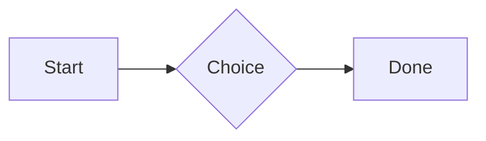

# QA · Right after: Paragraph

Paragraph followed straight away, with no blank line, by each element. Check: nothing overlaps, nothing is cut off, and the space between is even. Markdown joins some pairs without a blank line (text followed by --- is a heading, and a line of text can carry on into the next), so check that what's drawn matches the Markdown.

#qa/adjacent

#### 1. Paragraph, then Paragraph

A paragraph with **bold**, *italic*, ~~struck~~, ==highlighted==, `code`, a [link](https://example.com) and a #qa/tag.
A paragraph with **bold**, *italic*, ~~struck~~, ==highlighted==, `code`, a [link](https://example.com) and a #qa/tag.

#### 2. Paragraph, then Long paragraph

A paragraph with **bold**, *italic*, ~~struck~~, ==highlighted==, `code`, a [link](https://example.com) and a #qa/tag.
A long paragraph that wraps onto several lines at the usual width, so the space between its lines, its indent on every line, and where it meets the edges of anything around it can be checked. It goes on a little longer to be sure it wraps on a phone too.

#### 3. Paragraph, then Heading 1

A paragraph with **bold**, *italic*, ~~struck~~, ==highlighted==, `code`, a [link](https://example.com) and a #qa/tag.
# Heading one

#### 4. Paragraph, then Heading 2

A paragraph with **bold**, *italic*, ~~struck~~, ==highlighted==, `code`, a [link](https://example.com) and a #qa/tag.
## Heading two

#### 5. Paragraph, then Heading 3

A paragraph with **bold**, *italic*, ~~struck~~, ==highlighted==, `code`, a [link](https://example.com) and a #qa/tag.
### Heading three

#### 6. Paragraph, then Bullet list

A paragraph with **bold**, *italic*, ~~struck~~, ==highlighted==, `code`, a [link](https://example.com) and a #qa/tag.
- First item
- Second item
  - Nested item
    - Third level
- Last item

#### 7. Paragraph, then Numbered list

A paragraph with **bold**, *italic*, ~~struck~~, ==highlighted==, `code`, a [link](https://example.com) and a #qa/tag.
1. First
2. Second
   1. Nested
3. Third

#### 8. Paragraph, then Todo list

A paragraph with **bold**, *italic*, ~~struck~~, ==highlighted==, `code`, a [link](https://example.com) and a #qa/tag.
- [x] Done todo
- [ ] Open todo
  - [ ] Nested open todo

#### 9. Paragraph, then Quote

A paragraph with **bold**, *italic*, ~~struck~~, ==highlighted==, `code`, a [link](https://example.com) and a #qa/tag.
> A quote that runs over
> two lines.

#### 10. Paragraph, then Code block

A paragraph with **bold**, *italic*, ~~struck~~, ==highlighted==, `code`, a [link](https://example.com) and a #qa/tag.
```
plain code
  indented line
```

#### 11. Paragraph, then Code block (TypeScript)

A paragraph with **bold**, *italic*, ~~struck~~, ==highlighted==, `code`, a [link](https://example.com) and a #qa/tag.
```ts
const greeting: string = "hello";
console.log(greeting);
```

#### 12. Paragraph, then JSON block (no language)

A paragraph with **bold**, *italic*, ~~struck~~, ==highlighted==, `code`, a [link](https://example.com) and a #qa/tag.
```
{"name":"lines","tags":["a","b"],"id":12345678901234567890}
```

#### 13. Paragraph, then Diagram

A paragraph with **bold**, *italic*, ~~struck~~, ==highlighted==, `code`, a [link](https://example.com) and a #qa/tag.


#### 14. Paragraph, then Table

A paragraph with **bold**, *italic*, ~~struck~~, ==highlighted==, `code`, a [link](https://example.com) and a #qa/tag.
| Left | Center | Right |
| :--- | :----: | ----: |
| a | **b** | 1 |
| longer cell text | `code` | 22 |

#### 15. Paragraph, then Divider

A paragraph with **bold**, *italic*, ~~struck~~, ==highlighted==, `code`, a [link](https://example.com) and a #qa/tag.
---

#### 16. Paragraph, then Key: Value line

A paragraph with **bold**, *italic*, ~~struck~~, ==highlighted==, `code`, a [link](https://example.com) and a #qa/tag.
**Wi-Fi password:** correct-horse-battery

#### 17. Paragraph, then Image

A paragraph with **bold**, *italic*, ~~struck~~, ==highlighted==, `code`, a [link](https://example.com) and a #qa/tag.


#### 18. Paragraph, then File

A paragraph with **bold**, *italic*, ~~struck~~, ==highlighted==, `code`, a [link](https://example.com) and a #qa/tag.
[Budget.csv](attachment:budget.csv)

#### 19. Paragraph, then Missing file

A paragraph with **bold**, *italic*, ~~struck~~, ==highlighted==, `code`, a [link](https://example.com) and a #qa/tag.
[Not here yet.pdf](../attachments/00000000000000000000000000000000.pdf)

#### 20. Paragraph, then Card

A paragraph with **bold**, *italic*, ~~struck~~, ==highlighted==, `code`, a [link](https://example.com) and a #qa/tag.
::: card
Text in a card.
:::

#### 21. Paragraph, then Callout (info)

A paragraph with **bold**, *italic*, ~~struck~~, ==highlighted==, `code`, a [link](https://example.com) and a #qa/tag.
:::i
Text in an info callout.
:::

#### 22. Paragraph, then Callout (warning, chosen icon)

A paragraph with **bold**, *italic*, ~~struck~~, ==highlighted==, `code`, a [link](https://example.com) and a #qa/tag.
:::! icon=flag
Text in a warning callout with the flag icon.
:::

#### 23. Paragraph, then Callout (decision, no icon)

A paragraph with **bold**, *italic*, ~~struck~~, ==highlighted==, `code`, a [link](https://example.com) and a #qa/tag.
:::^ icon=none
Text in a decision callout with no icon.
:::
