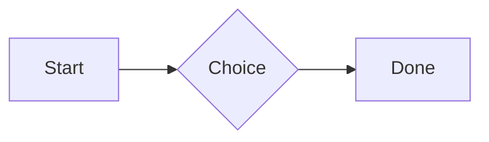
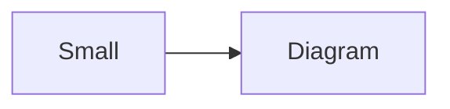

# QA · Right after: Long paragraph

Long paragraph followed straight away, with no blank line, by each element. Check: nothing overlaps, nothing is cut off, and the space between is even. Markdown joins some pairs without a blank line (text followed by --- is a heading, and a line of text can carry on into the next), so check that what's drawn matches the Markdown.

#qa/adjacent

#### 1. Long paragraph, then Paragraph

A long paragraph that wraps onto several lines at the usual width, so the space between its lines, its indent on every line, and where it meets the edges of anything around it can be checked. It goes on a little longer to be sure it wraps on a phone too.
A paragraph with **bold**, *italic*, <u>underlined</u>, ~~struck~~, ==highlighted==, `code`, a [link](https://example.com) and a #qa/tag.

#### 2. Long paragraph, then Long paragraph

A long paragraph that wraps onto several lines at the usual width, so the space between its lines, its indent on every line, and where it meets the edges of anything around it can be checked. It goes on a little longer to be sure it wraps on a phone too.
A long paragraph that wraps onto several lines at the usual width, so the space between its lines, its indent on every line, and where it meets the edges of anything around it can be checked. It goes on a little longer to be sure it wraps on a phone too.

#### 3. Long paragraph, then Heading 1

A long paragraph that wraps onto several lines at the usual width, so the space between its lines, its indent on every line, and where it meets the edges of anything around it can be checked. It goes on a little longer to be sure it wraps on a phone too.
# Heading one

#### 4. Long paragraph, then Heading 2

A long paragraph that wraps onto several lines at the usual width, so the space between its lines, its indent on every line, and where it meets the edges of anything around it can be checked. It goes on a little longer to be sure it wraps on a phone too.
## Heading two

#### 5. Long paragraph, then Heading 3

A long paragraph that wraps onto several lines at the usual width, so the space between its lines, its indent on every line, and where it meets the edges of anything around it can be checked. It goes on a little longer to be sure it wraps on a phone too.
### Heading three

#### 6. Long paragraph, then Bullet list

A long paragraph that wraps onto several lines at the usual width, so the space between its lines, its indent on every line, and where it meets the edges of anything around it can be checked. It goes on a little longer to be sure it wraps on a phone too.
- First item
- Second item
  - Nested item
    - Third level
- Last item

#### 7. Long paragraph, then Numbered list

A long paragraph that wraps onto several lines at the usual width, so the space between its lines, its indent on every line, and where it meets the edges of anything around it can be checked. It goes on a little longer to be sure it wraps on a phone too.
1. First
2. Second
   1. Nested
3. Third

#### 8. Long paragraph, then Todo list

A long paragraph that wraps onto several lines at the usual width, so the space between its lines, its indent on every line, and where it meets the edges of anything around it can be checked. It goes on a little longer to be sure it wraps on a phone too.
- [x] Done todo
- [ ] Open todo
  - [ ] Nested open todo

#### 9. Long paragraph, then Quote

A long paragraph that wraps onto several lines at the usual width, so the space between its lines, its indent on every line, and where it meets the edges of anything around it can be checked. It goes on a little longer to be sure it wraps on a phone too.
> A quote that runs over
> two lines.

#### 10. Long paragraph, then Line marks

A long paragraph that wraps onto several lines at the usual width, so the space between its lines, its indent on every line, and where it meets the edges of anything around it can be checked. It goes on a little longer to be sure it wraps on a phone too.
Marked as the accent. <!-- mark -->
Two lines marked green, one bar. <!-- mark green: ready -->
The second of them. <!-- mark green: ready -->
Red, with a label to point at. <!-- mark red: to fix -->
- A list item, marked purple. <!-- mark purple -->

#### 11. Long paragraph, then Code block

A long paragraph that wraps onto several lines at the usual width, so the space between its lines, its indent on every line, and where it meets the edges of anything around it can be checked. It goes on a little longer to be sure it wraps on a phone too.
```
plain code
  indented line
```

#### 12. Long paragraph, then Code block (TypeScript)

A long paragraph that wraps onto several lines at the usual width, so the space between its lines, its indent on every line, and where it meets the edges of anything around it can be checked. It goes on a little longer to be sure it wraps on a phone too.
```ts
const greeting: string = "hello";
console.log(greeting);
```

#### 13. Long paragraph, then JSON block (no language)

A long paragraph that wraps onto several lines at the usual width, so the space between its lines, its indent on every line, and where it meets the edges of anything around it can be checked. It goes on a little longer to be sure it wraps on a phone too.
```
{"name":"lines","tags":["a","b"],"id":12345678901234567890}
```

#### 14. Long paragraph, then Diagram

A long paragraph that wraps onto several lines at the usual width, so the space between its lines, its indent on every line, and where it meets the edges of anything around it can be checked. It goes on a little longer to be sure it wraps on a phone too.


#### 15. Long paragraph, then Diagram (240 px wide)

A long paragraph that wraps onto several lines at the usual width, so the space between its lines, its indent on every line, and where it meets the edges of anything around it can be checked. It goes on a little longer to be sure it wraps on a phone too.


#### 16. Long paragraph, then 3D model (openscad block), a colored part, an echo

A long paragraph that wraps onto several lines at the usual width, so the space between its lines, its indent on every line, and where it meets the edges of anything around it can be checked. It goes on a little longer to be sure it wraps on a phone too.
```openscad
difference() {
  cube(20, center = true);
  sphere(r = 13);
}
translate([25, 0, 0]) color("tomato") cylinder(h = 10, r = 5);
echo("made");
```

#### 17. Long paragraph, then Flat model (openscad block)

A long paragraph that wraps onto several lines at the usual width, so the space between its lines, its indent on every line, and where it meets the edges of anything around it can be checked. It goes on a little longer to be sure it wraps on a phone too.
```openscad
square(20);
translate([30, 10]) circle(8);
```

#### 18. Long paragraph, then Broken model (openscad block)

A long paragraph that wraps onto several lines at the usual width, so the space between its lines, its indent on every line, and where it meets the edges of anything around it can be checked. It goes on a little longer to be sure it wraps on a phone too.
```openscad
cube(10)
sphere(3;
```

#### 19. Long paragraph, then 3D model (stl block)

A long paragraph that wraps onto several lines at the usual width, so the space between its lines, its indent on every line, and where it meets the edges of anything around it can be checked. It goes on a little longer to be sure it wraps on a phone too.
```stl
solid pyramid
facet normal 0 0 -1
outer loop
vertex 0 0 0
vertex 10 10 0
vertex 10 0 0
endloop
endfacet
facet normal 0 0 -1
outer loop
vertex 0 0 0
vertex 0 10 0
vertex 10 10 0
endloop
endfacet
facet normal 0 -1 1
outer loop
vertex 0 0 0
vertex 10 0 0
vertex 5 5 8
endloop
endfacet
facet normal 1 0 1
outer loop
vertex 10 0 0
vertex 10 10 0
vertex 5 5 8
endloop
endfacet
facet normal 0 1 1
outer loop
vertex 10 10 0
vertex 0 10 0
vertex 5 5 8
endloop
endfacet
facet normal -1 0 1
outer loop
vertex 0 10 0
vertex 0 0 0
vertex 5 5 8
endloop
endfacet
endsolid pyramid
```

#### 20. Long paragraph, then Timing diagram (wavedrom block)

A long paragraph that wraps onto several lines at the usual width, so the space between its lines, its indent on every line, and where it meets the edges of anything around it can be checked. It goes on a little longer to be sure it wraps on a phone too.
```wavedrom
{ signal: [
  { name: "clk", wave: "p.....|..." },
  { name: "data", wave: "x.345x|=.x", data: ["head", "body", "tail", "data"] },
  {},
  { name: "ack", wave: "1.....|01.", node: ".a......b" }
], edge: ["a~>b t1"] }
```

#### 21. Long paragraph, then Math block

A long paragraph that wraps onto several lines at the usual width, so the space between its lines, its indent on every line, and where it meets the edges of anything around it can be checked. It goes on a little longer to be sure it wraps on a phone too.
$$
\int_0^1 x^2\,dx = \frac{1}{3}
$$

#### 22. Long paragraph, then Table

A long paragraph that wraps onto several lines at the usual width, so the space between its lines, its indent on every line, and where it meets the edges of anything around it can be checked. It goes on a little longer to be sure it wraps on a phone too.
| Left | Center | Right |
| :--- | :----: | ----: |
| a | **b** | 1 |
| longer cell text | `code` | 22 |

#### 23. Long paragraph, then Table with formulas

A long paragraph that wraps onto several lines at the usual width, so the space between its lines, its indent on every line, and where it meets the edges of anything around it can be checked. It goes on a little longer to be sure it wraps on a phone too.
| Item | Cost |
| --- | ---: |
| Rent | 1200 |
| Food | 450.50 |
| Total | =SUM(B2:B3) |
| Broken | =B2/0 |

#### 24. Long paragraph, then Hurl entries (hurl block): a capture used by the next entry, and asserts

A long paragraph that wraps onto several lines at the usual width, so the space between its lines, its indent on every line, and where it meets the edges of anything around it can be checked. It goes on a little longer to be sure it wraps on a phone too.
```hurl
# A todo
GET https://jsonplaceholder.typicode.com/todos/1
HTTP 200
[Captures]
owner: jsonpath "$.userId"
[Asserts]
jsonpath "$.id" == 1

# Its owner
GET https://jsonplaceholder.typicode.com/users/{{owner}}
HTTP 200
[Asserts]
jsonpath "$.name" isString
```

#### 25. Long paragraph, then Secret ({{name}}, kept in a locked secrets note)

A long paragraph that wraps onto several lines at the usual width, so the space between its lines, its indent on every line, and where it meets the edges of anything around it can be checked. It goes on a little longer to be sure it wraps on a phone too.
The token is {{qa-token}}, and {{no-such-secret}} isn't one.

#### 26. Long paragraph, then API requests (http block): a variable, a named request and one using its response

A long paragraph that wraps onto several lines at the usual width, so the space between its lines, its indent on every line, and where it meets the edges of anything around it can be checked. It goes on a little longer to be sure it wraps on a phone too.
```http
@api = https://jsonplaceholder.typicode.com

### A todo
# @name todo
GET {{api}}/todos/1

### Its owner
GET {{api}}/users/{{todo.response.body.$.userId}}
```

#### 27. Long paragraph, then Spreadsheet (csv block)

A long paragraph that wraps onto several lines at the usual width, so the space between its lines, its indent on every line, and where it meets the edges of anything around it can be checked. It goes on a little longer to be sure it wraps on a phone too.
```csv
Item, Cost
Rent, 1200
Food, 450.50
Total, =SUM(B2:B3)
```

#### 28. Long paragraph, then Named spreadsheet (csv name=), and a formula in another block using it

A long paragraph that wraps onto several lines at the usual width, so the space between its lines, its indent on every line, and where it meets the edges of anything around it can be checked. It goes on a little longer to be sure it wraps on a phone too.
```csv name=costs
Item, Cost, Day
Rent, $1200, 2026-01-05
```

```csv
Total, =costs!B2*2
```

#### 29. Long paragraph, then Divider

A long paragraph that wraps onto several lines at the usual width, so the space between its lines, its indent on every line, and where it meets the edges of anything around it can be checked. It goes on a little longer to be sure it wraps on a phone too.
---

#### 30. Long paragraph, then Key: Value line

A long paragraph that wraps onto several lines at the usual width, so the space between its lines, its indent on every line, and where it meets the edges of anything around it can be checked. It goes on a little longer to be sure it wraps on a phone too.
**Wi-Fi password:** correct-horse-battery

#### 31. Long paragraph, then Mention

A long paragraph that wraps onto several lines at the usual width, so the space between its lines, its indent on every line, and where it meets the edges of anything around it can be checked. It goes on a little longer to be sure it wraps on a phone too.
Ask @[QA · Ada] at @[QA · Ada].email.

#### 32. Long paragraph, then Wiki link

A long paragraph that wraps onto several lines at the usual width, so the space between its lines, its indent on every line, and where it meets the edges of anything around it can be checked. It goes on a little longer to be sure it wraps on a phone too.
Ask [[QA · Ada]], or [[QA · Ada|her]].

#### 33. Long paragraph, then Symbols

A long paragraph that wraps onto several lines at the usual width, so the space between its lines, its indent on every line, and where it meets the edges of anything around it can be checked. It goes on a little longer to be sure it wraps on a phone too.
Home -> cabin <- back, a <-> b, x => y, p <=> q, 1 <= 2 >= 0 != 3. Stays: --> !== \-> and `a -> b` in code.

#### 34. Long paragraph, then GitHub links

A long paragraph that wraps onto several lines at the usual width, so the space between its lines, its indent on every line, and where it meets the edges of anything around it can be checked. It goes on a little longer to be sure it wraps on a phone too.
Issue https://github.com/overtio/lines/issues/1 and [a named link](https://github.com/overtio/lines)

#### 35. Long paragraph, then arXiv links

A long paragraph that wraps onto several lines at the usual width, so the space between its lines, its indent on every line, and where it meets the edges of anything around it can be checked. It goes on a little longer to be sure it wraps on a phone too.
Paper https://arxiv.org/abs/1706.03762 and [a named link](https://arxiv.org/abs/2006.11239)

#### 36. Long paragraph, then Image

A long paragraph that wraps onto several lines at the usual width, so the space between its lines, its indent on every line, and where it meets the edges of anything around it can be checked. It goes on a little longer to be sure it wraps on a phone too.


#### 37. Long paragraph, then Drawing

A long paragraph that wraps onto several lines at the usual width, so the space between its lines, its indent on every line, and where it meets the edges of anything around it can be checked. It goes on a little longer to be sure it wraps on a phone too.


#### 38. Long paragraph, then File

A long paragraph that wraps onto several lines at the usual width, so the space between its lines, its indent on every line, and where it meets the edges of anything around it can be checked. It goes on a little longer to be sure it wraps on a phone too.
[Budget.csv](attachment:budget.csv)

#### 39. Long paragraph, then Attached 3D model (STL)

A long paragraph that wraps onto several lines at the usual width, so the space between its lines, its indent on every line, and where it meets the edges of anything around it can be checked. It goes on a little longer to be sure it wraps on a phone too.
[Bracket.stl](attachment:bracket.stl)

#### 40. Long paragraph, then Terminal recording (.cast file)

A long paragraph that wraps onto several lines at the usual width, so the space between its lines, its indent on every line, and where it meets the edges of anything around it can be checked. It goes on a little longer to be sure it wraps on a phone too.
[terminal.cast](attachment:terminal.cast)

#### 41. Long paragraph, then Audio

A long paragraph that wraps onto several lines at the usual width, so the space between its lines, its indent on every line, and where it meets the edges of anything around it can be checked. It goes on a little longer to be sure it wraps on a phone too.
[Chime.mp3](attachment:chime.mp3)

#### 42. Long paragraph, then Video

A long paragraph that wraps onto several lines at the usual width, so the space between its lines, its indent on every line, and where it meets the edges of anything around it can be checked. It goes on a little longer to be sure it wraps on a phone too.
[Sky.mp4](attachment:sky.mp4)

#### 43. Long paragraph, then Missing file

A long paragraph that wraps onto several lines at the usual width, so the space between its lines, its indent on every line, and where it meets the edges of anything around it can be checked. It goes on a little longer to be sure it wraps on a phone too.
[Not here yet.pdf](../attachments/00000000000000000000000000000000.pdf)

#### 44. Long paragraph, then Card

A long paragraph that wraps onto several lines at the usual width, so the space between its lines, its indent on every line, and where it meets the edges of anything around it can be checked. It goes on a little longer to be sure it wraps on a phone too.
::: card
Text in a card.
:::

#### 45. Long paragraph, then Callout (info)

A long paragraph that wraps onto several lines at the usual width, so the space between its lines, its indent on every line, and where it meets the edges of anything around it can be checked. It goes on a little longer to be sure it wraps on a phone too.
:::i
Text in an info callout.
:::

#### 46. Long paragraph, then Callout (warning, chosen icon)

A long paragraph that wraps onto several lines at the usual width, so the space between its lines, its indent on every line, and where it meets the edges of anything around it can be checked. It goes on a little longer to be sure it wraps on a phone too.
:::! icon=flag
Text in a warning callout with the flag icon.
:::

#### 47. Long paragraph, then Callout (decision, no icon)

A long paragraph that wraps onto several lines at the usual width, so the space between its lines, its indent on every line, and where it meets the edges of anything around it can be checked. It goes on a little longer to be sure it wraps on a phone too.
:::^ icon=none
Text in a decision callout with no icon.
:::
