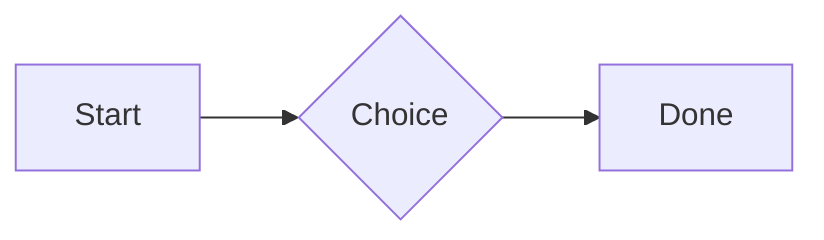

# QA · Right after: Heading 1

Heading 1 followed straight away, with no blank line, by each element. Check: nothing overlaps, nothing is cut off, and the space between is even. Markdown joins some pairs without a blank line (text followed by --- is a heading, and a line of text can carry on into the next), so check that what's drawn matches the Markdown.

#qa/adjacent

#### 1. Heading 1, then Paragraph

# Heading one
A paragraph with **bold**, *italic*, ~~struck~~, ==highlighted==, `code`, a [link](https://example.com) and a #qa/tag.

#### 2. Heading 1, then Long paragraph

# Heading one
A long paragraph that wraps onto several lines at the usual width, so the space between its lines, its indent on every line, and where it meets the edges of anything around it can be checked. It goes on a little longer to be sure it wraps on a phone too.

#### 3. Heading 1, then Heading 1

# Heading one
# Heading one

#### 4. Heading 1, then Heading 2

# Heading one
## Heading two

#### 5. Heading 1, then Heading 3

# Heading one
### Heading three

#### 6. Heading 1, then Bullet list

# Heading one
- First item
- Second item
  - Nested item
    - Third level
- Last item

#### 7. Heading 1, then Numbered list

# Heading one
1. First
2. Second
   1. Nested
3. Third

#### 8. Heading 1, then Todo list

# Heading one
- [x] Done todo
- [ ] Open todo
  - [ ] Nested open todo

#### 9. Heading 1, then Quote

# Heading one
> A quote that runs over
> two lines.

#### 10. Heading 1, then Code block

# Heading one
```
plain code
  indented line
```

#### 11. Heading 1, then Code block (TypeScript)

# Heading one
```ts
const greeting: string = "hello";
console.log(greeting);
```

#### 12. Heading 1, then JSON block (no language)

# Heading one
```
{"name":"lines","tags":["a","b"],"id":12345678901234567890}
```

#### 13. Heading 1, then Diagram

# Heading one


#### 14. Heading 1, then Table

# Heading one
| Left | Center | Right |
| :--- | :----: | ----: |
| a | **b** | 1 |
| longer cell text | `code` | 22 |

#### 15. Heading 1, then Divider

# Heading one
---

#### 16. Heading 1, then Key: Value line

# Heading one
**Wi-Fi password:** correct-horse-battery

#### 17. Heading 1, then Image

# Heading one


#### 18. Heading 1, then File

# Heading one
[Budget.csv](attachment:budget.csv)

#### 19. Heading 1, then Missing file

# Heading one
[Not here yet.pdf](../attachments/00000000000000000000000000000000.pdf)

#### 20. Heading 1, then Card

# Heading one
::: card
Text in a card.
:::

#### 21. Heading 1, then Callout (info)

# Heading one
:::i
Text in an info callout.
:::

#### 22. Heading 1, then Callout (warning, chosen icon)

# Heading one
:::! icon=flag
Text in a warning callout with the flag icon.
:::

#### 23. Heading 1, then Callout (decision, no icon)

# Heading one
:::^ icon=none
Text in a decision callout with no icon.
:::
