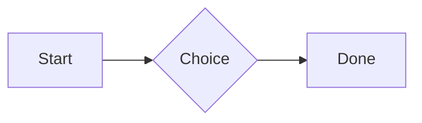
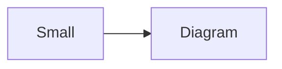

# QA · Right after: Heading 1

Heading 1 followed straight away, with no blank line, by each element. Check: nothing overlaps, nothing is cut off, and the space between is even. Markdown joins some pairs without a blank line (text followed by --- is a heading, and a line of text can carry on into the next), so check that what's drawn matches the Markdown.

#qa/adjacent

#### 1. Heading 1, then Paragraph

# Heading one
A paragraph with **bold**, *italic*, <u>underlined</u>, ~~struck~~, ==highlighted==, `code`, a [link](https://example.com) and a #qa/tag.

#### 2. Heading 1, then Long paragraph

# Heading one
A long paragraph that wraps onto several lines at the usual width, so the space between its lines, its indent on every line, and where it meets the edges of anything around it can be checked. It goes on a little longer to be sure it wraps on a phone too.

#### 3. Heading 1, then Heading 1

# Heading one
# Heading one

#### 4. Heading 1, then Heading 2

# Heading one
## Heading two

#### 5. Heading 1, then Heading 3

# Heading one
### Heading three

#### 6. Heading 1, then Bullet list

# Heading one
- First item
- Second item
  - Nested item
    - Third level
- Last item

#### 7. Heading 1, then Numbered list

# Heading one
1. First
2. Second
   1. Nested
3. Third

#### 8. Heading 1, then Todo list

# Heading one
- [x] Done todo
- [ ] Open todo
  - [ ] Nested open todo

#### 9. Heading 1, then Quote

# Heading one
> A quote that runs over
> two lines.

#### 10. Heading 1, then Line marks

# Heading one
Marked as the accent. <!-- mark -->
Two lines marked green, one bar. <!-- mark green: ready -->
The second of them. <!-- mark green: ready -->
Red, with a label to point at. <!-- mark red: to fix -->
- A list item, marked purple. <!-- mark purple -->

#### 11. Heading 1, then Code block

# Heading one
```
plain code
  indented line
```

#### 12. Heading 1, then Code block (TypeScript)

# Heading one
```ts
const greeting: string = "hello";
console.log(greeting);
```

#### 13. Heading 1, then JSON block (no language)

# Heading one
```
{"name":"lines","tags":["a","b"],"id":12345678901234567890}
```

#### 14. Heading 1, then Diagram

# Heading one


#### 15. Heading 1, then Diagram (240 px wide)

# Heading one


#### 16. Heading 1, then 3D model (openscad block), a colored part, an echo

# Heading one
```openscad
difference() {
  cube(20, center = true);
  sphere(r = 13);
}
translate([25, 0, 0]) color("tomato") cylinder(h = 10, r = 5);
echo("made");
```

#### 17. Heading 1, then Flat model (openscad block)

# Heading one
```openscad
square(20);
translate([30, 10]) circle(8);
```

#### 18. Heading 1, then Broken model (openscad block)

# Heading one
```openscad
cube(10)
sphere(3;
```

#### 19. Heading 1, then 3D model (stl block)

# Heading one
```stl
solid pyramid
facet normal 0 0 -1
outer loop
vertex 0 0 0
vertex 10 10 0
vertex 10 0 0
endloop
endfacet
facet normal 0 0 -1
outer loop
vertex 0 0 0
vertex 0 10 0
vertex 10 10 0
endloop
endfacet
facet normal 0 -1 1
outer loop
vertex 0 0 0
vertex 10 0 0
vertex 5 5 8
endloop
endfacet
facet normal 1 0 1
outer loop
vertex 10 0 0
vertex 10 10 0
vertex 5 5 8
endloop
endfacet
facet normal 0 1 1
outer loop
vertex 10 10 0
vertex 0 10 0
vertex 5 5 8
endloop
endfacet
facet normal -1 0 1
outer loop
vertex 0 10 0
vertex 0 0 0
vertex 5 5 8
endloop
endfacet
endsolid pyramid
```

#### 20. Heading 1, then Timing diagram (wavedrom block)

# Heading one
```wavedrom
{ signal: [
  { name: "clk", wave: "p.....|..." },
  { name: "data", wave: "x.345x|=.x", data: ["head", "body", "tail", "data"] },
  {},
  { name: "ack", wave: "1.....|01.", node: ".a......b" }
], edge: ["a~>b t1"] }
```

#### 21. Heading 1, then Math block

# Heading one
$$
\int_0^1 x^2\,dx = \frac{1}{3}
$$

#### 22. Heading 1, then Table

# Heading one
| Left | Center | Right |
| :--- | :----: | ----: |
| a | **b** | 1 |
| longer cell text | `code` | 22 |

#### 23. Heading 1, then Table with formulas

# Heading one
| Item | Cost |
| --- | ---: |
| Rent | 1200 |
| Food | 450.50 |
| Total | =SUM(B2:B3) |
| Broken | =B2/0 |

#### 24. Heading 1, then Hurl entries (hurl block): a capture used by the next entry, and asserts

# Heading one
```hurl
# A todo
GET https://jsonplaceholder.typicode.com/todos/1
HTTP 200
[Captures]
owner: jsonpath "$.userId"
[Asserts]
jsonpath "$.id" == 1

# Its owner
GET https://jsonplaceholder.typicode.com/users/{{owner}}
HTTP 200
[Asserts]
jsonpath "$.name" isString
```

#### 25. Heading 1, then Secret ({{name}}, kept in a locked secrets note)

# Heading one
The token is {{qa-token}}, and {{no-such-secret}} isn't one.

#### 26. Heading 1, then API requests (http block): a variable, a named request and one using its response

# Heading one
```http
@api = https://jsonplaceholder.typicode.com

### A todo
# @name todo
GET {{api}}/todos/1

### Its owner
GET {{api}}/users/{{todo.response.body.$.userId}}
```

#### 27. Heading 1, then Spreadsheet (csv block)

# Heading one
```csv
Item, Cost
Rent, 1200
Food, 450.50
Total, =SUM(B2:B3)
```

#### 28. Heading 1, then Named spreadsheet (csv name=), and a formula in another block using it

# Heading one
```csv name=costs
Item, Cost, Day
Rent, $1200, 2026-01-05
```

```csv
Total, =costs!B2*2
```

#### 29. Heading 1, then Divider

# Heading one
---

#### 30. Heading 1, then Key: Value line

# Heading one
**Wi-Fi password:** correct-horse-battery

#### 31. Heading 1, then Mention

# Heading one
Ask @[QA · Ada] at @[QA · Ada].email.

#### 32. Heading 1, then Wiki link

# Heading one
Ask [[QA · Ada]], or [[QA · Ada|her]].

#### 33. Heading 1, then Symbols

# Heading one
Home -> cabin <- back, a <-> b, x => y, p <=> q, 1 <= 2 >= 0 != 3. Stays: --> !== \-> and `a -> b` in code.

#### 34. Heading 1, then GitHub links

# Heading one
Issue https://github.com/overtio/lines/issues/1 and [a named link](https://github.com/overtio/lines)

#### 35. Heading 1, then arXiv links

# Heading one
Paper https://arxiv.org/abs/1706.03762 and [a named link](https://arxiv.org/abs/2006.11239)

#### 36. Heading 1, then Image

# Heading one


#### 37. Heading 1, then Drawing

# Heading one


#### 38. Heading 1, then File

# Heading one
[Budget.csv](attachment:budget.csv)

#### 39. Heading 1, then Attached 3D model (STL)

# Heading one
[Bracket.stl](attachment:bracket.stl)

#### 40. Heading 1, then Terminal recording (.cast file)

# Heading one
[terminal.cast](attachment:terminal.cast)

#### 41. Heading 1, then Audio

# Heading one
[Chime.mp3](attachment:chime.mp3)

#### 42. Heading 1, then Video

# Heading one
[Sky.mp4](attachment:sky.mp4)

#### 43. Heading 1, then Missing file

# Heading one
[Not here yet.pdf](../attachments/00000000000000000000000000000000.pdf)

#### 44. Heading 1, then Card

# Heading one
::: card
Text in a card.
:::

#### 45. Heading 1, then Callout (info)

# Heading one
:::i
Text in an info callout.
:::

#### 46. Heading 1, then Callout (warning, chosen icon)

# Heading one
:::! icon=flag
Text in a warning callout with the flag icon.
:::

#### 47. Heading 1, then Callout (decision, no icon)

# Heading one
:::^ icon=none
Text in a decision callout with no icon.
:::
