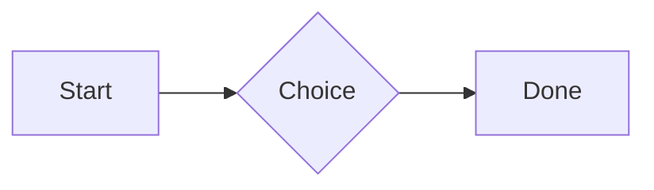
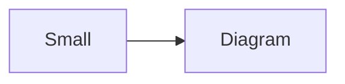

# QA · Right after: Heading 2

Heading 2 followed straight away, with no blank line, by each element. Check: nothing overlaps, nothing is cut off, and the space between is even. Markdown joins some pairs without a blank line (text followed by --- is a heading, and a line of text can carry on into the next), so check that what's drawn matches the Markdown.

#qa/adjacent

#### 1. Heading 2, then Paragraph

## Heading two
A paragraph with **bold**, *italic*, <u>underlined</u>, ~~struck~~, ==highlighted==, `code`, a [link](https://example.com) and a #qa/tag.

#### 2. Heading 2, then Long paragraph

## Heading two
A long paragraph that wraps onto several lines at the usual width, so the space between its lines, its indent on every line, and where it meets the edges of anything around it can be checked. It goes on a little longer to be sure it wraps on a phone too.

#### 3. Heading 2, then Heading 1

## Heading two
# Heading one

#### 4. Heading 2, then Heading 2

## Heading two
## Heading two

#### 5. Heading 2, then Heading 3

## Heading two
### Heading three

#### 6. Heading 2, then Bullet list

## Heading two
- First item
- Second item
  - Nested item
    - Third level
- Last item

#### 7. Heading 2, then Numbered list

## Heading two
1. First
2. Second
   1. Nested
3. Third

#### 8. Heading 2, then Todo list

## Heading two
- [x] Done todo
- [ ] Open todo
  - [ ] Nested open todo

#### 9. Heading 2, then Quote

## Heading two
> A quote that runs over
> two lines.

#### 10. Heading 2, then Line marks

## Heading two
Marked as the accent. <!-- mark -->
Two lines marked green, one bar. <!-- mark green: ready -->
The second of them. <!-- mark green: ready -->
Red, with a label to point at. <!-- mark red: to fix -->
- A list item, marked purple. <!-- mark purple -->

#### 11. Heading 2, then Code block

## Heading two
```
plain code
  indented line
```

#### 12. Heading 2, then Code block (TypeScript)

## Heading two
```ts
const greeting: string = "hello";
console.log(greeting);
```

#### 13. Heading 2, then JSON block (no language)

## Heading two
```
{"name":"lines","tags":["a","b"],"id":12345678901234567890}
```

#### 14. Heading 2, then Diagram

## Heading two


#### 15. Heading 2, then Diagram (240 px wide)

## Heading two


#### 16. Heading 2, then 3D model (openscad block), a colored part, an echo

## Heading two
```openscad
difference() {
  cube(20, center = true);
  sphere(r = 13);
}
translate([25, 0, 0]) color("tomato") cylinder(h = 10, r = 5);
echo("made");
```

#### 17. Heading 2, then Flat model (openscad block)

## Heading two
```openscad
square(20);
translate([30, 10]) circle(8);
```

#### 18. Heading 2, then Broken model (openscad block)

## Heading two
```openscad
cube(10)
sphere(3;
```

#### 19. Heading 2, then 3D model (stl block)

## Heading two
```stl
solid pyramid
facet normal 0 0 -1
outer loop
vertex 0 0 0
vertex 10 10 0
vertex 10 0 0
endloop
endfacet
facet normal 0 0 -1
outer loop
vertex 0 0 0
vertex 0 10 0
vertex 10 10 0
endloop
endfacet
facet normal 0 -1 1
outer loop
vertex 0 0 0
vertex 10 0 0
vertex 5 5 8
endloop
endfacet
facet normal 1 0 1
outer loop
vertex 10 0 0
vertex 10 10 0
vertex 5 5 8
endloop
endfacet
facet normal 0 1 1
outer loop
vertex 10 10 0
vertex 0 10 0
vertex 5 5 8
endloop
endfacet
facet normal -1 0 1
outer loop
vertex 0 10 0
vertex 0 0 0
vertex 5 5 8
endloop
endfacet
endsolid pyramid
```

#### 20. Heading 2, then Timing diagram (wavedrom block)

## Heading two
```wavedrom
{ signal: [
  { name: "clk", wave: "p.....|..." },
  { name: "data", wave: "x.345x|=.x", data: ["head", "body", "tail", "data"] },
  {},
  { name: "ack", wave: "1.....|01.", node: ".a......b" }
], edge: ["a~>b t1"] }
```

#### 21. Heading 2, then Typing practice (typing block)

## Heading two
```typing
It’s a “fine” day — type it.
function go() {
  return 1;
}
```

#### 22. Heading 2, then Math block

## Heading two
$$
\int_0^1 x^2\,dx = \frac{1}{3}
$$

#### 23. Heading 2, then Table

## Heading two
| Left | Center | Right |
| :--- | :----: | ----: |
| a | **b** | 1 |
| longer cell text | `code` | 22 |

#### 24. Heading 2, then Table with formulas

## Heading two
| Item | Cost |
| --- | ---: |
| Rent | 1200 |
| Food | 450.50 |
| Total | =SUM(B2:B3) |
| Broken | =B2/0 |

#### 25. Heading 2, then Hurl entries (hurl block): a capture used by the next entry, and asserts

## Heading two
```hurl
# A todo
GET https://jsonplaceholder.typicode.com/todos/1
HTTP 200
[Captures]
owner: jsonpath "$.userId"
[Asserts]
jsonpath "$.id" == 1

# Its owner
GET https://jsonplaceholder.typicode.com/users/{{owner}}
HTTP 200
[Asserts]
jsonpath "$.name" isString
```

#### 26. Heading 2, then Secret ({{name}}, kept in a locked secrets note)

## Heading two
The token is {{qa-token}}, and {{no-such-secret}} isn't one.

#### 27. Heading 2, then API requests (http block): a variable, a named request and one using its response

## Heading two
```http
@api = https://jsonplaceholder.typicode.com

### A todo
# @name todo
GET {{api}}/todos/1

### Its owner
GET {{api}}/users/{{todo.response.body.$.userId}}
```

#### 28. Heading 2, then Spreadsheet (csv block)

## Heading two
```csv
Item, Cost
Rent, 1200
Food, 450.50
Total, =SUM(B2:B3)
```

#### 29. Heading 2, then Named spreadsheet (csv name=), and a formula in another block using it

## Heading two
```csv name=costs
Item, Cost, Day
Rent, $1200, 2026-01-05
```

```csv
Total, =costs!B2*2
```

#### 30. Heading 2, then Divider

## Heading two
---

#### 31. Heading 2, then Page breaks (as lines writes them, and as Obsidian and Typora do; a new page in the PDF at each, a gap between pages over a backdrop)

## Heading two
Before the break.

<!-- pagebreak -->
After it, on a new page.

<div style="page-break-after: always"></div>

And another.

#### 32. Heading 2, then Key: Value line

## Heading two
**Wi-Fi password:** correct-horse-battery

#### 33. Heading 2, then Score (Settings → Little Touches)

## Heading two
Rating: 4/5
Half: 3.5/5
Score: 7 / 10
Not a score: 12/20

#### 34. Heading 2, then Mention

## Heading two
Ask @[QA · Ada] at @[QA · Ada].email.

#### 35. Heading 2, then Wiki link

## Heading two
Ask [[QA · Ada]], or [[QA · Ada|her]].

#### 36. Heading 2, then Symbols

## Heading two
Home -> cabin <- back, a <-> b, x => y, p <=> q, 1 <= 2 >= 0 != 3. Stays: --> !== \-> and `a -> b` in code.

#### 37. Heading 2, then GitHub links

## Heading two
Issue https://github.com/overtio/lines/issues/1 and [a named link](https://github.com/overtio/lines)

#### 38. Heading 2, then arXiv links

## Heading two
Paper https://arxiv.org/abs/1706.03762 and [a named link](https://arxiv.org/abs/2006.11239)

#### 39. Heading 2, then Time in an episode

## Heading two
At [12:34](https://traffic.megaphone.fm/FSI3647670844.mp3#t=754) they said it; [3:16] stays text here

#### 40. Heading 2, then Image

## Heading two


#### 41. Heading 2, then Drawing

## Heading two


#### 42. Heading 2, then File

## Heading two
[Budget.csv](attachment:budget.csv)

#### 43. Heading 2, then Folder and file links

## Heading two
See [Projects](file:///Users/me/My%20Projects/) and [the plan](file:///Users/me/plan.pdf) on this computer.

#### 44. Heading 2, then Attached 3D model (STL)

## Heading two
[Bracket.stl](attachment:bracket.stl)

#### 45. Heading 2, then Terminal recording (.cast file)

## Heading two
[terminal.cast](attachment:terminal.cast)

#### 46. Heading 2, then Audio

## Heading two
[Chime.mp3](attachment:chime.mp3)

#### 47. Heading 2, then Video

## Heading two
[Sky.mp4](attachment:sky.mp4)

#### 48. Heading 2, then Missing file

## Heading two
[Not here yet.pdf](../attachments/00000000000000000000000000000000.pdf)

#### 49. Heading 2, then Card

## Heading two
::: card
Text in a card.
:::

#### 50. Heading 2, then Callout (info)

## Heading two
:::i
Text in an info callout.
:::

#### 51. Heading 2, then Callout (warning, chosen icon)

## Heading two
:::! icon=flag
Text in a warning callout with the flag icon.
:::

#### 52. Heading 2, then Callout (decision, no icon)

## Heading two
:::^ icon=none
Text in a decision callout with no icon.
:::
