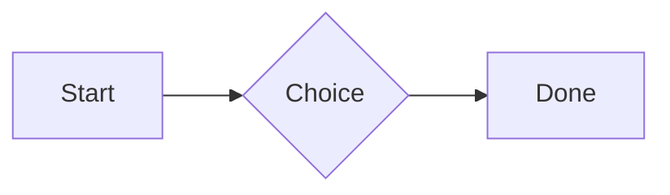

# QA · Right after: Heading 2

Heading 2 followed straight away, with no blank line, by each element. Check: nothing overlaps, nothing is cut off, and the space between is even. Markdown joins some pairs without a blank line (text followed by --- is a heading, and a line of text can carry on into the next), so check that what's drawn matches the Markdown.

#qa/adjacent

#### 1. Heading 2, then Paragraph

## Heading two
A paragraph with **bold**, *italic*, ~~struck~~, ==highlighted==, `code`, a [link](https://example.com) and a #qa/tag.

#### 2. Heading 2, then Long paragraph

## Heading two
A long paragraph that wraps onto several lines at the usual width, so the space between its lines, its indent on every line, and where it meets the edges of anything around it can be checked. It goes on a little longer to be sure it wraps on a phone too.

#### 3. Heading 2, then Heading 1

## Heading two
# Heading one

#### 4. Heading 2, then Heading 2

## Heading two
## Heading two

#### 5. Heading 2, then Heading 3

## Heading two
### Heading three

#### 6. Heading 2, then Bullet list

## Heading two
- First item
- Second item
  - Nested item
    - Third level
- Last item

#### 7. Heading 2, then Numbered list

## Heading two
1. First
2. Second
   1. Nested
3. Third

#### 8. Heading 2, then Todo list

## Heading two
- [x] Done todo
- [ ] Open todo
  - [ ] Nested open todo

#### 9. Heading 2, then Quote

## Heading two
> A quote that runs over
> two lines.

#### 10. Heading 2, then Code block

## Heading two
```
plain code
  indented line
```

#### 11. Heading 2, then Code block (TypeScript)

## Heading two
```ts
const greeting: string = "hello";
console.log(greeting);
```

#### 12. Heading 2, then JSON block (no language)

## Heading two
```
{"name":"lines","tags":["a","b"],"id":12345678901234567890}
```

#### 13. Heading 2, then Diagram

## Heading two


#### 14. Heading 2, then Table

## Heading two
| Left | Center | Right |
| :--- | :----: | ----: |
| a | **b** | 1 |
| longer cell text | `code` | 22 |

#### 15. Heading 2, then Divider

## Heading two
---

#### 16. Heading 2, then Key: Value line

## Heading two
**Wi-Fi password:** correct-horse-battery

#### 17. Heading 2, then Image

## Heading two


#### 18. Heading 2, then File

## Heading two
[Budget.csv](attachment:budget.csv)

#### 19. Heading 2, then Missing file

## Heading two
[Not here yet.pdf](../attachments/00000000000000000000000000000000.pdf)

#### 20. Heading 2, then Card

## Heading two
::: card
Text in a card.
:::

#### 21. Heading 2, then Callout (info)

## Heading two
:::i
Text in an info callout.
:::

#### 22. Heading 2, then Callout (warning, chosen icon)

## Heading two
:::! icon=flag
Text in a warning callout with the flag icon.
:::

#### 23. Heading 2, then Callout (decision, no icon)

## Heading two
:::^ icon=none
Text in a decision callout with no icon.
:::
