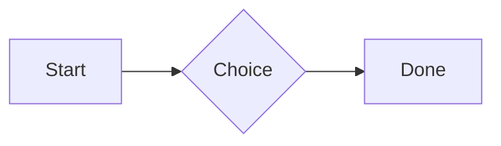

# QA · Right after: Heading 3

Heading 3 followed straight away, with no blank line, by each element. Check: nothing overlaps, nothing is cut off, and the space between is even. Markdown joins some pairs without a blank line (text followed by --- is a heading, and a line of text can carry on into the next), so check that what's drawn matches the Markdown.

#qa/adjacent

#### 1. Heading 3, then Paragraph

### Heading three
A paragraph with **bold**, *italic*, ~~struck~~, ==highlighted==, `code`, a [link](https://example.com) and a #qa/tag.

#### 2. Heading 3, then Long paragraph

### Heading three
A long paragraph that wraps onto several lines at the usual width, so the space between its lines, its indent on every line, and where it meets the edges of anything around it can be checked. It goes on a little longer to be sure it wraps on a phone too.

#### 3. Heading 3, then Heading 1

### Heading three
# Heading one

#### 4. Heading 3, then Heading 2

### Heading three
## Heading two

#### 5. Heading 3, then Heading 3

### Heading three
### Heading three

#### 6. Heading 3, then Bullet list

### Heading three
- First item
- Second item
  - Nested item
    - Third level
- Last item

#### 7. Heading 3, then Numbered list

### Heading three
1. First
2. Second
   1. Nested
3. Third

#### 8. Heading 3, then Todo list

### Heading three
- [x] Done todo
- [ ] Open todo
  - [ ] Nested open todo

#### 9. Heading 3, then Quote

### Heading three
> A quote that runs over
> two lines.

#### 10. Heading 3, then Code block

### Heading three
```
plain code
  indented line
```

#### 11. Heading 3, then Code block (TypeScript)

### Heading three
```ts
const greeting: string = "hello";
console.log(greeting);
```

#### 12. Heading 3, then JSON block (no language)

### Heading three
```
{"name":"lines","tags":["a","b"],"id":12345678901234567890}
```

#### 13. Heading 3, then Diagram

### Heading three


#### 14. Heading 3, then Table

### Heading three
| Left | Center | Right |
| :--- | :----: | ----: |
| a | **b** | 1 |
| longer cell text | `code` | 22 |

#### 15. Heading 3, then Divider

### Heading three
---

#### 16. Heading 3, then Key: Value line

### Heading three
**Wi-Fi password:** correct-horse-battery

#### 17. Heading 3, then Image

### Heading three


#### 18. Heading 3, then File

### Heading three
[Budget.csv](attachment:budget.csv)

#### 19. Heading 3, then Missing file

### Heading three
[Not here yet.pdf](../attachments/00000000000000000000000000000000.pdf)

#### 20. Heading 3, then Card

### Heading three
::: card
Text in a card.
:::

#### 21. Heading 3, then Callout (info)

### Heading three
:::i
Text in an info callout.
:::

#### 22. Heading 3, then Callout (warning, chosen icon)

### Heading three
:::! icon=flag
Text in a warning callout with the flag icon.
:::

#### 23. Heading 3, then Callout (decision, no icon)

### Heading three
:::^ icon=none
Text in a decision callout with no icon.
:::
