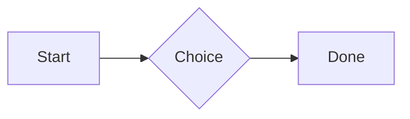
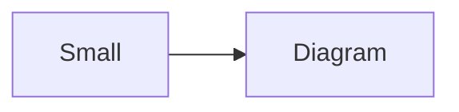

# QA · Right after: Heading 3

Heading 3 followed straight away, with no blank line, by each element. Check: nothing overlaps, nothing is cut off, and the space between is even. Markdown joins some pairs without a blank line (text followed by --- is a heading, and a line of text can carry on into the next), so check that what's drawn matches the Markdown.

#qa/adjacent

#### 1. Heading 3, then Paragraph

### Heading three
A paragraph with **bold**, *italic*, <u>underlined</u>, ~~struck~~, ==highlighted==, `code`, a [link](https://example.com) and a #qa/tag.

#### 2. Heading 3, then Long paragraph

### Heading three
A long paragraph that wraps onto several lines at the usual width, so the space between its lines, its indent on every line, and where it meets the edges of anything around it can be checked. It goes on a little longer to be sure it wraps on a phone too.

#### 3. Heading 3, then Heading 1

### Heading three
# Heading one

#### 4. Heading 3, then Heading 2

### Heading three
## Heading two

#### 5. Heading 3, then Heading 3

### Heading three
### Heading three

#### 6. Heading 3, then Bullet list

### Heading three
- First item
- Second item
  - Nested item
    - Third level
- Last item

#### 7. Heading 3, then Numbered list

### Heading three
1. First
2. Second
   1. Nested
3. Third

#### 8. Heading 3, then Todo list

### Heading three
- [x] Done todo
- [ ] Open todo
  - [ ] Nested open todo

#### 9. Heading 3, then Quote

### Heading three
> A quote that runs over
> two lines.

#### 10. Heading 3, then Line marks

### Heading three
Marked as the accent. <!-- mark -->
Two lines marked green, one bar. <!-- mark green: ready -->
The second of them. <!-- mark green: ready -->
Red, with a label to point at. <!-- mark red: to fix -->
- A list item, marked purple. <!-- mark purple -->

#### 11. Heading 3, then Code block

### Heading three
```
plain code
  indented line
```

#### 12. Heading 3, then Code block (TypeScript)

### Heading three
```ts
const greeting: string = "hello";
console.log(greeting);
```

#### 13. Heading 3, then JSON block (no language)

### Heading three
```
{"name":"lines","tags":["a","b"],"id":12345678901234567890}
```

#### 14. Heading 3, then Diagram

### Heading three


#### 15. Heading 3, then Diagram (240 px wide)

### Heading three


#### 16. Heading 3, then 3D model (openscad block), a colored part, an echo

### Heading three
```openscad
difference() {
  cube(20, center = true);
  sphere(r = 13);
}
translate([25, 0, 0]) color("tomato") cylinder(h = 10, r = 5);
echo("made");
```

#### 17. Heading 3, then Flat model (openscad block)

### Heading three
```openscad
square(20);
translate([30, 10]) circle(8);
```

#### 18. Heading 3, then Broken model (openscad block)

### Heading three
```openscad
cube(10)
sphere(3;
```

#### 19. Heading 3, then 3D model (stl block)

### Heading three
```stl
solid pyramid
facet normal 0 0 -1
outer loop
vertex 0 0 0
vertex 10 10 0
vertex 10 0 0
endloop
endfacet
facet normal 0 0 -1
outer loop
vertex 0 0 0
vertex 0 10 0
vertex 10 10 0
endloop
endfacet
facet normal 0 -1 1
outer loop
vertex 0 0 0
vertex 10 0 0
vertex 5 5 8
endloop
endfacet
facet normal 1 0 1
outer loop
vertex 10 0 0
vertex 10 10 0
vertex 5 5 8
endloop
endfacet
facet normal 0 1 1
outer loop
vertex 10 10 0
vertex 0 10 0
vertex 5 5 8
endloop
endfacet
facet normal -1 0 1
outer loop
vertex 0 10 0
vertex 0 0 0
vertex 5 5 8
endloop
endfacet
endsolid pyramid
```

#### 20. Heading 3, then Timing diagram (wavedrom block)

### Heading three
```wavedrom
{ signal: [
  { name: "clk", wave: "p.....|..." },
  { name: "data", wave: "x.345x|=.x", data: ["head", "body", "tail", "data"] },
  {},
  { name: "ack", wave: "1.....|01.", node: ".a......b" }
], edge: ["a~>b t1"] }
```

#### 21. Heading 3, then Typing practice (typing block)

### Heading three
```typing
It’s a “fine” day — type it.
function go() {
  return 1;
}
```

#### 22. Heading 3, then Math block

### Heading three
$$
\int_0^1 x^2\,dx = \frac{1}{3}
$$

#### 23. Heading 3, then Table

### Heading three
| Left | Center | Right |
| :--- | :----: | ----: |
| a | **b** | 1 |
| longer cell text | `code` | 22 |

#### 24. Heading 3, then Table with formulas

### Heading three
| Item | Cost |
| --- | ---: |
| Rent | 1200 |
| Food | 450.50 |
| Total | =SUM(B2:B3) |
| Broken | =B2/0 |

#### 25. Heading 3, then Hurl entries (hurl block): a capture used by the next entry, and asserts

### Heading three
```hurl
# A todo
GET https://jsonplaceholder.typicode.com/todos/1
HTTP 200
[Captures]
owner: jsonpath "$.userId"
[Asserts]
jsonpath "$.id" == 1

# Its owner
GET https://jsonplaceholder.typicode.com/users/{{owner}}
HTTP 200
[Asserts]
jsonpath "$.name" isString
```

#### 26. Heading 3, then Secret ({{name}}, kept in a locked secrets note)

### Heading three
The token is {{qa-token}}, and {{no-such-secret}} isn't one.

#### 27. Heading 3, then API requests (http block): a variable, a named request and one using its response

### Heading three
```http
@api = https://jsonplaceholder.typicode.com

### A todo
# @name todo
GET {{api}}/todos/1

### Its owner
GET {{api}}/users/{{todo.response.body.$.userId}}
```

#### 28. Heading 3, then Spreadsheet (csv block)

### Heading three
```csv
Item, Cost
Rent, 1200
Food, 450.50
Total, =SUM(B2:B3)
```

#### 29. Heading 3, then Named spreadsheet (csv name=), and a formula in another block using it

### Heading three
```csv name=costs
Item, Cost, Day
Rent, $1200, 2026-01-05
```

```csv
Total, =costs!B2*2
```

#### 30. Heading 3, then Divider

### Heading three
---

#### 31. Heading 3, then Page breaks (as lines writes them, and as Obsidian and Typora do; a new page in the PDF at each, a gap between pages over a backdrop)

### Heading three
Before the break.

<!-- pagebreak -->
After it, on a new page.

<div style="page-break-after: always"></div>

And another.

#### 32. Heading 3, then Key: Value line

### Heading three
**Wi-Fi password:** correct-horse-battery

#### 33. Heading 3, then Score (Settings → Little Touches)

### Heading three
Rating: 4/5
Score: 7 / 10
Not a score: 12/20

#### 34. Heading 3, then Mention

### Heading three
Ask @[QA · Ada] at @[QA · Ada].email.

#### 35. Heading 3, then Wiki link

### Heading three
Ask [[QA · Ada]], or [[QA · Ada|her]].

#### 36. Heading 3, then Symbols

### Heading three
Home -> cabin <- back, a <-> b, x => y, p <=> q, 1 <= 2 >= 0 != 3. Stays: --> !== \-> and `a -> b` in code.

#### 37. Heading 3, then GitHub links

### Heading three
Issue https://github.com/overtio/lines/issues/1 and [a named link](https://github.com/overtio/lines)

#### 38. Heading 3, then arXiv links

### Heading three
Paper https://arxiv.org/abs/1706.03762 and [a named link](https://arxiv.org/abs/2006.11239)

#### 39. Heading 3, then Image

### Heading three


#### 40. Heading 3, then Drawing

### Heading three


#### 41. Heading 3, then File

### Heading three
[Budget.csv](attachment:budget.csv)

#### 42. Heading 3, then Folder and file links

### Heading three
See [Projects](file:///Users/me/My%20Projects/) and [the plan](file:///Users/me/plan.pdf) on this computer.

#### 43. Heading 3, then Attached 3D model (STL)

### Heading three
[Bracket.stl](attachment:bracket.stl)

#### 44. Heading 3, then Terminal recording (.cast file)

### Heading three
[terminal.cast](attachment:terminal.cast)

#### 45. Heading 3, then Audio

### Heading three
[Chime.mp3](attachment:chime.mp3)

#### 46. Heading 3, then Video

### Heading three
[Sky.mp4](attachment:sky.mp4)

#### 47. Heading 3, then Missing file

### Heading three
[Not here yet.pdf](../attachments/00000000000000000000000000000000.pdf)

#### 48. Heading 3, then Card

### Heading three
::: card
Text in a card.
:::

#### 49. Heading 3, then Callout (info)

### Heading three
:::i
Text in an info callout.
:::

#### 50. Heading 3, then Callout (warning, chosen icon)

### Heading three
:::! icon=flag
Text in a warning callout with the flag icon.
:::

#### 51. Heading 3, then Callout (decision, no icon)

### Heading three
:::^ icon=none
Text in a decision callout with no icon.
:::
