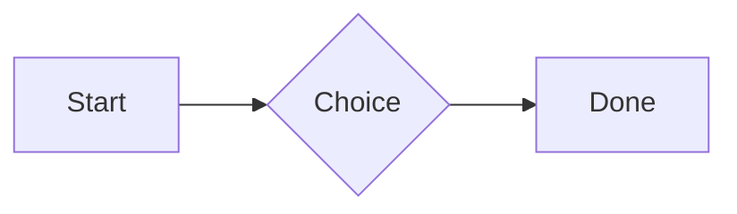
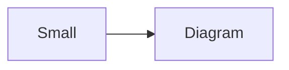

# QA · Right after: Bullet list

Bullet list followed straight away, with no blank line, by each element. Check: nothing overlaps, nothing is cut off, and the space between is even. Markdown joins some pairs without a blank line (text followed by --- is a heading, and a line of text can carry on into the next), so check that what's drawn matches the Markdown.

#qa/adjacent

#### 1. Bullet list, then Paragraph

- First item
- Second item
  - Nested item
    - Third level
- Last item
A paragraph with **bold**, *italic*, <u>underlined</u>, ~~struck~~, ==highlighted==, `code`, a [link](https://example.com) and a #qa/tag.

#### 2. Bullet list, then Long paragraph

- First item
- Second item
  - Nested item
    - Third level
- Last item
A long paragraph that wraps onto several lines at the usual width, so the space between its lines, its indent on every line, and where it meets the edges of anything around it can be checked. It goes on a little longer to be sure it wraps on a phone too.

#### 3. Bullet list, then Heading 1

- First item
- Second item
  - Nested item
    - Third level
- Last item
# Heading one

#### 4. Bullet list, then Heading 2

- First item
- Second item
  - Nested item
    - Third level
- Last item
## Heading two

#### 5. Bullet list, then Heading 3

- First item
- Second item
  - Nested item
    - Third level
- Last item
### Heading three

#### 6. Bullet list, then Bullet list

- First item
- Second item
  - Nested item
    - Third level
- Last item
- First item
- Second item
  - Nested item
    - Third level
- Last item

#### 7. Bullet list, then Numbered list

- First item
- Second item
  - Nested item
    - Third level
- Last item
1. First
2. Second
   1. Nested
3. Third

#### 8. Bullet list, then Todo list

- First item
- Second item
  - Nested item
    - Third level
- Last item
- [x] Done todo
- [ ] Open todo
  - [ ] Nested open todo

#### 9. Bullet list, then Quote

- First item
- Second item
  - Nested item
    - Third level
- Last item
> A quote that runs over
> two lines.

#### 10. Bullet list, then Code block

- First item
- Second item
  - Nested item
    - Third level
- Last item
```
plain code
  indented line
```

#### 11. Bullet list, then Code block (TypeScript)

- First item
- Second item
  - Nested item
    - Third level
- Last item
```ts
const greeting: string = "hello";
console.log(greeting);
```

#### 12. Bullet list, then JSON block (no language)

- First item
- Second item
  - Nested item
    - Third level
- Last item
```
{"name":"lines","tags":["a","b"],"id":12345678901234567890}
```

#### 13. Bullet list, then Diagram

- First item
- Second item
  - Nested item
    - Third level
- Last item


#### 14. Bullet list, then Diagram (240 px wide)

- First item
- Second item
  - Nested item
    - Third level
- Last item


#### 15. Bullet list, then Math block

- First item
- Second item
  - Nested item
    - Third level
- Last item
$$
\int_0^1 x^2\,dx = \frac{1}{3}
$$

#### 16. Bullet list, then Table

- First item
- Second item
  - Nested item
    - Third level
- Last item
| Left | Center | Right |
| :--- | :----: | ----: |
| a | **b** | 1 |
| longer cell text | `code` | 22 |

#### 17. Bullet list, then Table with formulas

- First item
- Second item
  - Nested item
    - Third level
- Last item
| Item | Cost |
| --- | ---: |
| Rent | 1200 |
| Food | 450.50 |
| Total | =SUM(B2:B3) |
| Broken | =B2/0 |

#### 18. Bullet list, then Spreadsheet (csv block)

- First item
- Second item
  - Nested item
    - Third level
- Last item
```csv
Item, Cost
Rent, 1200
Food, 450.50
Total, =SUM(B2:B3)
```

#### 19. Bullet list, then Named spreadsheet (csv name=), and a formula in another block using it

- First item
- Second item
  - Nested item
    - Third level
- Last item
```csv name=costs
Item, Cost, Day
Rent, $1200, 2026-01-05
```

```csv
Total, =costs!B2*2
```

#### 20. Bullet list, then Divider

- First item
- Second item
  - Nested item
    - Third level
- Last item
---

#### 21. Bullet list, then Key: Value line

- First item
- Second item
  - Nested item
    - Third level
- Last item
**Wi-Fi password:** correct-horse-battery

#### 22. Bullet list, then Mention

- First item
- Second item
  - Nested item
    - Third level
- Last item
Ask @[QA · Ada] at @[QA · Ada].email.

#### 23. Bullet list, then Wiki link

- First item
- Second item
  - Nested item
    - Third level
- Last item
Ask [[QA · Ada]], or [[QA · Ada|her]].

#### 24. Bullet list, then Symbols

- First item
- Second item
  - Nested item
    - Third level
- Last item
Home -> cabin <- back, a <-> b, x => y, p <=> q, 1 <= 2 >= 0 != 3. Stays: --> !== \-> and `a -> b` in code.

#### 25. Bullet list, then GitHub links

- First item
- Second item
  - Nested item
    - Third level
- Last item
Issue https://github.com/overtio/lines/issues/1 and [a named link](https://github.com/overtio/lines)

#### 26. Bullet list, then Image

- First item
- Second item
  - Nested item
    - Third level
- Last item


#### 27. Bullet list, then Drawing

- First item
- Second item
  - Nested item
    - Third level
- Last item


#### 28. Bullet list, then File

- First item
- Second item
  - Nested item
    - Third level
- Last item
[Budget.csv](attachment:budget.csv)

#### 29. Bullet list, then Missing file

- First item
- Second item
  - Nested item
    - Third level
- Last item
[Not here yet.pdf](../attachments/00000000000000000000000000000000.pdf)

#### 30. Bullet list, then Card

- First item
- Second item
  - Nested item
    - Third level
- Last item
::: card
Text in a card.
:::

#### 31. Bullet list, then Callout (info)

- First item
- Second item
  - Nested item
    - Third level
- Last item
:::i
Text in an info callout.
:::

#### 32. Bullet list, then Callout (warning, chosen icon)

- First item
- Second item
  - Nested item
    - Third level
- Last item
:::! icon=flag
Text in a warning callout with the flag icon.
:::

#### 33. Bullet list, then Callout (decision, no icon)

- First item
- Second item
  - Nested item
    - Third level
- Last item
:::^ icon=none
Text in a decision callout with no icon.
:::
