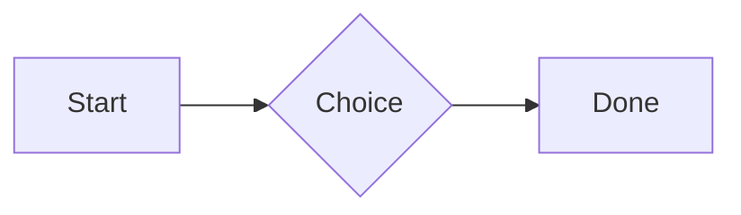
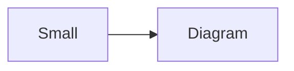

# QA · Right after: Numbered list

Numbered list followed straight away, with no blank line, by each element. Check: nothing overlaps, nothing is cut off, and the space between is even. Markdown joins some pairs without a blank line (text followed by --- is a heading, and a line of text can carry on into the next), so check that what's drawn matches the Markdown.

#qa/adjacent

#### 1. Numbered list, then Paragraph

1. First
2. Second
   1. Nested
3. Third
A paragraph with **bold**, *italic*, <u>underlined</u>, ~~struck~~, ==highlighted==, `code`, a [link](https://example.com) and a #qa/tag.

#### 2. Numbered list, then Long paragraph

1. First
2. Second
   1. Nested
3. Third
A long paragraph that wraps onto several lines at the usual width, so the space between its lines, its indent on every line, and where it meets the edges of anything around it can be checked. It goes on a little longer to be sure it wraps on a phone too.

#### 3. Numbered list, then Heading 1

1. First
2. Second
   1. Nested
3. Third
# Heading one

#### 4. Numbered list, then Heading 2

1. First
2. Second
   1. Nested
3. Third
## Heading two

#### 5. Numbered list, then Heading 3

1. First
2. Second
   1. Nested
3. Third
### Heading three

#### 6. Numbered list, then Bullet list

1. First
2. Second
   1. Nested
3. Third
- First item
- Second item
  - Nested item
    - Third level
- Last item

#### 7. Numbered list, then Numbered list

1. First
2. Second
   1. Nested
3. Third
1. First
2. Second
   1. Nested
3. Third

#### 8. Numbered list, then Todo list

1. First
2. Second
   1. Nested
3. Third
- [x] Done todo
- [ ] Open todo
  - [ ] Nested open todo

#### 9. Numbered list, then Quote

1. First
2. Second
   1. Nested
3. Third
> A quote that runs over
> two lines.

#### 10. Numbered list, then Code block

1. First
2. Second
   1. Nested
3. Third
```
plain code
  indented line
```

#### 11. Numbered list, then Code block (TypeScript)

1. First
2. Second
   1. Nested
3. Third
```ts
const greeting: string = "hello";
console.log(greeting);
```

#### 12. Numbered list, then JSON block (no language)

1. First
2. Second
   1. Nested
3. Third
```
{"name":"lines","tags":["a","b"],"id":12345678901234567890}
```

#### 13. Numbered list, then Diagram

1. First
2. Second
   1. Nested
3. Third


#### 14. Numbered list, then Diagram (240 px wide)

1. First
2. Second
   1. Nested
3. Third


#### 15. Numbered list, then 3D model (openscad block), a colored part, an echo

1. First
2. Second
   1. Nested
3. Third
```openscad
difference() {
  cube(20, center = true);
  sphere(r = 13);
}
translate([25, 0, 0]) color("tomato") cylinder(h = 10, r = 5);
echo("made");
```

#### 16. Numbered list, then Flat model (openscad block)

1. First
2. Second
   1. Nested
3. Third
```openscad
square(20);
translate([30, 10]) circle(8);
```

#### 17. Numbered list, then Broken model (openscad block)

1. First
2. Second
   1. Nested
3. Third
```openscad
cube(10)
sphere(3;
```

#### 18. Numbered list, then 3D model (stl block)

1. First
2. Second
   1. Nested
3. Third
```stl
solid pyramid
facet normal 0 0 -1
outer loop
vertex 0 0 0
vertex 10 10 0
vertex 10 0 0
endloop
endfacet
facet normal 0 0 -1
outer loop
vertex 0 0 0
vertex 0 10 0
vertex 10 10 0
endloop
endfacet
facet normal 0 -1 1
outer loop
vertex 0 0 0
vertex 10 0 0
vertex 5 5 8
endloop
endfacet
facet normal 1 0 1
outer loop
vertex 10 0 0
vertex 10 10 0
vertex 5 5 8
endloop
endfacet
facet normal 0 1 1
outer loop
vertex 10 10 0
vertex 0 10 0
vertex 5 5 8
endloop
endfacet
facet normal -1 0 1
outer loop
vertex 0 10 0
vertex 0 0 0
vertex 5 5 8
endloop
endfacet
endsolid pyramid
```

#### 19. Numbered list, then Math block

1. First
2. Second
   1. Nested
3. Third
$$
\int_0^1 x^2\,dx = \frac{1}{3}
$$

#### 20. Numbered list, then Table

1. First
2. Second
   1. Nested
3. Third
| Left | Center | Right |
| :--- | :----: | ----: |
| a | **b** | 1 |
| longer cell text | `code` | 22 |

#### 21. Numbered list, then Table with formulas

1. First
2. Second
   1. Nested
3. Third
| Item | Cost |
| --- | ---: |
| Rent | 1200 |
| Food | 450.50 |
| Total | =SUM(B2:B3) |
| Broken | =B2/0 |

#### 22. Numbered list, then Hurl entries (hurl block): a capture used by the next entry, and asserts

1. First
2. Second
   1. Nested
3. Third
```hurl
# A todo
GET https://jsonplaceholder.typicode.com/todos/1
HTTP 200
[Captures]
owner: jsonpath "$.userId"
[Asserts]
jsonpath "$.id" == 1

# Its owner
GET https://jsonplaceholder.typicode.com/users/{{owner}}
HTTP 200
[Asserts]
jsonpath "$.name" isString
```

#### 23. Numbered list, then Secret ({{name}}, kept in a locked secrets note)

1. First
2. Second
   1. Nested
3. Third
The token is {{qa-token}}, and {{no-such-secret}} isn't one.

#### 24. Numbered list, then API requests (http block): a variable, a named request and one using its response

1. First
2. Second
   1. Nested
3. Third
```http
@api = https://jsonplaceholder.typicode.com

### A todo
# @name todo
GET {{api}}/todos/1

### Its owner
GET {{api}}/users/{{todo.response.body.$.userId}}
```

#### 25. Numbered list, then Spreadsheet (csv block)

1. First
2. Second
   1. Nested
3. Third
```csv
Item, Cost
Rent, 1200
Food, 450.50
Total, =SUM(B2:B3)
```

#### 26. Numbered list, then Named spreadsheet (csv name=), and a formula in another block using it

1. First
2. Second
   1. Nested
3. Third
```csv name=costs
Item, Cost, Day
Rent, $1200, 2026-01-05
```

```csv
Total, =costs!B2*2
```

#### 27. Numbered list, then Divider

1. First
2. Second
   1. Nested
3. Third
---

#### 28. Numbered list, then Key: Value line

1. First
2. Second
   1. Nested
3. Third
**Wi-Fi password:** correct-horse-battery

#### 29. Numbered list, then Mention

1. First
2. Second
   1. Nested
3. Third
Ask @[QA · Ada] at @[QA · Ada].email.

#### 30. Numbered list, then Wiki link

1. First
2. Second
   1. Nested
3. Third
Ask [[QA · Ada]], or [[QA · Ada|her]].

#### 31. Numbered list, then Symbols

1. First
2. Second
   1. Nested
3. Third
Home -> cabin <- back, a <-> b, x => y, p <=> q, 1 <= 2 >= 0 != 3. Stays: --> !== \-> and `a -> b` in code.

#### 32. Numbered list, then GitHub links

1. First
2. Second
   1. Nested
3. Third
Issue https://github.com/overtio/lines/issues/1 and [a named link](https://github.com/overtio/lines)

#### 33. Numbered list, then Image

1. First
2. Second
   1. Nested
3. Third


#### 34. Numbered list, then Drawing

1. First
2. Second
   1. Nested
3. Third


#### 35. Numbered list, then File

1. First
2. Second
   1. Nested
3. Third
[Budget.csv](attachment:budget.csv)

#### 36. Numbered list, then Attached 3D model (STL)

1. First
2. Second
   1. Nested
3. Third
[Bracket.stl](attachment:bracket.stl)

#### 37. Numbered list, then Terminal recording (.cast file)

1. First
2. Second
   1. Nested
3. Third
[terminal.cast](attachment:terminal.cast)

#### 38. Numbered list, then Missing file

1. First
2. Second
   1. Nested
3. Third
[Not here yet.pdf](../attachments/00000000000000000000000000000000.pdf)

#### 39. Numbered list, then Card

1. First
2. Second
   1. Nested
3. Third
::: card
Text in a card.
:::

#### 40. Numbered list, then Callout (info)

1. First
2. Second
   1. Nested
3. Third
:::i
Text in an info callout.
:::

#### 41. Numbered list, then Callout (warning, chosen icon)

1. First
2. Second
   1. Nested
3. Third
:::! icon=flag
Text in a warning callout with the flag icon.
:::

#### 42. Numbered list, then Callout (decision, no icon)

1. First
2. Second
   1. Nested
3. Third
:::^ icon=none
Text in a decision callout with no icon.
:::
