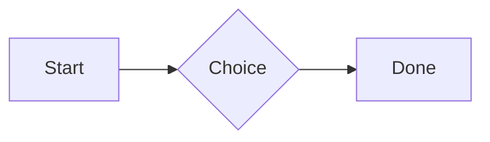

# QA · Right after: Todo list

Todo list followed straight away, with no blank line, by each element. Check: nothing overlaps, nothing is cut off, and the space between is even. Markdown joins some pairs without a blank line (text followed by --- is a heading, and a line of text can carry on into the next), so check that what's drawn matches the Markdown.

#qa/adjacent

#### 1. Todo list, then Paragraph

- [x] Done todo
- [ ] Open todo
  - [ ] Nested open todo
A paragraph with **bold**, *italic*, ~~struck~~, ==highlighted==, `code`, a [link](https://example.com) and a #qa/tag.

#### 2. Todo list, then Long paragraph

- [x] Done todo
- [ ] Open todo
  - [ ] Nested open todo
A long paragraph that wraps onto several lines at the usual width, so the space between its lines, its indent on every line, and where it meets the edges of anything around it can be checked. It goes on a little longer to be sure it wraps on a phone too.

#### 3. Todo list, then Heading 1

- [x] Done todo
- [ ] Open todo
  - [ ] Nested open todo
# Heading one

#### 4. Todo list, then Heading 2

- [x] Done todo
- [ ] Open todo
  - [ ] Nested open todo
## Heading two

#### 5. Todo list, then Heading 3

- [x] Done todo
- [ ] Open todo
  - [ ] Nested open todo
### Heading three

#### 6. Todo list, then Bullet list

- [x] Done todo
- [ ] Open todo
  - [ ] Nested open todo
- First item
- Second item
  - Nested item
    - Third level
- Last item

#### 7. Todo list, then Numbered list

- [x] Done todo
- [ ] Open todo
  - [ ] Nested open todo
1. First
2. Second
   1. Nested
3. Third

#### 8. Todo list, then Todo list

- [x] Done todo
- [ ] Open todo
  - [ ] Nested open todo
- [x] Done todo
- [ ] Open todo
  - [ ] Nested open todo

#### 9. Todo list, then Quote

- [x] Done todo
- [ ] Open todo
  - [ ] Nested open todo
> A quote that runs over
> two lines.

#### 10. Todo list, then Code block

- [x] Done todo
- [ ] Open todo
  - [ ] Nested open todo
```
plain code
  indented line
```

#### 11. Todo list, then Code block (TypeScript)

- [x] Done todo
- [ ] Open todo
  - [ ] Nested open todo
```ts
const greeting: string = "hello";
console.log(greeting);
```

#### 12. Todo list, then JSON block (no language)

- [x] Done todo
- [ ] Open todo
  - [ ] Nested open todo
```
{"name":"lines","tags":["a","b"],"id":12345678901234567890}
```

#### 13. Todo list, then Diagram

- [x] Done todo
- [ ] Open todo
  - [ ] Nested open todo


#### 14. Todo list, then Table

- [x] Done todo
- [ ] Open todo
  - [ ] Nested open todo
| Left | Center | Right |
| :--- | :----: | ----: |
| a | **b** | 1 |
| longer cell text | `code` | 22 |

#### 15. Todo list, then Divider

- [x] Done todo
- [ ] Open todo
  - [ ] Nested open todo
---

#### 16. Todo list, then Key: Value line

- [x] Done todo
- [ ] Open todo
  - [ ] Nested open todo
**Wi-Fi password:** correct-horse-battery

#### 17. Todo list, then Image

- [x] Done todo
- [ ] Open todo
  - [ ] Nested open todo


#### 18. Todo list, then File

- [x] Done todo
- [ ] Open todo
  - [ ] Nested open todo
[Budget.csv](attachment:budget.csv)

#### 19. Todo list, then Missing file

- [x] Done todo
- [ ] Open todo
  - [ ] Nested open todo
[Not here yet.pdf](../attachments/00000000000000000000000000000000.pdf)

#### 20. Todo list, then Card

- [x] Done todo
- [ ] Open todo
  - [ ] Nested open todo
::: card
Text in a card.
:::

#### 21. Todo list, then Callout (info)

- [x] Done todo
- [ ] Open todo
  - [ ] Nested open todo
:::i
Text in an info callout.
:::

#### 22. Todo list, then Callout (warning, chosen icon)

- [x] Done todo
- [ ] Open todo
  - [ ] Nested open todo
:::! icon=flag
Text in a warning callout with the flag icon.
:::

#### 23. Todo list, then Callout (decision, no icon)

- [x] Done todo
- [ ] Open todo
  - [ ] Nested open todo
:::^ icon=none
Text in a decision callout with no icon.
:::
