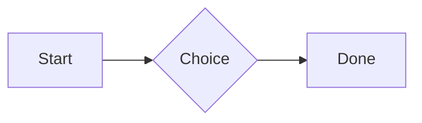
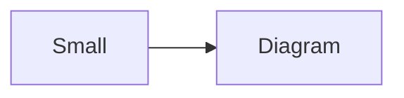

# QA · Right after: Quote

Quote followed straight away, with no blank line, by each element. Check: nothing overlaps, nothing is cut off, and the space between is even. Markdown joins some pairs without a blank line (text followed by --- is a heading, and a line of text can carry on into the next), so check that what's drawn matches the Markdown.

#qa/adjacent

#### 1. Quote, then Paragraph

> A quote that runs over
> two lines.
A paragraph with **bold**, *italic*, <u>underlined</u>, ~~struck~~, ==highlighted==, `code`, a [link](https://example.com) and a #qa/tag.

#### 2. Quote, then Long paragraph

> A quote that runs over
> two lines.
A long paragraph that wraps onto several lines at the usual width, so the space between its lines, its indent on every line, and where it meets the edges of anything around it can be checked. It goes on a little longer to be sure it wraps on a phone too.

#### 3. Quote, then Heading 1

> A quote that runs over
> two lines.
# Heading one

#### 4. Quote, then Heading 2

> A quote that runs over
> two lines.
## Heading two

#### 5. Quote, then Heading 3

> A quote that runs over
> two lines.
### Heading three

#### 6. Quote, then Bullet list

> A quote that runs over
> two lines.
- First item
- Second item
  - Nested item
    - Third level
- Last item

#### 7. Quote, then Numbered list

> A quote that runs over
> two lines.
1. First
2. Second
   1. Nested
3. Third

#### 8. Quote, then Todo list

> A quote that runs over
> two lines.
- [x] Done todo
- [ ] Open todo
  - [ ] Nested open todo

#### 9. Quote, then Quote

> A quote that runs over
> two lines.
> A quote that runs over
> two lines.

#### 10. Quote, then Line marks

> A quote that runs over
> two lines.
Marked as the accent. <!-- mark -->
Two lines marked green, one bar. <!-- mark green: ready -->
The second of them. <!-- mark green: ready -->
Red, with a label to point at. <!-- mark red: to fix -->
- A list item, marked purple. <!-- mark purple -->

#### 11. Quote, then Code block

> A quote that runs over
> two lines.
```
plain code
  indented line
```

#### 12. Quote, then Code block (TypeScript)

> A quote that runs over
> two lines.
```ts
const greeting: string = "hello";
console.log(greeting);
```

#### 13. Quote, then JSON block (no language)

> A quote that runs over
> two lines.
```
{"name":"lines","tags":["a","b"],"id":12345678901234567890}
```

#### 14. Quote, then Diagram

> A quote that runs over
> two lines.


#### 15. Quote, then Diagram (240 px wide)

> A quote that runs over
> two lines.


#### 16. Quote, then 3D model (openscad block), a colored part, an echo

> A quote that runs over
> two lines.
```openscad
difference() {
  cube(20, center = true);
  sphere(r = 13);
}
translate([25, 0, 0]) color("tomato") cylinder(h = 10, r = 5);
echo("made");
```

#### 17. Quote, then Flat model (openscad block)

> A quote that runs over
> two lines.
```openscad
square(20);
translate([30, 10]) circle(8);
```

#### 18. Quote, then Broken model (openscad block)

> A quote that runs over
> two lines.
```openscad
cube(10)
sphere(3;
```

#### 19. Quote, then 3D model (stl block)

> A quote that runs over
> two lines.
```stl
solid pyramid
facet normal 0 0 -1
outer loop
vertex 0 0 0
vertex 10 10 0
vertex 10 0 0
endloop
endfacet
facet normal 0 0 -1
outer loop
vertex 0 0 0
vertex 0 10 0
vertex 10 10 0
endloop
endfacet
facet normal 0 -1 1
outer loop
vertex 0 0 0
vertex 10 0 0
vertex 5 5 8
endloop
endfacet
facet normal 1 0 1
outer loop
vertex 10 0 0
vertex 10 10 0
vertex 5 5 8
endloop
endfacet
facet normal 0 1 1
outer loop
vertex 10 10 0
vertex 0 10 0
vertex 5 5 8
endloop
endfacet
facet normal -1 0 1
outer loop
vertex 0 10 0
vertex 0 0 0
vertex 5 5 8
endloop
endfacet
endsolid pyramid
```

#### 20. Quote, then Timing diagram (wavedrom block)

> A quote that runs over
> two lines.
```wavedrom
{ signal: [
  { name: "clk", wave: "p.....|..." },
  { name: "data", wave: "x.345x|=.x", data: ["head", "body", "tail", "data"] },
  {},
  { name: "ack", wave: "1.....|01.", node: ".a......b" }
], edge: ["a~>b t1"] }
```

#### 21. Quote, then Typing practice (typing block)

> A quote that runs over
> two lines.
```typing
It’s a “fine” day — type it.
function go() {
  return 1;
}
```

#### 22. Quote, then Math block

> A quote that runs over
> two lines.
$$
\int_0^1 x^2\,dx = \frac{1}{3}
$$

#### 23. Quote, then Table

> A quote that runs over
> two lines.
| Left | Center | Right |
| :--- | :----: | ----: |
| a | **b** | 1 |
| longer cell text | `code` | 22 |

#### 24. Quote, then Table with formulas

> A quote that runs over
> two lines.
| Item | Cost |
| --- | ---: |
| Rent | 1200 |
| Food | 450.50 |
| Total | =SUM(B2:B3) |
| Broken | =B2/0 |

#### 25. Quote, then Hurl entries (hurl block): a capture used by the next entry, and asserts

> A quote that runs over
> two lines.
```hurl
# A todo
GET https://jsonplaceholder.typicode.com/todos/1
HTTP 200
[Captures]
owner: jsonpath "$.userId"
[Asserts]
jsonpath "$.id" == 1

# Its owner
GET https://jsonplaceholder.typicode.com/users/{{owner}}
HTTP 200
[Asserts]
jsonpath "$.name" isString
```

#### 26. Quote, then Secret ({{name}}, kept in a locked secrets note)

> A quote that runs over
> two lines.
The token is {{qa-token}}, and {{no-such-secret}} isn't one.

#### 27. Quote, then API requests (http block): a variable, a named request and one using its response

> A quote that runs over
> two lines.
```http
@api = https://jsonplaceholder.typicode.com

### A todo
# @name todo
GET {{api}}/todos/1

### Its owner
GET {{api}}/users/{{todo.response.body.$.userId}}
```

#### 28. Quote, then Spreadsheet (csv block)

> A quote that runs over
> two lines.
```csv
Item, Cost
Rent, 1200
Food, 450.50
Total, =SUM(B2:B3)
```

#### 29. Quote, then Named spreadsheet (csv name=), and a formula in another block using it

> A quote that runs over
> two lines.
```csv name=costs
Item, Cost, Day
Rent, $1200, 2026-01-05
```

```csv
Total, =costs!B2*2
```

#### 30. Quote, then Divider

> A quote that runs over
> two lines.
---

#### 31. Quote, then Page breaks (as lines writes them, and as Obsidian and Typora do; a new page in the PDF at each, a gap between pages over a backdrop)

> A quote that runs over
> two lines.
Before the break.

<!-- pagebreak -->
After it, on a new page.

<div style="page-break-after: always"></div>

And another.

#### 32. Quote, then Key: Value line

> A quote that runs over
> two lines.
**Wi-Fi password:** correct-horse-battery

#### 33. Quote, then Mention

> A quote that runs over
> two lines.
Ask @[QA · Ada] at @[QA · Ada].email.

#### 34. Quote, then Wiki link

> A quote that runs over
> two lines.
Ask [[QA · Ada]], or [[QA · Ada|her]].

#### 35. Quote, then Symbols

> A quote that runs over
> two lines.
Home -> cabin <- back, a <-> b, x => y, p <=> q, 1 <= 2 >= 0 != 3. Stays: --> !== \-> and `a -> b` in code.

#### 36. Quote, then GitHub links

> A quote that runs over
> two lines.
Issue https://github.com/overtio/lines/issues/1 and [a named link](https://github.com/overtio/lines)

#### 37. Quote, then arXiv links

> A quote that runs over
> two lines.
Paper https://arxiv.org/abs/1706.03762 and [a named link](https://arxiv.org/abs/2006.11239)

#### 38. Quote, then Image

> A quote that runs over
> two lines.


#### 39. Quote, then Drawing

> A quote that runs over
> two lines.


#### 40. Quote, then File

> A quote that runs over
> two lines.
[Budget.csv](attachment:budget.csv)

#### 41. Quote, then Attached 3D model (STL)

> A quote that runs over
> two lines.
[Bracket.stl](attachment:bracket.stl)

#### 42. Quote, then Terminal recording (.cast file)

> A quote that runs over
> two lines.
[terminal.cast](attachment:terminal.cast)

#### 43. Quote, then Audio

> A quote that runs over
> two lines.
[Chime.mp3](attachment:chime.mp3)

#### 44. Quote, then Video

> A quote that runs over
> two lines.
[Sky.mp4](attachment:sky.mp4)

#### 45. Quote, then Missing file

> A quote that runs over
> two lines.
[Not here yet.pdf](../attachments/00000000000000000000000000000000.pdf)

#### 46. Quote, then Card

> A quote that runs over
> two lines.
::: card
Text in a card.
:::

#### 47. Quote, then Callout (info)

> A quote that runs over
> two lines.
:::i
Text in an info callout.
:::

#### 48. Quote, then Callout (warning, chosen icon)

> A quote that runs over
> two lines.
:::! icon=flag
Text in a warning callout with the flag icon.
:::

#### 49. Quote, then Callout (decision, no icon)

> A quote that runs over
> two lines.
:::^ icon=none
Text in a decision callout with no icon.
:::
