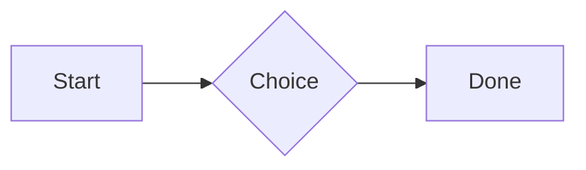
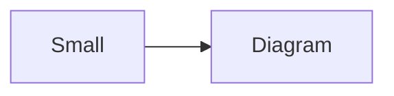

# QA · Right after: Quote

Quote followed straight away, with no blank line, by each element. Check: nothing overlaps, nothing is cut off, and the space between is even. Markdown joins some pairs without a blank line (text followed by --- is a heading, and a line of text can carry on into the next), so check that what's drawn matches the Markdown.

#qa/adjacent

#### 1. Quote, then Paragraph

> A quote that runs over
> two lines.
A paragraph with **bold**, *italic*, <u>underlined</u>, ~~struck~~, ==highlighted==, `code`, a [link](https://example.com) and a #qa/tag.

#### 2. Quote, then Long paragraph

> A quote that runs over
> two lines.
A long paragraph that wraps onto several lines at the usual width, so the space between its lines, its indent on every line, and where it meets the edges of anything around it can be checked. It goes on a little longer to be sure it wraps on a phone too.

#### 3. Quote, then Heading 1

> A quote that runs over
> two lines.
# Heading one

#### 4. Quote, then Heading 2

> A quote that runs over
> two lines.
## Heading two

#### 5. Quote, then Heading 3

> A quote that runs over
> two lines.
### Heading three

#### 6. Quote, then Bullet list

> A quote that runs over
> two lines.
- First item
- Second item
  - Nested item
    - Third level
- Last item

#### 7. Quote, then Numbered list

> A quote that runs over
> two lines.
1. First
2. Second
   1. Nested
3. Third

#### 8. Quote, then Todo list

> A quote that runs over
> two lines.
- [x] Done todo
- [ ] Open todo
  - [ ] Nested open todo

#### 9. Quote, then Quote

> A quote that runs over
> two lines.
> A quote that runs over
> two lines.

#### 10. Quote, then Code block

> A quote that runs over
> two lines.
```
plain code
  indented line
```

#### 11. Quote, then Code block (TypeScript)

> A quote that runs over
> two lines.
```ts
const greeting: string = "hello";
console.log(greeting);
```

#### 12. Quote, then JSON block (no language)

> A quote that runs over
> two lines.
```
{"name":"lines","tags":["a","b"],"id":12345678901234567890}
```

#### 13. Quote, then Diagram

> A quote that runs over
> two lines.


#### 14. Quote, then Diagram (240 px wide)

> A quote that runs over
> two lines.


#### 15. Quote, then Math block

> A quote that runs over
> two lines.
$$
\int_0^1 x^2\,dx = \frac{1}{3}
$$

#### 16. Quote, then Table

> A quote that runs over
> two lines.
| Left | Center | Right |
| :--- | :----: | ----: |
| a | **b** | 1 |
| longer cell text | `code` | 22 |

#### 17. Quote, then Table with formulas

> A quote that runs over
> two lines.
| Item | Cost |
| --- | ---: |
| Rent | 1200 |
| Food | 450.50 |
| Total | =SUM(B2:B3) |
| Broken | =B2/0 |

#### 18. Quote, then Spreadsheet (csv block)

> A quote that runs over
> two lines.
```csv
Item, Cost
Rent, 1200
Food, 450.50
Total, =SUM(B2:B3)
```

#### 19. Quote, then Divider

> A quote that runs over
> two lines.
---

#### 20. Quote, then Key: Value line

> A quote that runs over
> two lines.
**Wi-Fi password:** correct-horse-battery

#### 21. Quote, then Mention

> A quote that runs over
> two lines.
Ask @[QA · Ada] at @[QA · Ada].email.

#### 22. Quote, then Wiki link

> A quote that runs over
> two lines.
Ask [[QA · Ada]], or [[QA · Ada|her]].

#### 23. Quote, then Symbols

> A quote that runs over
> two lines.
Home -> cabin <- back, a <-> b, x => y, p <=> q, 1 <= 2 >= 0 != 3. Stays: --> !== \-> and `a -> b` in code.

#### 24. Quote, then GitHub links

> A quote that runs over
> two lines.
Issue https://github.com/overtio/lines/issues/1 and [a named link](https://github.com/overtio/lines)

#### 25. Quote, then Image

> A quote that runs over
> two lines.


#### 26. Quote, then Drawing

> A quote that runs over
> two lines.


#### 27. Quote, then File

> A quote that runs over
> two lines.
[Budget.csv](attachment:budget.csv)

#### 28. Quote, then Missing file

> A quote that runs over
> two lines.
[Not here yet.pdf](../attachments/00000000000000000000000000000000.pdf)

#### 29. Quote, then Card

> A quote that runs over
> two lines.
::: card
Text in a card.
:::

#### 30. Quote, then Callout (info)

> A quote that runs over
> two lines.
:::i
Text in an info callout.
:::

#### 31. Quote, then Callout (warning, chosen icon)

> A quote that runs over
> two lines.
:::! icon=flag
Text in a warning callout with the flag icon.
:::

#### 32. Quote, then Callout (decision, no icon)

> A quote that runs over
> two lines.
:::^ icon=none
Text in a decision callout with no icon.
:::
