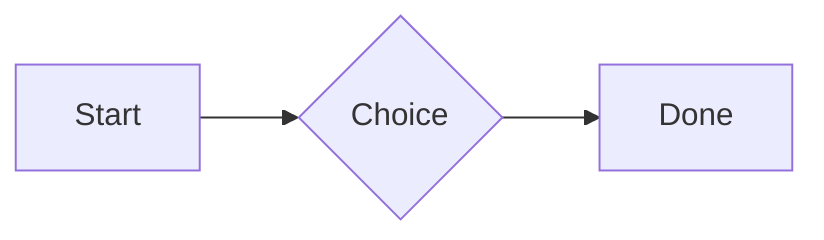
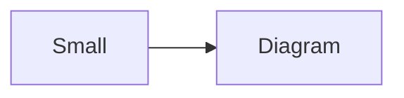

# QA · Right after: Code block

Code block followed straight away, with no blank line, by each element. Check: nothing overlaps, nothing is cut off, and the space between is even. Markdown joins some pairs without a blank line (text followed by --- is a heading, and a line of text can carry on into the next), so check that what's drawn matches the Markdown.

#qa/adjacent

#### 1. Code block, then Paragraph

```
plain code
  indented line
```
A paragraph with **bold**, *italic*, <u>underlined</u>, ~~struck~~, ==highlighted==, `code`, a [link](https://example.com) and a #qa/tag.

#### 2. Code block, then Long paragraph

```
plain code
  indented line
```
A long paragraph that wraps onto several lines at the usual width, so the space between its lines, its indent on every line, and where it meets the edges of anything around it can be checked. It goes on a little longer to be sure it wraps on a phone too.

#### 3. Code block, then Heading 1

```
plain code
  indented line
```
# Heading one

#### 4. Code block, then Heading 2

```
plain code
  indented line
```
## Heading two

#### 5. Code block, then Heading 3

```
plain code
  indented line
```
### Heading three

#### 6. Code block, then Bullet list

```
plain code
  indented line
```
- First item
- Second item
  - Nested item
    - Third level
- Last item

#### 7. Code block, then Numbered list

```
plain code
  indented line
```
1. First
2. Second
   1. Nested
3. Third

#### 8. Code block, then Todo list

```
plain code
  indented line
```
- [x] Done todo
- [ ] Open todo
  - [ ] Nested open todo

#### 9. Code block, then Quote

```
plain code
  indented line
```
> A quote that runs over
> two lines.

#### 10. Code block, then Code block

```
plain code
  indented line
```
```
plain code
  indented line
```

#### 11. Code block, then Code block (TypeScript)

```
plain code
  indented line
```
```ts
const greeting: string = "hello";
console.log(greeting);
```

#### 12. Code block, then JSON block (no language)

```
plain code
  indented line
```
```
{"name":"lines","tags":["a","b"],"id":12345678901234567890}
```

#### 13. Code block, then Diagram

```
plain code
  indented line
```


#### 14. Code block, then Diagram (240 px wide)

```
plain code
  indented line
```


#### 15. Code block, then Math block

```
plain code
  indented line
```
$$
\int_0^1 x^2\,dx = \frac{1}{3}
$$

#### 16. Code block, then Table

```
plain code
  indented line
```
| Left | Center | Right |
| :--- | :----: | ----: |
| a | **b** | 1 |
| longer cell text | `code` | 22 |

#### 17. Code block, then Table with formulas

```
plain code
  indented line
```
| Item | Cost |
| --- | ---: |
| Rent | 1200 |
| Food | 450.50 |
| Total | =SUM(B2:B3) |
| Broken | =B2/0 |

#### 18. Code block, then Spreadsheet (csv block)

```
plain code
  indented line
```
```csv
Item, Cost
Rent, 1200
Food, 450.50
Total, =SUM(B2:B3)
```

#### 19. Code block, then Divider

```
plain code
  indented line
```
---

#### 20. Code block, then Key: Value line

```
plain code
  indented line
```
**Wi-Fi password:** correct-horse-battery

#### 21. Code block, then Mention

```
plain code
  indented line
```
Ask @[QA · Ada] at @[QA · Ada].email.

#### 22. Code block, then Wiki link

```
plain code
  indented line
```
Ask [[QA · Ada]], or [[QA · Ada|her]].

#### 23. Code block, then Symbols

```
plain code
  indented line
```
Home -> cabin <- back, a <-> b, x => y, p <=> q, 1 <= 2 >= 0 != 3. Stays: --> !== \-> and `a -> b` in code.

#### 24. Code block, then GitHub links

```
plain code
  indented line
```
Issue https://github.com/overtio/lines/issues/1 and [a named link](https://github.com/overtio/lines)

#### 25. Code block, then Image

```
plain code
  indented line
```


#### 26. Code block, then Drawing

```
plain code
  indented line
```


#### 27. Code block, then File

```
plain code
  indented line
```
[Budget.csv](attachment:budget.csv)

#### 28. Code block, then Missing file

```
plain code
  indented line
```
[Not here yet.pdf](../attachments/00000000000000000000000000000000.pdf)

#### 29. Code block, then Card

```
plain code
  indented line
```
::: card
Text in a card.
:::

#### 30. Code block, then Callout (info)

```
plain code
  indented line
```
:::i
Text in an info callout.
:::

#### 31. Code block, then Callout (warning, chosen icon)

```
plain code
  indented line
```
:::! icon=flag
Text in a warning callout with the flag icon.
:::

#### 32. Code block, then Callout (decision, no icon)

```
plain code
  indented line
```
:::^ icon=none
Text in a decision callout with no icon.
:::
