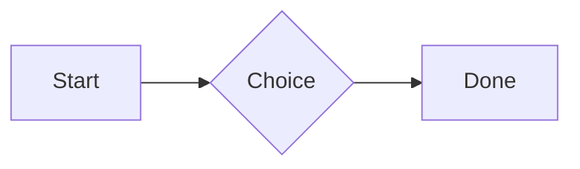
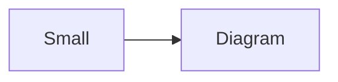

# QA · Right after: Code block (TypeScript)

Code block (TypeScript) followed straight away, with no blank line, by each element. Check: nothing overlaps, nothing is cut off, and the space between is even. Markdown joins some pairs without a blank line (text followed by --- is a heading, and a line of text can carry on into the next), so check that what's drawn matches the Markdown.

#qa/adjacent

#### 1. Code block (TypeScript), then Paragraph

```ts
const greeting: string = "hello";
console.log(greeting);
```
A paragraph with **bold**, *italic*, <u>underlined</u>, ~~struck~~, ==highlighted==, `code`, a [link](https://example.com) and a #qa/tag.

#### 2. Code block (TypeScript), then Long paragraph

```ts
const greeting: string = "hello";
console.log(greeting);
```
A long paragraph that wraps onto several lines at the usual width, so the space between its lines, its indent on every line, and where it meets the edges of anything around it can be checked. It goes on a little longer to be sure it wraps on a phone too.

#### 3. Code block (TypeScript), then Heading 1

```ts
const greeting: string = "hello";
console.log(greeting);
```
# Heading one

#### 4. Code block (TypeScript), then Heading 2

```ts
const greeting: string = "hello";
console.log(greeting);
```
## Heading two

#### 5. Code block (TypeScript), then Heading 3

```ts
const greeting: string = "hello";
console.log(greeting);
```
### Heading three

#### 6. Code block (TypeScript), then Bullet list

```ts
const greeting: string = "hello";
console.log(greeting);
```
- First item
- Second item
  - Nested item
    - Third level
- Last item

#### 7. Code block (TypeScript), then Numbered list

```ts
const greeting: string = "hello";
console.log(greeting);
```
1. First
2. Second
   1. Nested
3. Third

#### 8. Code block (TypeScript), then Todo list

```ts
const greeting: string = "hello";
console.log(greeting);
```
- [x] Done todo
- [ ] Open todo
  - [ ] Nested open todo

#### 9. Code block (TypeScript), then Quote

```ts
const greeting: string = "hello";
console.log(greeting);
```
> A quote that runs over
> two lines.

#### 10. Code block (TypeScript), then Code block

```ts
const greeting: string = "hello";
console.log(greeting);
```
```
plain code
  indented line
```

#### 11. Code block (TypeScript), then Code block (TypeScript)

```ts
const greeting: string = "hello";
console.log(greeting);
```
```ts
const greeting: string = "hello";
console.log(greeting);
```

#### 12. Code block (TypeScript), then JSON block (no language)

```ts
const greeting: string = "hello";
console.log(greeting);
```
```
{"name":"lines","tags":["a","b"],"id":12345678901234567890}
```

#### 13. Code block (TypeScript), then Diagram

```ts
const greeting: string = "hello";
console.log(greeting);
```


#### 14. Code block (TypeScript), then Diagram (240 px wide)

```ts
const greeting: string = "hello";
console.log(greeting);
```


#### 15. Code block (TypeScript), then 3D model (openscad block), a colored part, an echo

```ts
const greeting: string = "hello";
console.log(greeting);
```
```openscad
difference() {
  cube(20, center = true);
  sphere(r = 13);
}
translate([25, 0, 0]) color("tomato") cylinder(h = 10, r = 5);
echo("made");
```

#### 16. Code block (TypeScript), then Flat model (openscad block)

```ts
const greeting: string = "hello";
console.log(greeting);
```
```openscad
square(20);
translate([30, 10]) circle(8);
```

#### 17. Code block (TypeScript), then Broken model (openscad block)

```ts
const greeting: string = "hello";
console.log(greeting);
```
```openscad
cube(10)
sphere(3;
```

#### 18. Code block (TypeScript), then 3D model (stl block)

```ts
const greeting: string = "hello";
console.log(greeting);
```
```stl
solid pyramid
facet normal 0 0 -1
outer loop
vertex 0 0 0
vertex 10 10 0
vertex 10 0 0
endloop
endfacet
facet normal 0 0 -1
outer loop
vertex 0 0 0
vertex 0 10 0
vertex 10 10 0
endloop
endfacet
facet normal 0 -1 1
outer loop
vertex 0 0 0
vertex 10 0 0
vertex 5 5 8
endloop
endfacet
facet normal 1 0 1
outer loop
vertex 10 0 0
vertex 10 10 0
vertex 5 5 8
endloop
endfacet
facet normal 0 1 1
outer loop
vertex 10 10 0
vertex 0 10 0
vertex 5 5 8
endloop
endfacet
facet normal -1 0 1
outer loop
vertex 0 10 0
vertex 0 0 0
vertex 5 5 8
endloop
endfacet
endsolid pyramid
```

#### 19. Code block (TypeScript), then Timing diagram (wavedrom block)

```ts
const greeting: string = "hello";
console.log(greeting);
```
```wavedrom
{ signal: [
  { name: "clk", wave: "p.....|..." },
  { name: "data", wave: "x.345x|=.x", data: ["head", "body", "tail", "data"] },
  {},
  { name: "ack", wave: "1.....|01.", node: ".a......b" }
], edge: ["a~>b t1"] }
```

#### 20. Code block (TypeScript), then Math block

```ts
const greeting: string = "hello";
console.log(greeting);
```
$$
\int_0^1 x^2\,dx = \frac{1}{3}
$$

#### 21. Code block (TypeScript), then Table

```ts
const greeting: string = "hello";
console.log(greeting);
```
| Left | Center | Right |
| :--- | :----: | ----: |
| a | **b** | 1 |
| longer cell text | `code` | 22 |

#### 22. Code block (TypeScript), then Table with formulas

```ts
const greeting: string = "hello";
console.log(greeting);
```
| Item | Cost |
| --- | ---: |
| Rent | 1200 |
| Food | 450.50 |
| Total | =SUM(B2:B3) |
| Broken | =B2/0 |

#### 23. Code block (TypeScript), then Hurl entries (hurl block): a capture used by the next entry, and asserts

```ts
const greeting: string = "hello";
console.log(greeting);
```
```hurl
# A todo
GET https://jsonplaceholder.typicode.com/todos/1
HTTP 200
[Captures]
owner: jsonpath "$.userId"
[Asserts]
jsonpath "$.id" == 1

# Its owner
GET https://jsonplaceholder.typicode.com/users/{{owner}}
HTTP 200
[Asserts]
jsonpath "$.name" isString
```

#### 24. Code block (TypeScript), then Secret ({{name}}, kept in a locked secrets note)

```ts
const greeting: string = "hello";
console.log(greeting);
```
The token is {{qa-token}}, and {{no-such-secret}} isn't one.

#### 25. Code block (TypeScript), then API requests (http block): a variable, a named request and one using its response

```ts
const greeting: string = "hello";
console.log(greeting);
```
```http
@api = https://jsonplaceholder.typicode.com

### A todo
# @name todo
GET {{api}}/todos/1

### Its owner
GET {{api}}/users/{{todo.response.body.$.userId}}
```

#### 26. Code block (TypeScript), then Spreadsheet (csv block)

```ts
const greeting: string = "hello";
console.log(greeting);
```
```csv
Item, Cost
Rent, 1200
Food, 450.50
Total, =SUM(B2:B3)
```

#### 27. Code block (TypeScript), then Named spreadsheet (csv name=), and a formula in another block using it

```ts
const greeting: string = "hello";
console.log(greeting);
```
```csv name=costs
Item, Cost, Day
Rent, $1200, 2026-01-05
```

```csv
Total, =costs!B2*2
```

#### 28. Code block (TypeScript), then Divider

```ts
const greeting: string = "hello";
console.log(greeting);
```
---

#### 29. Code block (TypeScript), then Key: Value line

```ts
const greeting: string = "hello";
console.log(greeting);
```
**Wi-Fi password:** correct-horse-battery

#### 30. Code block (TypeScript), then Mention

```ts
const greeting: string = "hello";
console.log(greeting);
```
Ask @[QA · Ada] at @[QA · Ada].email.

#### 31. Code block (TypeScript), then Wiki link

```ts
const greeting: string = "hello";
console.log(greeting);
```
Ask [[QA · Ada]], or [[QA · Ada|her]].

#### 32. Code block (TypeScript), then Symbols

```ts
const greeting: string = "hello";
console.log(greeting);
```
Home -> cabin <- back, a <-> b, x => y, p <=> q, 1 <= 2 >= 0 != 3. Stays: --> !== \-> and `a -> b` in code.

#### 33. Code block (TypeScript), then GitHub links

```ts
const greeting: string = "hello";
console.log(greeting);
```
Issue https://github.com/overtio/lines/issues/1 and [a named link](https://github.com/overtio/lines)

#### 34. Code block (TypeScript), then arXiv links

```ts
const greeting: string = "hello";
console.log(greeting);
```
Paper https://arxiv.org/abs/1706.03762 and [a named link](https://arxiv.org/abs/2006.11239)

#### 35. Code block (TypeScript), then Image

```ts
const greeting: string = "hello";
console.log(greeting);
```


#### 36. Code block (TypeScript), then Drawing

```ts
const greeting: string = "hello";
console.log(greeting);
```


#### 37. Code block (TypeScript), then File

```ts
const greeting: string = "hello";
console.log(greeting);
```
[Budget.csv](attachment:budget.csv)

#### 38. Code block (TypeScript), then Attached 3D model (STL)

```ts
const greeting: string = "hello";
console.log(greeting);
```
[Bracket.stl](attachment:bracket.stl)

#### 39. Code block (TypeScript), then Terminal recording (.cast file)

```ts
const greeting: string = "hello";
console.log(greeting);
```
[terminal.cast](attachment:terminal.cast)

#### 40. Code block (TypeScript), then Missing file

```ts
const greeting: string = "hello";
console.log(greeting);
```
[Not here yet.pdf](../attachments/00000000000000000000000000000000.pdf)

#### 41. Code block (TypeScript), then Card

```ts
const greeting: string = "hello";
console.log(greeting);
```
::: card
Text in a card.
:::

#### 42. Code block (TypeScript), then Callout (info)

```ts
const greeting: string = "hello";
console.log(greeting);
```
:::i
Text in an info callout.
:::

#### 43. Code block (TypeScript), then Callout (warning, chosen icon)

```ts
const greeting: string = "hello";
console.log(greeting);
```
:::! icon=flag
Text in a warning callout with the flag icon.
:::

#### 44. Code block (TypeScript), then Callout (decision, no icon)

```ts
const greeting: string = "hello";
console.log(greeting);
```
:::^ icon=none
Text in a decision callout with no icon.
:::
