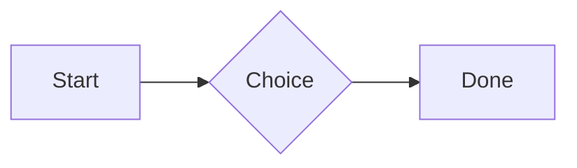

# QA · Right after: JSON block (no language)

JSON block (no language) followed straight away, with no blank line, by each element. Check: nothing overlaps, nothing is cut off, and the space between is even. Markdown joins some pairs without a blank line (text followed by --- is a heading, and a line of text can carry on into the next), so check that what's drawn matches the Markdown.

#qa/adjacent

#### 1. JSON block (no language), then Paragraph

```
{"name":"lines","tags":["a","b"],"id":12345678901234567890}
```
A paragraph with **bold**, *italic*, ~~struck~~, ==highlighted==, `code`, a [link](https://example.com) and a #qa/tag.

#### 2. JSON block (no language), then Long paragraph

```
{"name":"lines","tags":["a","b"],"id":12345678901234567890}
```
A long paragraph that wraps onto several lines at the usual width, so the space between its lines, its indent on every line, and where it meets the edges of anything around it can be checked. It goes on a little longer to be sure it wraps on a phone too.

#### 3. JSON block (no language), then Heading 1

```
{"name":"lines","tags":["a","b"],"id":12345678901234567890}
```
# Heading one

#### 4. JSON block (no language), then Heading 2

```
{"name":"lines","tags":["a","b"],"id":12345678901234567890}
```
## Heading two

#### 5. JSON block (no language), then Heading 3

```
{"name":"lines","tags":["a","b"],"id":12345678901234567890}
```
### Heading three

#### 6. JSON block (no language), then Bullet list

```
{"name":"lines","tags":["a","b"],"id":12345678901234567890}
```
- First item
- Second item
  - Nested item
    - Third level
- Last item

#### 7. JSON block (no language), then Numbered list

```
{"name":"lines","tags":["a","b"],"id":12345678901234567890}
```
1. First
2. Second
   1. Nested
3. Third

#### 8. JSON block (no language), then Todo list

```
{"name":"lines","tags":["a","b"],"id":12345678901234567890}
```
- [x] Done todo
- [ ] Open todo
  - [ ] Nested open todo

#### 9. JSON block (no language), then Quote

```
{"name":"lines","tags":["a","b"],"id":12345678901234567890}
```
> A quote that runs over
> two lines.

#### 10. JSON block (no language), then Code block

```
{"name":"lines","tags":["a","b"],"id":12345678901234567890}
```
```
plain code
  indented line
```

#### 11. JSON block (no language), then Code block (TypeScript)

```
{"name":"lines","tags":["a","b"],"id":12345678901234567890}
```
```ts
const greeting: string = "hello";
console.log(greeting);
```

#### 12. JSON block (no language), then JSON block (no language)

```
{"name":"lines","tags":["a","b"],"id":12345678901234567890}
```
```
{"name":"lines","tags":["a","b"],"id":12345678901234567890}
```

#### 13. JSON block (no language), then Diagram

```
{"name":"lines","tags":["a","b"],"id":12345678901234567890}
```


#### 14. JSON block (no language), then Table

```
{"name":"lines","tags":["a","b"],"id":12345678901234567890}
```
| Left | Center | Right |
| :--- | :----: | ----: |
| a | **b** | 1 |
| longer cell text | `code` | 22 |

#### 15. JSON block (no language), then Divider

```
{"name":"lines","tags":["a","b"],"id":12345678901234567890}
```
---

#### 16. JSON block (no language), then Key: Value line

```
{"name":"lines","tags":["a","b"],"id":12345678901234567890}
```
**Wi-Fi password:** correct-horse-battery

#### 17. JSON block (no language), then Image

```
{"name":"lines","tags":["a","b"],"id":12345678901234567890}
```


#### 18. JSON block (no language), then File

```
{"name":"lines","tags":["a","b"],"id":12345678901234567890}
```
[Budget.csv](attachment:budget.csv)

#### 19. JSON block (no language), then Missing file

```
{"name":"lines","tags":["a","b"],"id":12345678901234567890}
```
[Not here yet.pdf](../attachments/00000000000000000000000000000000.pdf)

#### 20. JSON block (no language), then Card

```
{"name":"lines","tags":["a","b"],"id":12345678901234567890}
```
::: card
Text in a card.
:::

#### 21. JSON block (no language), then Callout (info)

```
{"name":"lines","tags":["a","b"],"id":12345678901234567890}
```
:::i
Text in an info callout.
:::

#### 22. JSON block (no language), then Callout (warning, chosen icon)

```
{"name":"lines","tags":["a","b"],"id":12345678901234567890}
```
:::! icon=flag
Text in a warning callout with the flag icon.
:::

#### 23. JSON block (no language), then Callout (decision, no icon)

```
{"name":"lines","tags":["a","b"],"id":12345678901234567890}
```
:::^ icon=none
Text in a decision callout with no icon.
:::
