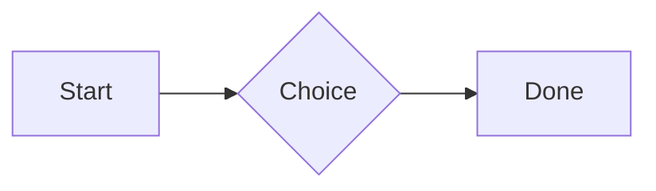
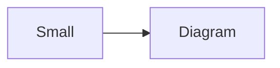

# QA · Right after: Diagram

Diagram followed straight away, with no blank line, by each element. Check: nothing overlaps, nothing is cut off, and the space between is even. Markdown joins some pairs without a blank line (text followed by --- is a heading, and a line of text can carry on into the next), so check that what's drawn matches the Markdown.

#qa/adjacent

#### 1. Diagram, then Paragraph


A paragraph with **bold**, *italic*, <u>underlined</u>, ~~struck~~, ==highlighted==, `code`, a [link](https://example.com) and a #qa/tag.

#### 2. Diagram, then Long paragraph


A long paragraph that wraps onto several lines at the usual width, so the space between its lines, its indent on every line, and where it meets the edges of anything around it can be checked. It goes on a little longer to be sure it wraps on a phone too.

#### 3. Diagram, then Heading 1


# Heading one

#### 4. Diagram, then Heading 2


## Heading two

#### 5. Diagram, then Heading 3


### Heading three

#### 6. Diagram, then Bullet list


- First item
- Second item
  - Nested item
    - Third level
- Last item

#### 7. Diagram, then Numbered list


1. First
2. Second
   1. Nested
3. Third

#### 8. Diagram, then Todo list


- [x] Done todo
- [ ] Open todo
  - [ ] Nested open todo

#### 9. Diagram, then Quote


> A quote that runs over
> two lines.

#### 10. Diagram, then Code block


```
plain code
  indented line
```

#### 11. Diagram, then Code block (TypeScript)


```ts
const greeting: string = "hello";
console.log(greeting);
```

#### 12. Diagram, then JSON block (no language)


```
{"name":"lines","tags":["a","b"],"id":12345678901234567890}
```

#### 13. Diagram, then Diagram


#### 14. Diagram, then Diagram (240 px wide)




#### 15. Diagram, then Math block


$$
\int_0^1 x^2\,dx = \frac{1}{3}
$$

#### 16. Diagram, then Table


| Left | Center | Right |
| :--- | :----: | ----: |
| a | **b** | 1 |
| longer cell text | `code` | 22 |

#### 17. Diagram, then Table with formulas


| Item | Cost |
| --- | ---: |
| Rent | 1200 |
| Food | 450.50 |
| Total | =SUM(B2:B3) |
| Broken | =B2/0 |

#### 18. Diagram, then Spreadsheet (csv block)


```csv
Item, Cost
Rent, 1200
Food, 450.50
Total, =SUM(B2:B3)
```

#### 19. Diagram, then Divider

```mermaid
flowchart LR
  A[Start] --> B{Choice}
  B --> C[Done]
```
---

#### 20. Diagram, then Key: Value line

```mermaid
flowchart LR
  A[Start] --> B{Choice}
  B --> C[Done]
```
**Wi-Fi password:** correct-horse-battery

#### 21. Diagram, then Mention

```mermaid
flowchart LR
  A[Start] --> B{Choice}
  B --> C[Done]
```
Ask @[QA · Ada] at @[QA · Ada].email.

#### 22. Diagram, then Wiki link

```mermaid
flowchart LR
  A[Start] --> B{Choice}
  B --> C[Done]
```
Ask [[QA · Ada]], or [[QA · Ada|her]].

#### 23. Diagram, then Symbols

```mermaid
flowchart LR
  A[Start] --> B{Choice}
  B --> C[Done]
```
Home -> cabin <- back, a <-> b, x => y, p <=> q, 1 <= 2 >= 0 != 3. Stays: --> !== \-> and `a -> b` in code.

#### 24. Diagram, then GitHub links

```mermaid
flowchart LR
  A[Start] --> B{Choice}
  B --> C[Done]
```
Issue https://github.com/overtio/lines/issues/1 and [a named link](https://github.com/overtio/lines)

#### 25. Diagram, then Image

```mermaid
flowchart LR
  A[Start] --> B{Choice}
  B --> C[Done]
```


#### 26. Diagram, then Drawing

```mermaid
flowchart LR
  A[Start] --> B{Choice}
  B --> C[Done]
```


#### 27. Diagram, then File

```mermaid
flowchart LR
  A[Start] --> B{Choice}
  B --> C[Done]
```
[Budget.csv](attachment:budget.csv)

#### 28. Diagram, then Missing file

```mermaid
flowchart LR
  A[Start] --> B{Choice}
  B --> C[Done]
```
[Not here yet.pdf](../attachments/00000000000000000000000000000000.pdf)

#### 29. Diagram, then Card

```mermaid
flowchart LR
  A[Start] --> B{Choice}
  B --> C[Done]
```
::: card
Text in a card.
:::

#### 30. Diagram, then Callout (info)

```mermaid
flowchart LR
  A[Start] --> B{Choice}
  B --> C[Done]
```
:::i
Text in an info callout.
:::

#### 31. Diagram, then Callout (warning, chosen icon)

```mermaid
flowchart LR
  A[Start] --> B{Choice}
  B --> C[Done]
```
:::! icon=flag
Text in a warning callout with the flag icon.
:::

#### 32. Diagram, then Callout (decision, no icon)

```mermaid
flowchart LR
  A[Start] --> B{Choice}
  B --> C[Done]
```
:::^ icon=none
Text in a decision callout with no icon.
:::
