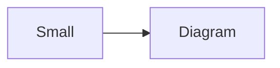
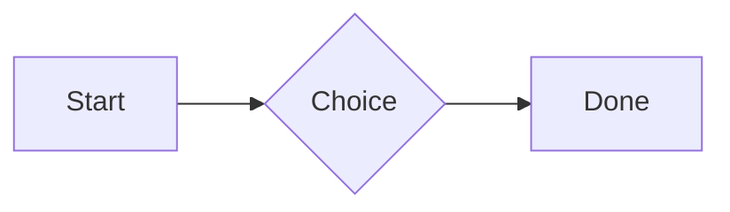

# QA · Right after: Diagram (240 px wide)

Diagram (240 px wide) followed straight away, with no blank line, by each element. Check: nothing overlaps, nothing is cut off, and the space between is even. Markdown joins some pairs without a blank line (text followed by --- is a heading, and a line of text can carry on into the next), so check that what's drawn matches the Markdown.

#qa/adjacent

#### 1. Diagram (240 px wide), then Paragraph


A paragraph with **bold**, *italic*, <u>underlined</u>, ~~struck~~, ==highlighted==, `code`, a [link](https://example.com) and a #qa/tag.

#### 2. Diagram (240 px wide), then Long paragraph


A long paragraph that wraps onto several lines at the usual width, so the space between its lines, its indent on every line, and where it meets the edges of anything around it can be checked. It goes on a little longer to be sure it wraps on a phone too.

#### 3. Diagram (240 px wide), then Heading 1


# Heading one

#### 4. Diagram (240 px wide), then Heading 2


## Heading two

#### 5. Diagram (240 px wide), then Heading 3


### Heading three

#### 6. Diagram (240 px wide), then Bullet list


- First item
- Second item
  - Nested item
    - Third level
- Last item

#### 7. Diagram (240 px wide), then Numbered list


1. First
2. Second
   1. Nested
3. Third

#### 8. Diagram (240 px wide), then Todo list


- [x] Done todo
- [ ] Open todo
  - [ ] Nested open todo

#### 9. Diagram (240 px wide), then Quote


> A quote that runs over
> two lines.

#### 10. Diagram (240 px wide), then Code block


```
plain code
  indented line
```

#### 11. Diagram (240 px wide), then Code block (TypeScript)


```ts
const greeting: string = "hello";
console.log(greeting);
```

#### 12. Diagram (240 px wide), then JSON block (no language)


```
{"name":"lines","tags":["a","b"],"id":12345678901234567890}
```

#### 13. Diagram (240 px wide), then Diagram




#### 14. Diagram (240 px wide), then Diagram (240 px wide)


#### 15. Diagram (240 px wide), then Math block


$$
\int_0^1 x^2\,dx = \frac{1}{3}
$$

#### 16. Diagram (240 px wide), then Table


| Left | Center | Right |
| :--- | :----: | ----: |
| a | **b** | 1 |
| longer cell text | `code` | 22 |

#### 17. Diagram (240 px wide), then Table with formulas


| Item | Cost |
| --- | ---: |
| Rent | 1200 |
| Food | 450.50 |
| Total | =SUM(B2:B3) |
| Broken | =B2/0 |

#### 18. Diagram (240 px wide), then Spreadsheet (csv block)


```csv
Item, Cost
Rent, 1200
Food, 450.50
Total, =SUM(B2:B3)
```

#### 19. Diagram (240 px wide), then Divider

```mermaid |240
flowchart LR
  A[Small] --> B[Diagram]
```
---

#### 20. Diagram (240 px wide), then Key: Value line

```mermaid |240
flowchart LR
  A[Small] --> B[Diagram]
```
**Wi-Fi password:** correct-horse-battery

#### 21. Diagram (240 px wide), then Mention

```mermaid |240
flowchart LR
  A[Small] --> B[Diagram]
```
Ask @[QA · Ada] at @[QA · Ada].email.

#### 22. Diagram (240 px wide), then Wiki link

```mermaid |240
flowchart LR
  A[Small] --> B[Diagram]
```
Ask [[QA · Ada]], or [[QA · Ada|her]].

#### 23. Diagram (240 px wide), then Symbols

```mermaid |240
flowchart LR
  A[Small] --> B[Diagram]
```
Home -> cabin <- back, a <-> b, x => y, p <=> q, 1 <= 2 >= 0 != 3. Stays: --> !== \-> and `a -> b` in code.

#### 24. Diagram (240 px wide), then GitHub links

```mermaid |240
flowchart LR
  A[Small] --> B[Diagram]
```
Issue https://github.com/overtio/lines/issues/1 and [a named link](https://github.com/overtio/lines)

#### 25. Diagram (240 px wide), then Image

```mermaid |240
flowchart LR
  A[Small] --> B[Diagram]
```


#### 26. Diagram (240 px wide), then Drawing

```mermaid |240
flowchart LR
  A[Small] --> B[Diagram]
```


#### 27. Diagram (240 px wide), then File

```mermaid |240
flowchart LR
  A[Small] --> B[Diagram]
```
[Budget.csv](attachment:budget.csv)

#### 28. Diagram (240 px wide), then Missing file

```mermaid |240
flowchart LR
  A[Small] --> B[Diagram]
```
[Not here yet.pdf](../attachments/00000000000000000000000000000000.pdf)

#### 29. Diagram (240 px wide), then Card

```mermaid |240
flowchart LR
  A[Small] --> B[Diagram]
```
::: card
Text in a card.
:::

#### 30. Diagram (240 px wide), then Callout (info)

```mermaid |240
flowchart LR
  A[Small] --> B[Diagram]
```
:::i
Text in an info callout.
:::

#### 31. Diagram (240 px wide), then Callout (warning, chosen icon)

```mermaid |240
flowchart LR
  A[Small] --> B[Diagram]
```
:::! icon=flag
Text in a warning callout with the flag icon.
:::

#### 32. Diagram (240 px wide), then Callout (decision, no icon)

```mermaid |240
flowchart LR
  A[Small] --> B[Diagram]
```
:::^ icon=none
Text in a decision callout with no icon.
:::
