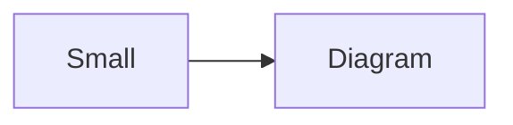
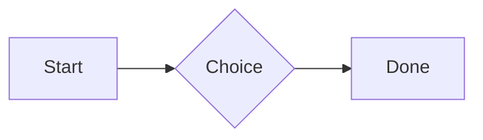

# QA · Right after: Diagram (240 px wide)

Diagram (240 px wide) followed straight away, with no blank line, by each element. Check: nothing overlaps, nothing is cut off, and the space between is even. Markdown joins some pairs without a blank line (text followed by --- is a heading, and a line of text can carry on into the next), so check that what's drawn matches the Markdown.

#qa/adjacent

#### 1. Diagram (240 px wide), then Paragraph


A paragraph with **bold**, *italic*, <u>underlined</u>, ~~struck~~, ==highlighted==, `code`, a [link](https://example.com) and a #qa/tag.

#### 2. Diagram (240 px wide), then Long paragraph


A long paragraph that wraps onto several lines at the usual width, so the space between its lines, its indent on every line, and where it meets the edges of anything around it can be checked. It goes on a little longer to be sure it wraps on a phone too.

#### 3. Diagram (240 px wide), then Heading 1


# Heading one

#### 4. Diagram (240 px wide), then Heading 2


## Heading two

#### 5. Diagram (240 px wide), then Heading 3


### Heading three

#### 6. Diagram (240 px wide), then Bullet list


- First item
- Second item
  - Nested item
    - Third level
- Last item

#### 7. Diagram (240 px wide), then Numbered list


1. First
2. Second
   1. Nested
3. Third

#### 8. Diagram (240 px wide), then Todo list


- [x] Done todo
- [ ] Open todo
  - [ ] Nested open todo

#### 9. Diagram (240 px wide), then Quote


> A quote that runs over
> two lines.

#### 10. Diagram (240 px wide), then Line marks


Marked as the accent. <!-- mark -->
Two lines marked green, one bar. <!-- mark green: ready -->
The second of them. <!-- mark green: ready -->
Red, with a label to point at. <!-- mark red: to fix -->
- A list item, marked purple. <!-- mark purple -->

#### 11. Diagram (240 px wide), then Code block


```
plain code
  indented line
```

#### 12. Diagram (240 px wide), then Code block (TypeScript)


```ts
const greeting: string = "hello";
console.log(greeting);
```

#### 13. Diagram (240 px wide), then JSON block (no language)


```
{"name":"lines","tags":["a","b"],"id":12345678901234567890}
```

#### 14. Diagram (240 px wide), then Diagram




#### 15. Diagram (240 px wide), then Diagram (240 px wide)


#### 16. Diagram (240 px wide), then 3D model (openscad block), a colored part, an echo


```openscad
difference() {
  cube(20, center = true);
  sphere(r = 13);
}
translate([25, 0, 0]) color("tomato") cylinder(h = 10, r = 5);
echo("made");
```

#### 17. Diagram (240 px wide), then Flat model (openscad block)


```openscad
square(20);
translate([30, 10]) circle(8);
```

#### 18. Diagram (240 px wide), then Broken model (openscad block)


```openscad
cube(10)
sphere(3;
```

#### 19. Diagram (240 px wide), then 3D model (stl block)

```mermaid |240
flowchart LR
  A[Small] --> B[Diagram]
```
```stl
solid pyramid
facet normal 0 0 -1
outer loop
vertex 0 0 0
vertex 10 10 0
vertex 10 0 0
endloop
endfacet
facet normal 0 0 -1
outer loop
vertex 0 0 0
vertex 0 10 0
vertex 10 10 0
endloop
endfacet
facet normal 0 -1 1
outer loop
vertex 0 0 0
vertex 10 0 0
vertex 5 5 8
endloop
endfacet
facet normal 1 0 1
outer loop
vertex 10 0 0
vertex 10 10 0
vertex 5 5 8
endloop
endfacet
facet normal 0 1 1
outer loop
vertex 10 10 0
vertex 0 10 0
vertex 5 5 8
endloop
endfacet
facet normal -1 0 1
outer loop
vertex 0 10 0
vertex 0 0 0
vertex 5 5 8
endloop
endfacet
endsolid pyramid
```

#### 20. Diagram (240 px wide), then Timing diagram (wavedrom block)

```mermaid |240
flowchart LR
  A[Small] --> B[Diagram]
```
```wavedrom
{ signal: [
  { name: "clk", wave: "p.....|..." },
  { name: "data", wave: "x.345x|=.x", data: ["head", "body", "tail", "data"] },
  {},
  { name: "ack", wave: "1.....|01.", node: ".a......b" }
], edge: ["a~>b t1"] }
```

#### 21. Diagram (240 px wide), then Typing practice (typing block)

```mermaid |240
flowchart LR
  A[Small] --> B[Diagram]
```
```typing
It’s a “fine” day — type it.
function go() {
  return 1;
}
```

#### 22. Diagram (240 px wide), then Math block

```mermaid |240
flowchart LR
  A[Small] --> B[Diagram]
```
$$
\int_0^1 x^2\,dx = \frac{1}{3}
$$

#### 23. Diagram (240 px wide), then Table

```mermaid |240
flowchart LR
  A[Small] --> B[Diagram]
```
| Left | Center | Right |
| :--- | :----: | ----: |
| a | **b** | 1 |
| longer cell text | `code` | 22 |

#### 24. Diagram (240 px wide), then Table with formulas

```mermaid |240
flowchart LR
  A[Small] --> B[Diagram]
```
| Item | Cost |
| --- | ---: |
| Rent | 1200 |
| Food | 450.50 |
| Total | =SUM(B2:B3) |
| Broken | =B2/0 |

#### 25. Diagram (240 px wide), then Hurl entries (hurl block): a capture used by the next entry, and asserts

```mermaid |240
flowchart LR
  A[Small] --> B[Diagram]
```
```hurl
# A todo
GET https://jsonplaceholder.typicode.com/todos/1
HTTP 200
[Captures]
owner: jsonpath "$.userId"
[Asserts]
jsonpath "$.id" == 1

# Its owner
GET https://jsonplaceholder.typicode.com/users/{{owner}}
HTTP 200
[Asserts]
jsonpath "$.name" isString
```

#### 26. Diagram (240 px wide), then Secret ({{name}}, kept in a locked secrets note)

```mermaid |240
flowchart LR
  A[Small] --> B[Diagram]
```
The token is {{qa-token}}, and {{no-such-secret}} isn't one.

#### 27. Diagram (240 px wide), then API requests (http block): a variable, a named request and one using its response

```mermaid |240
flowchart LR
  A[Small] --> B[Diagram]
```
```http
@api = https://jsonplaceholder.typicode.com

### A todo
# @name todo
GET {{api}}/todos/1

### Its owner
GET {{api}}/users/{{todo.response.body.$.userId}}
```

#### 28. Diagram (240 px wide), then Spreadsheet (csv block)

```mermaid |240
flowchart LR
  A[Small] --> B[Diagram]
```
```csv
Item, Cost
Rent, 1200
Food, 450.50
Total, =SUM(B2:B3)
```

#### 29. Diagram (240 px wide), then Named spreadsheet (csv name=), and a formula in another block using it

```mermaid |240
flowchart LR
  A[Small] --> B[Diagram]
```
```csv name=costs
Item, Cost, Day
Rent, $1200, 2026-01-05
```

```csv
Total, =costs!B2*2
```

#### 30. Diagram (240 px wide), then Divider

```mermaid |240
flowchart LR
  A[Small] --> B[Diagram]
```
---

#### 31. Diagram (240 px wide), then Page breaks (as lines writes them, and as Obsidian and Typora do; a new page in the PDF at each, a gap between pages over a backdrop)

```mermaid |240
flowchart LR
  A[Small] --> B[Diagram]
```
Before the break.

<!-- pagebreak -->
After it, on a new page.

<div style="page-break-after: always"></div>

And another.

#### 32. Diagram (240 px wide), then Key: Value line

```mermaid |240
flowchart LR
  A[Small] --> B[Diagram]
```
**Wi-Fi password:** correct-horse-battery

#### 33. Diagram (240 px wide), then Score (Settings → Little Touches)

```mermaid |240
flowchart LR
  A[Small] --> B[Diagram]
```
Rating: 4/5
Score: 7 / 10
Not a score: 12/20

#### 34. Diagram (240 px wide), then Mention

```mermaid |240
flowchart LR
  A[Small] --> B[Diagram]
```
Ask @[QA · Ada] at @[QA · Ada].email.

#### 35. Diagram (240 px wide), then Wiki link

```mermaid |240
flowchart LR
  A[Small] --> B[Diagram]
```
Ask [[QA · Ada]], or [[QA · Ada|her]].

#### 36. Diagram (240 px wide), then Symbols

```mermaid |240
flowchart LR
  A[Small] --> B[Diagram]
```
Home -> cabin <- back, a <-> b, x => y, p <=> q, 1 <= 2 >= 0 != 3. Stays: --> !== \-> and `a -> b` in code.

#### 37. Diagram (240 px wide), then GitHub links

```mermaid |240
flowchart LR
  A[Small] --> B[Diagram]
```
Issue https://github.com/overtio/lines/issues/1 and [a named link](https://github.com/overtio/lines)

#### 38. Diagram (240 px wide), then arXiv links

```mermaid |240
flowchart LR
  A[Small] --> B[Diagram]
```
Paper https://arxiv.org/abs/1706.03762 and [a named link](https://arxiv.org/abs/2006.11239)

#### 39. Diagram (240 px wide), then Time in an episode

```mermaid |240
flowchart LR
  A[Small] --> B[Diagram]
```
At [12:34](https://traffic.megaphone.fm/FSI3647670844.mp3#t=754) they said it; [3:16] stays text here

#### 40. Diagram (240 px wide), then Image

```mermaid |240
flowchart LR
  A[Small] --> B[Diagram]
```


#### 41. Diagram (240 px wide), then Drawing

```mermaid |240
flowchart LR
  A[Small] --> B[Diagram]
```


#### 42. Diagram (240 px wide), then File

```mermaid |240
flowchart LR
  A[Small] --> B[Diagram]
```
[Budget.csv](attachment:budget.csv)

#### 43. Diagram (240 px wide), then Folder and file links

```mermaid |240
flowchart LR
  A[Small] --> B[Diagram]
```
See [Projects](file:///Users/me/My%20Projects/) and [the plan](file:///Users/me/plan.pdf) on this computer.

#### 44. Diagram (240 px wide), then Attached 3D model (STL)

```mermaid |240
flowchart LR
  A[Small] --> B[Diagram]
```
[Bracket.stl](attachment:bracket.stl)

#### 45. Diagram (240 px wide), then Terminal recording (.cast file)

```mermaid |240
flowchart LR
  A[Small] --> B[Diagram]
```
[terminal.cast](attachment:terminal.cast)

#### 46. Diagram (240 px wide), then Audio

```mermaid |240
flowchart LR
  A[Small] --> B[Diagram]
```
[Chime.mp3](attachment:chime.mp3)

#### 47. Diagram (240 px wide), then Video

```mermaid |240
flowchart LR
  A[Small] --> B[Diagram]
```
[Sky.mp4](attachment:sky.mp4)

#### 48. Diagram (240 px wide), then Missing file

```mermaid |240
flowchart LR
  A[Small] --> B[Diagram]
```
[Not here yet.pdf](../attachments/00000000000000000000000000000000.pdf)

#### 49. Diagram (240 px wide), then Card

```mermaid |240
flowchart LR
  A[Small] --> B[Diagram]
```
::: card
Text in a card.
:::

#### 50. Diagram (240 px wide), then Callout (info)

```mermaid |240
flowchart LR
  A[Small] --> B[Diagram]
```
:::i
Text in an info callout.
:::

#### 51. Diagram (240 px wide), then Callout (warning, chosen icon)

```mermaid |240
flowchart LR
  A[Small] --> B[Diagram]
```
:::! icon=flag
Text in a warning callout with the flag icon.
:::

#### 52. Diagram (240 px wide), then Callout (decision, no icon)

```mermaid |240
flowchart LR
  A[Small] --> B[Diagram]
```
:::^ icon=none
Text in a decision callout with no icon.
:::
