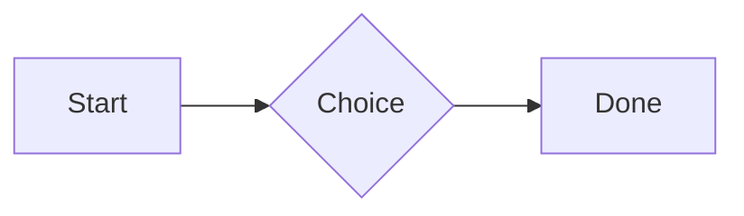

# QA · Right after: Divider

Divider followed straight away, with no blank line, by each element. Check: nothing overlaps, nothing is cut off, and the space between is even. Markdown joins some pairs without a blank line (text followed by --- is a heading, and a line of text can carry on into the next), so check that what's drawn matches the Markdown.

#qa/adjacent

#### 1. Divider, then Paragraph

---
A paragraph with **bold**, *italic*, ~~struck~~, ==highlighted==, `code`, a [link](https://example.com) and a #qa/tag.

#### 2. Divider, then Long paragraph

---
A long paragraph that wraps onto several lines at the usual width, so the space between its lines, its indent on every line, and where it meets the edges of anything around it can be checked. It goes on a little longer to be sure it wraps on a phone too.

#### 3. Divider, then Heading 1

---
# Heading one

#### 4. Divider, then Heading 2

---
## Heading two

#### 5. Divider, then Heading 3

---
### Heading three

#### 6. Divider, then Bullet list

---
- First item
- Second item
  - Nested item
    - Third level
- Last item

#### 7. Divider, then Numbered list

---
1. First
2. Second
   1. Nested
3. Third

#### 8. Divider, then Todo list

---
- [x] Done todo
- [ ] Open todo
  - [ ] Nested open todo

#### 9. Divider, then Quote

---
> A quote that runs over
> two lines.

#### 10. Divider, then Code block

---
```
plain code
  indented line
```

#### 11. Divider, then Code block (TypeScript)

---
```ts
const greeting: string = "hello";
console.log(greeting);
```

#### 12. Divider, then JSON block (no language)

---
```
{"name":"lines","tags":["a","b"],"id":12345678901234567890}
```

#### 13. Divider, then Diagram

---


#### 14. Divider, then Table

---
| Left | Center | Right |
| :--- | :----: | ----: |
| a | **b** | 1 |
| longer cell text | `code` | 22 |

#### 15. Divider, then Divider

---
---

#### 16. Divider, then Key: Value line

---
**Wi-Fi password:** correct-horse-battery

#### 17. Divider, then Image

---


#### 18. Divider, then File

---
[Budget.csv](attachment:budget.csv)

#### 19. Divider, then Missing file

---
[Not here yet.pdf](../attachments/00000000000000000000000000000000.pdf)

#### 20. Divider, then Card

---
::: card
Text in a card.
:::

#### 21. Divider, then Callout (info)

---
:::i
Text in an info callout.
:::

#### 22. Divider, then Callout (warning, chosen icon)

---
:::! icon=flag
Text in a warning callout with the flag icon.
:::

#### 23. Divider, then Callout (decision, no icon)

---
:::^ icon=none
Text in a decision callout with no icon.
:::
