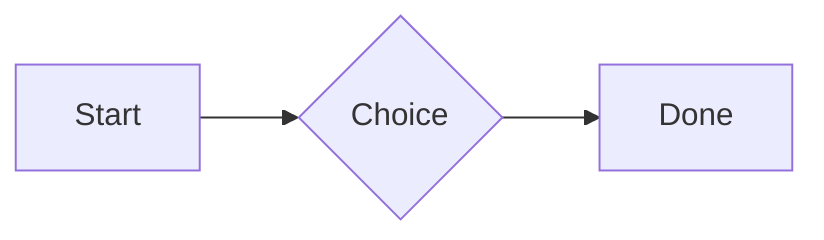
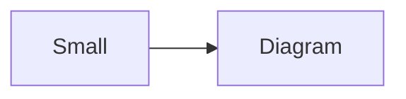

# QA · Right after: Broken model (openscad block)

Broken model (openscad block) followed straight away, with no blank line, by each element. Check: nothing overlaps, nothing is cut off, and the space between is even. Markdown joins some pairs without a blank line (text followed by --- is a heading, and a line of text can carry on into the next), so check that what's drawn matches the Markdown.

#qa/adjacent

#### 1. Broken model (openscad block), then Paragraph

```openscad
cube(10)
sphere(3;
```
A paragraph with **bold**, *italic*, <u>underlined</u>, ~~struck~~, ==highlighted==, `code`, a [link](https://example.com) and a #qa/tag.

#### 2. Broken model (openscad block), then Long paragraph

```openscad
cube(10)
sphere(3;
```
A long paragraph that wraps onto several lines at the usual width, so the space between its lines, its indent on every line, and where it meets the edges of anything around it can be checked. It goes on a little longer to be sure it wraps on a phone too.

#### 3. Broken model (openscad block), then Heading 1

```openscad
cube(10)
sphere(3;
```
# Heading one

#### 4. Broken model (openscad block), then Heading 2

```openscad
cube(10)
sphere(3;
```
## Heading two

#### 5. Broken model (openscad block), then Heading 3

```openscad
cube(10)
sphere(3;
```
### Heading three

#### 6. Broken model (openscad block), then Bullet list

```openscad
cube(10)
sphere(3;
```
- First item
- Second item
  - Nested item
    - Third level
- Last item

#### 7. Broken model (openscad block), then Numbered list

```openscad
cube(10)
sphere(3;
```
1. First
2. Second
   1. Nested
3. Third

#### 8. Broken model (openscad block), then Todo list

```openscad
cube(10)
sphere(3;
```
- [x] Done todo
- [ ] Open todo
  - [ ] Nested open todo

#### 9. Broken model (openscad block), then Quote

```openscad
cube(10)
sphere(3;
```
> A quote that runs over
> two lines.

#### 10. Broken model (openscad block), then Code block

```openscad
cube(10)
sphere(3;
```
```
plain code
  indented line
```

#### 11. Broken model (openscad block), then Code block (TypeScript)

```openscad
cube(10)
sphere(3;
```
```ts
const greeting: string = "hello";
console.log(greeting);
```

#### 12. Broken model (openscad block), then JSON block (no language)

```openscad
cube(10)
sphere(3;
```
```
{"name":"lines","tags":["a","b"],"id":12345678901234567890}
```

#### 13. Broken model (openscad block), then Diagram

```openscad
cube(10)
sphere(3;
```


#### 14. Broken model (openscad block), then Diagram (240 px wide)

```openscad
cube(10)
sphere(3;
```


#### 15. Broken model (openscad block), then 3D model (openscad block), a colored part, an echo

```openscad
cube(10)
sphere(3;
```
```openscad
difference() {
  cube(20, center = true);
  sphere(r = 13);
}
translate([25, 0, 0]) color("tomato") cylinder(h = 10, r = 5);
echo("made");
```

#### 16. Broken model (openscad block), then Flat model (openscad block)

```openscad
cube(10)
sphere(3;
```
```openscad
square(20);
translate([30, 10]) circle(8);
```

#### 17. Broken model (openscad block), then Broken model (openscad block)

```openscad
cube(10)
sphere(3;
```
```openscad
cube(10)
sphere(3;
```

#### 18. Broken model (openscad block), then 3D model (stl block)

```openscad
cube(10)
sphere(3;
```
```stl
solid pyramid
facet normal 0 0 -1
outer loop
vertex 0 0 0
vertex 10 10 0
vertex 10 0 0
endloop
endfacet
facet normal 0 0 -1
outer loop
vertex 0 0 0
vertex 0 10 0
vertex 10 10 0
endloop
endfacet
facet normal 0 -1 1
outer loop
vertex 0 0 0
vertex 10 0 0
vertex 5 5 8
endloop
endfacet
facet normal 1 0 1
outer loop
vertex 10 0 0
vertex 10 10 0
vertex 5 5 8
endloop
endfacet
facet normal 0 1 1
outer loop
vertex 10 10 0
vertex 0 10 0
vertex 5 5 8
endloop
endfacet
facet normal -1 0 1
outer loop
vertex 0 10 0
vertex 0 0 0
vertex 5 5 8
endloop
endfacet
endsolid pyramid
```

#### 19. Broken model (openscad block), then Timing diagram (wavedrom block)

```openscad
cube(10)
sphere(3;
```
```wavedrom
{ signal: [
  { name: "clk", wave: "p.....|..." },
  { name: "data", wave: "x.345x|=.x", data: ["head", "body", "tail", "data"] },
  {},
  { name: "ack", wave: "1.....|01.", node: ".a......b" }
], edge: ["a~>b t1"] }
```

#### 20. Broken model (openscad block), then Math block

```openscad
cube(10)
sphere(3;
```
$$
\int_0^1 x^2\,dx = \frac{1}{3}
$$

#### 21. Broken model (openscad block), then Table

```openscad
cube(10)
sphere(3;
```
| Left | Center | Right |
| :--- | :----: | ----: |
| a | **b** | 1 |
| longer cell text | `code` | 22 |

#### 22. Broken model (openscad block), then Table with formulas

```openscad
cube(10)
sphere(3;
```
| Item | Cost |
| --- | ---: |
| Rent | 1200 |
| Food | 450.50 |
| Total | =SUM(B2:B3) |
| Broken | =B2/0 |

#### 23. Broken model (openscad block), then Hurl entries (hurl block): a capture used by the next entry, and asserts

```openscad
cube(10)
sphere(3;
```
```hurl
# A todo
GET https://jsonplaceholder.typicode.com/todos/1
HTTP 200
[Captures]
owner: jsonpath "$.userId"
[Asserts]
jsonpath "$.id" == 1

# Its owner
GET https://jsonplaceholder.typicode.com/users/{{owner}}
HTTP 200
[Asserts]
jsonpath "$.name" isString
```

#### 24. Broken model (openscad block), then Secret ({{name}}, kept in a locked secrets note)

```openscad
cube(10)
sphere(3;
```
The token is {{qa-token}}, and {{no-such-secret}} isn't one.

#### 25. Broken model (openscad block), then API requests (http block): a variable, a named request and one using its response

```openscad
cube(10)
sphere(3;
```
```http
@api = https://jsonplaceholder.typicode.com

### A todo
# @name todo
GET {{api}}/todos/1

### Its owner
GET {{api}}/users/{{todo.response.body.$.userId}}
```

#### 26. Broken model (openscad block), then Spreadsheet (csv block)

```openscad
cube(10)
sphere(3;
```
```csv
Item, Cost
Rent, 1200
Food, 450.50
Total, =SUM(B2:B3)
```

#### 27. Broken model (openscad block), then Named spreadsheet (csv name=), and a formula in another block using it

```openscad
cube(10)
sphere(3;
```
```csv name=costs
Item, Cost, Day
Rent, $1200, 2026-01-05
```

```csv
Total, =costs!B2*2
```

#### 28. Broken model (openscad block), then Divider

```openscad
cube(10)
sphere(3;
```
---

#### 29. Broken model (openscad block), then Key: Value line

```openscad
cube(10)
sphere(3;
```
**Wi-Fi password:** correct-horse-battery

#### 30. Broken model (openscad block), then Mention

```openscad
cube(10)
sphere(3;
```
Ask @[QA · Ada] at @[QA · Ada].email.

#### 31. Broken model (openscad block), then Wiki link

```openscad
cube(10)
sphere(3;
```
Ask [[QA · Ada]], or [[QA · Ada|her]].

#### 32. Broken model (openscad block), then Symbols

```openscad
cube(10)
sphere(3;
```
Home -> cabin <- back, a <-> b, x => y, p <=> q, 1 <= 2 >= 0 != 3. Stays: --> !== \-> and `a -> b` in code.

#### 33. Broken model (openscad block), then GitHub links

```openscad
cube(10)
sphere(3;
```
Issue https://github.com/overtio/lines/issues/1 and [a named link](https://github.com/overtio/lines)

#### 34. Broken model (openscad block), then arXiv links

```openscad
cube(10)
sphere(3;
```
Paper https://arxiv.org/abs/1706.03762 and [a named link](https://arxiv.org/abs/2006.11239)

#### 35. Broken model (openscad block), then Image

```openscad
cube(10)
sphere(3;
```


#### 36. Broken model (openscad block), then Drawing

```openscad
cube(10)
sphere(3;
```


#### 37. Broken model (openscad block), then File

```openscad
cube(10)
sphere(3;
```
[Budget.csv](attachment:budget.csv)

#### 38. Broken model (openscad block), then Attached 3D model (STL)

```openscad
cube(10)
sphere(3;
```
[Bracket.stl](attachment:bracket.stl)

#### 39. Broken model (openscad block), then Terminal recording (.cast file)

```openscad
cube(10)
sphere(3;
```
[terminal.cast](attachment:terminal.cast)

#### 40. Broken model (openscad block), then Missing file

```openscad
cube(10)
sphere(3;
```
[Not here yet.pdf](../attachments/00000000000000000000000000000000.pdf)

#### 41. Broken model (openscad block), then Card

```openscad
cube(10)
sphere(3;
```
::: card
Text in a card.
:::

#### 42. Broken model (openscad block), then Callout (info)

```openscad
cube(10)
sphere(3;
```
:::i
Text in an info callout.
:::

#### 43. Broken model (openscad block), then Callout (warning, chosen icon)

```openscad
cube(10)
sphere(3;
```
:::! icon=flag
Text in a warning callout with the flag icon.
:::

#### 44. Broken model (openscad block), then Callout (decision, no icon)

```openscad
cube(10)
sphere(3;
```
:::^ icon=none
Text in a decision callout with no icon.
:::
