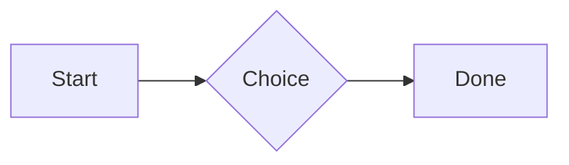
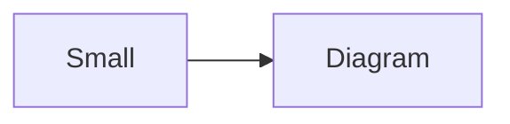

# QA · Right after: Flat model (openscad block)

Flat model (openscad block) followed straight away, with no blank line, by each element. Check: nothing overlaps, nothing is cut off, and the space between is even. Markdown joins some pairs without a blank line (text followed by --- is a heading, and a line of text can carry on into the next), so check that what's drawn matches the Markdown.

#qa/adjacent

#### 1. Flat model (openscad block), then Paragraph

```openscad
square(20);
translate([30, 10]) circle(8);
```
A paragraph with **bold**, *italic*, <u>underlined</u>, ~~struck~~, ==highlighted==, `code`, a [link](https://example.com) and a #qa/tag.

#### 2. Flat model (openscad block), then Long paragraph

```openscad
square(20);
translate([30, 10]) circle(8);
```
A long paragraph that wraps onto several lines at the usual width, so the space between its lines, its indent on every line, and where it meets the edges of anything around it can be checked. It goes on a little longer to be sure it wraps on a phone too.

#### 3. Flat model (openscad block), then Heading 1

```openscad
square(20);
translate([30, 10]) circle(8);
```
# Heading one

#### 4. Flat model (openscad block), then Heading 2

```openscad
square(20);
translate([30, 10]) circle(8);
```
## Heading two

#### 5. Flat model (openscad block), then Heading 3

```openscad
square(20);
translate([30, 10]) circle(8);
```
### Heading three

#### 6. Flat model (openscad block), then Bullet list

```openscad
square(20);
translate([30, 10]) circle(8);
```
- First item
- Second item
  - Nested item
    - Third level
- Last item

#### 7. Flat model (openscad block), then Numbered list

```openscad
square(20);
translate([30, 10]) circle(8);
```
1. First
2. Second
   1. Nested
3. Third

#### 8. Flat model (openscad block), then Todo list

```openscad
square(20);
translate([30, 10]) circle(8);
```
- [x] Done todo
- [ ] Open todo
  - [ ] Nested open todo

#### 9. Flat model (openscad block), then Quote

```openscad
square(20);
translate([30, 10]) circle(8);
```
> A quote that runs over
> two lines.

#### 10. Flat model (openscad block), then Line marks

```openscad
square(20);
translate([30, 10]) circle(8);
```
Marked as the accent. <!-- mark -->
Two lines marked green, one bar. <!-- mark green: ready -->
The second of them. <!-- mark green: ready -->
Red, with a label to point at. <!-- mark red: to fix -->
- A list item, marked purple. <!-- mark purple -->

#### 11. Flat model (openscad block), then Code block

```openscad
square(20);
translate([30, 10]) circle(8);
```
```
plain code
  indented line
```

#### 12. Flat model (openscad block), then Code block (TypeScript)

```openscad
square(20);
translate([30, 10]) circle(8);
```
```ts
const greeting: string = "hello";
console.log(greeting);
```

#### 13. Flat model (openscad block), then JSON block (no language)

```openscad
square(20);
translate([30, 10]) circle(8);
```
```
{"name":"lines","tags":["a","b"],"id":12345678901234567890}
```

#### 14. Flat model (openscad block), then Diagram

```openscad
square(20);
translate([30, 10]) circle(8);
```


#### 15. Flat model (openscad block), then Diagram (240 px wide)

```openscad
square(20);
translate([30, 10]) circle(8);
```


#### 16. Flat model (openscad block), then 3D model (openscad block), a colored part, an echo

```openscad
square(20);
translate([30, 10]) circle(8);
```
```openscad
difference() {
  cube(20, center = true);
  sphere(r = 13);
}
translate([25, 0, 0]) color("tomato") cylinder(h = 10, r = 5);
echo("made");
```

#### 17. Flat model (openscad block), then Flat model (openscad block)

```openscad
square(20);
translate([30, 10]) circle(8);
```
```openscad
square(20);
translate([30, 10]) circle(8);
```

#### 18. Flat model (openscad block), then Broken model (openscad block)

```openscad
square(20);
translate([30, 10]) circle(8);
```
```openscad
cube(10)
sphere(3;
```

#### 19. Flat model (openscad block), then 3D model (stl block)

```openscad
square(20);
translate([30, 10]) circle(8);
```
```stl
solid pyramid
facet normal 0 0 -1
outer loop
vertex 0 0 0
vertex 10 10 0
vertex 10 0 0
endloop
endfacet
facet normal 0 0 -1
outer loop
vertex 0 0 0
vertex 0 10 0
vertex 10 10 0
endloop
endfacet
facet normal 0 -1 1
outer loop
vertex 0 0 0
vertex 10 0 0
vertex 5 5 8
endloop
endfacet
facet normal 1 0 1
outer loop
vertex 10 0 0
vertex 10 10 0
vertex 5 5 8
endloop
endfacet
facet normal 0 1 1
outer loop
vertex 10 10 0
vertex 0 10 0
vertex 5 5 8
endloop
endfacet
facet normal -1 0 1
outer loop
vertex 0 10 0
vertex 0 0 0
vertex 5 5 8
endloop
endfacet
endsolid pyramid
```

#### 20. Flat model (openscad block), then Timing diagram (wavedrom block)

```openscad
square(20);
translate([30, 10]) circle(8);
```
```wavedrom
{ signal: [
  { name: "clk", wave: "p.....|..." },
  { name: "data", wave: "x.345x|=.x", data: ["head", "body", "tail", "data"] },
  {},
  { name: "ack", wave: "1.....|01.", node: ".a......b" }
], edge: ["a~>b t1"] }
```

#### 21. Flat model (openscad block), then Math block

```openscad
square(20);
translate([30, 10]) circle(8);
```
$$
\int_0^1 x^2\,dx = \frac{1}{3}
$$

#### 22. Flat model (openscad block), then Table

```openscad
square(20);
translate([30, 10]) circle(8);
```
| Left | Center | Right |
| :--- | :----: | ----: |
| a | **b** | 1 |
| longer cell text | `code` | 22 |

#### 23. Flat model (openscad block), then Table with formulas

```openscad
square(20);
translate([30, 10]) circle(8);
```
| Item | Cost |
| --- | ---: |
| Rent | 1200 |
| Food | 450.50 |
| Total | =SUM(B2:B3) |
| Broken | =B2/0 |

#### 24. Flat model (openscad block), then Hurl entries (hurl block): a capture used by the next entry, and asserts

```openscad
square(20);
translate([30, 10]) circle(8);
```
```hurl
# A todo
GET https://jsonplaceholder.typicode.com/todos/1
HTTP 200
[Captures]
owner: jsonpath "$.userId"
[Asserts]
jsonpath "$.id" == 1

# Its owner
GET https://jsonplaceholder.typicode.com/users/{{owner}}
HTTP 200
[Asserts]
jsonpath "$.name" isString
```

#### 25. Flat model (openscad block), then Secret ({{name}}, kept in a locked secrets note)

```openscad
square(20);
translate([30, 10]) circle(8);
```
The token is {{qa-token}}, and {{no-such-secret}} isn't one.

#### 26. Flat model (openscad block), then API requests (http block): a variable, a named request and one using its response

```openscad
square(20);
translate([30, 10]) circle(8);
```
```http
@api = https://jsonplaceholder.typicode.com

### A todo
# @name todo
GET {{api}}/todos/1

### Its owner
GET {{api}}/users/{{todo.response.body.$.userId}}
```

#### 27. Flat model (openscad block), then Spreadsheet (csv block)

```openscad
square(20);
translate([30, 10]) circle(8);
```
```csv
Item, Cost
Rent, 1200
Food, 450.50
Total, =SUM(B2:B3)
```

#### 28. Flat model (openscad block), then Named spreadsheet (csv name=), and a formula in another block using it

```openscad
square(20);
translate([30, 10]) circle(8);
```
```csv name=costs
Item, Cost, Day
Rent, $1200, 2026-01-05
```

```csv
Total, =costs!B2*2
```

#### 29. Flat model (openscad block), then Divider

```openscad
square(20);
translate([30, 10]) circle(8);
```
---

#### 30. Flat model (openscad block), then Page breaks (as lines writes them, and as Obsidian and Typora do; a new page in the PDF at each, a gap between pages over a backdrop)

```openscad
square(20);
translate([30, 10]) circle(8);
```
Before the break.

<!-- pagebreak -->
After it, on a new page.

<div style="page-break-after: always"></div>

And another.

#### 31. Flat model (openscad block), then Key: Value line

```openscad
square(20);
translate([30, 10]) circle(8);
```
**Wi-Fi password:** correct-horse-battery

#### 32. Flat model (openscad block), then Mention

```openscad
square(20);
translate([30, 10]) circle(8);
```
Ask @[QA · Ada] at @[QA · Ada].email.

#### 33. Flat model (openscad block), then Wiki link

```openscad
square(20);
translate([30, 10]) circle(8);
```
Ask [[QA · Ada]], or [[QA · Ada|her]].

#### 34. Flat model (openscad block), then Symbols

```openscad
square(20);
translate([30, 10]) circle(8);
```
Home -> cabin <- back, a <-> b, x => y, p <=> q, 1 <= 2 >= 0 != 3. Stays: --> !== \-> and `a -> b` in code.

#### 35. Flat model (openscad block), then GitHub links

```openscad
square(20);
translate([30, 10]) circle(8);
```
Issue https://github.com/overtio/lines/issues/1 and [a named link](https://github.com/overtio/lines)

#### 36. Flat model (openscad block), then arXiv links

```openscad
square(20);
translate([30, 10]) circle(8);
```
Paper https://arxiv.org/abs/1706.03762 and [a named link](https://arxiv.org/abs/2006.11239)

#### 37. Flat model (openscad block), then Image

```openscad
square(20);
translate([30, 10]) circle(8);
```


#### 38. Flat model (openscad block), then Drawing

```openscad
square(20);
translate([30, 10]) circle(8);
```


#### 39. Flat model (openscad block), then File

```openscad
square(20);
translate([30, 10]) circle(8);
```
[Budget.csv](attachment:budget.csv)

#### 40. Flat model (openscad block), then Attached 3D model (STL)

```openscad
square(20);
translate([30, 10]) circle(8);
```
[Bracket.stl](attachment:bracket.stl)

#### 41. Flat model (openscad block), then Terminal recording (.cast file)

```openscad
square(20);
translate([30, 10]) circle(8);
```
[terminal.cast](attachment:terminal.cast)

#### 42. Flat model (openscad block), then Audio

```openscad
square(20);
translate([30, 10]) circle(8);
```
[Chime.mp3](attachment:chime.mp3)

#### 43. Flat model (openscad block), then Video

```openscad
square(20);
translate([30, 10]) circle(8);
```
[Sky.mp4](attachment:sky.mp4)

#### 44. Flat model (openscad block), then Missing file

```openscad
square(20);
translate([30, 10]) circle(8);
```
[Not here yet.pdf](../attachments/00000000000000000000000000000000.pdf)

#### 45. Flat model (openscad block), then Card

```openscad
square(20);
translate([30, 10]) circle(8);
```
::: card
Text in a card.
:::

#### 46. Flat model (openscad block), then Callout (info)

```openscad
square(20);
translate([30, 10]) circle(8);
```
:::i
Text in an info callout.
:::

#### 47. Flat model (openscad block), then Callout (warning, chosen icon)

```openscad
square(20);
translate([30, 10]) circle(8);
```
:::! icon=flag
Text in a warning callout with the flag icon.
:::

#### 48. Flat model (openscad block), then Callout (decision, no icon)

```openscad
square(20);
translate([30, 10]) circle(8);
```
:::^ icon=none
Text in a decision callout with no icon.
:::
