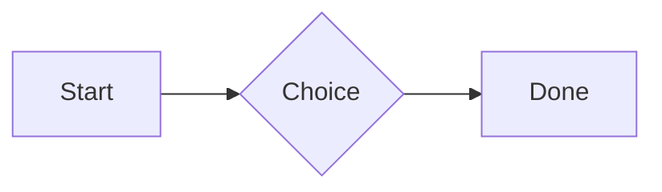
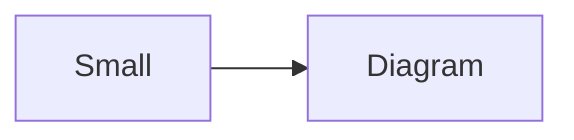

# QA · Right after: API requests (http block): a variable, a named request and one using its response

API requests (http block): a variable, a named request and one using its response followed straight away, with no blank line, by each element. Check: nothing overlaps, nothing is cut off, and the space between is even. Markdown joins some pairs without a blank line (text followed by --- is a heading, and a line of text can carry on into the next), so check that what's drawn matches the Markdown.

#qa/adjacent

#### 1. API requests (http block): a variable, a named request and one using its response, then Paragraph

```http
@api = https://jsonplaceholder.typicode.com

### A todo
# @name todo
GET {{api}}/todos/1

### Its owner
GET {{api}}/users/{{todo.response.body.$.userId}}
```
A paragraph with **bold**, *italic*, <u>underlined</u>, ~~struck~~, ==highlighted==, `code`, a [link](https://example.com) and a #qa/tag.

#### 2. API requests (http block): a variable, a named request and one using its response, then Long paragraph

```http
@api = https://jsonplaceholder.typicode.com

### A todo
# @name todo
GET {{api}}/todos/1

### Its owner
GET {{api}}/users/{{todo.response.body.$.userId}}
```
A long paragraph that wraps onto several lines at the usual width, so the space between its lines, its indent on every line, and where it meets the edges of anything around it can be checked. It goes on a little longer to be sure it wraps on a phone too.

#### 3. API requests (http block): a variable, a named request and one using its response, then Heading 1

```http
@api = https://jsonplaceholder.typicode.com

### A todo
# @name todo
GET {{api}}/todos/1

### Its owner
GET {{api}}/users/{{todo.response.body.$.userId}}
```
# Heading one

#### 4. API requests (http block): a variable, a named request and one using its response, then Heading 2

```http
@api = https://jsonplaceholder.typicode.com

### A todo
# @name todo
GET {{api}}/todos/1

### Its owner
GET {{api}}/users/{{todo.response.body.$.userId}}
```
## Heading two

#### 5. API requests (http block): a variable, a named request and one using its response, then Heading 3

```http
@api = https://jsonplaceholder.typicode.com

### A todo
# @name todo
GET {{api}}/todos/1

### Its owner
GET {{api}}/users/{{todo.response.body.$.userId}}
```
### Heading three

#### 6. API requests (http block): a variable, a named request and one using its response, then Bullet list

```http
@api = https://jsonplaceholder.typicode.com

### A todo
# @name todo
GET {{api}}/todos/1

### Its owner
GET {{api}}/users/{{todo.response.body.$.userId}}
```
- First item
- Second item
  - Nested item
    - Third level
- Last item

#### 7. API requests (http block): a variable, a named request and one using its response, then Numbered list

```http
@api = https://jsonplaceholder.typicode.com

### A todo
# @name todo
GET {{api}}/todos/1

### Its owner
GET {{api}}/users/{{todo.response.body.$.userId}}
```
1. First
2. Second
   1. Nested
3. Third

#### 8. API requests (http block): a variable, a named request and one using its response, then Todo list

```http
@api = https://jsonplaceholder.typicode.com

### A todo
# @name todo
GET {{api}}/todos/1

### Its owner
GET {{api}}/users/{{todo.response.body.$.userId}}
```
- [x] Done todo
- [ ] Open todo
  - [ ] Nested open todo

#### 9. API requests (http block): a variable, a named request and one using its response, then Quote

```http
@api = https://jsonplaceholder.typicode.com

### A todo
# @name todo
GET {{api}}/todos/1

### Its owner
GET {{api}}/users/{{todo.response.body.$.userId}}
```
> A quote that runs over
> two lines.

#### 10. API requests (http block): a variable, a named request and one using its response, then Code block

```http
@api = https://jsonplaceholder.typicode.com

### A todo
# @name todo
GET {{api}}/todos/1

### Its owner
GET {{api}}/users/{{todo.response.body.$.userId}}
```
```
plain code
  indented line
```

#### 11. API requests (http block): a variable, a named request and one using its response, then Code block (TypeScript)

```http
@api = https://jsonplaceholder.typicode.com

### A todo
# @name todo
GET {{api}}/todos/1

### Its owner
GET {{api}}/users/{{todo.response.body.$.userId}}
```
```ts
const greeting: string = "hello";
console.log(greeting);
```

#### 12. API requests (http block): a variable, a named request and one using its response, then JSON block (no language)

```http
@api = https://jsonplaceholder.typicode.com

### A todo
# @name todo
GET {{api}}/todos/1

### Its owner
GET {{api}}/users/{{todo.response.body.$.userId}}
```
```
{"name":"lines","tags":["a","b"],"id":12345678901234567890}
```

#### 13. API requests (http block): a variable, a named request and one using its response, then Diagram

```http
@api = https://jsonplaceholder.typicode.com

### A todo
# @name todo
GET {{api}}/todos/1

### Its owner
GET {{api}}/users/{{todo.response.body.$.userId}}
```


#### 14. API requests (http block): a variable, a named request and one using its response, then Diagram (240 px wide)

```http
@api = https://jsonplaceholder.typicode.com

### A todo
# @name todo
GET {{api}}/todos/1

### Its owner
GET {{api}}/users/{{todo.response.body.$.userId}}
```


#### 15. API requests (http block): a variable, a named request and one using its response, then Math block

```http
@api = https://jsonplaceholder.typicode.com

### A todo
# @name todo
GET {{api}}/todos/1

### Its owner
GET {{api}}/users/{{todo.response.body.$.userId}}
```
$$
\int_0^1 x^2\,dx = \frac{1}{3}
$$

#### 16. API requests (http block): a variable, a named request and one using its response, then Table

```http
@api = https://jsonplaceholder.typicode.com

### A todo
# @name todo
GET {{api}}/todos/1

### Its owner
GET {{api}}/users/{{todo.response.body.$.userId}}
```
| Left | Center | Right |
| :--- | :----: | ----: |
| a | **b** | 1 |
| longer cell text | `code` | 22 |

#### 17. API requests (http block): a variable, a named request and one using its response, then Table with formulas

```http
@api = https://jsonplaceholder.typicode.com

### A todo
# @name todo
GET {{api}}/todos/1

### Its owner
GET {{api}}/users/{{todo.response.body.$.userId}}
```
| Item | Cost |
| --- | ---: |
| Rent | 1200 |
| Food | 450.50 |
| Total | =SUM(B2:B3) |
| Broken | =B2/0 |

#### 18. API requests (http block): a variable, a named request and one using its response, then API requests (http block): a variable, a named request and one using its response

```http
@api = https://jsonplaceholder.typicode.com

### A todo
# @name todo
GET {{api}}/todos/1

### Its owner
GET {{api}}/users/{{todo.response.body.$.userId}}
```
```http
@api = https://jsonplaceholder.typicode.com

### A todo
# @name todo
GET {{api}}/todos/1

### Its owner
GET {{api}}/users/{{todo.response.body.$.userId}}
```

#### 19. API requests (http block): a variable, a named request and one using its response, then Spreadsheet (csv block)

```http
@api = https://jsonplaceholder.typicode.com

### A todo
# @name todo
GET {{api}}/todos/1

### Its owner
GET {{api}}/users/{{todo.response.body.$.userId}}
```
```csv
Item, Cost
Rent, 1200
Food, 450.50
Total, =SUM(B2:B3)
```

#### 20. API requests (http block): a variable, a named request and one using its response, then Named spreadsheet (csv name=), and a formula in another block using it

```http
@api = https://jsonplaceholder.typicode.com

### A todo
# @name todo
GET {{api}}/todos/1

### Its owner
GET {{api}}/users/{{todo.response.body.$.userId}}
```
```csv name=costs
Item, Cost, Day
Rent, $1200, 2026-01-05
```

```csv
Total, =costs!B2*2
```

#### 21. API requests (http block): a variable, a named request and one using its response, then Divider

```http
@api = https://jsonplaceholder.typicode.com

### A todo
# @name todo
GET {{api}}/todos/1

### Its owner
GET {{api}}/users/{{todo.response.body.$.userId}}
```
---

#### 22. API requests (http block): a variable, a named request and one using its response, then Key: Value line

```http
@api = https://jsonplaceholder.typicode.com

### A todo
# @name todo
GET {{api}}/todos/1

### Its owner
GET {{api}}/users/{{todo.response.body.$.userId}}
```
**Wi-Fi password:** correct-horse-battery

#### 23. API requests (http block): a variable, a named request and one using its response, then Mention

```http
@api = https://jsonplaceholder.typicode.com

### A todo
# @name todo
GET {{api}}/todos/1

### Its owner
GET {{api}}/users/{{todo.response.body.$.userId}}
```
Ask @[QA · Ada] at @[QA · Ada].email.

#### 24. API requests (http block): a variable, a named request and one using its response, then Wiki link

```http
@api = https://jsonplaceholder.typicode.com

### A todo
# @name todo
GET {{api}}/todos/1

### Its owner
GET {{api}}/users/{{todo.response.body.$.userId}}
```
Ask [[QA · Ada]], or [[QA · Ada|her]].

#### 25. API requests (http block): a variable, a named request and one using its response, then Symbols

```http
@api = https://jsonplaceholder.typicode.com

### A todo
# @name todo
GET {{api}}/todos/1

### Its owner
GET {{api}}/users/{{todo.response.body.$.userId}}
```
Home -> cabin <- back, a <-> b, x => y, p <=> q, 1 <= 2 >= 0 != 3. Stays: --> !== \-> and `a -> b` in code.

#### 26. API requests (http block): a variable, a named request and one using its response, then GitHub links

```http
@api = https://jsonplaceholder.typicode.com

### A todo
# @name todo
GET {{api}}/todos/1

### Its owner
GET {{api}}/users/{{todo.response.body.$.userId}}
```
Issue https://github.com/overtio/lines/issues/1 and [a named link](https://github.com/overtio/lines)

#### 27. API requests (http block): a variable, a named request and one using its response, then Image

```http
@api = https://jsonplaceholder.typicode.com

### A todo
# @name todo
GET {{api}}/todos/1

### Its owner
GET {{api}}/users/{{todo.response.body.$.userId}}
```


#### 28. API requests (http block): a variable, a named request and one using its response, then Drawing

```http
@api = https://jsonplaceholder.typicode.com

### A todo
# @name todo
GET {{api}}/todos/1

### Its owner
GET {{api}}/users/{{todo.response.body.$.userId}}
```


#### 29. API requests (http block): a variable, a named request and one using its response, then File

```http
@api = https://jsonplaceholder.typicode.com

### A todo
# @name todo
GET {{api}}/todos/1

### Its owner
GET {{api}}/users/{{todo.response.body.$.userId}}
```
[Budget.csv](attachment:budget.csv)

#### 30. API requests (http block): a variable, a named request and one using its response, then Missing file

```http
@api = https://jsonplaceholder.typicode.com

### A todo
# @name todo
GET {{api}}/todos/1

### Its owner
GET {{api}}/users/{{todo.response.body.$.userId}}
```
[Not here yet.pdf](../attachments/00000000000000000000000000000000.pdf)

#### 31. API requests (http block): a variable, a named request and one using its response, then Card

```http
@api = https://jsonplaceholder.typicode.com

### A todo
# @name todo
GET {{api}}/todos/1

### Its owner
GET {{api}}/users/{{todo.response.body.$.userId}}
```
::: card
Text in a card.
:::

#### 32. API requests (http block): a variable, a named request and one using its response, then Callout (info)

```http
@api = https://jsonplaceholder.typicode.com

### A todo
# @name todo
GET {{api}}/todos/1

### Its owner
GET {{api}}/users/{{todo.response.body.$.userId}}
```
:::i
Text in an info callout.
:::

#### 33. API requests (http block): a variable, a named request and one using its response, then Callout (warning, chosen icon)

```http
@api = https://jsonplaceholder.typicode.com

### A todo
# @name todo
GET {{api}}/todos/1

### Its owner
GET {{api}}/users/{{todo.response.body.$.userId}}
```
:::! icon=flag
Text in a warning callout with the flag icon.
:::

#### 34. API requests (http block): a variable, a named request and one using its response, then Callout (decision, no icon)

```http
@api = https://jsonplaceholder.typicode.com

### A todo
# @name todo
GET {{api}}/todos/1

### Its owner
GET {{api}}/users/{{todo.response.body.$.userId}}
```
:::^ icon=none
Text in a decision callout with no icon.
:::
