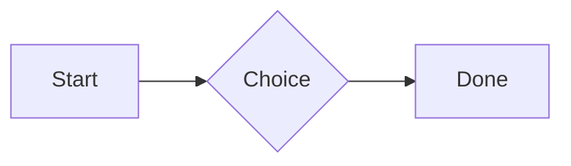

# QA · Right after: Math block

Math block followed straight away, with no blank line, by each element. Check: nothing overlaps, nothing is cut off, and the space between is even. Markdown joins some pairs without a blank line (text followed by --- is a heading, and a line of text can carry on into the next), so check that what's drawn matches the Markdown.

#qa/adjacent

#### 1. Math block, then Paragraph

$$
\int_0^1 x^2\,dx = \frac{1}{3}
$$
A paragraph with **bold**, *italic*, <u>underlined</u>, ~~struck~~, ==highlighted==, `code`, a [link](https://example.com) and a #qa/tag.

#### 2. Math block, then Long paragraph

$$
\int_0^1 x^2\,dx = \frac{1}{3}
$$
A long paragraph that wraps onto several lines at the usual width, so the space between its lines, its indent on every line, and where it meets the edges of anything around it can be checked. It goes on a little longer to be sure it wraps on a phone too.

#### 3. Math block, then Heading 1

$$
\int_0^1 x^2\,dx = \frac{1}{3}
$$
# Heading one

#### 4. Math block, then Heading 2

$$
\int_0^1 x^2\,dx = \frac{1}{3}
$$
## Heading two

#### 5. Math block, then Heading 3

$$
\int_0^1 x^2\,dx = \frac{1}{3}
$$
### Heading three

#### 6. Math block, then Bullet list

$$
\int_0^1 x^2\,dx = \frac{1}{3}
$$
- First item
- Second item
  - Nested item
    - Third level
- Last item

#### 7. Math block, then Numbered list

$$
\int_0^1 x^2\,dx = \frac{1}{3}
$$
1. First
2. Second
   1. Nested
3. Third

#### 8. Math block, then Todo list

$$
\int_0^1 x^2\,dx = \frac{1}{3}
$$
- [x] Done todo
- [ ] Open todo
  - [ ] Nested open todo

#### 9. Math block, then Quote

$$
\int_0^1 x^2\,dx = \frac{1}{3}
$$
> A quote that runs over
> two lines.

#### 10. Math block, then Code block

$$
\int_0^1 x^2\,dx = \frac{1}{3}
$$
```
plain code
  indented line
```

#### 11. Math block, then Code block (TypeScript)

$$
\int_0^1 x^2\,dx = \frac{1}{3}
$$
```ts
const greeting: string = "hello";
console.log(greeting);
```

#### 12. Math block, then JSON block (no language)

$$
\int_0^1 x^2\,dx = \frac{1}{3}
$$
```
{"name":"lines","tags":["a","b"],"id":12345678901234567890}
```

#### 13. Math block, then Diagram

$$
\int_0^1 x^2\,dx = \frac{1}{3}
$$


#### 14. Math block, then Diagram (240 px wide)

$$
\int_0^1 x^2\,dx = \frac{1}{3}
$$


#### 15. Math block, then 3D model (openscad block), a colored part, an echo

$$
\int_0^1 x^2\,dx = \frac{1}{3}
$$
```openscad
difference() {
  cube(20, center = true);
  sphere(r = 13);
}
translate([25, 0, 0]) color("tomato") cylinder(h = 10, r = 5);
echo("made");
```

#### 16. Math block, then Flat model (openscad block)

$$
\int_0^1 x^2\,dx = \frac{1}{3}
$$
```openscad
square(20);
translate([30, 10]) circle(8);
```

#### 17. Math block, then Broken model (openscad block)

$$
\int_0^1 x^2\,dx = \frac{1}{3}
$$
```openscad
cube(10)
sphere(3;
```

#### 18. Math block, then 3D model (stl block)

$$
\int_0^1 x^2\,dx = \frac{1}{3}
$$
```stl
solid pyramid
facet normal 0 0 -1
outer loop
vertex 0 0 0
vertex 10 10 0
vertex 10 0 0
endloop
endfacet
facet normal 0 0 -1
outer loop
vertex 0 0 0
vertex 0 10 0
vertex 10 10 0
endloop
endfacet
facet normal 0 -1 1
outer loop
vertex 0 0 0
vertex 10 0 0
vertex 5 5 8
endloop
endfacet
facet normal 1 0 1
outer loop
vertex 10 0 0
vertex 10 10 0
vertex 5 5 8
endloop
endfacet
facet normal 0 1 1
outer loop
vertex 10 10 0
vertex 0 10 0
vertex 5 5 8
endloop
endfacet
facet normal -1 0 1
outer loop
vertex 0 10 0
vertex 0 0 0
vertex 5 5 8
endloop
endfacet
endsolid pyramid
```

#### 19. Math block, then Math block

$$
\int_0^1 x^2\,dx = \frac{1}{3}
$$
$$
\int_0^1 x^2\,dx = \frac{1}{3}
$$

#### 20. Math block, then Table

$$
\int_0^1 x^2\,dx = \frac{1}{3}
$$
| Left | Center | Right |
| :--- | :----: | ----: |
| a | **b** | 1 |
| longer cell text | `code` | 22 |

#### 21. Math block, then Table with formulas

$$
\int_0^1 x^2\,dx = \frac{1}{3}
$$
| Item | Cost |
| --- | ---: |
| Rent | 1200 |
| Food | 450.50 |
| Total | =SUM(B2:B3) |
| Broken | =B2/0 |

#### 22. Math block, then Hurl entries (hurl block): a capture used by the next entry, and asserts

$$
\int_0^1 x^2\,dx = \frac{1}{3}
$$
```hurl
# A todo
GET https://jsonplaceholder.typicode.com/todos/1
HTTP 200
[Captures]
owner: jsonpath "$.userId"
[Asserts]
jsonpath "$.id" == 1

# Its owner
GET https://jsonplaceholder.typicode.com/users/{{owner}}
HTTP 200
[Asserts]
jsonpath "$.name" isString
```

#### 23. Math block, then Secret ({{name}}, kept in a locked secrets note)

$$
\int_0^1 x^2\,dx = \frac{1}{3}
$$
The token is {{qa-token}}, and {{no-such-secret}} isn't one.

#### 24. Math block, then API requests (http block): a variable, a named request and one using its response

$$
\int_0^1 x^2\,dx = \frac{1}{3}
$$
```http
@api = https://jsonplaceholder.typicode.com

### A todo
# @name todo
GET {{api}}/todos/1

### Its owner
GET {{api}}/users/{{todo.response.body.$.userId}}
```

#### 25. Math block, then Spreadsheet (csv block)

$$
\int_0^1 x^2\,dx = \frac{1}{3}
$$
```csv
Item, Cost
Rent, 1200
Food, 450.50
Total, =SUM(B2:B3)
```

#### 26. Math block, then Named spreadsheet (csv name=), and a formula in another block using it

$$
\int_0^1 x^2\,dx = \frac{1}{3}
$$
```csv name=costs
Item, Cost, Day
Rent, $1200, 2026-01-05
```

```csv
Total, =costs!B2*2
```

#### 27. Math block, then Divider

$$
\int_0^1 x^2\,dx = \frac{1}{3}
$$
---

#### 28. Math block, then Key: Value line

$$
\int_0^1 x^2\,dx = \frac{1}{3}
$$
**Wi-Fi password:** correct-horse-battery

#### 29. Math block, then Mention

$$
\int_0^1 x^2\,dx = \frac{1}{3}
$$
Ask @[QA · Ada] at @[QA · Ada].email.

#### 30. Math block, then Wiki link

$$
\int_0^1 x^2\,dx = \frac{1}{3}
$$
Ask [[QA · Ada]], or [[QA · Ada|her]].

#### 31. Math block, then Symbols

$$
\int_0^1 x^2\,dx = \frac{1}{3}
$$
Home -> cabin <- back, a <-> b, x => y, p <=> q, 1 <= 2 >= 0 != 3. Stays: --> !== \-> and `a -> b` in code.

#### 32. Math block, then GitHub links

$$
\int_0^1 x^2\,dx = \frac{1}{3}
$$
Issue https://github.com/overtio/lines/issues/1 and [a named link](https://github.com/overtio/lines)

#### 33. Math block, then arXiv links

$$
\int_0^1 x^2\,dx = \frac{1}{3}
$$
Paper https://arxiv.org/abs/1706.03762 and [a named link](https://arxiv.org/abs/2006.11239)

#### 34. Math block, then Image

$$
\int_0^1 x^2\,dx = \frac{1}{3}
$$


#### 35. Math block, then Drawing

$$
\int_0^1 x^2\,dx = \frac{1}{3}
$$


#### 36. Math block, then File

$$
\int_0^1 x^2\,dx = \frac{1}{3}
$$
[Budget.csv](attachment:budget.csv)

#### 37. Math block, then Attached 3D model (STL)

$$
\int_0^1 x^2\,dx = \frac{1}{3}
$$
[Bracket.stl](attachment:bracket.stl)

#### 38. Math block, then Terminal recording (.cast file)

$$
\int_0^1 x^2\,dx = \frac{1}{3}
$$
[terminal.cast](attachment:terminal.cast)

#### 39. Math block, then Missing file

$$
\int_0^1 x^2\,dx = \frac{1}{3}
$$
[Not here yet.pdf](../attachments/00000000000000000000000000000000.pdf)

#### 40. Math block, then Card

$$
\int_0^1 x^2\,dx = \frac{1}{3}
$$
::: card
Text in a card.
:::

#### 41. Math block, then Callout (info)

$$
\int_0^1 x^2\,dx = \frac{1}{3}
$$
:::i
Text in an info callout.
:::

#### 42. Math block, then Callout (warning, chosen icon)

$$
\int_0^1 x^2\,dx = \frac{1}{3}
$$
:::! icon=flag
Text in a warning callout with the flag icon.
:::

#### 43. Math block, then Callout (decision, no icon)

$$
\int_0^1 x^2\,dx = \frac{1}{3}
$$
:::^ icon=none
Text in a decision callout with no icon.
:::
