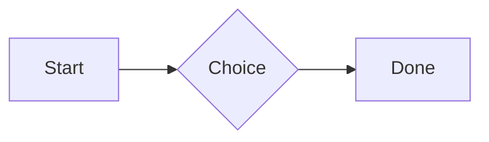

# QA · Right after: Callout (info)

Callout (info) followed straight away, with no blank line, by each element. Check: nothing overlaps, nothing is cut off, and the space between is even. Markdown joins some pairs without a blank line (text followed by --- is a heading, and a line of text can carry on into the next), so check that what's drawn matches the Markdown.

#qa/adjacent

#### 1. Callout (info), then Paragraph

:::i
Text in an info callout.
:::
A paragraph with **bold**, *italic*, ~~struck~~, ==highlighted==, `code`, a [link](https://example.com) and a #qa/tag.

#### 2. Callout (info), then Long paragraph

:::i
Text in an info callout.
:::
A long paragraph that wraps onto several lines at the usual width, so the space between its lines, its indent on every line, and where it meets the edges of anything around it can be checked. It goes on a little longer to be sure it wraps on a phone too.

#### 3. Callout (info), then Heading 1

:::i
Text in an info callout.
:::
# Heading one

#### 4. Callout (info), then Heading 2

:::i
Text in an info callout.
:::
## Heading two

#### 5. Callout (info), then Heading 3

:::i
Text in an info callout.
:::
### Heading three

#### 6. Callout (info), then Bullet list

:::i
Text in an info callout.
:::
- First item
- Second item
  - Nested item
    - Third level
- Last item

#### 7. Callout (info), then Numbered list

:::i
Text in an info callout.
:::
1. First
2. Second
   1. Nested
3. Third

#### 8. Callout (info), then Todo list

:::i
Text in an info callout.
:::
- [x] Done todo
- [ ] Open todo
  - [ ] Nested open todo

#### 9. Callout (info), then Quote

:::i
Text in an info callout.
:::
> A quote that runs over
> two lines.

#### 10. Callout (info), then Code block

:::i
Text in an info callout.
:::
```
plain code
  indented line
```

#### 11. Callout (info), then Code block (TypeScript)

:::i
Text in an info callout.
:::
```ts
const greeting: string = "hello";
console.log(greeting);
```

#### 12. Callout (info), then JSON block (no language)

:::i
Text in an info callout.
:::
```
{"name":"lines","tags":["a","b"],"id":12345678901234567890}
```

#### 13. Callout (info), then Diagram

:::i
Text in an info callout.
:::


#### 14. Callout (info), then Table

:::i
Text in an info callout.
:::
| Left | Center | Right |
| :--- | :----: | ----: |
| a | **b** | 1 |
| longer cell text | `code` | 22 |

#### 15. Callout (info), then Divider

:::i
Text in an info callout.
:::
---

#### 16. Callout (info), then Key: Value line

:::i
Text in an info callout.
:::
**Wi-Fi password:** correct-horse-battery

#### 17. Callout (info), then Image

:::i
Text in an info callout.
:::


#### 18. Callout (info), then File

:::i
Text in an info callout.
:::
[Budget.csv](attachment:budget.csv)

#### 19. Callout (info), then Missing file

:::i
Text in an info callout.
:::
[Not here yet.pdf](../attachments/00000000000000000000000000000000.pdf)

#### 20. Callout (info), then Card

:::i
Text in an info callout.
:::
::: card
Text in a card.
:::

#### 21. Callout (info), then Callout (info)

:::i
Text in an info callout.
:::
:::i
Text in an info callout.
:::

#### 22. Callout (info), then Callout (warning, chosen icon)

:::i
Text in an info callout.
:::
:::! icon=flag
Text in a warning callout with the flag icon.
:::

#### 23. Callout (info), then Callout (decision, no icon)

:::i
Text in an info callout.
:::
:::^ icon=none
Text in a decision callout with no icon.
:::
