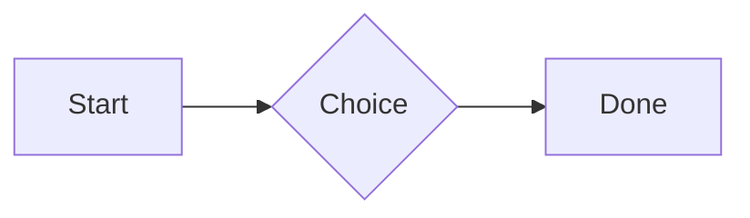
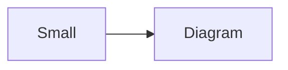

# QA · Right after: Spreadsheet (csv block)

Spreadsheet (csv block) followed straight away, with no blank line, by each element. Check: nothing overlaps, nothing is cut off, and the space between is even. Markdown joins some pairs without a blank line (text followed by --- is a heading, and a line of text can carry on into the next), so check that what's drawn matches the Markdown.

#qa/adjacent

#### 1. Spreadsheet (csv block), then Paragraph

```csv
Item, Cost
Rent, 1200
Food, 450.50
Total, =SUM(B2:B3)
```
A paragraph with **bold**, *italic*, <u>underlined</u>, ~~struck~~, ==highlighted==, `code`, a [link](https://example.com) and a #qa/tag.

#### 2. Spreadsheet (csv block), then Long paragraph

```csv
Item, Cost
Rent, 1200
Food, 450.50
Total, =SUM(B2:B3)
```
A long paragraph that wraps onto several lines at the usual width, so the space between its lines, its indent on every line, and where it meets the edges of anything around it can be checked. It goes on a little longer to be sure it wraps on a phone too.

#### 3. Spreadsheet (csv block), then Heading 1

```csv
Item, Cost
Rent, 1200
Food, 450.50
Total, =SUM(B2:B3)
```
# Heading one

#### 4. Spreadsheet (csv block), then Heading 2

```csv
Item, Cost
Rent, 1200
Food, 450.50
Total, =SUM(B2:B3)
```
## Heading two

#### 5. Spreadsheet (csv block), then Heading 3

```csv
Item, Cost
Rent, 1200
Food, 450.50
Total, =SUM(B2:B3)
```
### Heading three

#### 6. Spreadsheet (csv block), then Bullet list

```csv
Item, Cost
Rent, 1200
Food, 450.50
Total, =SUM(B2:B3)
```
- First item
- Second item
  - Nested item
    - Third level
- Last item

#### 7. Spreadsheet (csv block), then Numbered list

```csv
Item, Cost
Rent, 1200
Food, 450.50
Total, =SUM(B2:B3)
```
1. First
2. Second
   1. Nested
3. Third

#### 8. Spreadsheet (csv block), then Todo list

```csv
Item, Cost
Rent, 1200
Food, 450.50
Total, =SUM(B2:B3)
```
- [x] Done todo
- [ ] Open todo
  - [ ] Nested open todo

#### 9. Spreadsheet (csv block), then Quote

```csv
Item, Cost
Rent, 1200
Food, 450.50
Total, =SUM(B2:B3)
```
> A quote that runs over
> two lines.

#### 10. Spreadsheet (csv block), then Code block

```csv
Item, Cost
Rent, 1200
Food, 450.50
Total, =SUM(B2:B3)
```
```
plain code
  indented line
```

#### 11. Spreadsheet (csv block), then Code block (TypeScript)

```csv
Item, Cost
Rent, 1200
Food, 450.50
Total, =SUM(B2:B3)
```
```ts
const greeting: string = "hello";
console.log(greeting);
```

#### 12. Spreadsheet (csv block), then JSON block (no language)

```csv
Item, Cost
Rent, 1200
Food, 450.50
Total, =SUM(B2:B3)
```
```
{"name":"lines","tags":["a","b"],"id":12345678901234567890}
```

#### 13. Spreadsheet (csv block), then Diagram

```csv
Item, Cost
Rent, 1200
Food, 450.50
Total, =SUM(B2:B3)
```


#### 14. Spreadsheet (csv block), then Diagram (240 px wide)

```csv
Item, Cost
Rent, 1200
Food, 450.50
Total, =SUM(B2:B3)
```


#### 15. Spreadsheet (csv block), then Math block

```csv
Item, Cost
Rent, 1200
Food, 450.50
Total, =SUM(B2:B3)
```
$$
\int_0^1 x^2\,dx = \frac{1}{3}
$$

#### 16. Spreadsheet (csv block), then Table

```csv
Item, Cost
Rent, 1200
Food, 450.50
Total, =SUM(B2:B3)
```
| Left | Center | Right |
| :--- | :----: | ----: |
| a | **b** | 1 |
| longer cell text | `code` | 22 |

#### 17. Spreadsheet (csv block), then Table with formulas

```csv
Item, Cost
Rent, 1200
Food, 450.50
Total, =SUM(B2:B3)
```
| Item | Cost |
| --- | ---: |
| Rent | 1200 |
| Food | 450.50 |
| Total | =SUM(B2:B3) |
| Broken | =B2/0 |

#### 18. Spreadsheet (csv block), then Hurl entries (hurl block): a capture used by the next entry, and asserts

```csv
Item, Cost
Rent, 1200
Food, 450.50
Total, =SUM(B2:B3)
```
```hurl
# A todo
GET https://jsonplaceholder.typicode.com/todos/1
HTTP 200
[Captures]
owner: jsonpath "$.userId"
[Asserts]
jsonpath "$.id" == 1

# Its owner
GET https://jsonplaceholder.typicode.com/users/{{owner}}
HTTP 200
[Asserts]
jsonpath "$.name" isString
```

#### 19. Spreadsheet (csv block), then Secret ({{name}}, kept in a locked secrets note)

```csv
Item, Cost
Rent, 1200
Food, 450.50
Total, =SUM(B2:B3)
```
The token is {{qa-token}}, and {{no-such-secret}} isn't one.

#### 20. Spreadsheet (csv block), then API requests (http block): a variable, a named request and one using its response

```csv
Item, Cost
Rent, 1200
Food, 450.50
Total, =SUM(B2:B3)
```
```http
@api = https://jsonplaceholder.typicode.com

### A todo
# @name todo
GET {{api}}/todos/1

### Its owner
GET {{api}}/users/{{todo.response.body.$.userId}}
```

#### 21. Spreadsheet (csv block), then Spreadsheet (csv block)

```csv
Item, Cost
Rent, 1200
Food, 450.50
Total, =SUM(B2:B3)
```
```csv
Item, Cost
Rent, 1200
Food, 450.50
Total, =SUM(B2:B3)
```

#### 22. Spreadsheet (csv block), then Named spreadsheet (csv name=), and a formula in another block using it

```csv
Item, Cost
Rent, 1200
Food, 450.50
Total, =SUM(B2:B3)
```
```csv name=costs
Item, Cost, Day
Rent, $1200, 2026-01-05
```

```csv
Total, =costs!B2*2
```

#### 23. Spreadsheet (csv block), then Divider

```csv
Item, Cost
Rent, 1200
Food, 450.50
Total, =SUM(B2:B3)
```
---

#### 24. Spreadsheet (csv block), then Key: Value line

```csv
Item, Cost
Rent, 1200
Food, 450.50
Total, =SUM(B2:B3)
```
**Wi-Fi password:** correct-horse-battery

#### 25. Spreadsheet (csv block), then Mention

```csv
Item, Cost
Rent, 1200
Food, 450.50
Total, =SUM(B2:B3)
```
Ask @[QA · Ada] at @[QA · Ada].email.

#### 26. Spreadsheet (csv block), then Wiki link

```csv
Item, Cost
Rent, 1200
Food, 450.50
Total, =SUM(B2:B3)
```
Ask [[QA · Ada]], or [[QA · Ada|her]].

#### 27. Spreadsheet (csv block), then Symbols

```csv
Item, Cost
Rent, 1200
Food, 450.50
Total, =SUM(B2:B3)
```
Home -> cabin <- back, a <-> b, x => y, p <=> q, 1 <= 2 >= 0 != 3. Stays: --> !== \-> and `a -> b` in code.

#### 28. Spreadsheet (csv block), then GitHub links

```csv
Item, Cost
Rent, 1200
Food, 450.50
Total, =SUM(B2:B3)
```
Issue https://github.com/overtio/lines/issues/1 and [a named link](https://github.com/overtio/lines)

#### 29. Spreadsheet (csv block), then Image

```csv
Item, Cost
Rent, 1200
Food, 450.50
Total, =SUM(B2:B3)
```


#### 30. Spreadsheet (csv block), then Drawing

```csv
Item, Cost
Rent, 1200
Food, 450.50
Total, =SUM(B2:B3)
```


#### 31. Spreadsheet (csv block), then File

```csv
Item, Cost
Rent, 1200
Food, 450.50
Total, =SUM(B2:B3)
```
[Budget.csv](attachment:budget.csv)

#### 32. Spreadsheet (csv block), then Missing file

```csv
Item, Cost
Rent, 1200
Food, 450.50
Total, =SUM(B2:B3)
```
[Not here yet.pdf](../attachments/00000000000000000000000000000000.pdf)

#### 33. Spreadsheet (csv block), then Card

```csv
Item, Cost
Rent, 1200
Food, 450.50
Total, =SUM(B2:B3)
```
::: card
Text in a card.
:::

#### 34. Spreadsheet (csv block), then Callout (info)

```csv
Item, Cost
Rent, 1200
Food, 450.50
Total, =SUM(B2:B3)
```
:::i
Text in an info callout.
:::

#### 35. Spreadsheet (csv block), then Callout (warning, chosen icon)

```csv
Item, Cost
Rent, 1200
Food, 450.50
Total, =SUM(B2:B3)
```
:::! icon=flag
Text in a warning callout with the flag icon.
:::

#### 36. Spreadsheet (csv block), then Callout (decision, no icon)

```csv
Item, Cost
Rent, 1200
Food, 450.50
Total, =SUM(B2:B3)
```
:::^ icon=none
Text in a decision callout with no icon.
:::
