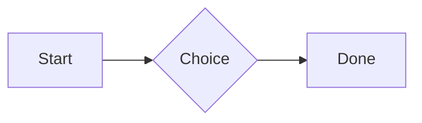
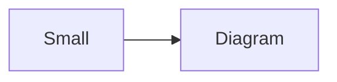

# QA · Right after: Typing practice (typing block)

Typing practice (typing block) followed straight away, with no blank line, by each element. Check: nothing overlaps, nothing is cut off, and the space between is even. Markdown joins some pairs without a blank line (text followed by --- is a heading, and a line of text can carry on into the next), so check that what's drawn matches the Markdown.

#qa/adjacent

#### 1. Typing practice (typing block), then Paragraph

```typing
It’s a “fine” day — type it.
function go() {
  return 1;
}
```
A paragraph with **bold**, *italic*, <u>underlined</u>, ~~struck~~, ==highlighted==, `code`, a [link](https://example.com) and a #qa/tag.

#### 2. Typing practice (typing block), then Long paragraph

```typing
It’s a “fine” day — type it.
function go() {
  return 1;
}
```
A long paragraph that wraps onto several lines at the usual width, so the space between its lines, its indent on every line, and where it meets the edges of anything around it can be checked. It goes on a little longer to be sure it wraps on a phone too.

#### 3. Typing practice (typing block), then Heading 1

```typing
It’s a “fine” day — type it.
function go() {
  return 1;
}
```
# Heading one

#### 4. Typing practice (typing block), then Heading 2

```typing
It’s a “fine” day — type it.
function go() {
  return 1;
}
```
## Heading two

#### 5. Typing practice (typing block), then Heading 3

```typing
It’s a “fine” day — type it.
function go() {
  return 1;
}
```
### Heading three

#### 6. Typing practice (typing block), then Bullet list

```typing
It’s a “fine” day — type it.
function go() {
  return 1;
}
```
- First item
- Second item
  - Nested item
    - Third level
- Last item

#### 7. Typing practice (typing block), then Numbered list

```typing
It’s a “fine” day — type it.
function go() {
  return 1;
}
```
1. First
2. Second
   1. Nested
3. Third

#### 8. Typing practice (typing block), then Todo list

```typing
It’s a “fine” day — type it.
function go() {
  return 1;
}
```
- [x] Done todo
- [ ] Open todo
  - [ ] Nested open todo

#### 9. Typing practice (typing block), then Quote

```typing
It’s a “fine” day — type it.
function go() {
  return 1;
}
```
> A quote that runs over
> two lines.

#### 10. Typing practice (typing block), then Line marks

```typing
It’s a “fine” day — type it.
function go() {
  return 1;
}
```
Marked as the accent. <!-- mark -->
Two lines marked green, one bar. <!-- mark green: ready -->
The second of them. <!-- mark green: ready -->
Red, with a label to point at. <!-- mark red: to fix -->
- A list item, marked purple. <!-- mark purple -->

#### 11. Typing practice (typing block), then Code block

```typing
It’s a “fine” day — type it.
function go() {
  return 1;
}
```
```
plain code
  indented line
```

#### 12. Typing practice (typing block), then Code block (TypeScript)

```typing
It’s a “fine” day — type it.
function go() {
  return 1;
}
```
```ts
const greeting: string = "hello";
console.log(greeting);
```

#### 13. Typing practice (typing block), then JSON block (no language)

```typing
It’s a “fine” day — type it.
function go() {
  return 1;
}
```
```
{"name":"lines","tags":["a","b"],"id":12345678901234567890}
```

#### 14. Typing practice (typing block), then Diagram

```typing
It’s a “fine” day — type it.
function go() {
  return 1;
}
```


#### 15. Typing practice (typing block), then Diagram (240 px wide)

```typing
It’s a “fine” day — type it.
function go() {
  return 1;
}
```


#### 16. Typing practice (typing block), then 3D model (openscad block), a colored part, an echo

```typing
It’s a “fine” day — type it.
function go() {
  return 1;
}
```
```openscad
difference() {
  cube(20, center = true);
  sphere(r = 13);
}
translate([25, 0, 0]) color("tomato") cylinder(h = 10, r = 5);
echo("made");
```

#### 17. Typing practice (typing block), then Flat model (openscad block)

```typing
It’s a “fine” day — type it.
function go() {
  return 1;
}
```
```openscad
square(20);
translate([30, 10]) circle(8);
```

#### 18. Typing practice (typing block), then Broken model (openscad block)

```typing
It’s a “fine” day — type it.
function go() {
  return 1;
}
```
```openscad
cube(10)
sphere(3;
```

#### 19. Typing practice (typing block), then 3D model (stl block)

```typing
It’s a “fine” day — type it.
function go() {
  return 1;
}
```
```stl
solid pyramid
facet normal 0 0 -1
outer loop
vertex 0 0 0
vertex 10 10 0
vertex 10 0 0
endloop
endfacet
facet normal 0 0 -1
outer loop
vertex 0 0 0
vertex 0 10 0
vertex 10 10 0
endloop
endfacet
facet normal 0 -1 1
outer loop
vertex 0 0 0
vertex 10 0 0
vertex 5 5 8
endloop
endfacet
facet normal 1 0 1
outer loop
vertex 10 0 0
vertex 10 10 0
vertex 5 5 8
endloop
endfacet
facet normal 0 1 1
outer loop
vertex 10 10 0
vertex 0 10 0
vertex 5 5 8
endloop
endfacet
facet normal -1 0 1
outer loop
vertex 0 10 0
vertex 0 0 0
vertex 5 5 8
endloop
endfacet
endsolid pyramid
```

#### 20. Typing practice (typing block), then Timing diagram (wavedrom block)

```typing
It’s a “fine” day — type it.
function go() {
  return 1;
}
```
```wavedrom
{ signal: [
  { name: "clk", wave: "p.....|..." },
  { name: "data", wave: "x.345x|=.x", data: ["head", "body", "tail", "data"] },
  {},
  { name: "ack", wave: "1.....|01.", node: ".a......b" }
], edge: ["a~>b t1"] }
```

#### 21. Typing practice (typing block), then Typing practice (typing block)

```typing
It’s a “fine” day — type it.
function go() {
  return 1;
}
```
```typing
It’s a “fine” day — type it.
function go() {
  return 1;
}
```

#### 22. Typing practice (typing block), then Math block

```typing
It’s a “fine” day — type it.
function go() {
  return 1;
}
```
$$
\int_0^1 x^2\,dx = \frac{1}{3}
$$

#### 23. Typing practice (typing block), then Table

```typing
It’s a “fine” day — type it.
function go() {
  return 1;
}
```
| Left | Center | Right |
| :--- | :----: | ----: |
| a | **b** | 1 |
| longer cell text | `code` | 22 |

#### 24. Typing practice (typing block), then Table with formulas

```typing
It’s a “fine” day — type it.
function go() {
  return 1;
}
```
| Item | Cost |
| --- | ---: |
| Rent | 1200 |
| Food | 450.50 |
| Total | =SUM(B2:B3) |
| Broken | =B2/0 |

#### 25. Typing practice (typing block), then Hurl entries (hurl block): a capture used by the next entry, and asserts

```typing
It’s a “fine” day — type it.
function go() {
  return 1;
}
```
```hurl
# A todo
GET https://jsonplaceholder.typicode.com/todos/1
HTTP 200
[Captures]
owner: jsonpath "$.userId"
[Asserts]
jsonpath "$.id" == 1

# Its owner
GET https://jsonplaceholder.typicode.com/users/{{owner}}
HTTP 200
[Asserts]
jsonpath "$.name" isString
```

#### 26. Typing practice (typing block), then Secret ({{name}}, kept in a locked secrets note)

```typing
It’s a “fine” day — type it.
function go() {
  return 1;
}
```
The token is {{qa-token}}, and {{no-such-secret}} isn't one.

#### 27. Typing practice (typing block), then API requests (http block): a variable, a named request and one using its response

```typing
It’s a “fine” day — type it.
function go() {
  return 1;
}
```
```http
@api = https://jsonplaceholder.typicode.com

### A todo
# @name todo
GET {{api}}/todos/1

### Its owner
GET {{api}}/users/{{todo.response.body.$.userId}}
```

#### 28. Typing practice (typing block), then Spreadsheet (csv block)

```typing
It’s a “fine” day — type it.
function go() {
  return 1;
}
```
```csv
Item, Cost
Rent, 1200
Food, 450.50
Total, =SUM(B2:B3)
```

#### 29. Typing practice (typing block), then Named spreadsheet (csv name=), and a formula in another block using it

```typing
It’s a “fine” day — type it.
function go() {
  return 1;
}
```
```csv name=costs
Item, Cost, Day
Rent, $1200, 2026-01-05
```

```csv
Total, =costs!B2*2
```

#### 30. Typing practice (typing block), then Divider

```typing
It’s a “fine” day — type it.
function go() {
  return 1;
}
```
---

#### 31. Typing practice (typing block), then Page breaks (as lines writes them, and as Obsidian and Typora do; a new page in the PDF at each, a gap between pages over a backdrop)

```typing
It’s a “fine” day — type it.
function go() {
  return 1;
}
```
Before the break.

<!-- pagebreak -->
After it, on a new page.

<div style="page-break-after: always"></div>

And another.

#### 32. Typing practice (typing block), then Key: Value line

```typing
It’s a “fine” day — type it.
function go() {
  return 1;
}
```
**Wi-Fi password:** correct-horse-battery

#### 33. Typing practice (typing block), then Mention

```typing
It’s a “fine” day — type it.
function go() {
  return 1;
}
```
Ask @[QA · Ada] at @[QA · Ada].email.

#### 34. Typing practice (typing block), then Wiki link

```typing
It’s a “fine” day — type it.
function go() {
  return 1;
}
```
Ask [[QA · Ada]], or [[QA · Ada|her]].

#### 35. Typing practice (typing block), then Symbols

```typing
It’s a “fine” day — type it.
function go() {
  return 1;
}
```
Home -> cabin <- back, a <-> b, x => y, p <=> q, 1 <= 2 >= 0 != 3. Stays: --> !== \-> and `a -> b` in code.

#### 36. Typing practice (typing block), then GitHub links

```typing
It’s a “fine” day — type it.
function go() {
  return 1;
}
```
Issue https://github.com/overtio/lines/issues/1 and [a named link](https://github.com/overtio/lines)

#### 37. Typing practice (typing block), then arXiv links

```typing
It’s a “fine” day — type it.
function go() {
  return 1;
}
```
Paper https://arxiv.org/abs/1706.03762 and [a named link](https://arxiv.org/abs/2006.11239)

#### 38. Typing practice (typing block), then Image

```typing
It’s a “fine” day — type it.
function go() {
  return 1;
}
```


#### 39. Typing practice (typing block), then Drawing

```typing
It’s a “fine” day — type it.
function go() {
  return 1;
}
```


#### 40. Typing practice (typing block), then File

```typing
It’s a “fine” day — type it.
function go() {
  return 1;
}
```
[Budget.csv](attachment:budget.csv)

#### 41. Typing practice (typing block), then Attached 3D model (STL)

```typing
It’s a “fine” day — type it.
function go() {
  return 1;
}
```
[Bracket.stl](attachment:bracket.stl)

#### 42. Typing practice (typing block), then Terminal recording (.cast file)

```typing
It’s a “fine” day — type it.
function go() {
  return 1;
}
```
[terminal.cast](attachment:terminal.cast)

#### 43. Typing practice (typing block), then Audio

```typing
It’s a “fine” day — type it.
function go() {
  return 1;
}
```
[Chime.mp3](attachment:chime.mp3)

#### 44. Typing practice (typing block), then Video

```typing
It’s a “fine” day — type it.
function go() {
  return 1;
}
```
[Sky.mp4](attachment:sky.mp4)

#### 45. Typing practice (typing block), then Missing file

```typing
It’s a “fine” day — type it.
function go() {
  return 1;
}
```
[Not here yet.pdf](../attachments/00000000000000000000000000000000.pdf)

#### 46. Typing practice (typing block), then Card

```typing
It’s a “fine” day — type it.
function go() {
  return 1;
}
```
::: card
Text in a card.
:::

#### 47. Typing practice (typing block), then Callout (info)

```typing
It’s a “fine” day — type it.
function go() {
  return 1;
}
```
:::i
Text in an info callout.
:::

#### 48. Typing practice (typing block), then Callout (warning, chosen icon)

```typing
It’s a “fine” day — type it.
function go() {
  return 1;
}
```
:::! icon=flag
Text in a warning callout with the flag icon.
:::

#### 49. Typing practice (typing block), then Callout (decision, no icon)

```typing
It’s a “fine” day — type it.
function go() {
  return 1;
}
```
:::^ icon=none
Text in a decision callout with no icon.
:::
