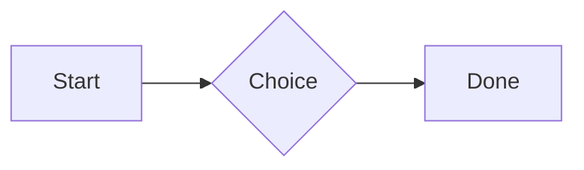

# QA · Right after: Callout (warning, chosen icon)

Callout (warning, chosen icon) followed straight away, with no blank line, by each element. Check: nothing overlaps, nothing is cut off, and the space between is even. Markdown joins some pairs without a blank line (text followed by --- is a heading, and a line of text can carry on into the next), so check that what's drawn matches the Markdown.

#qa/adjacent

#### 1. Callout (warning, chosen icon), then Paragraph

:::! icon=flag
Text in a warning callout with the flag icon.
:::
A paragraph with **bold**, *italic*, ~~struck~~, ==highlighted==, `code`, a [link](https://example.com) and a #qa/tag.

#### 2. Callout (warning, chosen icon), then Long paragraph

:::! icon=flag
Text in a warning callout with the flag icon.
:::
A long paragraph that wraps onto several lines at the usual width, so the space between its lines, its indent on every line, and where it meets the edges of anything around it can be checked. It goes on a little longer to be sure it wraps on a phone too.

#### 3. Callout (warning, chosen icon), then Heading 1

:::! icon=flag
Text in a warning callout with the flag icon.
:::
# Heading one

#### 4. Callout (warning, chosen icon), then Heading 2

:::! icon=flag
Text in a warning callout with the flag icon.
:::
## Heading two

#### 5. Callout (warning, chosen icon), then Heading 3

:::! icon=flag
Text in a warning callout with the flag icon.
:::
### Heading three

#### 6. Callout (warning, chosen icon), then Bullet list

:::! icon=flag
Text in a warning callout with the flag icon.
:::
- First item
- Second item
  - Nested item
    - Third level
- Last item

#### 7. Callout (warning, chosen icon), then Numbered list

:::! icon=flag
Text in a warning callout with the flag icon.
:::
1. First
2. Second
   1. Nested
3. Third

#### 8. Callout (warning, chosen icon), then Todo list

:::! icon=flag
Text in a warning callout with the flag icon.
:::
- [x] Done todo
- [ ] Open todo
  - [ ] Nested open todo

#### 9. Callout (warning, chosen icon), then Quote

:::! icon=flag
Text in a warning callout with the flag icon.
:::
> A quote that runs over
> two lines.

#### 10. Callout (warning, chosen icon), then Code block

:::! icon=flag
Text in a warning callout with the flag icon.
:::
```
plain code
  indented line
```

#### 11. Callout (warning, chosen icon), then Code block (TypeScript)

:::! icon=flag
Text in a warning callout with the flag icon.
:::
```ts
const greeting: string = "hello";
console.log(greeting);
```

#### 12. Callout (warning, chosen icon), then JSON block (no language)

:::! icon=flag
Text in a warning callout with the flag icon.
:::
```
{"name":"lines","tags":["a","b"],"id":12345678901234567890}
```

#### 13. Callout (warning, chosen icon), then Diagram

:::! icon=flag
Text in a warning callout with the flag icon.
:::


#### 14. Callout (warning, chosen icon), then Table

:::! icon=flag
Text in a warning callout with the flag icon.
:::
| Left | Center | Right |
| :--- | :----: | ----: |
| a | **b** | 1 |
| longer cell text | `code` | 22 |

#### 15. Callout (warning, chosen icon), then Divider

:::! icon=flag
Text in a warning callout with the flag icon.
:::
---

#### 16. Callout (warning, chosen icon), then Key: Value line

:::! icon=flag
Text in a warning callout with the flag icon.
:::
**Wi-Fi password:** correct-horse-battery

#### 17. Callout (warning, chosen icon), then Image

:::! icon=flag
Text in a warning callout with the flag icon.
:::


#### 18. Callout (warning, chosen icon), then File

:::! icon=flag
Text in a warning callout with the flag icon.
:::
[Budget.csv](attachment:budget.csv)

#### 19. Callout (warning, chosen icon), then Missing file

:::! icon=flag
Text in a warning callout with the flag icon.
:::
[Not here yet.pdf](../attachments/00000000000000000000000000000000.pdf)

#### 20. Callout (warning, chosen icon), then Card

:::! icon=flag
Text in a warning callout with the flag icon.
:::
::: card
Text in a card.
:::

#### 21. Callout (warning, chosen icon), then Callout (info)

:::! icon=flag
Text in a warning callout with the flag icon.
:::
:::i
Text in an info callout.
:::

#### 22. Callout (warning, chosen icon), then Callout (warning, chosen icon)

:::! icon=flag
Text in a warning callout with the flag icon.
:::
:::! icon=flag
Text in a warning callout with the flag icon.
:::

#### 23. Callout (warning, chosen icon), then Callout (decision, no icon)

:::! icon=flag
Text in a warning callout with the flag icon.
:::
:::^ icon=none
Text in a decision callout with no icon.
:::
