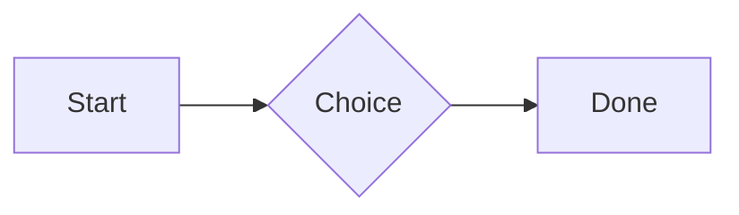
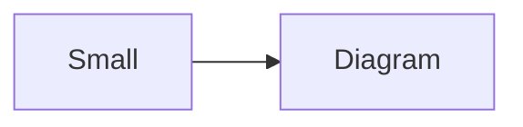

# QA · Right after: Mention

Mention followed straight away, with no blank line, by each element. Check: nothing overlaps, nothing is cut off, and the space between is even. Markdown joins some pairs without a blank line (text followed by --- is a heading, and a line of text can carry on into the next), so check that what's drawn matches the Markdown.

#qa/adjacent

#### 1. Mention, then Paragraph

Ask @[QA · Ada] at @[QA · Ada].email.
A paragraph with **bold**, *italic*, <u>underlined</u>, ~~struck~~, ==highlighted==, `code`, a [link](https://example.com) and a #qa/tag.

#### 2. Mention, then Long paragraph

Ask @[QA · Ada] at @[QA · Ada].email.
A long paragraph that wraps onto several lines at the usual width, so the space between its lines, its indent on every line, and where it meets the edges of anything around it can be checked. It goes on a little longer to be sure it wraps on a phone too.

#### 3. Mention, then Heading 1

Ask @[QA · Ada] at @[QA · Ada].email.
# Heading one

#### 4. Mention, then Heading 2

Ask @[QA · Ada] at @[QA · Ada].email.
## Heading two

#### 5. Mention, then Heading 3

Ask @[QA · Ada] at @[QA · Ada].email.
### Heading three

#### 6. Mention, then Bullet list

Ask @[QA · Ada] at @[QA · Ada].email.
- First item
- Second item
  - Nested item
    - Third level
- Last item

#### 7. Mention, then Numbered list

Ask @[QA · Ada] at @[QA · Ada].email.
1. First
2. Second
   1. Nested
3. Third

#### 8. Mention, then Todo list

Ask @[QA · Ada] at @[QA · Ada].email.
- [x] Done todo
- [ ] Open todo
  - [ ] Nested open todo

#### 9. Mention, then Quote

Ask @[QA · Ada] at @[QA · Ada].email.
> A quote that runs over
> two lines.

#### 10. Mention, then Code block

Ask @[QA · Ada] at @[QA · Ada].email.
```
plain code
  indented line
```

#### 11. Mention, then Code block (TypeScript)

Ask @[QA · Ada] at @[QA · Ada].email.
```ts
const greeting: string = "hello";
console.log(greeting);
```

#### 12. Mention, then JSON block (no language)

Ask @[QA · Ada] at @[QA · Ada].email.
```
{"name":"lines","tags":["a","b"],"id":12345678901234567890}
```

#### 13. Mention, then Diagram

Ask @[QA · Ada] at @[QA · Ada].email.


#### 14. Mention, then Diagram (240 px wide)

Ask @[QA · Ada] at @[QA · Ada].email.


#### 15. Mention, then Math block

Ask @[QA · Ada] at @[QA · Ada].email.
$$
\int_0^1 x^2\,dx = \frac{1}{3}
$$

#### 16. Mention, then Table

Ask @[QA · Ada] at @[QA · Ada].email.
| Left | Center | Right |
| :--- | :----: | ----: |
| a | **b** | 1 |
| longer cell text | `code` | 22 |

#### 17. Mention, then Table with formulas

Ask @[QA · Ada] at @[QA · Ada].email.
| Item | Cost |
| --- | ---: |
| Rent | 1200 |
| Food | 450.50 |
| Total | =SUM(B2:B3) |
| Broken | =B2/0 |

#### 18. Mention, then Spreadsheet (csv block)

Ask @[QA · Ada] at @[QA · Ada].email.
```csv
Item, Cost
Rent, 1200
Food, 450.50
Total, =SUM(B2:B3)
```

#### 19. Mention, then Named spreadsheet (csv name=), and a formula in another block using it

Ask @[QA · Ada] at @[QA · Ada].email.
```csv name=costs
Item, Cost, Day
Rent, $1200, 2026-01-05
```

```csv
Total, =costs!B2*2
```

#### 20. Mention, then Divider

Ask @[QA · Ada] at @[QA · Ada].email.
---

#### 21. Mention, then Key: Value line

Ask @[QA · Ada] at @[QA · Ada].email.
**Wi-Fi password:** correct-horse-battery

#### 22. Mention, then Mention

Ask @[QA · Ada] at @[QA · Ada].email.
Ask @[QA · Ada] at @[QA · Ada].email.

#### 23. Mention, then Wiki link

Ask @[QA · Ada] at @[QA · Ada].email.
Ask [[QA · Ada]], or [[QA · Ada|her]].

#### 24. Mention, then Symbols

Ask @[QA · Ada] at @[QA · Ada].email.
Home -> cabin <- back, a <-> b, x => y, p <=> q, 1 <= 2 >= 0 != 3. Stays: --> !== \-> and `a -> b` in code.

#### 25. Mention, then GitHub links

Ask @[QA · Ada] at @[QA · Ada].email.
Issue https://github.com/overtio/lines/issues/1 and [a named link](https://github.com/overtio/lines)

#### 26. Mention, then Image

Ask @[QA · Ada] at @[QA · Ada].email.


#### 27. Mention, then Drawing

Ask @[QA · Ada] at @[QA · Ada].email.


#### 28. Mention, then File

Ask @[QA · Ada] at @[QA · Ada].email.
[Budget.csv](attachment:budget.csv)

#### 29. Mention, then Missing file

Ask @[QA · Ada] at @[QA · Ada].email.
[Not here yet.pdf](../attachments/00000000000000000000000000000000.pdf)

#### 30. Mention, then Card

Ask @[QA · Ada] at @[QA · Ada].email.
::: card
Text in a card.
:::

#### 31. Mention, then Callout (info)

Ask @[QA · Ada] at @[QA · Ada].email.
:::i
Text in an info callout.
:::

#### 32. Mention, then Callout (warning, chosen icon)

Ask @[QA · Ada] at @[QA · Ada].email.
:::! icon=flag
Text in a warning callout with the flag icon.
:::

#### 33. Mention, then Callout (decision, no icon)

Ask @[QA · Ada] at @[QA · Ada].email.
:::^ icon=none
Text in a decision callout with no icon.
:::
