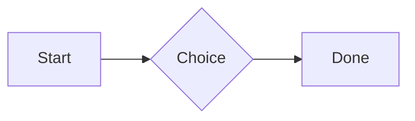

# QA · Right after: Callout (decision, no icon)

Callout (decision, no icon) followed straight away, with no blank line, by each element. Check: nothing overlaps, nothing is cut off, and the space between is even. Markdown joins some pairs without a blank line (text followed by --- is a heading, and a line of text can carry on into the next), so check that what's drawn matches the Markdown.

#qa/adjacent

#### 1. Callout (decision, no icon), then Paragraph

:::^ icon=none
Text in a decision callout with no icon.
:::
A paragraph with **bold**, *italic*, ~~struck~~, ==highlighted==, `code`, a [link](https://example.com) and a #qa/tag.

#### 2. Callout (decision, no icon), then Long paragraph

:::^ icon=none
Text in a decision callout with no icon.
:::
A long paragraph that wraps onto several lines at the usual width, so the space between its lines, its indent on every line, and where it meets the edges of anything around it can be checked. It goes on a little longer to be sure it wraps on a phone too.

#### 3. Callout (decision, no icon), then Heading 1

:::^ icon=none
Text in a decision callout with no icon.
:::
# Heading one

#### 4. Callout (decision, no icon), then Heading 2

:::^ icon=none
Text in a decision callout with no icon.
:::
## Heading two

#### 5. Callout (decision, no icon), then Heading 3

:::^ icon=none
Text in a decision callout with no icon.
:::
### Heading three

#### 6. Callout (decision, no icon), then Bullet list

:::^ icon=none
Text in a decision callout with no icon.
:::
- First item
- Second item
  - Nested item
    - Third level
- Last item

#### 7. Callout (decision, no icon), then Numbered list

:::^ icon=none
Text in a decision callout with no icon.
:::
1. First
2. Second
   1. Nested
3. Third

#### 8. Callout (decision, no icon), then Todo list

:::^ icon=none
Text in a decision callout with no icon.
:::
- [x] Done todo
- [ ] Open todo
  - [ ] Nested open todo

#### 9. Callout (decision, no icon), then Quote

:::^ icon=none
Text in a decision callout with no icon.
:::
> A quote that runs over
> two lines.

#### 10. Callout (decision, no icon), then Code block

:::^ icon=none
Text in a decision callout with no icon.
:::
```
plain code
  indented line
```

#### 11. Callout (decision, no icon), then Code block (TypeScript)

:::^ icon=none
Text in a decision callout with no icon.
:::
```ts
const greeting: string = "hello";
console.log(greeting);
```

#### 12. Callout (decision, no icon), then JSON block (no language)

:::^ icon=none
Text in a decision callout with no icon.
:::
```
{"name":"lines","tags":["a","b"],"id":12345678901234567890}
```

#### 13. Callout (decision, no icon), then Diagram

:::^ icon=none
Text in a decision callout with no icon.
:::


#### 14. Callout (decision, no icon), then Table

:::^ icon=none
Text in a decision callout with no icon.
:::
| Left | Center | Right |
| :--- | :----: | ----: |
| a | **b** | 1 |
| longer cell text | `code` | 22 |

#### 15. Callout (decision, no icon), then Divider

:::^ icon=none
Text in a decision callout with no icon.
:::
---

#### 16. Callout (decision, no icon), then Key: Value line

:::^ icon=none
Text in a decision callout with no icon.
:::
**Wi-Fi password:** correct-horse-battery

#### 17. Callout (decision, no icon), then Image

:::^ icon=none
Text in a decision callout with no icon.
:::


#### 18. Callout (decision, no icon), then File

:::^ icon=none
Text in a decision callout with no icon.
:::
[Budget.csv](attachment:budget.csv)

#### 19. Callout (decision, no icon), then Missing file

:::^ icon=none
Text in a decision callout with no icon.
:::
[Not here yet.pdf](../attachments/00000000000000000000000000000000.pdf)

#### 20. Callout (decision, no icon), then Card

:::^ icon=none
Text in a decision callout with no icon.
:::
::: card
Text in a card.
:::

#### 21. Callout (decision, no icon), then Callout (info)

:::^ icon=none
Text in a decision callout with no icon.
:::
:::i
Text in an info callout.
:::

#### 22. Callout (decision, no icon), then Callout (warning, chosen icon)

:::^ icon=none
Text in a decision callout with no icon.
:::
:::! icon=flag
Text in a warning callout with the flag icon.
:::

#### 23. Callout (decision, no icon), then Callout (decision, no icon)

:::^ icon=none
Text in a decision callout with no icon.
:::
:::^ icon=none
Text in a decision callout with no icon.
:::
