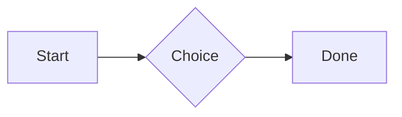

# QA · Right after: Missing file

Missing file followed straight away, with no blank line, by each element. Check: nothing overlaps, nothing is cut off, and the space between is even. Markdown joins some pairs without a blank line (text followed by --- is a heading, and a line of text can carry on into the next), so check that what's drawn matches the Markdown.

#qa/adjacent

#### 1. Missing file, then Paragraph

[Not here yet.pdf](../attachments/00000000000000000000000000000000.pdf)
A paragraph with **bold**, *italic*, ~~struck~~, ==highlighted==, `code`, a [link](https://example.com) and a #qa/tag.

#### 2. Missing file, then Long paragraph

[Not here yet.pdf](../attachments/00000000000000000000000000000000.pdf)
A long paragraph that wraps onto several lines at the usual width, so the space between its lines, its indent on every line, and where it meets the edges of anything around it can be checked. It goes on a little longer to be sure it wraps on a phone too.

#### 3. Missing file, then Heading 1

[Not here yet.pdf](../attachments/00000000000000000000000000000000.pdf)
# Heading one

#### 4. Missing file, then Heading 2

[Not here yet.pdf](../attachments/00000000000000000000000000000000.pdf)
## Heading two

#### 5. Missing file, then Heading 3

[Not here yet.pdf](../attachments/00000000000000000000000000000000.pdf)
### Heading three

#### 6. Missing file, then Bullet list

[Not here yet.pdf](../attachments/00000000000000000000000000000000.pdf)
- First item
- Second item
  - Nested item
    - Third level
- Last item

#### 7. Missing file, then Numbered list

[Not here yet.pdf](../attachments/00000000000000000000000000000000.pdf)
1. First
2. Second
   1. Nested
3. Third

#### 8. Missing file, then Todo list

[Not here yet.pdf](../attachments/00000000000000000000000000000000.pdf)
- [x] Done todo
- [ ] Open todo
  - [ ] Nested open todo

#### 9. Missing file, then Quote

[Not here yet.pdf](../attachments/00000000000000000000000000000000.pdf)
> A quote that runs over
> two lines.

#### 10. Missing file, then Code block

[Not here yet.pdf](../attachments/00000000000000000000000000000000.pdf)
```
plain code
  indented line
```

#### 11. Missing file, then Code block (TypeScript)

[Not here yet.pdf](../attachments/00000000000000000000000000000000.pdf)
```ts
const greeting: string = "hello";
console.log(greeting);
```

#### 12. Missing file, then JSON block (no language)

[Not here yet.pdf](../attachments/00000000000000000000000000000000.pdf)
```
{"name":"lines","tags":["a","b"],"id":12345678901234567890}
```

#### 13. Missing file, then Diagram

[Not here yet.pdf](../attachments/00000000000000000000000000000000.pdf)


#### 14. Missing file, then Diagram (240 px wide)

[Not here yet.pdf](../attachments/00000000000000000000000000000000.pdf)


#### 15. Missing file, then Math block

[Not here yet.pdf](../attachments/00000000000000000000000000000000.pdf)
$$
\int_0^1 x^2\,dx = \frac{1}{3}
$$

#### 16. Missing file, then Table

[Not here yet.pdf](../attachments/00000000000000000000000000000000.pdf)
| Left | Center | Right |
| :--- | :----: | ----: |
| a | **b** | 1 |
| longer cell text | `code` | 22 |

#### 17. Missing file, then Divider

[Not here yet.pdf](../attachments/00000000000000000000000000000000.pdf)
---

#### 18. Missing file, then Key: Value line

[Not here yet.pdf](../attachments/00000000000000000000000000000000.pdf)
**Wi-Fi password:** correct-horse-battery

#### 19. Missing file, then Mention

[Not here yet.pdf](../attachments/00000000000000000000000000000000.pdf)
Ask @[QA · Ada] at @[QA · Ada].email.

#### 20. Missing file, then Wiki link

[Not here yet.pdf](../attachments/00000000000000000000000000000000.pdf)
Ask [[QA · Ada]], or [[QA · Ada|her]].

#### 21. Missing file, then Symbols

[Not here yet.pdf](../attachments/00000000000000000000000000000000.pdf)
Home -> cabin <- back, a <-> b, x => y, p <=> q, 1 <= 2 >= 0 != 3. Stays: --> !== \-> and `a -> b` in code.

#### 22. Missing file, then GitHub links

[Not here yet.pdf](../attachments/00000000000000000000000000000000.pdf)
Issue https://github.com/overtio/lines/issues/1 and [a named link](https://github.com/overtio/lines)

#### 23. Missing file, then Image

[Not here yet.pdf](../attachments/00000000000000000000000000000000.pdf)


#### 24. Missing file, then Drawing

[Not here yet.pdf](../attachments/00000000000000000000000000000000.pdf)


#### 25. Missing file, then File

[Not here yet.pdf](../attachments/00000000000000000000000000000000.pdf)
[Budget.csv](attachment:budget.csv)

#### 26. Missing file, then Missing file

[Not here yet.pdf](../attachments/00000000000000000000000000000000.pdf)
[Not here yet.pdf](../attachments/00000000000000000000000000000000.pdf)

#### 27. Missing file, then Card

[Not here yet.pdf](../attachments/00000000000000000000000000000000.pdf)
::: card
Text in a card.
:::

#### 28. Missing file, then Callout (info)

[Not here yet.pdf](../attachments/00000000000000000000000000000000.pdf)
:::i
Text in an info callout.
:::

#### 29. Missing file, then Callout (warning, chosen icon)

[Not here yet.pdf](../attachments/00000000000000000000000000000000.pdf)
:::! icon=flag
Text in a warning callout with the flag icon.
:::

#### 30. Missing file, then Callout (decision, no icon)

[Not here yet.pdf](../attachments/00000000000000000000000000000000.pdf)
:::^ icon=none
Text in a decision callout with no icon.
:::
