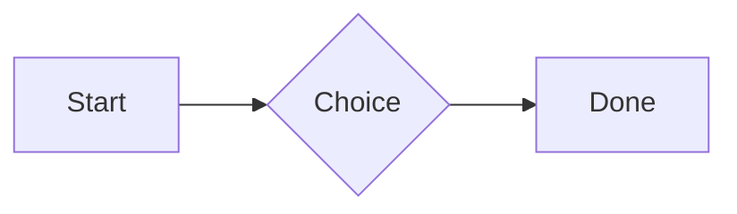
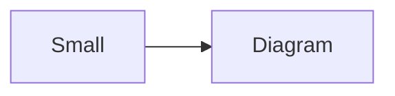

# QA · Right after: Secret ({{name}}, kept in a locked secrets note)

Secret ({{name}}, kept in a locked secrets note) followed straight away, with no blank line, by each element. Check: nothing overlaps, nothing is cut off, and the space between is even. Markdown joins some pairs without a blank line (text followed by --- is a heading, and a line of text can carry on into the next), so check that what's drawn matches the Markdown.

#qa/adjacent

#### 1. Secret ({{name}}, kept in a locked secrets note), then Paragraph

The token is {{qa-token}}, and {{no-such-secret}} isn't one.
A paragraph with **bold**, *italic*, <u>underlined</u>, ~~struck~~, ==highlighted==, `code`, a [link](https://example.com) and a #qa/tag.

#### 2. Secret ({{name}}, kept in a locked secrets note), then Long paragraph

The token is {{qa-token}}, and {{no-such-secret}} isn't one.
A long paragraph that wraps onto several lines at the usual width, so the space between its lines, its indent on every line, and where it meets the edges of anything around it can be checked. It goes on a little longer to be sure it wraps on a phone too.

#### 3. Secret ({{name}}, kept in a locked secrets note), then Heading 1

The token is {{qa-token}}, and {{no-such-secret}} isn't one.
# Heading one

#### 4. Secret ({{name}}, kept in a locked secrets note), then Heading 2

The token is {{qa-token}}, and {{no-such-secret}} isn't one.
## Heading two

#### 5. Secret ({{name}}, kept in a locked secrets note), then Heading 3

The token is {{qa-token}}, and {{no-such-secret}} isn't one.
### Heading three

#### 6. Secret ({{name}}, kept in a locked secrets note), then Bullet list

The token is {{qa-token}}, and {{no-such-secret}} isn't one.
- First item
- Second item
  - Nested item
    - Third level
- Last item

#### 7. Secret ({{name}}, kept in a locked secrets note), then Numbered list

The token is {{qa-token}}, and {{no-such-secret}} isn't one.
1. First
2. Second
   1. Nested
3. Third

#### 8. Secret ({{name}}, kept in a locked secrets note), then Todo list

The token is {{qa-token}}, and {{no-such-secret}} isn't one.
- [x] Done todo
- [ ] Open todo
  - [ ] Nested open todo

#### 9. Secret ({{name}}, kept in a locked secrets note), then Quote

The token is {{qa-token}}, and {{no-such-secret}} isn't one.
> A quote that runs over
> two lines.

#### 10. Secret ({{name}}, kept in a locked secrets note), then Line marks

The token is {{qa-token}}, and {{no-such-secret}} isn't one.
Marked as the accent. <!-- mark -->
Two lines marked green, one bar. <!-- mark green: ready -->
The second of them. <!-- mark green: ready -->
Red, with a label to point at. <!-- mark red: to fix -->
- A list item, marked purple. <!-- mark purple -->

#### 11. Secret ({{name}}, kept in a locked secrets note), then Code block

The token is {{qa-token}}, and {{no-such-secret}} isn't one.
```
plain code
  indented line
```

#### 12. Secret ({{name}}, kept in a locked secrets note), then Code block (TypeScript)

The token is {{qa-token}}, and {{no-such-secret}} isn't one.
```ts
const greeting: string = "hello";
console.log(greeting);
```

#### 13. Secret ({{name}}, kept in a locked secrets note), then JSON block (no language)

The token is {{qa-token}}, and {{no-such-secret}} isn't one.
```
{"name":"lines","tags":["a","b"],"id":12345678901234567890}
```

#### 14. Secret ({{name}}, kept in a locked secrets note), then Diagram

The token is {{qa-token}}, and {{no-such-secret}} isn't one.


#### 15. Secret ({{name}}, kept in a locked secrets note), then Diagram (240 px wide)

The token is {{qa-token}}, and {{no-such-secret}} isn't one.


#### 16. Secret ({{name}}, kept in a locked secrets note), then 3D model (openscad block), a colored part, an echo

The token is {{qa-token}}, and {{no-such-secret}} isn't one.
```openscad
difference() {
  cube(20, center = true);
  sphere(r = 13);
}
translate([25, 0, 0]) color("tomato") cylinder(h = 10, r = 5);
echo("made");
```

#### 17. Secret ({{name}}, kept in a locked secrets note), then Flat model (openscad block)

The token is {{qa-token}}, and {{no-such-secret}} isn't one.
```openscad
square(20);
translate([30, 10]) circle(8);
```

#### 18. Secret ({{name}}, kept in a locked secrets note), then Broken model (openscad block)

The token is {{qa-token}}, and {{no-such-secret}} isn't one.
```openscad
cube(10)
sphere(3;
```

#### 19. Secret ({{name}}, kept in a locked secrets note), then 3D model (stl block)

The token is {{qa-token}}, and {{no-such-secret}} isn't one.
```stl
solid pyramid
facet normal 0 0 -1
outer loop
vertex 0 0 0
vertex 10 10 0
vertex 10 0 0
endloop
endfacet
facet normal 0 0 -1
outer loop
vertex 0 0 0
vertex 0 10 0
vertex 10 10 0
endloop
endfacet
facet normal 0 -1 1
outer loop
vertex 0 0 0
vertex 10 0 0
vertex 5 5 8
endloop
endfacet
facet normal 1 0 1
outer loop
vertex 10 0 0
vertex 10 10 0
vertex 5 5 8
endloop
endfacet
facet normal 0 1 1
outer loop
vertex 10 10 0
vertex 0 10 0
vertex 5 5 8
endloop
endfacet
facet normal -1 0 1
outer loop
vertex 0 10 0
vertex 0 0 0
vertex 5 5 8
endloop
endfacet
endsolid pyramid
```

#### 20. Secret ({{name}}, kept in a locked secrets note), then Timing diagram (wavedrom block)

The token is {{qa-token}}, and {{no-such-secret}} isn't one.
```wavedrom
{ signal: [
  { name: "clk", wave: "p.....|..." },
  { name: "data", wave: "x.345x|=.x", data: ["head", "body", "tail", "data"] },
  {},
  { name: "ack", wave: "1.....|01.", node: ".a......b" }
], edge: ["a~>b t1"] }
```

#### 21. Secret ({{name}}, kept in a locked secrets note), then Typing practice (typing block)

The token is {{qa-token}}, and {{no-such-secret}} isn't one.
```typing
It’s a “fine” day — type it.
function go() {
  return 1;
}
```

#### 22. Secret ({{name}}, kept in a locked secrets note), then Math block

The token is {{qa-token}}, and {{no-such-secret}} isn't one.
$$
\int_0^1 x^2\,dx = \frac{1}{3}
$$

#### 23. Secret ({{name}}, kept in a locked secrets note), then Table

The token is {{qa-token}}, and {{no-such-secret}} isn't one.
| Left | Center | Right |
| :--- | :----: | ----: |
| a | **b** | 1 |
| longer cell text | `code` | 22 |

#### 24. Secret ({{name}}, kept in a locked secrets note), then Table with formulas

The token is {{qa-token}}, and {{no-such-secret}} isn't one.
| Item | Cost |
| --- | ---: |
| Rent | 1200 |
| Food | 450.50 |
| Total | =SUM(B2:B3) |
| Broken | =B2/0 |

#### 25. Secret ({{name}}, kept in a locked secrets note), then Hurl entries (hurl block): a capture used by the next entry, and asserts

The token is {{qa-token}}, and {{no-such-secret}} isn't one.
```hurl
# A todo
GET https://jsonplaceholder.typicode.com/todos/1
HTTP 200
[Captures]
owner: jsonpath "$.userId"
[Asserts]
jsonpath "$.id" == 1

# Its owner
GET https://jsonplaceholder.typicode.com/users/{{owner}}
HTTP 200
[Asserts]
jsonpath "$.name" isString
```

#### 26. Secret ({{name}}, kept in a locked secrets note), then Secret ({{name}}, kept in a locked secrets note)

The token is {{qa-token}}, and {{no-such-secret}} isn't one.
The token is {{qa-token}}, and {{no-such-secret}} isn't one.

#### 27. Secret ({{name}}, kept in a locked secrets note), then API requests (http block): a variable, a named request and one using its response

The token is {{qa-token}}, and {{no-such-secret}} isn't one.
```http
@api = https://jsonplaceholder.typicode.com

### A todo
# @name todo
GET {{api}}/todos/1

### Its owner
GET {{api}}/users/{{todo.response.body.$.userId}}
```

#### 28. Secret ({{name}}, kept in a locked secrets note), then Spreadsheet (csv block)

The token is {{qa-token}}, and {{no-such-secret}} isn't one.
```csv
Item, Cost
Rent, 1200
Food, 450.50
Total, =SUM(B2:B3)
```

#### 29. Secret ({{name}}, kept in a locked secrets note), then Named spreadsheet (csv name=), and a formula in another block using it

The token is {{qa-token}}, and {{no-such-secret}} isn't one.
```csv name=costs
Item, Cost, Day
Rent, $1200, 2026-01-05
```

```csv
Total, =costs!B2*2
```

#### 30. Secret ({{name}}, kept in a locked secrets note), then Divider

The token is {{qa-token}}, and {{no-such-secret}} isn't one.
---

#### 31. Secret ({{name}}, kept in a locked secrets note), then Page breaks (as lines writes them, and as Obsidian and Typora do; a new page in the PDF at each, a gap between pages over a backdrop)

The token is {{qa-token}}, and {{no-such-secret}} isn't one.
Before the break.

<!-- pagebreak -->
After it, on a new page.

<div style="page-break-after: always"></div>

And another.

#### 32. Secret ({{name}}, kept in a locked secrets note), then Key: Value line

The token is {{qa-token}}, and {{no-such-secret}} isn't one.
**Wi-Fi password:** correct-horse-battery

#### 33. Secret ({{name}}, kept in a locked secrets note), then Mention

The token is {{qa-token}}, and {{no-such-secret}} isn't one.
Ask @[QA · Ada] at @[QA · Ada].email.

#### 34. Secret ({{name}}, kept in a locked secrets note), then Wiki link

The token is {{qa-token}}, and {{no-such-secret}} isn't one.
Ask [[QA · Ada]], or [[QA · Ada|her]].

#### 35. Secret ({{name}}, kept in a locked secrets note), then Symbols

The token is {{qa-token}}, and {{no-such-secret}} isn't one.
Home -> cabin <- back, a <-> b, x => y, p <=> q, 1 <= 2 >= 0 != 3. Stays: --> !== \-> and `a -> b` in code.

#### 36. Secret ({{name}}, kept in a locked secrets note), then GitHub links

The token is {{qa-token}}, and {{no-such-secret}} isn't one.
Issue https://github.com/overtio/lines/issues/1 and [a named link](https://github.com/overtio/lines)

#### 37. Secret ({{name}}, kept in a locked secrets note), then arXiv links

The token is {{qa-token}}, and {{no-such-secret}} isn't one.
Paper https://arxiv.org/abs/1706.03762 and [a named link](https://arxiv.org/abs/2006.11239)

#### 38. Secret ({{name}}, kept in a locked secrets note), then Image

The token is {{qa-token}}, and {{no-such-secret}} isn't one.


#### 39. Secret ({{name}}, kept in a locked secrets note), then Drawing

The token is {{qa-token}}, and {{no-such-secret}} isn't one.


#### 40. Secret ({{name}}, kept in a locked secrets note), then File

The token is {{qa-token}}, and {{no-such-secret}} isn't one.
[Budget.csv](attachment:budget.csv)

#### 41. Secret ({{name}}, kept in a locked secrets note), then Folder and file links

The token is {{qa-token}}, and {{no-such-secret}} isn't one.
See [Projects](file:///Users/me/My%20Projects/) and [the plan](file:///Users/me/plan.pdf) on this computer.

#### 42. Secret ({{name}}, kept in a locked secrets note), then Attached 3D model (STL)

The token is {{qa-token}}, and {{no-such-secret}} isn't one.
[Bracket.stl](attachment:bracket.stl)

#### 43. Secret ({{name}}, kept in a locked secrets note), then Terminal recording (.cast file)

The token is {{qa-token}}, and {{no-such-secret}} isn't one.
[terminal.cast](attachment:terminal.cast)

#### 44. Secret ({{name}}, kept in a locked secrets note), then Audio

The token is {{qa-token}}, and {{no-such-secret}} isn't one.
[Chime.mp3](attachment:chime.mp3)

#### 45. Secret ({{name}}, kept in a locked secrets note), then Video

The token is {{qa-token}}, and {{no-such-secret}} isn't one.
[Sky.mp4](attachment:sky.mp4)

#### 46. Secret ({{name}}, kept in a locked secrets note), then Missing file

The token is {{qa-token}}, and {{no-such-secret}} isn't one.
[Not here yet.pdf](../attachments/00000000000000000000000000000000.pdf)

#### 47. Secret ({{name}}, kept in a locked secrets note), then Card

The token is {{qa-token}}, and {{no-such-secret}} isn't one.
::: card
Text in a card.
:::

#### 48. Secret ({{name}}, kept in a locked secrets note), then Callout (info)

The token is {{qa-token}}, and {{no-such-secret}} isn't one.
:::i
Text in an info callout.
:::

#### 49. Secret ({{name}}, kept in a locked secrets note), then Callout (warning, chosen icon)

The token is {{qa-token}}, and {{no-such-secret}} isn't one.
:::! icon=flag
Text in a warning callout with the flag icon.
:::

#### 50. Secret ({{name}}, kept in a locked secrets note), then Callout (decision, no icon)

The token is {{qa-token}}, and {{no-such-secret}} isn't one.
:::^ icon=none
Text in a decision callout with no icon.
:::
