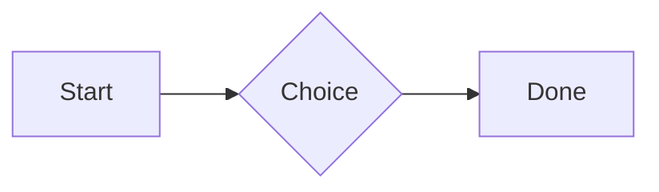
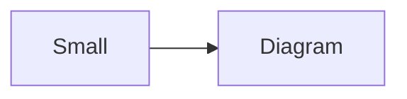

# QA · Right after: Named spreadsheet (csv name=), and a formula in another block using it

Named spreadsheet (csv name=), and a formula in another block using it followed straight away, with no blank line, by each element. Check: nothing overlaps, nothing is cut off, and the space between is even. Markdown joins some pairs without a blank line (text followed by --- is a heading, and a line of text can carry on into the next), so check that what's drawn matches the Markdown.

#qa/adjacent

#### 1. Named spreadsheet (csv name=), and a formula in another block using it, then Paragraph

```csv name=costs
Item, Cost, Day
Rent, $1200, 2026-01-05
```

```csv
Total, =costs!B2*2
```
A paragraph with **bold**, *italic*, <u>underlined</u>, ~~struck~~, ==highlighted==, `code`, a [link](https://example.com) and a #qa/tag.

#### 2. Named spreadsheet (csv name=), and a formula in another block using it, then Long paragraph

```csv name=costs
Item, Cost, Day
Rent, $1200, 2026-01-05
```

```csv
Total, =costs!B2*2
```
A long paragraph that wraps onto several lines at the usual width, so the space between its lines, its indent on every line, and where it meets the edges of anything around it can be checked. It goes on a little longer to be sure it wraps on a phone too.

#### 3. Named spreadsheet (csv name=), and a formula in another block using it, then Heading 1

```csv name=costs
Item, Cost, Day
Rent, $1200, 2026-01-05
```

```csv
Total, =costs!B2*2
```
# Heading one

#### 4. Named spreadsheet (csv name=), and a formula in another block using it, then Heading 2

```csv name=costs
Item, Cost, Day
Rent, $1200, 2026-01-05
```

```csv
Total, =costs!B2*2
```
## Heading two

#### 5. Named spreadsheet (csv name=), and a formula in another block using it, then Heading 3

```csv name=costs
Item, Cost, Day
Rent, $1200, 2026-01-05
```

```csv
Total, =costs!B2*2
```
### Heading three

#### 6. Named spreadsheet (csv name=), and a formula in another block using it, then Bullet list

```csv name=costs
Item, Cost, Day
Rent, $1200, 2026-01-05
```

```csv
Total, =costs!B2*2
```
- First item
- Second item
  - Nested item
    - Third level
- Last item

#### 7. Named spreadsheet (csv name=), and a formula in another block using it, then Numbered list

```csv name=costs
Item, Cost, Day
Rent, $1200, 2026-01-05
```

```csv
Total, =costs!B2*2
```
1. First
2. Second
   1. Nested
3. Third

#### 8. Named spreadsheet (csv name=), and a formula in another block using it, then Todo list

```csv name=costs
Item, Cost, Day
Rent, $1200, 2026-01-05
```

```csv
Total, =costs!B2*2
```
- [x] Done todo
- [ ] Open todo
  - [ ] Nested open todo

#### 9. Named spreadsheet (csv name=), and a formula in another block using it, then Quote

```csv name=costs
Item, Cost, Day
Rent, $1200, 2026-01-05
```

```csv
Total, =costs!B2*2
```
> A quote that runs over
> two lines.

#### 10. Named spreadsheet (csv name=), and a formula in another block using it, then Code block

```csv name=costs
Item, Cost, Day
Rent, $1200, 2026-01-05
```

```csv
Total, =costs!B2*2
```
```
plain code
  indented line
```

#### 11. Named spreadsheet (csv name=), and a formula in another block using it, then Code block (TypeScript)

```csv name=costs
Item, Cost, Day
Rent, $1200, 2026-01-05
```

```csv
Total, =costs!B2*2
```
```ts
const greeting: string = "hello";
console.log(greeting);
```

#### 12. Named spreadsheet (csv name=), and a formula in another block using it, then JSON block (no language)

```csv name=costs
Item, Cost, Day
Rent, $1200, 2026-01-05
```

```csv
Total, =costs!B2*2
```
```
{"name":"lines","tags":["a","b"],"id":12345678901234567890}
```

#### 13. Named spreadsheet (csv name=), and a formula in another block using it, then Diagram

```csv name=costs
Item, Cost, Day
Rent, $1200, 2026-01-05
```

```csv
Total, =costs!B2*2
```


#### 14. Named spreadsheet (csv name=), and a formula in another block using it, then Diagram (240 px wide)

```csv name=costs
Item, Cost, Day
Rent, $1200, 2026-01-05
```

```csv
Total, =costs!B2*2
```


#### 15. Named spreadsheet (csv name=), and a formula in another block using it, then 3D model (openscad block), a colored part, an echo

```csv name=costs
Item, Cost, Day
Rent, $1200, 2026-01-05
```

```csv
Total, =costs!B2*2
```
```openscad
difference() {
  cube(20, center = true);
  sphere(r = 13);
}
translate([25, 0, 0]) color("tomato") cylinder(h = 10, r = 5);
echo("made");
```

#### 16. Named spreadsheet (csv name=), and a formula in another block using it, then Flat model (openscad block)

```csv name=costs
Item, Cost, Day
Rent, $1200, 2026-01-05
```

```csv
Total, =costs!B2*2
```
```openscad
square(20);
translate([30, 10]) circle(8);
```

#### 17. Named spreadsheet (csv name=), and a formula in another block using it, then Broken model (openscad block)

```csv name=costs
Item, Cost, Day
Rent, $1200, 2026-01-05
```

```csv
Total, =costs!B2*2
```
```openscad
cube(10)
sphere(3;
```

#### 18. Named spreadsheet (csv name=), and a formula in another block using it, then 3D model (stl block)

```csv name=costs
Item, Cost, Day
Rent, $1200, 2026-01-05
```

```csv
Total, =costs!B2*2
```
```stl
solid pyramid
facet normal 0 0 -1
outer loop
vertex 0 0 0
vertex 10 10 0
vertex 10 0 0
endloop
endfacet
facet normal 0 0 -1
outer loop
vertex 0 0 0
vertex 0 10 0
vertex 10 10 0
endloop
endfacet
facet normal 0 -1 1
outer loop
vertex 0 0 0
vertex 10 0 0
vertex 5 5 8
endloop
endfacet
facet normal 1 0 1
outer loop
vertex 10 0 0
vertex 10 10 0
vertex 5 5 8
endloop
endfacet
facet normal 0 1 1
outer loop
vertex 10 10 0
vertex 0 10 0
vertex 5 5 8
endloop
endfacet
facet normal -1 0 1
outer loop
vertex 0 10 0
vertex 0 0 0
vertex 5 5 8
endloop
endfacet
endsolid pyramid
```

#### 19. Named spreadsheet (csv name=), and a formula in another block using it, then Timing diagram (wavedrom block)

```csv name=costs
Item, Cost, Day
Rent, $1200, 2026-01-05
```

```csv
Total, =costs!B2*2
```
```wavedrom
{ signal: [
  { name: "clk", wave: "p.....|..." },
  { name: "data", wave: "x.345x|=.x", data: ["head", "body", "tail", "data"] },
  {},
  { name: "ack", wave: "1.....|01.", node: ".a......b" }
], edge: ["a~>b t1"] }
```

#### 20. Named spreadsheet (csv name=), and a formula in another block using it, then Math block

```csv name=costs
Item, Cost, Day
Rent, $1200, 2026-01-05
```

```csv
Total, =costs!B2*2
```
$$
\int_0^1 x^2\,dx = \frac{1}{3}
$$

#### 21. Named spreadsheet (csv name=), and a formula in another block using it, then Table

```csv name=costs
Item, Cost, Day
Rent, $1200, 2026-01-05
```

```csv
Total, =costs!B2*2
```
| Left | Center | Right |
| :--- | :----: | ----: |
| a | **b** | 1 |
| longer cell text | `code` | 22 |

#### 22. Named spreadsheet (csv name=), and a formula in another block using it, then Table with formulas

```csv name=costs
Item, Cost, Day
Rent, $1200, 2026-01-05
```

```csv
Total, =costs!B2*2
```
| Item | Cost |
| --- | ---: |
| Rent | 1200 |
| Food | 450.50 |
| Total | =SUM(B2:B3) |
| Broken | =B2/0 |

#### 23. Named spreadsheet (csv name=), and a formula in another block using it, then Hurl entries (hurl block): a capture used by the next entry, and asserts

```csv name=costs
Item, Cost, Day
Rent, $1200, 2026-01-05
```

```csv
Total, =costs!B2*2
```
```hurl
# A todo
GET https://jsonplaceholder.typicode.com/todos/1
HTTP 200
[Captures]
owner: jsonpath "$.userId"
[Asserts]
jsonpath "$.id" == 1

# Its owner
GET https://jsonplaceholder.typicode.com/users/{{owner}}
HTTP 200
[Asserts]
jsonpath "$.name" isString
```

#### 24. Named spreadsheet (csv name=), and a formula in another block using it, then Secret ({{name}}, kept in a locked secrets note)

```csv name=costs
Item, Cost, Day
Rent, $1200, 2026-01-05
```

```csv
Total, =costs!B2*2
```
The token is {{qa-token}}, and {{no-such-secret}} isn't one.

#### 25. Named spreadsheet (csv name=), and a formula in another block using it, then API requests (http block): a variable, a named request and one using its response

```csv name=costs
Item, Cost, Day
Rent, $1200, 2026-01-05
```

```csv
Total, =costs!B2*2
```
```http
@api = https://jsonplaceholder.typicode.com

### A todo
# @name todo
GET {{api}}/todos/1

### Its owner
GET {{api}}/users/{{todo.response.body.$.userId}}
```

#### 26. Named spreadsheet (csv name=), and a formula in another block using it, then Spreadsheet (csv block)

```csv name=costs
Item, Cost, Day
Rent, $1200, 2026-01-05
```

```csv
Total, =costs!B2*2
```
```csv
Item, Cost
Rent, 1200
Food, 450.50
Total, =SUM(B2:B3)
```

#### 27. Named spreadsheet (csv name=), and a formula in another block using it, then Named spreadsheet (csv name=), and a formula in another block using it

```csv name=costs
Item, Cost, Day
Rent, $1200, 2026-01-05
```

```csv
Total, =costs!B2*2
```
```csv name=costs
Item, Cost, Day
Rent, $1200, 2026-01-05
```

```csv
Total, =costs!B2*2
```

#### 28. Named spreadsheet (csv name=), and a formula in another block using it, then Divider

```csv name=costs
Item, Cost, Day
Rent, $1200, 2026-01-05
```

```csv
Total, =costs!B2*2
```
---

#### 29. Named spreadsheet (csv name=), and a formula in another block using it, then Key: Value line

```csv name=costs
Item, Cost, Day
Rent, $1200, 2026-01-05
```

```csv
Total, =costs!B2*2
```
**Wi-Fi password:** correct-horse-battery

#### 30. Named spreadsheet (csv name=), and a formula in another block using it, then Mention

```csv name=costs
Item, Cost, Day
Rent, $1200, 2026-01-05
```

```csv
Total, =costs!B2*2
```
Ask @[QA · Ada] at @[QA · Ada].email.

#### 31. Named spreadsheet (csv name=), and a formula in another block using it, then Wiki link

```csv name=costs
Item, Cost, Day
Rent, $1200, 2026-01-05
```

```csv
Total, =costs!B2*2
```
Ask [[QA · Ada]], or [[QA · Ada|her]].

#### 32. Named spreadsheet (csv name=), and a formula in another block using it, then Symbols

```csv name=costs
Item, Cost, Day
Rent, $1200, 2026-01-05
```

```csv
Total, =costs!B2*2
```
Home -> cabin <- back, a <-> b, x => y, p <=> q, 1 <= 2 >= 0 != 3. Stays: --> !== \-> and `a -> b` in code.

#### 33. Named spreadsheet (csv name=), and a formula in another block using it, then GitHub links

```csv name=costs
Item, Cost, Day
Rent, $1200, 2026-01-05
```

```csv
Total, =costs!B2*2
```
Issue https://github.com/overtio/lines/issues/1 and [a named link](https://github.com/overtio/lines)

#### 34. Named spreadsheet (csv name=), and a formula in another block using it, then arXiv links

```csv name=costs
Item, Cost, Day
Rent, $1200, 2026-01-05
```

```csv
Total, =costs!B2*2
```
Paper https://arxiv.org/abs/1706.03762 and [a named link](https://arxiv.org/abs/2006.11239)

#### 35. Named spreadsheet (csv name=), and a formula in another block using it, then Image

```csv name=costs
Item, Cost, Day
Rent, $1200, 2026-01-05
```

```csv
Total, =costs!B2*2
```


#### 36. Named spreadsheet (csv name=), and a formula in another block using it, then Drawing

```csv name=costs
Item, Cost, Day
Rent, $1200, 2026-01-05
```

```csv
Total, =costs!B2*2
```


#### 37. Named spreadsheet (csv name=), and a formula in another block using it, then File

```csv name=costs
Item, Cost, Day
Rent, $1200, 2026-01-05
```

```csv
Total, =costs!B2*2
```
[Budget.csv](attachment:budget.csv)

#### 38. Named spreadsheet (csv name=), and a formula in another block using it, then Attached 3D model (STL)

```csv name=costs
Item, Cost, Day
Rent, $1200, 2026-01-05
```

```csv
Total, =costs!B2*2
```
[Bracket.stl](attachment:bracket.stl)

#### 39. Named spreadsheet (csv name=), and a formula in another block using it, then Terminal recording (.cast file)

```csv name=costs
Item, Cost, Day
Rent, $1200, 2026-01-05
```

```csv
Total, =costs!B2*2
```
[terminal.cast](attachment:terminal.cast)

#### 40. Named spreadsheet (csv name=), and a formula in another block using it, then Audio

```csv name=costs
Item, Cost, Day
Rent, $1200, 2026-01-05
```

```csv
Total, =costs!B2*2
```
[Chime.mp3](attachment:chime.mp3)

#### 41. Named spreadsheet (csv name=), and a formula in another block using it, then Video

```csv name=costs
Item, Cost, Day
Rent, $1200, 2026-01-05
```

```csv
Total, =costs!B2*2
```
[Sky.mp4](attachment:sky.mp4)

#### 42. Named spreadsheet (csv name=), and a formula in another block using it, then Missing file

```csv name=costs
Item, Cost, Day
Rent, $1200, 2026-01-05
```

```csv
Total, =costs!B2*2
```
[Not here yet.pdf](../attachments/00000000000000000000000000000000.pdf)

#### 43. Named spreadsheet (csv name=), and a formula in another block using it, then Card

```csv name=costs
Item, Cost, Day
Rent, $1200, 2026-01-05
```

```csv
Total, =costs!B2*2
```
::: card
Text in a card.
:::

#### 44. Named spreadsheet (csv name=), and a formula in another block using it, then Callout (info)

```csv name=costs
Item, Cost, Day
Rent, $1200, 2026-01-05
```

```csv
Total, =costs!B2*2
```
:::i
Text in an info callout.
:::

#### 45. Named spreadsheet (csv name=), and a formula in another block using it, then Callout (warning, chosen icon)

```csv name=costs
Item, Cost, Day
Rent, $1200, 2026-01-05
```

```csv
Total, =costs!B2*2
```
:::! icon=flag
Text in a warning callout with the flag icon.
:::

#### 46. Named spreadsheet (csv name=), and a formula in another block using it, then Callout (decision, no icon)

```csv name=costs
Item, Cost, Day
Rent, $1200, 2026-01-05
```

```csv
Total, =costs!B2*2
```
:::^ icon=none
Text in a decision callout with no icon.
:::
