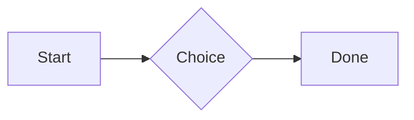
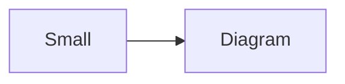

# QA · Right after: Key: Value line

Key: Value line followed straight away, with no blank line, by each element. Check: nothing overlaps, nothing is cut off, and the space between is even. Markdown joins some pairs without a blank line (text followed by --- is a heading, and a line of text can carry on into the next), so check that what's drawn matches the Markdown.

#qa/adjacent

#### 1. Key: Value line, then Paragraph

**Wi-Fi password:** correct-horse-battery
A paragraph with **bold**, *italic*, <u>underlined</u>, ~~struck~~, ==highlighted==, `code`, a [link](https://example.com) and a #qa/tag.

#### 2. Key: Value line, then Long paragraph

**Wi-Fi password:** correct-horse-battery
A long paragraph that wraps onto several lines at the usual width, so the space between its lines, its indent on every line, and where it meets the edges of anything around it can be checked. It goes on a little longer to be sure it wraps on a phone too.

#### 3. Key: Value line, then Heading 1

**Wi-Fi password:** correct-horse-battery
# Heading one

#### 4. Key: Value line, then Heading 2

**Wi-Fi password:** correct-horse-battery
## Heading two

#### 5. Key: Value line, then Heading 3

**Wi-Fi password:** correct-horse-battery
### Heading three

#### 6. Key: Value line, then Bullet list

**Wi-Fi password:** correct-horse-battery
- First item
- Second item
  - Nested item
    - Third level
- Last item

#### 7. Key: Value line, then Numbered list

**Wi-Fi password:** correct-horse-battery
1. First
2. Second
   1. Nested
3. Third

#### 8. Key: Value line, then Todo list

**Wi-Fi password:** correct-horse-battery
- [x] Done todo
- [ ] Open todo
  - [ ] Nested open todo

#### 9. Key: Value line, then Quote

**Wi-Fi password:** correct-horse-battery
> A quote that runs over
> two lines.

#### 10. Key: Value line, then Code block

**Wi-Fi password:** correct-horse-battery
```
plain code
  indented line
```

#### 11. Key: Value line, then Code block (TypeScript)

**Wi-Fi password:** correct-horse-battery
```ts
const greeting: string = "hello";
console.log(greeting);
```

#### 12. Key: Value line, then JSON block (no language)

**Wi-Fi password:** correct-horse-battery
```
{"name":"lines","tags":["a","b"],"id":12345678901234567890}
```

#### 13. Key: Value line, then Diagram

**Wi-Fi password:** correct-horse-battery


#### 14. Key: Value line, then Diagram (240 px wide)

**Wi-Fi password:** correct-horse-battery


#### 15. Key: Value line, then 3D model (openscad block), a colored part, an echo

**Wi-Fi password:** correct-horse-battery
```openscad
difference() {
  cube(20, center = true);
  sphere(r = 13);
}
translate([25, 0, 0]) color("tomato") cylinder(h = 10, r = 5);
echo("made");
```

#### 16. Key: Value line, then Flat model (openscad block)

**Wi-Fi password:** correct-horse-battery
```openscad
square(20);
translate([30, 10]) circle(8);
```

#### 17. Key: Value line, then Broken model (openscad block)

**Wi-Fi password:** correct-horse-battery
```openscad
cube(10)
sphere(3;
```

#### 18. Key: Value line, then 3D model (stl block)

**Wi-Fi password:** correct-horse-battery
```stl
solid pyramid
facet normal 0 0 -1
outer loop
vertex 0 0 0
vertex 10 10 0
vertex 10 0 0
endloop
endfacet
facet normal 0 0 -1
outer loop
vertex 0 0 0
vertex 0 10 0
vertex 10 10 0
endloop
endfacet
facet normal 0 -1 1
outer loop
vertex 0 0 0
vertex 10 0 0
vertex 5 5 8
endloop
endfacet
facet normal 1 0 1
outer loop
vertex 10 0 0
vertex 10 10 0
vertex 5 5 8
endloop
endfacet
facet normal 0 1 1
outer loop
vertex 10 10 0
vertex 0 10 0
vertex 5 5 8
endloop
endfacet
facet normal -1 0 1
outer loop
vertex 0 10 0
vertex 0 0 0
vertex 5 5 8
endloop
endfacet
endsolid pyramid
```

#### 19. Key: Value line, then Timing diagram (wavedrom block)

**Wi-Fi password:** correct-horse-battery
```wavedrom
{ signal: [
  { name: "clk", wave: "p.....|..." },
  { name: "data", wave: "x.345x|=.x", data: ["head", "body", "tail", "data"] },
  {},
  { name: "ack", wave: "1.....|01.", node: ".a......b" }
], edge: ["a~>b t1"] }
```

#### 20. Key: Value line, then Math block

**Wi-Fi password:** correct-horse-battery
$$
\int_0^1 x^2\,dx = \frac{1}{3}
$$

#### 21. Key: Value line, then Table

**Wi-Fi password:** correct-horse-battery
| Left | Center | Right |
| :--- | :----: | ----: |
| a | **b** | 1 |
| longer cell text | `code` | 22 |

#### 22. Key: Value line, then Table with formulas

**Wi-Fi password:** correct-horse-battery
| Item | Cost |
| --- | ---: |
| Rent | 1200 |
| Food | 450.50 |
| Total | =SUM(B2:B3) |
| Broken | =B2/0 |

#### 23. Key: Value line, then Hurl entries (hurl block): a capture used by the next entry, and asserts

**Wi-Fi password:** correct-horse-battery
```hurl
# A todo
GET https://jsonplaceholder.typicode.com/todos/1
HTTP 200
[Captures]
owner: jsonpath "$.userId"
[Asserts]
jsonpath "$.id" == 1

# Its owner
GET https://jsonplaceholder.typicode.com/users/{{owner}}
HTTP 200
[Asserts]
jsonpath "$.name" isString
```

#### 24. Key: Value line, then Secret ({{name}}, kept in a locked secrets note)

**Wi-Fi password:** correct-horse-battery
The token is {{qa-token}}, and {{no-such-secret}} isn't one.

#### 25. Key: Value line, then API requests (http block): a variable, a named request and one using its response

**Wi-Fi password:** correct-horse-battery
```http
@api = https://jsonplaceholder.typicode.com

### A todo
# @name todo
GET {{api}}/todos/1

### Its owner
GET {{api}}/users/{{todo.response.body.$.userId}}
```

#### 26. Key: Value line, then Spreadsheet (csv block)

**Wi-Fi password:** correct-horse-battery
```csv
Item, Cost
Rent, 1200
Food, 450.50
Total, =SUM(B2:B3)
```

#### 27. Key: Value line, then Named spreadsheet (csv name=), and a formula in another block using it

**Wi-Fi password:** correct-horse-battery
```csv name=costs
Item, Cost, Day
Rent, $1200, 2026-01-05
```

```csv
Total, =costs!B2*2
```

#### 28. Key: Value line, then Divider

**Wi-Fi password:** correct-horse-battery
---

#### 29. Key: Value line, then Key: Value line

**Wi-Fi password:** correct-horse-battery
**Wi-Fi password:** correct-horse-battery

#### 30. Key: Value line, then Mention

**Wi-Fi password:** correct-horse-battery
Ask @[QA · Ada] at @[QA · Ada].email.

#### 31. Key: Value line, then Wiki link

**Wi-Fi password:** correct-horse-battery
Ask [[QA · Ada]], or [[QA · Ada|her]].

#### 32. Key: Value line, then Symbols

**Wi-Fi password:** correct-horse-battery
Home -> cabin <- back, a <-> b, x => y, p <=> q, 1 <= 2 >= 0 != 3. Stays: --> !== \-> and `a -> b` in code.

#### 33. Key: Value line, then GitHub links

**Wi-Fi password:** correct-horse-battery
Issue https://github.com/overtio/lines/issues/1 and [a named link](https://github.com/overtio/lines)

#### 34. Key: Value line, then arXiv links

**Wi-Fi password:** correct-horse-battery
Paper https://arxiv.org/abs/1706.03762 and [a named link](https://arxiv.org/abs/2006.11239)

#### 35. Key: Value line, then Image

**Wi-Fi password:** correct-horse-battery


#### 36. Key: Value line, then Drawing

**Wi-Fi password:** correct-horse-battery


#### 37. Key: Value line, then File

**Wi-Fi password:** correct-horse-battery
[Budget.csv](attachment:budget.csv)

#### 38. Key: Value line, then Attached 3D model (STL)

**Wi-Fi password:** correct-horse-battery
[Bracket.stl](attachment:bracket.stl)

#### 39. Key: Value line, then Terminal recording (.cast file)

**Wi-Fi password:** correct-horse-battery
[terminal.cast](attachment:terminal.cast)

#### 40. Key: Value line, then Missing file

**Wi-Fi password:** correct-horse-battery
[Not here yet.pdf](../attachments/00000000000000000000000000000000.pdf)

#### 41. Key: Value line, then Card

**Wi-Fi password:** correct-horse-battery
::: card
Text in a card.
:::

#### 42. Key: Value line, then Callout (info)

**Wi-Fi password:** correct-horse-battery
:::i
Text in an info callout.
:::

#### 43. Key: Value line, then Callout (warning, chosen icon)

**Wi-Fi password:** correct-horse-battery
:::! icon=flag
Text in a warning callout with the flag icon.
:::

#### 44. Key: Value line, then Callout (decision, no icon)

**Wi-Fi password:** correct-horse-battery
:::^ icon=none
Text in a decision callout with no icon.
:::
