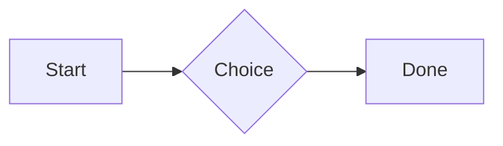
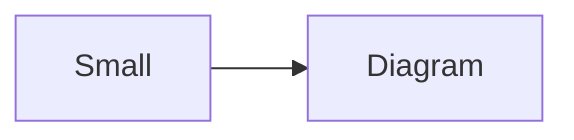

# QA · Right after: Card

Card followed straight away, with no blank line, by each element. Check: nothing overlaps, nothing is cut off, and the space between is even. Markdown joins some pairs without a blank line (text followed by --- is a heading, and a line of text can carry on into the next), so check that what's drawn matches the Markdown.

#qa/adjacent

#### 1. Card, then Paragraph

::: card
Text in a card.
:::
A paragraph with **bold**, *italic*, <u>underlined</u>, ~~struck~~, ==highlighted==, `code`, a [link](https://example.com) and a #qa/tag.

#### 2. Card, then Long paragraph

::: card
Text in a card.
:::
A long paragraph that wraps onto several lines at the usual width, so the space between its lines, its indent on every line, and where it meets the edges of anything around it can be checked. It goes on a little longer to be sure it wraps on a phone too.

#### 3. Card, then Heading 1

::: card
Text in a card.
:::
# Heading one

#### 4. Card, then Heading 2

::: card
Text in a card.
:::
## Heading two

#### 5. Card, then Heading 3

::: card
Text in a card.
:::
### Heading three

#### 6. Card, then Bullet list

::: card
Text in a card.
:::
- First item
- Second item
  - Nested item
    - Third level
- Last item

#### 7. Card, then Numbered list

::: card
Text in a card.
:::
1. First
2. Second
   1. Nested
3. Third

#### 8. Card, then Todo list

::: card
Text in a card.
:::
- [x] Done todo
- [ ] Open todo
  - [ ] Nested open todo

#### 9. Card, then Quote

::: card
Text in a card.
:::
> A quote that runs over
> two lines.

#### 10. Card, then Code block

::: card
Text in a card.
:::
```
plain code
  indented line
```

#### 11. Card, then Code block (TypeScript)

::: card
Text in a card.
:::
```ts
const greeting: string = "hello";
console.log(greeting);
```

#### 12. Card, then JSON block (no language)

::: card
Text in a card.
:::
```
{"name":"lines","tags":["a","b"],"id":12345678901234567890}
```

#### 13. Card, then Diagram

::: card
Text in a card.
:::


#### 14. Card, then Diagram (240 px wide)

::: card
Text in a card.
:::


#### 15. Card, then Math block

::: card
Text in a card.
:::
$$
\int_0^1 x^2\,dx = \frac{1}{3}
$$

#### 16. Card, then Table

::: card
Text in a card.
:::
| Left | Center | Right |
| :--- | :----: | ----: |
| a | **b** | 1 |
| longer cell text | `code` | 22 |

#### 17. Card, then Table with formulas

::: card
Text in a card.
:::
| Item | Cost |
| --- | ---: |
| Rent | 1200 |
| Food | 450.50 |
| Total | =SUM(B2:B3) |
| Broken | =B2/0 |

#### 18. Card, then Spreadsheet (csv block)

::: card
Text in a card.
:::
```csv
Item, Cost
Rent, 1200
Food, 450.50
Total, =SUM(B2:B3)
```

#### 19. Card, then Named spreadsheet (csv name=), and a formula in another block using it

::: card
Text in a card.
:::
```csv name=costs
Item, Cost, Day
Rent, $1200, 2026-01-05
```

```csv
Total, =costs!B2*2
```

#### 20. Card, then Divider

::: card
Text in a card.
:::
---

#### 21. Card, then Key: Value line

::: card
Text in a card.
:::
**Wi-Fi password:** correct-horse-battery

#### 22. Card, then Mention

::: card
Text in a card.
:::
Ask @[QA · Ada] at @[QA · Ada].email.

#### 23. Card, then Wiki link

::: card
Text in a card.
:::
Ask [[QA · Ada]], or [[QA · Ada|her]].

#### 24. Card, then Symbols

::: card
Text in a card.
:::
Home -> cabin <- back, a <-> b, x => y, p <=> q, 1 <= 2 >= 0 != 3. Stays: --> !== \-> and `a -> b` in code.

#### 25. Card, then GitHub links

::: card
Text in a card.
:::
Issue https://github.com/overtio/lines/issues/1 and [a named link](https://github.com/overtio/lines)

#### 26. Card, then Image

::: card
Text in a card.
:::


#### 27. Card, then Drawing

::: card
Text in a card.
:::


#### 28. Card, then File

::: card
Text in a card.
:::
[Budget.csv](attachment:budget.csv)

#### 29. Card, then Missing file

::: card
Text in a card.
:::
[Not here yet.pdf](../attachments/00000000000000000000000000000000.pdf)

#### 30. Card, then Card

::: card
Text in a card.
:::
::: card
Text in a card.
:::

#### 31. Card, then Callout (info)

::: card
Text in a card.
:::
:::i
Text in an info callout.
:::

#### 32. Card, then Callout (warning, chosen icon)

::: card
Text in a card.
:::
:::! icon=flag
Text in a warning callout with the flag icon.
:::

#### 33. Card, then Callout (decision, no icon)

::: card
Text in a card.
:::
:::^ icon=none
Text in a decision callout with no icon.
:::
