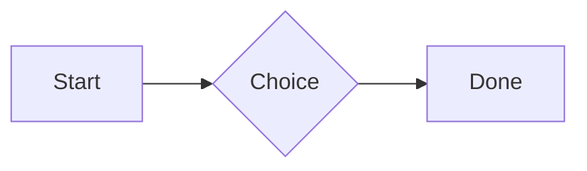
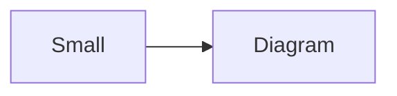

# QA · Right after: Divider

Divider followed straight away, with no blank line, by each element. Check: nothing overlaps, nothing is cut off, and the space between is even. Markdown joins some pairs without a blank line (text followed by --- is a heading, and a line of text can carry on into the next), so check that what's drawn matches the Markdown.

#qa/adjacent

#### 1. Divider, then Paragraph

---
A paragraph with **bold**, *italic*, <u>underlined</u>, ~~struck~~, ==highlighted==, `code`, a [link](https://example.com) and a #qa/tag.

#### 2. Divider, then Long paragraph

---
A long paragraph that wraps onto several lines at the usual width, so the space between its lines, its indent on every line, and where it meets the edges of anything around it can be checked. It goes on a little longer to be sure it wraps on a phone too.

#### 3. Divider, then Heading 1

---
# Heading one

#### 4. Divider, then Heading 2

---
## Heading two

#### 5. Divider, then Heading 3

---
### Heading three

#### 6. Divider, then Bullet list

---
- First item
- Second item
  - Nested item
    - Third level
- Last item

#### 7. Divider, then Numbered list

---
1. First
2. Second
   1. Nested
3. Third

#### 8. Divider, then Todo list

---
- [x] Done todo
- [ ] Open todo
  - [ ] Nested open todo

#### 9. Divider, then Quote

---
> A quote that runs over
> two lines.

#### 10. Divider, then Line marks

---
Marked as the accent. <!-- mark -->
Two lines marked green, one bar. <!-- mark green: ready -->
The second of them. <!-- mark green: ready -->
Red, with a label to point at. <!-- mark red: to fix -->
- A list item, marked purple. <!-- mark purple -->

#### 11. Divider, then Code block

---
```
plain code
  indented line
```

#### 12. Divider, then Code block (TypeScript)

---
```ts
const greeting: string = "hello";
console.log(greeting);
```

#### 13. Divider, then JSON block (no language)

---
```
{"name":"lines","tags":["a","b"],"id":12345678901234567890}
```

#### 14. Divider, then Diagram

---


#### 15. Divider, then Diagram (240 px wide)

---


#### 16. Divider, then 3D model (openscad block), a colored part, an echo

---
```openscad
difference() {
  cube(20, center = true);
  sphere(r = 13);
}
translate([25, 0, 0]) color("tomato") cylinder(h = 10, r = 5);
echo("made");
```

#### 17. Divider, then Flat model (openscad block)

---
```openscad
square(20);
translate([30, 10]) circle(8);
```

#### 18. Divider, then Broken model (openscad block)

---
```openscad
cube(10)
sphere(3;
```

#### 19. Divider, then 3D model (stl block)

---
```stl
solid pyramid
facet normal 0 0 -1
outer loop
vertex 0 0 0
vertex 10 10 0
vertex 10 0 0
endloop
endfacet
facet normal 0 0 -1
outer loop
vertex 0 0 0
vertex 0 10 0
vertex 10 10 0
endloop
endfacet
facet normal 0 -1 1
outer loop
vertex 0 0 0
vertex 10 0 0
vertex 5 5 8
endloop
endfacet
facet normal 1 0 1
outer loop
vertex 10 0 0
vertex 10 10 0
vertex 5 5 8
endloop
endfacet
facet normal 0 1 1
outer loop
vertex 10 10 0
vertex 0 10 0
vertex 5 5 8
endloop
endfacet
facet normal -1 0 1
outer loop
vertex 0 10 0
vertex 0 0 0
vertex 5 5 8
endloop
endfacet
endsolid pyramid
```

#### 20. Divider, then Timing diagram (wavedrom block)

---
```wavedrom
{ signal: [
  { name: "clk", wave: "p.....|..." },
  { name: "data", wave: "x.345x|=.x", data: ["head", "body", "tail", "data"] },
  {},
  { name: "ack", wave: "1.....|01.", node: ".a......b" }
], edge: ["a~>b t1"] }
```

#### 21. Divider, then Typing practice (typing block)

---
```typing
It’s a “fine” day — type it.
function go() {
  return 1;
}
```

#### 22. Divider, then Math block

---
$$
\int_0^1 x^2\,dx = \frac{1}{3}
$$

#### 23. Divider, then Table

---
| Left | Center | Right |
| :--- | :----: | ----: |
| a | **b** | 1 |
| longer cell text | `code` | 22 |

#### 24. Divider, then Table with formulas

---
| Item | Cost |
| --- | ---: |
| Rent | 1200 |
| Food | 450.50 |
| Total | =SUM(B2:B3) |
| Broken | =B2/0 |

#### 25. Divider, then Hurl entries (hurl block): a capture used by the next entry, and asserts

---
```hurl
# A todo
GET https://jsonplaceholder.typicode.com/todos/1
HTTP 200
[Captures]
owner: jsonpath "$.userId"
[Asserts]
jsonpath "$.id" == 1

# Its owner
GET https://jsonplaceholder.typicode.com/users/{{owner}}
HTTP 200
[Asserts]
jsonpath "$.name" isString
```

#### 26. Divider, then Secret ({{name}}, kept in a locked secrets note)

---
The token is {{qa-token}}, and {{no-such-secret}} isn't one.

#### 27. Divider, then API requests (http block): a variable, a named request and one using its response

---
```http
@api = https://jsonplaceholder.typicode.com

### A todo
# @name todo
GET {{api}}/todos/1

### Its owner
GET {{api}}/users/{{todo.response.body.$.userId}}
```

#### 28. Divider, then Spreadsheet (csv block)

---
```csv
Item, Cost
Rent, 1200
Food, 450.50
Total, =SUM(B2:B3)
```

#### 29. Divider, then Named spreadsheet (csv name=), and a formula in another block using it

---
```csv name=costs
Item, Cost, Day
Rent, $1200, 2026-01-05
```

```csv
Total, =costs!B2*2
```

#### 30. Divider, then Divider

---
---

#### 31. Divider, then Page breaks (as lines writes them, and as Obsidian and Typora do; a new page in the PDF at each, a gap between pages over a backdrop)

---
Before the break.

<!-- pagebreak -->
After it, on a new page.

<div style="page-break-after: always"></div>

And another.

#### 32. Divider, then Key: Value line

---
**Wi-Fi password:** correct-horse-battery

#### 33. Divider, then Score (Settings → Little Touches)

---
Rating: 4/5
Half: 3.5/5
Score: 7 / 10
Not a score: 12/20

#### 34. Divider, then Mention

---
Ask @[QA · Ada] at @[QA · Ada].email.

#### 35. Divider, then Wiki link

---
Ask [[QA · Ada]], or [[QA · Ada|her]].

#### 36. Divider, then Symbols

---
Home -> cabin <- back, a <-> b, x => y, p <=> q, 1 <= 2 >= 0 != 3. Stays: --> !== \-> and `a -> b` in code.

#### 37. Divider, then GitHub links

---
Issue https://github.com/overtio/lines/issues/1 and [a named link](https://github.com/overtio/lines)

#### 38. Divider, then arXiv links

---
Paper https://arxiv.org/abs/1706.03762 and [a named link](https://arxiv.org/abs/2006.11239)

#### 39. Divider, then Time in an episode

---
At [12:34](https://traffic.megaphone.fm/FSI3647670844.mp3#t=754) they said it; [3:16] stays text here

#### 40. Divider, then Image

---


#### 41. Divider, then Drawing

---


#### 42. Divider, then File

---
[Budget.csv](attachment:budget.csv)

#### 43. Divider, then Folder and file links

---
See [Projects](file:///Users/me/My%20Projects/) and [the plan](file:///Users/me/plan.pdf) on this computer.

#### 44. Divider, then Attached 3D model (STL)

---
[Bracket.stl](attachment:bracket.stl)

#### 45. Divider, then Terminal recording (.cast file)

---
[terminal.cast](attachment:terminal.cast)

#### 46. Divider, then Audio

---
[Chime.mp3](attachment:chime.mp3)

#### 47. Divider, then Video

---
[Sky.mp4](attachment:sky.mp4)

#### 48. Divider, then Missing file

---
[Not here yet.pdf](../attachments/00000000000000000000000000000000.pdf)

#### 49. Divider, then Card

---
::: card
Text in a card.
:::

#### 50. Divider, then Callout (info)

---
:::i
Text in an info callout.
:::

#### 51. Divider, then Callout (warning, chosen icon)

---
:::! icon=flag
Text in a warning callout with the flag icon.
:::

#### 52. Divider, then Callout (decision, no icon)

---
:::^ icon=none
Text in a decision callout with no icon.
:::
