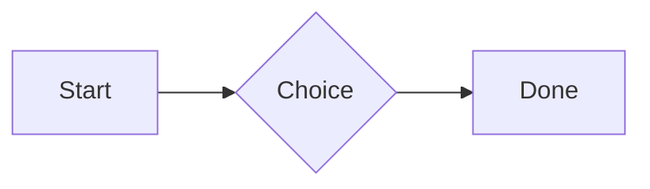
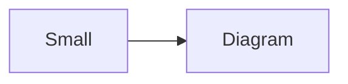

# QA · Right after: GitHub links

GitHub links followed straight away, with no blank line, by each element. Check: nothing overlaps, nothing is cut off, and the space between is even. Markdown joins some pairs without a blank line (text followed by --- is a heading, and a line of text can carry on into the next), so check that what's drawn matches the Markdown.

#qa/adjacent

#### 1. GitHub links, then Paragraph

Issue https://github.com/overtio/lines/issues/1 and [a named link](https://github.com/overtio/lines)
A paragraph with **bold**, *italic*, <u>underlined</u>, ~~struck~~, ==highlighted==, `code`, a [link](https://example.com) and a #qa/tag.

#### 2. GitHub links, then Long paragraph

Issue https://github.com/overtio/lines/issues/1 and [a named link](https://github.com/overtio/lines)
A long paragraph that wraps onto several lines at the usual width, so the space between its lines, its indent on every line, and where it meets the edges of anything around it can be checked. It goes on a little longer to be sure it wraps on a phone too.

#### 3. GitHub links, then Heading 1

Issue https://github.com/overtio/lines/issues/1 and [a named link](https://github.com/overtio/lines)
# Heading one

#### 4. GitHub links, then Heading 2

Issue https://github.com/overtio/lines/issues/1 and [a named link](https://github.com/overtio/lines)
## Heading two

#### 5. GitHub links, then Heading 3

Issue https://github.com/overtio/lines/issues/1 and [a named link](https://github.com/overtio/lines)
### Heading three

#### 6. GitHub links, then Bullet list

Issue https://github.com/overtio/lines/issues/1 and [a named link](https://github.com/overtio/lines)
- First item
- Second item
  - Nested item
    - Third level
- Last item

#### 7. GitHub links, then Numbered list

Issue https://github.com/overtio/lines/issues/1 and [a named link](https://github.com/overtio/lines)
1. First
2. Second
   1. Nested
3. Third

#### 8. GitHub links, then Todo list

Issue https://github.com/overtio/lines/issues/1 and [a named link](https://github.com/overtio/lines)
- [x] Done todo
- [ ] Open todo
  - [ ] Nested open todo

#### 9. GitHub links, then Quote

Issue https://github.com/overtio/lines/issues/1 and [a named link](https://github.com/overtio/lines)
> A quote that runs over
> two lines.

#### 10. GitHub links, then Code block

Issue https://github.com/overtio/lines/issues/1 and [a named link](https://github.com/overtio/lines)
```
plain code
  indented line
```

#### 11. GitHub links, then Code block (TypeScript)

Issue https://github.com/overtio/lines/issues/1 and [a named link](https://github.com/overtio/lines)
```ts
const greeting: string = "hello";
console.log(greeting);
```

#### 12. GitHub links, then JSON block (no language)

Issue https://github.com/overtio/lines/issues/1 and [a named link](https://github.com/overtio/lines)
```
{"name":"lines","tags":["a","b"],"id":12345678901234567890}
```

#### 13. GitHub links, then Diagram

Issue https://github.com/overtio/lines/issues/1 and [a named link](https://github.com/overtio/lines)


#### 14. GitHub links, then Diagram (240 px wide)

Issue https://github.com/overtio/lines/issues/1 and [a named link](https://github.com/overtio/lines)


#### 15. GitHub links, then 3D model (openscad block), a colored part, an echo

Issue https://github.com/overtio/lines/issues/1 and [a named link](https://github.com/overtio/lines)
```openscad
difference() {
  cube(20, center = true);
  sphere(r = 13);
}
translate([25, 0, 0]) color("tomato") cylinder(h = 10, r = 5);
echo("made");
```

#### 16. GitHub links, then Flat model (openscad block)

Issue https://github.com/overtio/lines/issues/1 and [a named link](https://github.com/overtio/lines)
```openscad
square(20);
translate([30, 10]) circle(8);
```

#### 17. GitHub links, then Broken model (openscad block)

Issue https://github.com/overtio/lines/issues/1 and [a named link](https://github.com/overtio/lines)
```openscad
cube(10)
sphere(3;
```

#### 18. GitHub links, then 3D model (stl block)

Issue https://github.com/overtio/lines/issues/1 and [a named link](https://github.com/overtio/lines)
```stl
solid pyramid
facet normal 0 0 -1
outer loop
vertex 0 0 0
vertex 10 10 0
vertex 10 0 0
endloop
endfacet
facet normal 0 0 -1
outer loop
vertex 0 0 0
vertex 0 10 0
vertex 10 10 0
endloop
endfacet
facet normal 0 -1 1
outer loop
vertex 0 0 0
vertex 10 0 0
vertex 5 5 8
endloop
endfacet
facet normal 1 0 1
outer loop
vertex 10 0 0
vertex 10 10 0
vertex 5 5 8
endloop
endfacet
facet normal 0 1 1
outer loop
vertex 10 10 0
vertex 0 10 0
vertex 5 5 8
endloop
endfacet
facet normal -1 0 1
outer loop
vertex 0 10 0
vertex 0 0 0
vertex 5 5 8
endloop
endfacet
endsolid pyramid
```

#### 19. GitHub links, then Timing diagram (wavedrom block)

Issue https://github.com/overtio/lines/issues/1 and [a named link](https://github.com/overtio/lines)
```wavedrom
{ signal: [
  { name: "clk", wave: "p.....|..." },
  { name: "data", wave: "x.345x|=.x", data: ["head", "body", "tail", "data"] },
  {},
  { name: "ack", wave: "1.....|01.", node: ".a......b" }
], edge: ["a~>b t1"] }
```

#### 20. GitHub links, then Math block

Issue https://github.com/overtio/lines/issues/1 and [a named link](https://github.com/overtio/lines)
$$
\int_0^1 x^2\,dx = \frac{1}{3}
$$

#### 21. GitHub links, then Table

Issue https://github.com/overtio/lines/issues/1 and [a named link](https://github.com/overtio/lines)
| Left | Center | Right |
| :--- | :----: | ----: |
| a | **b** | 1 |
| longer cell text | `code` | 22 |

#### 22. GitHub links, then Table with formulas

Issue https://github.com/overtio/lines/issues/1 and [a named link](https://github.com/overtio/lines)
| Item | Cost |
| --- | ---: |
| Rent | 1200 |
| Food | 450.50 |
| Total | =SUM(B2:B3) |
| Broken | =B2/0 |

#### 23. GitHub links, then Hurl entries (hurl block): a capture used by the next entry, and asserts

Issue https://github.com/overtio/lines/issues/1 and [a named link](https://github.com/overtio/lines)
```hurl
# A todo
GET https://jsonplaceholder.typicode.com/todos/1
HTTP 200
[Captures]
owner: jsonpath "$.userId"
[Asserts]
jsonpath "$.id" == 1

# Its owner
GET https://jsonplaceholder.typicode.com/users/{{owner}}
HTTP 200
[Asserts]
jsonpath "$.name" isString
```

#### 24. GitHub links, then Secret ({{name}}, kept in a locked secrets note)

Issue https://github.com/overtio/lines/issues/1 and [a named link](https://github.com/overtio/lines)
The token is {{qa-token}}, and {{no-such-secret}} isn't one.

#### 25. GitHub links, then API requests (http block): a variable, a named request and one using its response

Issue https://github.com/overtio/lines/issues/1 and [a named link](https://github.com/overtio/lines)
```http
@api = https://jsonplaceholder.typicode.com

### A todo
# @name todo
GET {{api}}/todos/1

### Its owner
GET {{api}}/users/{{todo.response.body.$.userId}}
```

#### 26. GitHub links, then Spreadsheet (csv block)

Issue https://github.com/overtio/lines/issues/1 and [a named link](https://github.com/overtio/lines)
```csv
Item, Cost
Rent, 1200
Food, 450.50
Total, =SUM(B2:B3)
```

#### 27. GitHub links, then Named spreadsheet (csv name=), and a formula in another block using it

Issue https://github.com/overtio/lines/issues/1 and [a named link](https://github.com/overtio/lines)
```csv name=costs
Item, Cost, Day
Rent, $1200, 2026-01-05
```

```csv
Total, =costs!B2*2
```

#### 28. GitHub links, then Divider

Issue https://github.com/overtio/lines/issues/1 and [a named link](https://github.com/overtio/lines)
---

#### 29. GitHub links, then Key: Value line

Issue https://github.com/overtio/lines/issues/1 and [a named link](https://github.com/overtio/lines)
**Wi-Fi password:** correct-horse-battery

#### 30. GitHub links, then Mention

Issue https://github.com/overtio/lines/issues/1 and [a named link](https://github.com/overtio/lines)
Ask @[QA · Ada] at @[QA · Ada].email.

#### 31. GitHub links, then Wiki link

Issue https://github.com/overtio/lines/issues/1 and [a named link](https://github.com/overtio/lines)
Ask [[QA · Ada]], or [[QA · Ada|her]].

#### 32. GitHub links, then Symbols

Issue https://github.com/overtio/lines/issues/1 and [a named link](https://github.com/overtio/lines)
Home -> cabin <- back, a <-> b, x => y, p <=> q, 1 <= 2 >= 0 != 3. Stays: --> !== \-> and `a -> b` in code.

#### 33. GitHub links, then GitHub links

Issue https://github.com/overtio/lines/issues/1 and [a named link](https://github.com/overtio/lines)
Issue https://github.com/overtio/lines/issues/1 and [a named link](https://github.com/overtio/lines)

#### 34. GitHub links, then arXiv links

Issue https://github.com/overtio/lines/issues/1 and [a named link](https://github.com/overtio/lines)
Paper https://arxiv.org/abs/1706.03762 and [a named link](https://arxiv.org/abs/2006.11239)

#### 35. GitHub links, then Image

Issue https://github.com/overtio/lines/issues/1 and [a named link](https://github.com/overtio/lines)


#### 36. GitHub links, then Drawing

Issue https://github.com/overtio/lines/issues/1 and [a named link](https://github.com/overtio/lines)


#### 37. GitHub links, then File

Issue https://github.com/overtio/lines/issues/1 and [a named link](https://github.com/overtio/lines)
[Budget.csv](attachment:budget.csv)

#### 38. GitHub links, then Attached 3D model (STL)

Issue https://github.com/overtio/lines/issues/1 and [a named link](https://github.com/overtio/lines)
[Bracket.stl](attachment:bracket.stl)

#### 39. GitHub links, then Terminal recording (.cast file)

Issue https://github.com/overtio/lines/issues/1 and [a named link](https://github.com/overtio/lines)
[terminal.cast](attachment:terminal.cast)

#### 40. GitHub links, then Missing file

Issue https://github.com/overtio/lines/issues/1 and [a named link](https://github.com/overtio/lines)
[Not here yet.pdf](../attachments/00000000000000000000000000000000.pdf)

#### 41. GitHub links, then Card

Issue https://github.com/overtio/lines/issues/1 and [a named link](https://github.com/overtio/lines)
::: card
Text in a card.
:::

#### 42. GitHub links, then Callout (info)

Issue https://github.com/overtio/lines/issues/1 and [a named link](https://github.com/overtio/lines)
:::i
Text in an info callout.
:::

#### 43. GitHub links, then Callout (warning, chosen icon)

Issue https://github.com/overtio/lines/issues/1 and [a named link](https://github.com/overtio/lines)
:::! icon=flag
Text in a warning callout with the flag icon.
:::

#### 44. GitHub links, then Callout (decision, no icon)

Issue https://github.com/overtio/lines/issues/1 and [a named link](https://github.com/overtio/lines)
:::^ icon=none
Text in a decision callout with no icon.
:::
