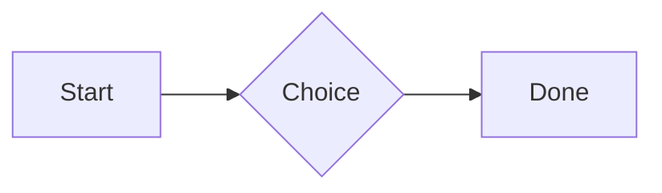
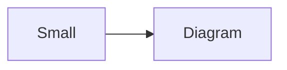

# QA · Right after: Score (Settings → Little Touches)

Score (Settings → Little Touches) followed straight away, with no blank line, by each element. Check: nothing overlaps, nothing is cut off, and the space between is even. Markdown joins some pairs without a blank line (text followed by --- is a heading, and a line of text can carry on into the next), so check that what's drawn matches the Markdown.

#qa/adjacent

#### 1. Score (Settings → Little Touches), then Paragraph

Rating: 4/5
Score: 7 / 10
Not a score: 12/20
A paragraph with **bold**, *italic*, <u>underlined</u>, ~~struck~~, ==highlighted==, `code`, a [link](https://example.com) and a #qa/tag.

#### 2. Score (Settings → Little Touches), then Long paragraph

Rating: 4/5
Score: 7 / 10
Not a score: 12/20
A long paragraph that wraps onto several lines at the usual width, so the space between its lines, its indent on every line, and where it meets the edges of anything around it can be checked. It goes on a little longer to be sure it wraps on a phone too.

#### 3. Score (Settings → Little Touches), then Heading 1

Rating: 4/5
Score: 7 / 10
Not a score: 12/20
# Heading one

#### 4. Score (Settings → Little Touches), then Heading 2

Rating: 4/5
Score: 7 / 10
Not a score: 12/20
## Heading two

#### 5. Score (Settings → Little Touches), then Heading 3

Rating: 4/5
Score: 7 / 10
Not a score: 12/20
### Heading three

#### 6. Score (Settings → Little Touches), then Bullet list

Rating: 4/5
Score: 7 / 10
Not a score: 12/20
- First item
- Second item
  - Nested item
    - Third level
- Last item

#### 7. Score (Settings → Little Touches), then Numbered list

Rating: 4/5
Score: 7 / 10
Not a score: 12/20
1. First
2. Second
   1. Nested
3. Third

#### 8. Score (Settings → Little Touches), then Todo list

Rating: 4/5
Score: 7 / 10
Not a score: 12/20
- [x] Done todo
- [ ] Open todo
  - [ ] Nested open todo

#### 9. Score (Settings → Little Touches), then Quote

Rating: 4/5
Score: 7 / 10
Not a score: 12/20
> A quote that runs over
> two lines.

#### 10. Score (Settings → Little Touches), then Line marks

Rating: 4/5
Score: 7 / 10
Not a score: 12/20
Marked as the accent. <!-- mark -->
Two lines marked green, one bar. <!-- mark green: ready -->
The second of them. <!-- mark green: ready -->
Red, with a label to point at. <!-- mark red: to fix -->
- A list item, marked purple. <!-- mark purple -->

#### 11. Score (Settings → Little Touches), then Code block

Rating: 4/5
Score: 7 / 10
Not a score: 12/20
```
plain code
  indented line
```

#### 12. Score (Settings → Little Touches), then Code block (TypeScript)

Rating: 4/5
Score: 7 / 10
Not a score: 12/20
```ts
const greeting: string = "hello";
console.log(greeting);
```

#### 13. Score (Settings → Little Touches), then JSON block (no language)

Rating: 4/5
Score: 7 / 10
Not a score: 12/20
```
{"name":"lines","tags":["a","b"],"id":12345678901234567890}
```

#### 14. Score (Settings → Little Touches), then Diagram

Rating: 4/5
Score: 7 / 10
Not a score: 12/20


#### 15. Score (Settings → Little Touches), then Diagram (240 px wide)

Rating: 4/5
Score: 7 / 10
Not a score: 12/20


#### 16. Score (Settings → Little Touches), then 3D model (openscad block), a colored part, an echo

Rating: 4/5
Score: 7 / 10
Not a score: 12/20
```openscad
difference() {
  cube(20, center = true);
  sphere(r = 13);
}
translate([25, 0, 0]) color("tomato") cylinder(h = 10, r = 5);
echo("made");
```

#### 17. Score (Settings → Little Touches), then Flat model (openscad block)

Rating: 4/5
Score: 7 / 10
Not a score: 12/20
```openscad
square(20);
translate([30, 10]) circle(8);
```

#### 18. Score (Settings → Little Touches), then Broken model (openscad block)

Rating: 4/5
Score: 7 / 10
Not a score: 12/20
```openscad
cube(10)
sphere(3;
```

#### 19. Score (Settings → Little Touches), then 3D model (stl block)

Rating: 4/5
Score: 7 / 10
Not a score: 12/20
```stl
solid pyramid
facet normal 0 0 -1
outer loop
vertex 0 0 0
vertex 10 10 0
vertex 10 0 0
endloop
endfacet
facet normal 0 0 -1
outer loop
vertex 0 0 0
vertex 0 10 0
vertex 10 10 0
endloop
endfacet
facet normal 0 -1 1
outer loop
vertex 0 0 0
vertex 10 0 0
vertex 5 5 8
endloop
endfacet
facet normal 1 0 1
outer loop
vertex 10 0 0
vertex 10 10 0
vertex 5 5 8
endloop
endfacet
facet normal 0 1 1
outer loop
vertex 10 10 0
vertex 0 10 0
vertex 5 5 8
endloop
endfacet
facet normal -1 0 1
outer loop
vertex 0 10 0
vertex 0 0 0
vertex 5 5 8
endloop
endfacet
endsolid pyramid
```

#### 20. Score (Settings → Little Touches), then Timing diagram (wavedrom block)

Rating: 4/5
Score: 7 / 10
Not a score: 12/20
```wavedrom
{ signal: [
  { name: "clk", wave: "p.....|..." },
  { name: "data", wave: "x.345x|=.x", data: ["head", "body", "tail", "data"] },
  {},
  { name: "ack", wave: "1.....|01.", node: ".a......b" }
], edge: ["a~>b t1"] }
```

#### 21. Score (Settings → Little Touches), then Typing practice (typing block)

Rating: 4/5
Score: 7 / 10
Not a score: 12/20
```typing
It’s a “fine” day — type it.
function go() {
  return 1;
}
```

#### 22. Score (Settings → Little Touches), then Math block

Rating: 4/5
Score: 7 / 10
Not a score: 12/20
$$
\int_0^1 x^2\,dx = \frac{1}{3}
$$

#### 23. Score (Settings → Little Touches), then Table

Rating: 4/5
Score: 7 / 10
Not a score: 12/20
| Left | Center | Right |
| :--- | :----: | ----: |
| a | **b** | 1 |
| longer cell text | `code` | 22 |

#### 24. Score (Settings → Little Touches), then Table with formulas

Rating: 4/5
Score: 7 / 10
Not a score: 12/20
| Item | Cost |
| --- | ---: |
| Rent | 1200 |
| Food | 450.50 |
| Total | =SUM(B2:B3) |
| Broken | =B2/0 |

#### 25. Score (Settings → Little Touches), then Hurl entries (hurl block): a capture used by the next entry, and asserts

Rating: 4/5
Score: 7 / 10
Not a score: 12/20
```hurl
# A todo
GET https://jsonplaceholder.typicode.com/todos/1
HTTP 200
[Captures]
owner: jsonpath "$.userId"
[Asserts]
jsonpath "$.id" == 1

# Its owner
GET https://jsonplaceholder.typicode.com/users/{{owner}}
HTTP 200
[Asserts]
jsonpath "$.name" isString
```

#### 26. Score (Settings → Little Touches), then Secret ({{name}}, kept in a locked secrets note)

Rating: 4/5
Score: 7 / 10
Not a score: 12/20
The token is {{qa-token}}, and {{no-such-secret}} isn't one.

#### 27. Score (Settings → Little Touches), then API requests (http block): a variable, a named request and one using its response

Rating: 4/5
Score: 7 / 10
Not a score: 12/20
```http
@api = https://jsonplaceholder.typicode.com

### A todo
# @name todo
GET {{api}}/todos/1

### Its owner
GET {{api}}/users/{{todo.response.body.$.userId}}
```

#### 28. Score (Settings → Little Touches), then Spreadsheet (csv block)

Rating: 4/5
Score: 7 / 10
Not a score: 12/20
```csv
Item, Cost
Rent, 1200
Food, 450.50
Total, =SUM(B2:B3)
```

#### 29. Score (Settings → Little Touches), then Named spreadsheet (csv name=), and a formula in another block using it

Rating: 4/5
Score: 7 / 10
Not a score: 12/20
```csv name=costs
Item, Cost, Day
Rent, $1200, 2026-01-05
```

```csv
Total, =costs!B2*2
```

#### 30. Score (Settings → Little Touches), then Divider

Rating: 4/5
Score: 7 / 10
Not a score: 12/20
---

#### 31. Score (Settings → Little Touches), then Page breaks (as lines writes them, and as Obsidian and Typora do; a new page in the PDF at each, a gap between pages over a backdrop)

Rating: 4/5
Score: 7 / 10
Not a score: 12/20
Before the break.

<!-- pagebreak -->
After it, on a new page.

<div style="page-break-after: always"></div>

And another.

#### 32. Score (Settings → Little Touches), then Key: Value line

Rating: 4/5
Score: 7 / 10
Not a score: 12/20
**Wi-Fi password:** correct-horse-battery

#### 33. Score (Settings → Little Touches), then Score (Settings → Little Touches)

Rating: 4/5
Score: 7 / 10
Not a score: 12/20
Rating: 4/5
Score: 7 / 10
Not a score: 12/20

#### 34. Score (Settings → Little Touches), then Mention

Rating: 4/5
Score: 7 / 10
Not a score: 12/20
Ask @[QA · Ada] at @[QA · Ada].email.

#### 35. Score (Settings → Little Touches), then Wiki link

Rating: 4/5
Score: 7 / 10
Not a score: 12/20
Ask [[QA · Ada]], or [[QA · Ada|her]].

#### 36. Score (Settings → Little Touches), then Symbols

Rating: 4/5
Score: 7 / 10
Not a score: 12/20
Home -> cabin <- back, a <-> b, x => y, p <=> q, 1 <= 2 >= 0 != 3. Stays: --> !== \-> and `a -> b` in code.

#### 37. Score (Settings → Little Touches), then GitHub links

Rating: 4/5
Score: 7 / 10
Not a score: 12/20
Issue https://github.com/overtio/lines/issues/1 and [a named link](https://github.com/overtio/lines)

#### 38. Score (Settings → Little Touches), then arXiv links

Rating: 4/5
Score: 7 / 10
Not a score: 12/20
Paper https://arxiv.org/abs/1706.03762 and [a named link](https://arxiv.org/abs/2006.11239)

#### 39. Score (Settings → Little Touches), then Time in an episode

Rating: 4/5
Score: 7 / 10
Not a score: 12/20
At [12:34](https://traffic.megaphone.fm/FSI3647670844.mp3#t=754) they said it; [3:16] stays text here

#### 40. Score (Settings → Little Touches), then Image

Rating: 4/5
Score: 7 / 10
Not a score: 12/20


#### 41. Score (Settings → Little Touches), then Drawing

Rating: 4/5
Score: 7 / 10
Not a score: 12/20


#### 42. Score (Settings → Little Touches), then File

Rating: 4/5
Score: 7 / 10
Not a score: 12/20
[Budget.csv](attachment:budget.csv)

#### 43. Score (Settings → Little Touches), then Folder and file links

Rating: 4/5
Score: 7 / 10
Not a score: 12/20
See [Projects](file:///Users/me/My%20Projects/) and [the plan](file:///Users/me/plan.pdf) on this computer.

#### 44. Score (Settings → Little Touches), then Attached 3D model (STL)

Rating: 4/5
Score: 7 / 10
Not a score: 12/20
[Bracket.stl](attachment:bracket.stl)

#### 45. Score (Settings → Little Touches), then Terminal recording (.cast file)

Rating: 4/5
Score: 7 / 10
Not a score: 12/20
[terminal.cast](attachment:terminal.cast)

#### 46. Score (Settings → Little Touches), then Audio

Rating: 4/5
Score: 7 / 10
Not a score: 12/20
[Chime.mp3](attachment:chime.mp3)

#### 47. Score (Settings → Little Touches), then Video

Rating: 4/5
Score: 7 / 10
Not a score: 12/20
[Sky.mp4](attachment:sky.mp4)

#### 48. Score (Settings → Little Touches), then Missing file

Rating: 4/5
Score: 7 / 10
Not a score: 12/20
[Not here yet.pdf](../attachments/00000000000000000000000000000000.pdf)

#### 49. Score (Settings → Little Touches), then Card

Rating: 4/5
Score: 7 / 10
Not a score: 12/20
::: card
Text in a card.
:::

#### 50. Score (Settings → Little Touches), then Callout (info)

Rating: 4/5
Score: 7 / 10
Not a score: 12/20
:::i
Text in an info callout.
:::

#### 51. Score (Settings → Little Touches), then Callout (warning, chosen icon)

Rating: 4/5
Score: 7 / 10
Not a score: 12/20
:::! icon=flag
Text in a warning callout with the flag icon.
:::

#### 52. Score (Settings → Little Touches), then Callout (decision, no icon)

Rating: 4/5
Score: 7 / 10
Not a score: 12/20
:::^ icon=none
Text in a decision callout with no icon.
:::
