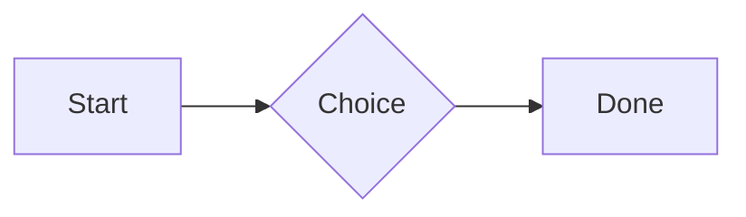
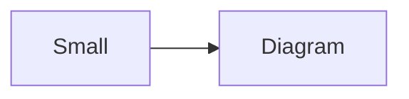

# QA · Right after: Wiki link

Wiki link followed straight away, with no blank line, by each element. Check: nothing overlaps, nothing is cut off, and the space between is even. Markdown joins some pairs without a blank line (text followed by --- is a heading, and a line of text can carry on into the next), so check that what's drawn matches the Markdown.

#qa/adjacent

#### 1. Wiki link, then Paragraph

Ask [[QA · Ada]], or [[QA · Ada|her]].
A paragraph with **bold**, *italic*, <u>underlined</u>, ~~struck~~, ==highlighted==, `code`, a [link](https://example.com) and a #qa/tag.

#### 2. Wiki link, then Long paragraph

Ask [[QA · Ada]], or [[QA · Ada|her]].
A long paragraph that wraps onto several lines at the usual width, so the space between its lines, its indent on every line, and where it meets the edges of anything around it can be checked. It goes on a little longer to be sure it wraps on a phone too.

#### 3. Wiki link, then Heading 1

Ask [[QA · Ada]], or [[QA · Ada|her]].
# Heading one

#### 4. Wiki link, then Heading 2

Ask [[QA · Ada]], or [[QA · Ada|her]].
## Heading two

#### 5. Wiki link, then Heading 3

Ask [[QA · Ada]], or [[QA · Ada|her]].
### Heading three

#### 6. Wiki link, then Bullet list

Ask [[QA · Ada]], or [[QA · Ada|her]].
- First item
- Second item
  - Nested item
    - Third level
- Last item

#### 7. Wiki link, then Numbered list

Ask [[QA · Ada]], or [[QA · Ada|her]].
1. First
2. Second
   1. Nested
3. Third

#### 8. Wiki link, then Todo list

Ask [[QA · Ada]], or [[QA · Ada|her]].
- [x] Done todo
- [ ] Open todo
  - [ ] Nested open todo

#### 9. Wiki link, then Quote

Ask [[QA · Ada]], or [[QA · Ada|her]].
> A quote that runs over
> two lines.

#### 10. Wiki link, then Line marks

Ask [[QA · Ada]], or [[QA · Ada|her]].
Marked as the accent. <!-- mark -->
Two lines marked green, one bar. <!-- mark green: ready -->
The second of them. <!-- mark green: ready -->
Red, with a label to point at. <!-- mark red: to fix -->
- A list item, marked purple. <!-- mark purple -->

#### 11. Wiki link, then Code block

Ask [[QA · Ada]], or [[QA · Ada|her]].
```
plain code
  indented line
```

#### 12. Wiki link, then Code block (TypeScript)

Ask [[QA · Ada]], or [[QA · Ada|her]].
```ts
const greeting: string = "hello";
console.log(greeting);
```

#### 13. Wiki link, then JSON block (no language)

Ask [[QA · Ada]], or [[QA · Ada|her]].
```
{"name":"lines","tags":["a","b"],"id":12345678901234567890}
```

#### 14. Wiki link, then Diagram

Ask [[QA · Ada]], or [[QA · Ada|her]].


#### 15. Wiki link, then Diagram (240 px wide)

Ask [[QA · Ada]], or [[QA · Ada|her]].


#### 16. Wiki link, then 3D model (openscad block), a colored part, an echo

Ask [[QA · Ada]], or [[QA · Ada|her]].
```openscad
difference() {
  cube(20, center = true);
  sphere(r = 13);
}
translate([25, 0, 0]) color("tomato") cylinder(h = 10, r = 5);
echo("made");
```

#### 17. Wiki link, then Flat model (openscad block)

Ask [[QA · Ada]], or [[QA · Ada|her]].
```openscad
square(20);
translate([30, 10]) circle(8);
```

#### 18. Wiki link, then Broken model (openscad block)

Ask [[QA · Ada]], or [[QA · Ada|her]].
```openscad
cube(10)
sphere(3;
```

#### 19. Wiki link, then 3D model (stl block)

Ask [[QA · Ada]], or [[QA · Ada|her]].
```stl
solid pyramid
facet normal 0 0 -1
outer loop
vertex 0 0 0
vertex 10 10 0
vertex 10 0 0
endloop
endfacet
facet normal 0 0 -1
outer loop
vertex 0 0 0
vertex 0 10 0
vertex 10 10 0
endloop
endfacet
facet normal 0 -1 1
outer loop
vertex 0 0 0
vertex 10 0 0
vertex 5 5 8
endloop
endfacet
facet normal 1 0 1
outer loop
vertex 10 0 0
vertex 10 10 0
vertex 5 5 8
endloop
endfacet
facet normal 0 1 1
outer loop
vertex 10 10 0
vertex 0 10 0
vertex 5 5 8
endloop
endfacet
facet normal -1 0 1
outer loop
vertex 0 10 0
vertex 0 0 0
vertex 5 5 8
endloop
endfacet
endsolid pyramid
```

#### 20. Wiki link, then Timing diagram (wavedrom block)

Ask [[QA · Ada]], or [[QA · Ada|her]].
```wavedrom
{ signal: [
  { name: "clk", wave: "p.....|..." },
  { name: "data", wave: "x.345x|=.x", data: ["head", "body", "tail", "data"] },
  {},
  { name: "ack", wave: "1.....|01.", node: ".a......b" }
], edge: ["a~>b t1"] }
```

#### 21. Wiki link, then Typing practice (typing block)

Ask [[QA · Ada]], or [[QA · Ada|her]].
```typing
It’s a “fine” day — type it.
function go() {
  return 1;
}
```

#### 22. Wiki link, then Math block

Ask [[QA · Ada]], or [[QA · Ada|her]].
$$
\int_0^1 x^2\,dx = \frac{1}{3}
$$

#### 23. Wiki link, then Table

Ask [[QA · Ada]], or [[QA · Ada|her]].
| Left | Center | Right |
| :--- | :----: | ----: |
| a | **b** | 1 |
| longer cell text | `code` | 22 |

#### 24. Wiki link, then Table with formulas

Ask [[QA · Ada]], or [[QA · Ada|her]].
| Item | Cost |
| --- | ---: |
| Rent | 1200 |
| Food | 450.50 |
| Total | =SUM(B2:B3) |
| Broken | =B2/0 |

#### 25. Wiki link, then Hurl entries (hurl block): a capture used by the next entry, and asserts

Ask [[QA · Ada]], or [[QA · Ada|her]].
```hurl
# A todo
GET https://jsonplaceholder.typicode.com/todos/1
HTTP 200
[Captures]
owner: jsonpath "$.userId"
[Asserts]
jsonpath "$.id" == 1

# Its owner
GET https://jsonplaceholder.typicode.com/users/{{owner}}
HTTP 200
[Asserts]
jsonpath "$.name" isString
```

#### 26. Wiki link, then Secret ({{name}}, kept in a locked secrets note)

Ask [[QA · Ada]], or [[QA · Ada|her]].
The token is {{qa-token}}, and {{no-such-secret}} isn't one.

#### 27. Wiki link, then API requests (http block): a variable, a named request and one using its response

Ask [[QA · Ada]], or [[QA · Ada|her]].
```http
@api = https://jsonplaceholder.typicode.com

### A todo
# @name todo
GET {{api}}/todos/1

### Its owner
GET {{api}}/users/{{todo.response.body.$.userId}}
```

#### 28. Wiki link, then Spreadsheet (csv block)

Ask [[QA · Ada]], or [[QA · Ada|her]].
```csv
Item, Cost
Rent, 1200
Food, 450.50
Total, =SUM(B2:B3)
```

#### 29. Wiki link, then Named spreadsheet (csv name=), and a formula in another block using it

Ask [[QA · Ada]], or [[QA · Ada|her]].
```csv name=costs
Item, Cost, Day
Rent, $1200, 2026-01-05
```

```csv
Total, =costs!B2*2
```

#### 30. Wiki link, then Divider

Ask [[QA · Ada]], or [[QA · Ada|her]].
---

#### 31. Wiki link, then Page breaks (as lines writes them, and as Obsidian and Typora do; a new page in the PDF at each, a gap between pages over a backdrop)

Ask [[QA · Ada]], or [[QA · Ada|her]].
Before the break.

<!-- pagebreak -->
After it, on a new page.

<div style="page-break-after: always"></div>

And another.

#### 32. Wiki link, then Key: Value line

Ask [[QA · Ada]], or [[QA · Ada|her]].
**Wi-Fi password:** correct-horse-battery

#### 33. Wiki link, then Score (Settings → Little Touches)

Ask [[QA · Ada]], or [[QA · Ada|her]].
Rating: 4/5
Half: 3.5/5
Score: 7 / 10
Not a score: 12/20

#### 34. Wiki link, then Mention

Ask [[QA · Ada]], or [[QA · Ada|her]].
Ask @[QA · Ada] at @[QA · Ada].email.

#### 35. Wiki link, then Wiki link

Ask [[QA · Ada]], or [[QA · Ada|her]].
Ask [[QA · Ada]], or [[QA · Ada|her]].

#### 36. Wiki link, then Symbols

Ask [[QA · Ada]], or [[QA · Ada|her]].
Home -> cabin <- back, a <-> b, x => y, p <=> q, 1 <= 2 >= 0 != 3. Stays: --> !== \-> and `a -> b` in code.

#### 37. Wiki link, then GitHub links

Ask [[QA · Ada]], or [[QA · Ada|her]].
Issue https://github.com/overtio/lines/issues/1 and [a named link](https://github.com/overtio/lines)

#### 38. Wiki link, then arXiv links

Ask [[QA · Ada]], or [[QA · Ada|her]].
Paper https://arxiv.org/abs/1706.03762 and [a named link](https://arxiv.org/abs/2006.11239)

#### 39. Wiki link, then Time in an episode

Ask [[QA · Ada]], or [[QA · Ada|her]].
At [12:34](https://traffic.megaphone.fm/FSI3647670844.mp3#t=754) they said it; [3:16] stays text here

#### 40. Wiki link, then Image

Ask [[QA · Ada]], or [[QA · Ada|her]].


#### 41. Wiki link, then Drawing

Ask [[QA · Ada]], or [[QA · Ada|her]].


#### 42. Wiki link, then File

Ask [[QA · Ada]], or [[QA · Ada|her]].
[Budget.csv](attachment:budget.csv)

#### 43. Wiki link, then Folder and file links

Ask [[QA · Ada]], or [[QA · Ada|her]].
See [Projects](file:///Users/me/My%20Projects/) and [the plan](file:///Users/me/plan.pdf) on this computer.

#### 44. Wiki link, then Attached 3D model (STL)

Ask [[QA · Ada]], or [[QA · Ada|her]].
[Bracket.stl](attachment:bracket.stl)

#### 45. Wiki link, then Terminal recording (.cast file)

Ask [[QA · Ada]], or [[QA · Ada|her]].
[terminal.cast](attachment:terminal.cast)

#### 46. Wiki link, then Audio

Ask [[QA · Ada]], or [[QA · Ada|her]].
[Chime.mp3](attachment:chime.mp3)

#### 47. Wiki link, then Video

Ask [[QA · Ada]], or [[QA · Ada|her]].
[Sky.mp4](attachment:sky.mp4)

#### 48. Wiki link, then Missing file

Ask [[QA · Ada]], or [[QA · Ada|her]].
[Not here yet.pdf](../attachments/00000000000000000000000000000000.pdf)

#### 49. Wiki link, then Card

Ask [[QA · Ada]], or [[QA · Ada|her]].
::: card
Text in a card.
:::

#### 50. Wiki link, then Callout (info)

Ask [[QA · Ada]], or [[QA · Ada|her]].
:::i
Text in an info callout.
:::

#### 51. Wiki link, then Callout (warning, chosen icon)

Ask [[QA · Ada]], or [[QA · Ada|her]].
:::! icon=flag
Text in a warning callout with the flag icon.
:::

#### 52. Wiki link, then Callout (decision, no icon)

Ask [[QA · Ada]], or [[QA · Ada|her]].
:::^ icon=none
Text in a decision callout with no icon.
:::
