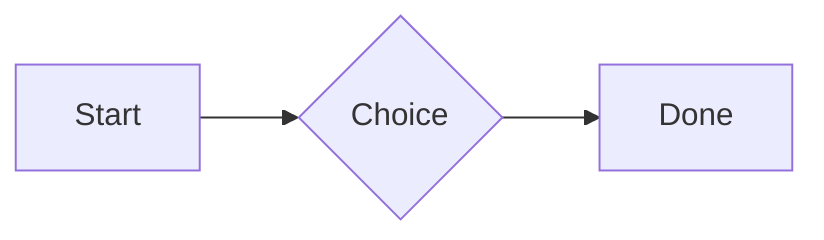
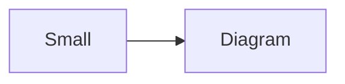

# QA · Right after: Terminal recording (.cast file)

Terminal recording (.cast file) followed straight away, with no blank line, by each element. Check: nothing overlaps, nothing is cut off, and the space between is even. Markdown joins some pairs without a blank line (text followed by --- is a heading, and a line of text can carry on into the next), so check that what's drawn matches the Markdown.

#qa/adjacent

#### 1. Terminal recording (.cast file), then Paragraph

[terminal.cast](attachment:terminal.cast)
A paragraph with **bold**, *italic*, <u>underlined</u>, ~~struck~~, ==highlighted==, `code`, a [link](https://example.com) and a #qa/tag.

#### 2. Terminal recording (.cast file), then Long paragraph

[terminal.cast](attachment:terminal.cast)
A long paragraph that wraps onto several lines at the usual width, so the space between its lines, its indent on every line, and where it meets the edges of anything around it can be checked. It goes on a little longer to be sure it wraps on a phone too.

#### 3. Terminal recording (.cast file), then Heading 1

[terminal.cast](attachment:terminal.cast)
# Heading one

#### 4. Terminal recording (.cast file), then Heading 2

[terminal.cast](attachment:terminal.cast)
## Heading two

#### 5. Terminal recording (.cast file), then Heading 3

[terminal.cast](attachment:terminal.cast)
### Heading three

#### 6. Terminal recording (.cast file), then Bullet list

[terminal.cast](attachment:terminal.cast)
- First item
- Second item
  - Nested item
    - Third level
- Last item

#### 7. Terminal recording (.cast file), then Numbered list

[terminal.cast](attachment:terminal.cast)
1. First
2. Second
   1. Nested
3. Third

#### 8. Terminal recording (.cast file), then Todo list

[terminal.cast](attachment:terminal.cast)
- [x] Done todo
- [ ] Open todo
  - [ ] Nested open todo

#### 9. Terminal recording (.cast file), then Quote

[terminal.cast](attachment:terminal.cast)
> A quote that runs over
> two lines.

#### 10. Terminal recording (.cast file), then Code block

[terminal.cast](attachment:terminal.cast)
```
plain code
  indented line
```

#### 11. Terminal recording (.cast file), then Code block (TypeScript)

[terminal.cast](attachment:terminal.cast)
```ts
const greeting: string = "hello";
console.log(greeting);
```

#### 12. Terminal recording (.cast file), then JSON block (no language)

[terminal.cast](attachment:terminal.cast)
```
{"name":"lines","tags":["a","b"],"id":12345678901234567890}
```

#### 13. Terminal recording (.cast file), then Diagram

[terminal.cast](attachment:terminal.cast)


#### 14. Terminal recording (.cast file), then Diagram (240 px wide)

[terminal.cast](attachment:terminal.cast)


#### 15. Terminal recording (.cast file), then 3D model (openscad block), a colored part, an echo

[terminal.cast](attachment:terminal.cast)
```openscad
difference() {
  cube(20, center = true);
  sphere(r = 13);
}
translate([25, 0, 0]) color("tomato") cylinder(h = 10, r = 5);
echo("made");
```

#### 16. Terminal recording (.cast file), then Flat model (openscad block)

[terminal.cast](attachment:terminal.cast)
```openscad
square(20);
translate([30, 10]) circle(8);
```

#### 17. Terminal recording (.cast file), then Broken model (openscad block)

[terminal.cast](attachment:terminal.cast)
```openscad
cube(10)
sphere(3;
```

#### 18. Terminal recording (.cast file), then 3D model (stl block)

[terminal.cast](attachment:terminal.cast)
```stl
solid pyramid
facet normal 0 0 -1
outer loop
vertex 0 0 0
vertex 10 10 0
vertex 10 0 0
endloop
endfacet
facet normal 0 0 -1
outer loop
vertex 0 0 0
vertex 0 10 0
vertex 10 10 0
endloop
endfacet
facet normal 0 -1 1
outer loop
vertex 0 0 0
vertex 10 0 0
vertex 5 5 8
endloop
endfacet
facet normal 1 0 1
outer loop
vertex 10 0 0
vertex 10 10 0
vertex 5 5 8
endloop
endfacet
facet normal 0 1 1
outer loop
vertex 10 10 0
vertex 0 10 0
vertex 5 5 8
endloop
endfacet
facet normal -1 0 1
outer loop
vertex 0 10 0
vertex 0 0 0
vertex 5 5 8
endloop
endfacet
endsolid pyramid
```

#### 19. Terminal recording (.cast file), then Math block

[terminal.cast](attachment:terminal.cast)
$$
\int_0^1 x^2\,dx = \frac{1}{3}
$$

#### 20. Terminal recording (.cast file), then Table

[terminal.cast](attachment:terminal.cast)
| Left | Center | Right |
| :--- | :----: | ----: |
| a | **b** | 1 |
| longer cell text | `code` | 22 |

#### 21. Terminal recording (.cast file), then Table with formulas

[terminal.cast](attachment:terminal.cast)
| Item | Cost |
| --- | ---: |
| Rent | 1200 |
| Food | 450.50 |
| Total | =SUM(B2:B3) |
| Broken | =B2/0 |

#### 22. Terminal recording (.cast file), then Hurl entries (hurl block): a capture used by the next entry, and asserts

[terminal.cast](attachment:terminal.cast)
```hurl
# A todo
GET https://jsonplaceholder.typicode.com/todos/1
HTTP 200
[Captures]
owner: jsonpath "$.userId"
[Asserts]
jsonpath "$.id" == 1

# Its owner
GET https://jsonplaceholder.typicode.com/users/{{owner}}
HTTP 200
[Asserts]
jsonpath "$.name" isString
```

#### 23. Terminal recording (.cast file), then Secret ({{name}}, kept in a locked secrets note)

[terminal.cast](attachment:terminal.cast)
The token is {{qa-token}}, and {{no-such-secret}} isn't one.

#### 24. Terminal recording (.cast file), then API requests (http block): a variable, a named request and one using its response

[terminal.cast](attachment:terminal.cast)
```http
@api = https://jsonplaceholder.typicode.com

### A todo
# @name todo
GET {{api}}/todos/1

### Its owner
GET {{api}}/users/{{todo.response.body.$.userId}}
```

#### 25. Terminal recording (.cast file), then Spreadsheet (csv block)

[terminal.cast](attachment:terminal.cast)
```csv
Item, Cost
Rent, 1200
Food, 450.50
Total, =SUM(B2:B3)
```

#### 26. Terminal recording (.cast file), then Named spreadsheet (csv name=), and a formula in another block using it

[terminal.cast](attachment:terminal.cast)
```csv name=costs
Item, Cost, Day
Rent, $1200, 2026-01-05
```

```csv
Total, =costs!B2*2
```

#### 27. Terminal recording (.cast file), then Divider

[terminal.cast](attachment:terminal.cast)
---

#### 28. Terminal recording (.cast file), then Key: Value line

[terminal.cast](attachment:terminal.cast)
**Wi-Fi password:** correct-horse-battery

#### 29. Terminal recording (.cast file), then Mention

[terminal.cast](attachment:terminal.cast)
Ask @[QA · Ada] at @[QA · Ada].email.

#### 30. Terminal recording (.cast file), then Wiki link

[terminal.cast](attachment:terminal.cast)
Ask [[QA · Ada]], or [[QA · Ada|her]].

#### 31. Terminal recording (.cast file), then Symbols

[terminal.cast](attachment:terminal.cast)
Home -> cabin <- back, a <-> b, x => y, p <=> q, 1 <= 2 >= 0 != 3. Stays: --> !== \-> and `a -> b` in code.

#### 32. Terminal recording (.cast file), then GitHub links

[terminal.cast](attachment:terminal.cast)
Issue https://github.com/overtio/lines/issues/1 and [a named link](https://github.com/overtio/lines)

#### 33. Terminal recording (.cast file), then Image

[terminal.cast](attachment:terminal.cast)


#### 34. Terminal recording (.cast file), then Drawing

[terminal.cast](attachment:terminal.cast)


#### 35. Terminal recording (.cast file), then File

[terminal.cast](attachment:terminal.cast)
[Budget.csv](attachment:budget.csv)

#### 36. Terminal recording (.cast file), then Attached 3D model (STL)

[terminal.cast](attachment:terminal.cast)
[Bracket.stl](attachment:bracket.stl)

#### 37. Terminal recording (.cast file), then Terminal recording (.cast file)

[terminal.cast](attachment:terminal.cast)
[terminal.cast](attachment:terminal.cast)

#### 38. Terminal recording (.cast file), then Missing file

[terminal.cast](attachment:terminal.cast)
[Not here yet.pdf](../attachments/00000000000000000000000000000000.pdf)

#### 39. Terminal recording (.cast file), then Card

[terminal.cast](attachment:terminal.cast)
::: card
Text in a card.
:::

#### 40. Terminal recording (.cast file), then Callout (info)

[terminal.cast](attachment:terminal.cast)
:::i
Text in an info callout.
:::

#### 41. Terminal recording (.cast file), then Callout (warning, chosen icon)

[terminal.cast](attachment:terminal.cast)
:::! icon=flag
Text in a warning callout with the flag icon.
:::

#### 42. Terminal recording (.cast file), then Callout (decision, no icon)

[terminal.cast](attachment:terminal.cast)
:::^ icon=none
Text in a decision callout with no icon.
:::
