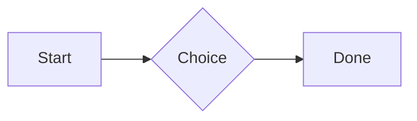
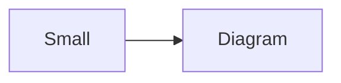

# QA · Right after: Attached 3D model (STL)

Attached 3D model (STL) followed straight away, with no blank line, by each element. Check: nothing overlaps, nothing is cut off, and the space between is even. Markdown joins some pairs without a blank line (text followed by --- is a heading, and a line of text can carry on into the next), so check that what's drawn matches the Markdown.

#qa/adjacent

#### 1. Attached 3D model (STL), then Paragraph

[Bracket.stl](attachment:bracket.stl)
A paragraph with **bold**, *italic*, <u>underlined</u>, ~~struck~~, ==highlighted==, `code`, a [link](https://example.com) and a #qa/tag.

#### 2. Attached 3D model (STL), then Long paragraph

[Bracket.stl](attachment:bracket.stl)
A long paragraph that wraps onto several lines at the usual width, so the space between its lines, its indent on every line, and where it meets the edges of anything around it can be checked. It goes on a little longer to be sure it wraps on a phone too.

#### 3. Attached 3D model (STL), then Heading 1

[Bracket.stl](attachment:bracket.stl)
# Heading one

#### 4. Attached 3D model (STL), then Heading 2

[Bracket.stl](attachment:bracket.stl)
## Heading two

#### 5. Attached 3D model (STL), then Heading 3

[Bracket.stl](attachment:bracket.stl)
### Heading three

#### 6. Attached 3D model (STL), then Bullet list

[Bracket.stl](attachment:bracket.stl)
- First item
- Second item
  - Nested item
    - Third level
- Last item

#### 7. Attached 3D model (STL), then Numbered list

[Bracket.stl](attachment:bracket.stl)
1. First
2. Second
   1. Nested
3. Third

#### 8. Attached 3D model (STL), then Todo list

[Bracket.stl](attachment:bracket.stl)
- [x] Done todo
- [ ] Open todo
  - [ ] Nested open todo

#### 9. Attached 3D model (STL), then Quote

[Bracket.stl](attachment:bracket.stl)
> A quote that runs over
> two lines.

#### 10. Attached 3D model (STL), then Line marks

[Bracket.stl](attachment:bracket.stl)
Marked as the accent. <!-- mark -->
Two lines marked green, one bar. <!-- mark green: ready -->
The second of them. <!-- mark green: ready -->
Red, with a label to point at. <!-- mark red: to fix -->
- A list item, marked purple. <!-- mark purple -->

#### 11. Attached 3D model (STL), then Code block

[Bracket.stl](attachment:bracket.stl)
```
plain code
  indented line
```

#### 12. Attached 3D model (STL), then Code block (TypeScript)

[Bracket.stl](attachment:bracket.stl)
```ts
const greeting: string = "hello";
console.log(greeting);
```

#### 13. Attached 3D model (STL), then JSON block (no language)

[Bracket.stl](attachment:bracket.stl)
```
{"name":"lines","tags":["a","b"],"id":12345678901234567890}
```

#### 14. Attached 3D model (STL), then Diagram

[Bracket.stl](attachment:bracket.stl)


#### 15. Attached 3D model (STL), then Diagram (240 px wide)

[Bracket.stl](attachment:bracket.stl)


#### 16. Attached 3D model (STL), then 3D model (openscad block), a colored part, an echo

[Bracket.stl](attachment:bracket.stl)
```openscad
difference() {
  cube(20, center = true);
  sphere(r = 13);
}
translate([25, 0, 0]) color("tomato") cylinder(h = 10, r = 5);
echo("made");
```

#### 17. Attached 3D model (STL), then Flat model (openscad block)

[Bracket.stl](attachment:bracket.stl)
```openscad
square(20);
translate([30, 10]) circle(8);
```

#### 18. Attached 3D model (STL), then Broken model (openscad block)

[Bracket.stl](attachment:bracket.stl)
```openscad
cube(10)
sphere(3;
```

#### 19. Attached 3D model (STL), then 3D model (stl block)

[Bracket.stl](attachment:bracket.stl)
```stl
solid pyramid
facet normal 0 0 -1
outer loop
vertex 0 0 0
vertex 10 10 0
vertex 10 0 0
endloop
endfacet
facet normal 0 0 -1
outer loop
vertex 0 0 0
vertex 0 10 0
vertex 10 10 0
endloop
endfacet
facet normal 0 -1 1
outer loop
vertex 0 0 0
vertex 10 0 0
vertex 5 5 8
endloop
endfacet
facet normal 1 0 1
outer loop
vertex 10 0 0
vertex 10 10 0
vertex 5 5 8
endloop
endfacet
facet normal 0 1 1
outer loop
vertex 10 10 0
vertex 0 10 0
vertex 5 5 8
endloop
endfacet
facet normal -1 0 1
outer loop
vertex 0 10 0
vertex 0 0 0
vertex 5 5 8
endloop
endfacet
endsolid pyramid
```

#### 20. Attached 3D model (STL), then Timing diagram (wavedrom block)

[Bracket.stl](attachment:bracket.stl)
```wavedrom
{ signal: [
  { name: "clk", wave: "p.....|..." },
  { name: "data", wave: "x.345x|=.x", data: ["head", "body", "tail", "data"] },
  {},
  { name: "ack", wave: "1.....|01.", node: ".a......b" }
], edge: ["a~>b t1"] }
```

#### 21. Attached 3D model (STL), then Typing practice (typing block)

[Bracket.stl](attachment:bracket.stl)
```typing
It’s a “fine” day — type it.
function go() {
  return 1;
}
```

#### 22. Attached 3D model (STL), then Math block

[Bracket.stl](attachment:bracket.stl)
$$
\int_0^1 x^2\,dx = \frac{1}{3}
$$

#### 23. Attached 3D model (STL), then Table

[Bracket.stl](attachment:bracket.stl)
| Left | Center | Right |
| :--- | :----: | ----: |
| a | **b** | 1 |
| longer cell text | `code` | 22 |

#### 24. Attached 3D model (STL), then Table with formulas

[Bracket.stl](attachment:bracket.stl)
| Item | Cost |
| --- | ---: |
| Rent | 1200 |
| Food | 450.50 |
| Total | =SUM(B2:B3) |
| Broken | =B2/0 |

#### 25. Attached 3D model (STL), then Hurl entries (hurl block): a capture used by the next entry, and asserts

[Bracket.stl](attachment:bracket.stl)
```hurl
# A todo
GET https://jsonplaceholder.typicode.com/todos/1
HTTP 200
[Captures]
owner: jsonpath "$.userId"
[Asserts]
jsonpath "$.id" == 1

# Its owner
GET https://jsonplaceholder.typicode.com/users/{{owner}}
HTTP 200
[Asserts]
jsonpath "$.name" isString
```

#### 26. Attached 3D model (STL), then Secret ({{name}}, kept in a locked secrets note)

[Bracket.stl](attachment:bracket.stl)
The token is {{qa-token}}, and {{no-such-secret}} isn't one.

#### 27. Attached 3D model (STL), then API requests (http block): a variable, a named request and one using its response

[Bracket.stl](attachment:bracket.stl)
```http
@api = https://jsonplaceholder.typicode.com

### A todo
# @name todo
GET {{api}}/todos/1

### Its owner
GET {{api}}/users/{{todo.response.body.$.userId}}
```

#### 28. Attached 3D model (STL), then Spreadsheet (csv block)

[Bracket.stl](attachment:bracket.stl)
```csv
Item, Cost
Rent, 1200
Food, 450.50
Total, =SUM(B2:B3)
```

#### 29. Attached 3D model (STL), then Named spreadsheet (csv name=), and a formula in another block using it

[Bracket.stl](attachment:bracket.stl)
```csv name=costs
Item, Cost, Day
Rent, $1200, 2026-01-05
```

```csv
Total, =costs!B2*2
```

#### 30. Attached 3D model (STL), then Divider

[Bracket.stl](attachment:bracket.stl)
---

#### 31. Attached 3D model (STL), then Page breaks (as lines writes them, and as Obsidian and Typora do; a new page in the PDF at each, a gap between pages over a backdrop)

[Bracket.stl](attachment:bracket.stl)
Before the break.

<!-- pagebreak -->
After it, on a new page.

<div style="page-break-after: always"></div>

And another.

#### 32. Attached 3D model (STL), then Key: Value line

[Bracket.stl](attachment:bracket.stl)
**Wi-Fi password:** correct-horse-battery

#### 33. Attached 3D model (STL), then Mention

[Bracket.stl](attachment:bracket.stl)
Ask @[QA · Ada] at @[QA · Ada].email.

#### 34. Attached 3D model (STL), then Wiki link

[Bracket.stl](attachment:bracket.stl)
Ask [[QA · Ada]], or [[QA · Ada|her]].

#### 35. Attached 3D model (STL), then Symbols

[Bracket.stl](attachment:bracket.stl)
Home -> cabin <- back, a <-> b, x => y, p <=> q, 1 <= 2 >= 0 != 3. Stays: --> !== \-> and `a -> b` in code.

#### 36. Attached 3D model (STL), then GitHub links

[Bracket.stl](attachment:bracket.stl)
Issue https://github.com/overtio/lines/issues/1 and [a named link](https://github.com/overtio/lines)

#### 37. Attached 3D model (STL), then arXiv links

[Bracket.stl](attachment:bracket.stl)
Paper https://arxiv.org/abs/1706.03762 and [a named link](https://arxiv.org/abs/2006.11239)

#### 38. Attached 3D model (STL), then Image

[Bracket.stl](attachment:bracket.stl)


#### 39. Attached 3D model (STL), then Drawing

[Bracket.stl](attachment:bracket.stl)


#### 40. Attached 3D model (STL), then File

[Bracket.stl](attachment:bracket.stl)
[Budget.csv](attachment:budget.csv)

#### 41. Attached 3D model (STL), then Attached 3D model (STL)

[Bracket.stl](attachment:bracket.stl)
[Bracket.stl](attachment:bracket.stl)

#### 42. Attached 3D model (STL), then Terminal recording (.cast file)

[Bracket.stl](attachment:bracket.stl)
[terminal.cast](attachment:terminal.cast)

#### 43. Attached 3D model (STL), then Audio

[Bracket.stl](attachment:bracket.stl)
[Chime.mp3](attachment:chime.mp3)

#### 44. Attached 3D model (STL), then Video

[Bracket.stl](attachment:bracket.stl)
[Sky.mp4](attachment:sky.mp4)

#### 45. Attached 3D model (STL), then Missing file

[Bracket.stl](attachment:bracket.stl)
[Not here yet.pdf](../attachments/00000000000000000000000000000000.pdf)

#### 46. Attached 3D model (STL), then Card

[Bracket.stl](attachment:bracket.stl)
::: card
Text in a card.
:::

#### 47. Attached 3D model (STL), then Callout (info)

[Bracket.stl](attachment:bracket.stl)
:::i
Text in an info callout.
:::

#### 48. Attached 3D model (STL), then Callout (warning, chosen icon)

[Bracket.stl](attachment:bracket.stl)
:::! icon=flag
Text in a warning callout with the flag icon.
:::

#### 49. Attached 3D model (STL), then Callout (decision, no icon)

[Bracket.stl](attachment:bracket.stl)
:::^ icon=none
Text in a decision callout with no icon.
:::
