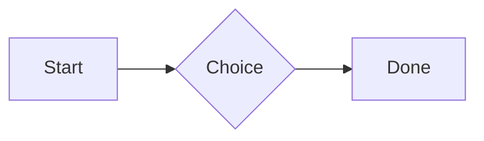
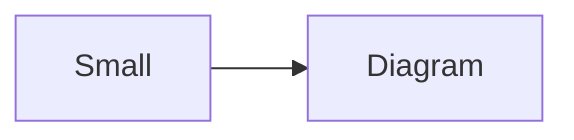

# QA · Right after: Callout (warning, chosen icon)

Callout (warning, chosen icon) followed straight away, with no blank line, by each element. Check: nothing overlaps, nothing is cut off, and the space between is even. Markdown joins some pairs without a blank line (text followed by --- is a heading, and a line of text can carry on into the next), so check that what's drawn matches the Markdown.

#qa/adjacent

#### 1. Callout (warning, chosen icon), then Paragraph

:::! icon=flag
Text in a warning callout with the flag icon.
:::
A paragraph with **bold**, *italic*, <u>underlined</u>, ~~struck~~, ==highlighted==, `code`, a [link](https://example.com) and a #qa/tag.

#### 2. Callout (warning, chosen icon), then Long paragraph

:::! icon=flag
Text in a warning callout with the flag icon.
:::
A long paragraph that wraps onto several lines at the usual width, so the space between its lines, its indent on every line, and where it meets the edges of anything around it can be checked. It goes on a little longer to be sure it wraps on a phone too.

#### 3. Callout (warning, chosen icon), then Heading 1

:::! icon=flag
Text in a warning callout with the flag icon.
:::
# Heading one

#### 4. Callout (warning, chosen icon), then Heading 2

:::! icon=flag
Text in a warning callout with the flag icon.
:::
## Heading two

#### 5. Callout (warning, chosen icon), then Heading 3

:::! icon=flag
Text in a warning callout with the flag icon.
:::
### Heading three

#### 6. Callout (warning, chosen icon), then Bullet list

:::! icon=flag
Text in a warning callout with the flag icon.
:::
- First item
- Second item
  - Nested item
    - Third level
- Last item

#### 7. Callout (warning, chosen icon), then Numbered list

:::! icon=flag
Text in a warning callout with the flag icon.
:::
1. First
2. Second
   1. Nested
3. Third

#### 8. Callout (warning, chosen icon), then Todo list

:::! icon=flag
Text in a warning callout with the flag icon.
:::
- [x] Done todo
- [ ] Open todo
  - [ ] Nested open todo

#### 9. Callout (warning, chosen icon), then Quote

:::! icon=flag
Text in a warning callout with the flag icon.
:::
> A quote that runs over
> two lines.

#### 10. Callout (warning, chosen icon), then Code block

:::! icon=flag
Text in a warning callout with the flag icon.
:::
```
plain code
  indented line
```

#### 11. Callout (warning, chosen icon), then Code block (TypeScript)

:::! icon=flag
Text in a warning callout with the flag icon.
:::
```ts
const greeting: string = "hello";
console.log(greeting);
```

#### 12. Callout (warning, chosen icon), then JSON block (no language)

:::! icon=flag
Text in a warning callout with the flag icon.
:::
```
{"name":"lines","tags":["a","b"],"id":12345678901234567890}
```

#### 13. Callout (warning, chosen icon), then Diagram

:::! icon=flag
Text in a warning callout with the flag icon.
:::


#### 14. Callout (warning, chosen icon), then Diagram (240 px wide)

:::! icon=flag
Text in a warning callout with the flag icon.
:::


#### 15. Callout (warning, chosen icon), then 3D model (openscad block), a colored part, an echo

:::! icon=flag
Text in a warning callout with the flag icon.
:::
```openscad
difference() {
  cube(20, center = true);
  sphere(r = 13);
}
translate([25, 0, 0]) color("tomato") cylinder(h = 10, r = 5);
echo("made");
```

#### 16. Callout (warning, chosen icon), then Flat model (openscad block)

:::! icon=flag
Text in a warning callout with the flag icon.
:::
```openscad
square(20);
translate([30, 10]) circle(8);
```

#### 17. Callout (warning, chosen icon), then Broken model (openscad block)

:::! icon=flag
Text in a warning callout with the flag icon.
:::
```openscad
cube(10)
sphere(3;
```

#### 18. Callout (warning, chosen icon), then 3D model (stl block)

:::! icon=flag
Text in a warning callout with the flag icon.
:::
```stl
solid pyramid
facet normal 0 0 -1
outer loop
vertex 0 0 0
vertex 10 10 0
vertex 10 0 0
endloop
endfacet
facet normal 0 0 -1
outer loop
vertex 0 0 0
vertex 0 10 0
vertex 10 10 0
endloop
endfacet
facet normal 0 -1 1
outer loop
vertex 0 0 0
vertex 10 0 0
vertex 5 5 8
endloop
endfacet
facet normal 1 0 1
outer loop
vertex 10 0 0
vertex 10 10 0
vertex 5 5 8
endloop
endfacet
facet normal 0 1 1
outer loop
vertex 10 10 0
vertex 0 10 0
vertex 5 5 8
endloop
endfacet
facet normal -1 0 1
outer loop
vertex 0 10 0
vertex 0 0 0
vertex 5 5 8
endloop
endfacet
endsolid pyramid
```

#### 19. Callout (warning, chosen icon), then Math block

:::! icon=flag
Text in a warning callout with the flag icon.
:::
$$
\int_0^1 x^2\,dx = \frac{1}{3}
$$

#### 20. Callout (warning, chosen icon), then Table

:::! icon=flag
Text in a warning callout with the flag icon.
:::
| Left | Center | Right |
| :--- | :----: | ----: |
| a | **b** | 1 |
| longer cell text | `code` | 22 |

#### 21. Callout (warning, chosen icon), then Table with formulas

:::! icon=flag
Text in a warning callout with the flag icon.
:::
| Item | Cost |
| --- | ---: |
| Rent | 1200 |
| Food | 450.50 |
| Total | =SUM(B2:B3) |
| Broken | =B2/0 |

#### 22. Callout (warning, chosen icon), then Hurl entries (hurl block): a capture used by the next entry, and asserts

:::! icon=flag
Text in a warning callout with the flag icon.
:::
```hurl
# A todo
GET https://jsonplaceholder.typicode.com/todos/1
HTTP 200
[Captures]
owner: jsonpath "$.userId"
[Asserts]
jsonpath "$.id" == 1

# Its owner
GET https://jsonplaceholder.typicode.com/users/{{owner}}
HTTP 200
[Asserts]
jsonpath "$.name" isString
```

#### 23. Callout (warning, chosen icon), then Secret ({{name}}, kept in a locked secrets note)

:::! icon=flag
Text in a warning callout with the flag icon.
:::
The token is {{qa-token}}, and {{no-such-secret}} isn't one.

#### 24. Callout (warning, chosen icon), then API requests (http block): a variable, a named request and one using its response

:::! icon=flag
Text in a warning callout with the flag icon.
:::
```http
@api = https://jsonplaceholder.typicode.com

### A todo
# @name todo
GET {{api}}/todos/1

### Its owner
GET {{api}}/users/{{todo.response.body.$.userId}}
```

#### 25. Callout (warning, chosen icon), then Spreadsheet (csv block)

:::! icon=flag
Text in a warning callout with the flag icon.
:::
```csv
Item, Cost
Rent, 1200
Food, 450.50
Total, =SUM(B2:B3)
```

#### 26. Callout (warning, chosen icon), then Named spreadsheet (csv name=), and a formula in another block using it

:::! icon=flag
Text in a warning callout with the flag icon.
:::
```csv name=costs
Item, Cost, Day
Rent, $1200, 2026-01-05
```

```csv
Total, =costs!B2*2
```

#### 27. Callout (warning, chosen icon), then Divider

:::! icon=flag
Text in a warning callout with the flag icon.
:::
---

#### 28. Callout (warning, chosen icon), then Key: Value line

:::! icon=flag
Text in a warning callout with the flag icon.
:::
**Wi-Fi password:** correct-horse-battery

#### 29. Callout (warning, chosen icon), then Mention

:::! icon=flag
Text in a warning callout with the flag icon.
:::
Ask @[QA · Ada] at @[QA · Ada].email.

#### 30. Callout (warning, chosen icon), then Wiki link

:::! icon=flag
Text in a warning callout with the flag icon.
:::
Ask [[QA · Ada]], or [[QA · Ada|her]].

#### 31. Callout (warning, chosen icon), then Symbols

:::! icon=flag
Text in a warning callout with the flag icon.
:::
Home -> cabin <- back, a <-> b, x => y, p <=> q, 1 <= 2 >= 0 != 3. Stays: --> !== \-> and `a -> b` in code.

#### 32. Callout (warning, chosen icon), then GitHub links

:::! icon=flag
Text in a warning callout with the flag icon.
:::
Issue https://github.com/overtio/lines/issues/1 and [a named link](https://github.com/overtio/lines)

#### 33. Callout (warning, chosen icon), then arXiv links

:::! icon=flag
Text in a warning callout with the flag icon.
:::
Paper https://arxiv.org/abs/1706.03762 and [a named link](https://arxiv.org/abs/2006.11239)

#### 34. Callout (warning, chosen icon), then Image

:::! icon=flag
Text in a warning callout with the flag icon.
:::


#### 35. Callout (warning, chosen icon), then Drawing

:::! icon=flag
Text in a warning callout with the flag icon.
:::


#### 36. Callout (warning, chosen icon), then File

:::! icon=flag
Text in a warning callout with the flag icon.
:::
[Budget.csv](attachment:budget.csv)

#### 37. Callout (warning, chosen icon), then Attached 3D model (STL)

:::! icon=flag
Text in a warning callout with the flag icon.
:::
[Bracket.stl](attachment:bracket.stl)

#### 38. Callout (warning, chosen icon), then Terminal recording (.cast file)

:::! icon=flag
Text in a warning callout with the flag icon.
:::
[terminal.cast](attachment:terminal.cast)

#### 39. Callout (warning, chosen icon), then Missing file

:::! icon=flag
Text in a warning callout with the flag icon.
:::
[Not here yet.pdf](../attachments/00000000000000000000000000000000.pdf)

#### 40. Callout (warning, chosen icon), then Card

:::! icon=flag
Text in a warning callout with the flag icon.
:::
::: card
Text in a card.
:::

#### 41. Callout (warning, chosen icon), then Callout (info)

:::! icon=flag
Text in a warning callout with the flag icon.
:::
:::i
Text in an info callout.
:::

#### 42. Callout (warning, chosen icon), then Callout (warning, chosen icon)

:::! icon=flag
Text in a warning callout with the flag icon.
:::
:::! icon=flag
Text in a warning callout with the flag icon.
:::

#### 43. Callout (warning, chosen icon), then Callout (decision, no icon)

:::! icon=flag
Text in a warning callout with the flag icon.
:::
:::^ icon=none
Text in a decision callout with no icon.
:::
