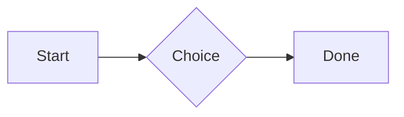

# QA · Right after: Missing file

Missing file followed straight away, with no blank line, by each element. Check: nothing overlaps, nothing is cut off, and the space between is even. Markdown joins some pairs without a blank line (text followed by --- is a heading, and a line of text can carry on into the next), so check that what's drawn matches the Markdown.

#qa/adjacent

#### 1. Missing file, then Paragraph

[Not here yet.pdf](../attachments/00000000000000000000000000000000.pdf)
A paragraph with **bold**, *italic*, <u>underlined</u>, ~~struck~~, ==highlighted==, `code`, a [link](https://example.com) and a #qa/tag.

#### 2. Missing file, then Long paragraph

[Not here yet.pdf](../attachments/00000000000000000000000000000000.pdf)
A long paragraph that wraps onto several lines at the usual width, so the space between its lines, its indent on every line, and where it meets the edges of anything around it can be checked. It goes on a little longer to be sure it wraps on a phone too.

#### 3. Missing file, then Heading 1

[Not here yet.pdf](../attachments/00000000000000000000000000000000.pdf)
# Heading one

#### 4. Missing file, then Heading 2

[Not here yet.pdf](../attachments/00000000000000000000000000000000.pdf)
## Heading two

#### 5. Missing file, then Heading 3

[Not here yet.pdf](../attachments/00000000000000000000000000000000.pdf)
### Heading three

#### 6. Missing file, then Bullet list

[Not here yet.pdf](../attachments/00000000000000000000000000000000.pdf)
- First item
- Second item
  - Nested item
    - Third level
- Last item

#### 7. Missing file, then Numbered list

[Not here yet.pdf](../attachments/00000000000000000000000000000000.pdf)
1. First
2. Second
   1. Nested
3. Third

#### 8. Missing file, then Todo list

[Not here yet.pdf](../attachments/00000000000000000000000000000000.pdf)
- [x] Done todo
- [ ] Open todo
  - [ ] Nested open todo

#### 9. Missing file, then Quote

[Not here yet.pdf](../attachments/00000000000000000000000000000000.pdf)
> A quote that runs over
> two lines.

#### 10. Missing file, then Code block

[Not here yet.pdf](../attachments/00000000000000000000000000000000.pdf)
```
plain code
  indented line
```

#### 11. Missing file, then Code block (TypeScript)

[Not here yet.pdf](../attachments/00000000000000000000000000000000.pdf)
```ts
const greeting: string = "hello";
console.log(greeting);
```

#### 12. Missing file, then JSON block (no language)

[Not here yet.pdf](../attachments/00000000000000000000000000000000.pdf)
```
{"name":"lines","tags":["a","b"],"id":12345678901234567890}
```

#### 13. Missing file, then Diagram

[Not here yet.pdf](../attachments/00000000000000000000000000000000.pdf)


#### 14. Missing file, then Diagram (240 px wide)

[Not here yet.pdf](../attachments/00000000000000000000000000000000.pdf)


#### 15. Missing file, then 3D model (openscad block), a colored part, an echo

[Not here yet.pdf](../attachments/00000000000000000000000000000000.pdf)
```openscad
difference() {
  cube(20, center = true);
  sphere(r = 13);
}
translate([25, 0, 0]) color("tomato") cylinder(h = 10, r = 5);
echo("made");
```

#### 16. Missing file, then Flat model (openscad block)

[Not here yet.pdf](../attachments/00000000000000000000000000000000.pdf)
```openscad
square(20);
translate([30, 10]) circle(8);
```

#### 17. Missing file, then Broken model (openscad block)

[Not here yet.pdf](../attachments/00000000000000000000000000000000.pdf)
```openscad
cube(10)
sphere(3;
```

#### 18. Missing file, then 3D model (stl block)

[Not here yet.pdf](../attachments/00000000000000000000000000000000.pdf)
```stl
solid pyramid
facet normal 0 0 -1
outer loop
vertex 0 0 0
vertex 10 10 0
vertex 10 0 0
endloop
endfacet
facet normal 0 0 -1
outer loop
vertex 0 0 0
vertex 0 10 0
vertex 10 10 0
endloop
endfacet
facet normal 0 -1 1
outer loop
vertex 0 0 0
vertex 10 0 0
vertex 5 5 8
endloop
endfacet
facet normal 1 0 1
outer loop
vertex 10 0 0
vertex 10 10 0
vertex 5 5 8
endloop
endfacet
facet normal 0 1 1
outer loop
vertex 10 10 0
vertex 0 10 0
vertex 5 5 8
endloop
endfacet
facet normal -1 0 1
outer loop
vertex 0 10 0
vertex 0 0 0
vertex 5 5 8
endloop
endfacet
endsolid pyramid
```

#### 19. Missing file, then Timing diagram (wavedrom block)

[Not here yet.pdf](../attachments/00000000000000000000000000000000.pdf)
```wavedrom
{ signal: [
  { name: "clk", wave: "p.....|..." },
  { name: "data", wave: "x.345x|=.x", data: ["head", "body", "tail", "data"] },
  {},
  { name: "ack", wave: "1.....|01.", node: ".a......b" }
], edge: ["a~>b t1"] }
```

#### 20. Missing file, then Math block

[Not here yet.pdf](../attachments/00000000000000000000000000000000.pdf)
$$
\int_0^1 x^2\,dx = \frac{1}{3}
$$

#### 21. Missing file, then Table

[Not here yet.pdf](../attachments/00000000000000000000000000000000.pdf)
| Left | Center | Right |
| :--- | :----: | ----: |
| a | **b** | 1 |
| longer cell text | `code` | 22 |

#### 22. Missing file, then Table with formulas

[Not here yet.pdf](../attachments/00000000000000000000000000000000.pdf)
| Item | Cost |
| --- | ---: |
| Rent | 1200 |
| Food | 450.50 |
| Total | =SUM(B2:B3) |
| Broken | =B2/0 |

#### 23. Missing file, then Hurl entries (hurl block): a capture used by the next entry, and asserts

[Not here yet.pdf](../attachments/00000000000000000000000000000000.pdf)
```hurl
# A todo
GET https://jsonplaceholder.typicode.com/todos/1
HTTP 200
[Captures]
owner: jsonpath "$.userId"
[Asserts]
jsonpath "$.id" == 1

# Its owner
GET https://jsonplaceholder.typicode.com/users/{{owner}}
HTTP 200
[Asserts]
jsonpath "$.name" isString
```

#### 24. Missing file, then Secret ({{name}}, kept in a locked secrets note)

[Not here yet.pdf](../attachments/00000000000000000000000000000000.pdf)
The token is {{qa-token}}, and {{no-such-secret}} isn't one.

#### 25. Missing file, then API requests (http block): a variable, a named request and one using its response

[Not here yet.pdf](../attachments/00000000000000000000000000000000.pdf)
```http
@api = https://jsonplaceholder.typicode.com

### A todo
# @name todo
GET {{api}}/todos/1

### Its owner
GET {{api}}/users/{{todo.response.body.$.userId}}
```

#### 26. Missing file, then Spreadsheet (csv block)

[Not here yet.pdf](../attachments/00000000000000000000000000000000.pdf)
```csv
Item, Cost
Rent, 1200
Food, 450.50
Total, =SUM(B2:B3)
```

#### 27. Missing file, then Named spreadsheet (csv name=), and a formula in another block using it

[Not here yet.pdf](../attachments/00000000000000000000000000000000.pdf)
```csv name=costs
Item, Cost, Day
Rent, $1200, 2026-01-05
```

```csv
Total, =costs!B2*2
```

#### 28. Missing file, then Divider

[Not here yet.pdf](../attachments/00000000000000000000000000000000.pdf)
---

#### 29. Missing file, then Key: Value line

[Not here yet.pdf](../attachments/00000000000000000000000000000000.pdf)
**Wi-Fi password:** correct-horse-battery

#### 30. Missing file, then Mention

[Not here yet.pdf](../attachments/00000000000000000000000000000000.pdf)
Ask @[QA · Ada] at @[QA · Ada].email.

#### 31. Missing file, then Wiki link

[Not here yet.pdf](../attachments/00000000000000000000000000000000.pdf)
Ask [[QA · Ada]], or [[QA · Ada|her]].

#### 32. Missing file, then Symbols

[Not here yet.pdf](../attachments/00000000000000000000000000000000.pdf)
Home -> cabin <- back, a <-> b, x => y, p <=> q, 1 <= 2 >= 0 != 3. Stays: --> !== \-> and `a -> b` in code.

#### 33. Missing file, then GitHub links

[Not here yet.pdf](../attachments/00000000000000000000000000000000.pdf)
Issue https://github.com/overtio/lines/issues/1 and [a named link](https://github.com/overtio/lines)

#### 34. Missing file, then arXiv links

[Not here yet.pdf](../attachments/00000000000000000000000000000000.pdf)
Paper https://arxiv.org/abs/1706.03762 and [a named link](https://arxiv.org/abs/2006.11239)

#### 35. Missing file, then Image

[Not here yet.pdf](../attachments/00000000000000000000000000000000.pdf)


#### 36. Missing file, then Drawing

[Not here yet.pdf](../attachments/00000000000000000000000000000000.pdf)


#### 37. Missing file, then File

[Not here yet.pdf](../attachments/00000000000000000000000000000000.pdf)
[Budget.csv](attachment:budget.csv)

#### 38. Missing file, then Attached 3D model (STL)

[Not here yet.pdf](../attachments/00000000000000000000000000000000.pdf)
[Bracket.stl](attachment:bracket.stl)

#### 39. Missing file, then Terminal recording (.cast file)

[Not here yet.pdf](../attachments/00000000000000000000000000000000.pdf)
[terminal.cast](attachment:terminal.cast)

#### 40. Missing file, then Audio

[Not here yet.pdf](../attachments/00000000000000000000000000000000.pdf)
[Chime.mp3](attachment:chime.mp3)

#### 41. Missing file, then Video

[Not here yet.pdf](../attachments/00000000000000000000000000000000.pdf)
[Sky.mp4](attachment:sky.mp4)

#### 42. Missing file, then Missing file

[Not here yet.pdf](../attachments/00000000000000000000000000000000.pdf)
[Not here yet.pdf](../attachments/00000000000000000000000000000000.pdf)

#### 43. Missing file, then Card

[Not here yet.pdf](../attachments/00000000000000000000000000000000.pdf)
::: card
Text in a card.
:::

#### 44. Missing file, then Callout (info)

[Not here yet.pdf](../attachments/00000000000000000000000000000000.pdf)
:::i
Text in an info callout.
:::

#### 45. Missing file, then Callout (warning, chosen icon)

[Not here yet.pdf](../attachments/00000000000000000000000000000000.pdf)
:::! icon=flag
Text in a warning callout with the flag icon.
:::

#### 46. Missing file, then Callout (decision, no icon)

[Not here yet.pdf](../attachments/00000000000000000000000000000000.pdf)
:::^ icon=none
Text in a decision callout with no icon.
:::
