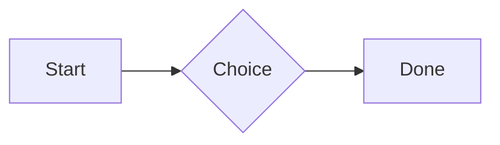
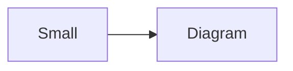

# QA · Right after: Callout (decision, no icon)

Callout (decision, no icon) followed straight away, with no blank line, by each element. Check: nothing overlaps, nothing is cut off, and the space between is even. Markdown joins some pairs without a blank line (text followed by --- is a heading, and a line of text can carry on into the next), so check that what's drawn matches the Markdown.

#qa/adjacent

#### 1. Callout (decision, no icon), then Paragraph

:::^ icon=none
Text in a decision callout with no icon.
:::
A paragraph with **bold**, *italic*, <u>underlined</u>, ~~struck~~, ==highlighted==, `code`, a [link](https://example.com) and a #qa/tag.

#### 2. Callout (decision, no icon), then Long paragraph

:::^ icon=none
Text in a decision callout with no icon.
:::
A long paragraph that wraps onto several lines at the usual width, so the space between its lines, its indent on every line, and where it meets the edges of anything around it can be checked. It goes on a little longer to be sure it wraps on a phone too.

#### 3. Callout (decision, no icon), then Heading 1

:::^ icon=none
Text in a decision callout with no icon.
:::
# Heading one

#### 4. Callout (decision, no icon), then Heading 2

:::^ icon=none
Text in a decision callout with no icon.
:::
## Heading two

#### 5. Callout (decision, no icon), then Heading 3

:::^ icon=none
Text in a decision callout with no icon.
:::
### Heading three

#### 6. Callout (decision, no icon), then Bullet list

:::^ icon=none
Text in a decision callout with no icon.
:::
- First item
- Second item
  - Nested item
    - Third level
- Last item

#### 7. Callout (decision, no icon), then Numbered list

:::^ icon=none
Text in a decision callout with no icon.
:::
1. First
2. Second
   1. Nested
3. Third

#### 8. Callout (decision, no icon), then Todo list

:::^ icon=none
Text in a decision callout with no icon.
:::
- [x] Done todo
- [ ] Open todo
  - [ ] Nested open todo

#### 9. Callout (decision, no icon), then Quote

:::^ icon=none
Text in a decision callout with no icon.
:::
> A quote that runs over
> two lines.

#### 10. Callout (decision, no icon), then Code block

:::^ icon=none
Text in a decision callout with no icon.
:::
```
plain code
  indented line
```

#### 11. Callout (decision, no icon), then Code block (TypeScript)

:::^ icon=none
Text in a decision callout with no icon.
:::
```ts
const greeting: string = "hello";
console.log(greeting);
```

#### 12. Callout (decision, no icon), then JSON block (no language)

:::^ icon=none
Text in a decision callout with no icon.
:::
```
{"name":"lines","tags":["a","b"],"id":12345678901234567890}
```

#### 13. Callout (decision, no icon), then Diagram

:::^ icon=none
Text in a decision callout with no icon.
:::


#### 14. Callout (decision, no icon), then Diagram (240 px wide)

:::^ icon=none
Text in a decision callout with no icon.
:::


#### 15. Callout (decision, no icon), then 3D model (openscad block), a colored part, an echo

:::^ icon=none
Text in a decision callout with no icon.
:::
```openscad
difference() {
  cube(20, center = true);
  sphere(r = 13);
}
translate([25, 0, 0]) color("tomato") cylinder(h = 10, r = 5);
echo("made");
```

#### 16. Callout (decision, no icon), then Flat model (openscad block)

:::^ icon=none
Text in a decision callout with no icon.
:::
```openscad
square(20);
translate([30, 10]) circle(8);
```

#### 17. Callout (decision, no icon), then Broken model (openscad block)

:::^ icon=none
Text in a decision callout with no icon.
:::
```openscad
cube(10)
sphere(3;
```

#### 18. Callout (decision, no icon), then 3D model (stl block)

:::^ icon=none
Text in a decision callout with no icon.
:::
```stl
solid pyramid
facet normal 0 0 -1
outer loop
vertex 0 0 0
vertex 10 10 0
vertex 10 0 0
endloop
endfacet
facet normal 0 0 -1
outer loop
vertex 0 0 0
vertex 0 10 0
vertex 10 10 0
endloop
endfacet
facet normal 0 -1 1
outer loop
vertex 0 0 0
vertex 10 0 0
vertex 5 5 8
endloop
endfacet
facet normal 1 0 1
outer loop
vertex 10 0 0
vertex 10 10 0
vertex 5 5 8
endloop
endfacet
facet normal 0 1 1
outer loop
vertex 10 10 0
vertex 0 10 0
vertex 5 5 8
endloop
endfacet
facet normal -1 0 1
outer loop
vertex 0 10 0
vertex 0 0 0
vertex 5 5 8
endloop
endfacet
endsolid pyramid
```

#### 19. Callout (decision, no icon), then Timing diagram (wavedrom block)

:::^ icon=none
Text in a decision callout with no icon.
:::
```wavedrom
{ signal: [
  { name: "clk", wave: "p.....|..." },
  { name: "data", wave: "x.345x|=.x", data: ["head", "body", "tail", "data"] },
  {},
  { name: "ack", wave: "1.....|01.", node: ".a......b" }
], edge: ["a~>b t1"] }
```

#### 20. Callout (decision, no icon), then Math block

:::^ icon=none
Text in a decision callout with no icon.
:::
$$
\int_0^1 x^2\,dx = \frac{1}{3}
$$

#### 21. Callout (decision, no icon), then Table

:::^ icon=none
Text in a decision callout with no icon.
:::
| Left | Center | Right |
| :--- | :----: | ----: |
| a | **b** | 1 |
| longer cell text | `code` | 22 |

#### 22. Callout (decision, no icon), then Table with formulas

:::^ icon=none
Text in a decision callout with no icon.
:::
| Item | Cost |
| --- | ---: |
| Rent | 1200 |
| Food | 450.50 |
| Total | =SUM(B2:B3) |
| Broken | =B2/0 |

#### 23. Callout (decision, no icon), then Hurl entries (hurl block): a capture used by the next entry, and asserts

:::^ icon=none
Text in a decision callout with no icon.
:::
```hurl
# A todo
GET https://jsonplaceholder.typicode.com/todos/1
HTTP 200
[Captures]
owner: jsonpath "$.userId"
[Asserts]
jsonpath "$.id" == 1

# Its owner
GET https://jsonplaceholder.typicode.com/users/{{owner}}
HTTP 200
[Asserts]
jsonpath "$.name" isString
```

#### 24. Callout (decision, no icon), then Secret ({{name}}, kept in a locked secrets note)

:::^ icon=none
Text in a decision callout with no icon.
:::
The token is {{qa-token}}, and {{no-such-secret}} isn't one.

#### 25. Callout (decision, no icon), then API requests (http block): a variable, a named request and one using its response

:::^ icon=none
Text in a decision callout with no icon.
:::
```http
@api = https://jsonplaceholder.typicode.com

### A todo
# @name todo
GET {{api}}/todos/1

### Its owner
GET {{api}}/users/{{todo.response.body.$.userId}}
```

#### 26. Callout (decision, no icon), then Spreadsheet (csv block)

:::^ icon=none
Text in a decision callout with no icon.
:::
```csv
Item, Cost
Rent, 1200
Food, 450.50
Total, =SUM(B2:B3)
```

#### 27. Callout (decision, no icon), then Named spreadsheet (csv name=), and a formula in another block using it

:::^ icon=none
Text in a decision callout with no icon.
:::
```csv name=costs
Item, Cost, Day
Rent, $1200, 2026-01-05
```

```csv
Total, =costs!B2*2
```

#### 28. Callout (decision, no icon), then Divider

:::^ icon=none
Text in a decision callout with no icon.
:::
---

#### 29. Callout (decision, no icon), then Key: Value line

:::^ icon=none
Text in a decision callout with no icon.
:::
**Wi-Fi password:** correct-horse-battery

#### 30. Callout (decision, no icon), then Mention

:::^ icon=none
Text in a decision callout with no icon.
:::
Ask @[QA · Ada] at @[QA · Ada].email.

#### 31. Callout (decision, no icon), then Wiki link

:::^ icon=none
Text in a decision callout with no icon.
:::
Ask [[QA · Ada]], or [[QA · Ada|her]].

#### 32. Callout (decision, no icon), then Symbols

:::^ icon=none
Text in a decision callout with no icon.
:::
Home -> cabin <- back, a <-> b, x => y, p <=> q, 1 <= 2 >= 0 != 3. Stays: --> !== \-> and `a -> b` in code.

#### 33. Callout (decision, no icon), then GitHub links

:::^ icon=none
Text in a decision callout with no icon.
:::
Issue https://github.com/overtio/lines/issues/1 and [a named link](https://github.com/overtio/lines)

#### 34. Callout (decision, no icon), then arXiv links

:::^ icon=none
Text in a decision callout with no icon.
:::
Paper https://arxiv.org/abs/1706.03762 and [a named link](https://arxiv.org/abs/2006.11239)

#### 35. Callout (decision, no icon), then Image

:::^ icon=none
Text in a decision callout with no icon.
:::


#### 36. Callout (decision, no icon), then Drawing

:::^ icon=none
Text in a decision callout with no icon.
:::


#### 37. Callout (decision, no icon), then File

:::^ icon=none
Text in a decision callout with no icon.
:::
[Budget.csv](attachment:budget.csv)

#### 38. Callout (decision, no icon), then Attached 3D model (STL)

:::^ icon=none
Text in a decision callout with no icon.
:::
[Bracket.stl](attachment:bracket.stl)

#### 39. Callout (decision, no icon), then Terminal recording (.cast file)

:::^ icon=none
Text in a decision callout with no icon.
:::
[terminal.cast](attachment:terminal.cast)

#### 40. Callout (decision, no icon), then Missing file

:::^ icon=none
Text in a decision callout with no icon.
:::
[Not here yet.pdf](../attachments/00000000000000000000000000000000.pdf)

#### 41. Callout (decision, no icon), then Card

:::^ icon=none
Text in a decision callout with no icon.
:::
::: card
Text in a card.
:::

#### 42. Callout (decision, no icon), then Callout (info)

:::^ icon=none
Text in a decision callout with no icon.
:::
:::i
Text in an info callout.
:::

#### 43. Callout (decision, no icon), then Callout (warning, chosen icon)

:::^ icon=none
Text in a decision callout with no icon.
:::
:::! icon=flag
Text in a warning callout with the flag icon.
:::

#### 44. Callout (decision, no icon), then Callout (decision, no icon)

:::^ icon=none
Text in a decision callout with no icon.
:::
:::^ icon=none
Text in a decision callout with no icon.
:::
