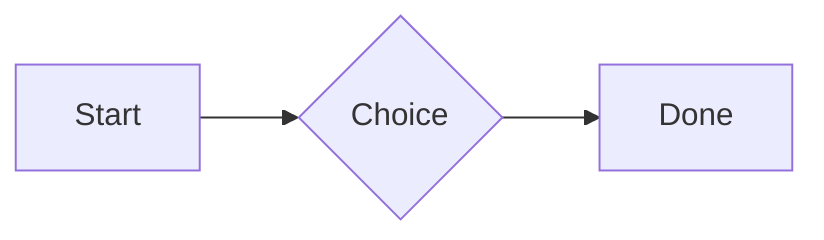
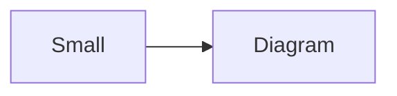

# QA · Right after: Callout (info)

Callout (info) followed straight away, with no blank line, by each element. Check: nothing overlaps, nothing is cut off, and the space between is even. Markdown joins some pairs without a blank line (text followed by --- is a heading, and a line of text can carry on into the next), so check that what's drawn matches the Markdown.

#qa/adjacent

#### 1. Callout (info), then Paragraph

:::i
Text in an info callout.
:::
A paragraph with **bold**, *italic*, <u>underlined</u>, ~~struck~~, ==highlighted==, `code`, a [link](https://example.com) and a #qa/tag.

#### 2. Callout (info), then Long paragraph

:::i
Text in an info callout.
:::
A long paragraph that wraps onto several lines at the usual width, so the space between its lines, its indent on every line, and where it meets the edges of anything around it can be checked. It goes on a little longer to be sure it wraps on a phone too.

#### 3. Callout (info), then Heading 1

:::i
Text in an info callout.
:::
# Heading one

#### 4. Callout (info), then Heading 2

:::i
Text in an info callout.
:::
## Heading two

#### 5. Callout (info), then Heading 3

:::i
Text in an info callout.
:::
### Heading three

#### 6. Callout (info), then Bullet list

:::i
Text in an info callout.
:::
- First item
- Second item
  - Nested item
    - Third level
- Last item

#### 7. Callout (info), then Numbered list

:::i
Text in an info callout.
:::
1. First
2. Second
   1. Nested
3. Third

#### 8. Callout (info), then Todo list

:::i
Text in an info callout.
:::
- [x] Done todo
- [ ] Open todo
  - [ ] Nested open todo

#### 9. Callout (info), then Quote

:::i
Text in an info callout.
:::
> A quote that runs over
> two lines.

#### 10. Callout (info), then Line marks

:::i
Text in an info callout.
:::
Marked as the accent. <!-- mark -->
Two lines marked green, one bar. <!-- mark green: ready -->
The second of them. <!-- mark green: ready -->
Red, with a label to point at. <!-- mark red: to fix -->
- A list item, marked purple. <!-- mark purple -->

#### 11. Callout (info), then Code block

:::i
Text in an info callout.
:::
```
plain code
  indented line
```

#### 12. Callout (info), then Code block (TypeScript)

:::i
Text in an info callout.
:::
```ts
const greeting: string = "hello";
console.log(greeting);
```

#### 13. Callout (info), then JSON block (no language)

:::i
Text in an info callout.
:::
```
{"name":"lines","tags":["a","b"],"id":12345678901234567890}
```

#### 14. Callout (info), then Diagram

:::i
Text in an info callout.
:::


#### 15. Callout (info), then Diagram (240 px wide)

:::i
Text in an info callout.
:::


#### 16. Callout (info), then 3D model (openscad block), a colored part, an echo

:::i
Text in an info callout.
:::
```openscad
difference() {
  cube(20, center = true);
  sphere(r = 13);
}
translate([25, 0, 0]) color("tomato") cylinder(h = 10, r = 5);
echo("made");
```

#### 17. Callout (info), then Flat model (openscad block)

:::i
Text in an info callout.
:::
```openscad
square(20);
translate([30, 10]) circle(8);
```

#### 18. Callout (info), then Broken model (openscad block)

:::i
Text in an info callout.
:::
```openscad
cube(10)
sphere(3;
```

#### 19. Callout (info), then 3D model (stl block)

:::i
Text in an info callout.
:::
```stl
solid pyramid
facet normal 0 0 -1
outer loop
vertex 0 0 0
vertex 10 10 0
vertex 10 0 0
endloop
endfacet
facet normal 0 0 -1
outer loop
vertex 0 0 0
vertex 0 10 0
vertex 10 10 0
endloop
endfacet
facet normal 0 -1 1
outer loop
vertex 0 0 0
vertex 10 0 0
vertex 5 5 8
endloop
endfacet
facet normal 1 0 1
outer loop
vertex 10 0 0
vertex 10 10 0
vertex 5 5 8
endloop
endfacet
facet normal 0 1 1
outer loop
vertex 10 10 0
vertex 0 10 0
vertex 5 5 8
endloop
endfacet
facet normal -1 0 1
outer loop
vertex 0 10 0
vertex 0 0 0
vertex 5 5 8
endloop
endfacet
endsolid pyramid
```

#### 20. Callout (info), then Timing diagram (wavedrom block)

:::i
Text in an info callout.
:::
```wavedrom
{ signal: [
  { name: "clk", wave: "p.....|..." },
  { name: "data", wave: "x.345x|=.x", data: ["head", "body", "tail", "data"] },
  {},
  { name: "ack", wave: "1.....|01.", node: ".a......b" }
], edge: ["a~>b t1"] }
```

#### 21. Callout (info), then Math block

:::i
Text in an info callout.
:::
$$
\int_0^1 x^2\,dx = \frac{1}{3}
$$

#### 22. Callout (info), then Table

:::i
Text in an info callout.
:::
| Left | Center | Right |
| :--- | :----: | ----: |
| a | **b** | 1 |
| longer cell text | `code` | 22 |

#### 23. Callout (info), then Table with formulas

:::i
Text in an info callout.
:::
| Item | Cost |
| --- | ---: |
| Rent | 1200 |
| Food | 450.50 |
| Total | =SUM(B2:B3) |
| Broken | =B2/0 |

#### 24. Callout (info), then Hurl entries (hurl block): a capture used by the next entry, and asserts

:::i
Text in an info callout.
:::
```hurl
# A todo
GET https://jsonplaceholder.typicode.com/todos/1
HTTP 200
[Captures]
owner: jsonpath "$.userId"
[Asserts]
jsonpath "$.id" == 1

# Its owner
GET https://jsonplaceholder.typicode.com/users/{{owner}}
HTTP 200
[Asserts]
jsonpath "$.name" isString
```

#### 25. Callout (info), then Secret ({{name}}, kept in a locked secrets note)

:::i
Text in an info callout.
:::
The token is {{qa-token}}, and {{no-such-secret}} isn't one.

#### 26. Callout (info), then API requests (http block): a variable, a named request and one using its response

:::i
Text in an info callout.
:::
```http
@api = https://jsonplaceholder.typicode.com

### A todo
# @name todo
GET {{api}}/todos/1

### Its owner
GET {{api}}/users/{{todo.response.body.$.userId}}
```

#### 27. Callout (info), then Spreadsheet (csv block)

:::i
Text in an info callout.
:::
```csv
Item, Cost
Rent, 1200
Food, 450.50
Total, =SUM(B2:B3)
```

#### 28. Callout (info), then Named spreadsheet (csv name=), and a formula in another block using it

:::i
Text in an info callout.
:::
```csv name=costs
Item, Cost, Day
Rent, $1200, 2026-01-05
```

```csv
Total, =costs!B2*2
```

#### 29. Callout (info), then Divider

:::i
Text in an info callout.
:::
---

#### 30. Callout (info), then Page breaks (as lines writes them, and as Obsidian and Typora do; a new page in the PDF at each, a gap between pages over a backdrop)

:::i
Text in an info callout.
:::
Before the break.

<!-- pagebreak -->
After it, on a new page.

<div style="page-break-after: always"></div>

And another.

#### 31. Callout (info), then Key: Value line

:::i
Text in an info callout.
:::
**Wi-Fi password:** correct-horse-battery

#### 32. Callout (info), then Mention

:::i
Text in an info callout.
:::
Ask @[QA · Ada] at @[QA · Ada].email.

#### 33. Callout (info), then Wiki link

:::i
Text in an info callout.
:::
Ask [[QA · Ada]], or [[QA · Ada|her]].

#### 34. Callout (info), then Symbols

:::i
Text in an info callout.
:::
Home -> cabin <- back, a <-> b, x => y, p <=> q, 1 <= 2 >= 0 != 3. Stays: --> !== \-> and `a -> b` in code.

#### 35. Callout (info), then GitHub links

:::i
Text in an info callout.
:::
Issue https://github.com/overtio/lines/issues/1 and [a named link](https://github.com/overtio/lines)

#### 36. Callout (info), then arXiv links

:::i
Text in an info callout.
:::
Paper https://arxiv.org/abs/1706.03762 and [a named link](https://arxiv.org/abs/2006.11239)

#### 37. Callout (info), then Image

:::i
Text in an info callout.
:::


#### 38. Callout (info), then Drawing

:::i
Text in an info callout.
:::


#### 39. Callout (info), then File

:::i
Text in an info callout.
:::
[Budget.csv](attachment:budget.csv)

#### 40. Callout (info), then Attached 3D model (STL)

:::i
Text in an info callout.
:::
[Bracket.stl](attachment:bracket.stl)

#### 41. Callout (info), then Terminal recording (.cast file)

:::i
Text in an info callout.
:::
[terminal.cast](attachment:terminal.cast)

#### 42. Callout (info), then Audio

:::i
Text in an info callout.
:::
[Chime.mp3](attachment:chime.mp3)

#### 43. Callout (info), then Video

:::i
Text in an info callout.
:::
[Sky.mp4](attachment:sky.mp4)

#### 44. Callout (info), then Missing file

:::i
Text in an info callout.
:::
[Not here yet.pdf](../attachments/00000000000000000000000000000000.pdf)

#### 45. Callout (info), then Card

:::i
Text in an info callout.
:::
::: card
Text in a card.
:::

#### 46. Callout (info), then Callout (info)

:::i
Text in an info callout.
:::
:::i
Text in an info callout.
:::

#### 47. Callout (info), then Callout (warning, chosen icon)

:::i
Text in an info callout.
:::
:::! icon=flag
Text in a warning callout with the flag icon.
:::

#### 48. Callout (info), then Callout (decision, no icon)

:::i
Text in an info callout.
:::
:::^ icon=none
Text in a decision callout with no icon.
:::
